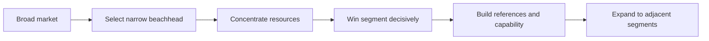

---
aliases:
  - Beachheads
  - Beachhead
  - beach-head
  - beach-heads
  - Beachhead Market
date_created: 2026-11-18
date_modified: 2026-11-18
tags:
  - GTM-Strategies
  - Marketing-Strategies
  - Founder-Advice
  - Lossless-Thinking
site_uuid: 9b9691c1-234e-4d3f-8308-fb68469779aa
publish: true
title: Beachhead Markets
slug: beachhead-markets
at_semantic_version: 0.0.0.1
cf_last_run: 2026-11-18T21:24:06.220Z
cf_last_run_model: Perplexity sonar-pro
---

# Defining and Describing Beachhead Markets

- _A beachhead market is the smallest strategically valuable customer segment a company can win decisively before expanding outward._
- The concept applies when a startup or new product faces limited resources, uncertain demand, or a broad market containing distinct customer groups.[^15fsjc][^s95r4m] Instead of pursuing the entire market simultaneously, the company concentrates its product, sales, marketing, and support efforts on one narrowly defined segment.[^15fsjc][^92ekea] Success in that segment can generate revenue, references, product learning, and credibility for expansion into adjacent segments.[^n2quzy]
- The term borrows its military metaphor from an invading force securing a coastal foothold before advancing inland.[^sgef22][^s95r4m] [[Sources/People/Geoffrey Moore|Geoffrey Moore]] connected the metaphor to technology-market adoption in *Crossing the Chasm*, describing the challenge of moving from early adopters to mainstream customers.[^15fsjc][^92ekea]

# Uses in Context

- **Startup strategy:** Founders use “beachhead market” to identify the first customer segment they intend to dominate rather than treating every potential buyer as equally important.[^15fsjc][^92ekea]
- **Product development:** The initial segment defines the “whole product” requirements—the complete combination of product, services, support, and integrations needed to solve a specific customer problem.[^n2quzy]
- **Go-to-market planning:** Teams use the term to describe a focused entry point that can provide references, revenue, and operational knowledge for later expansion.[^n2quzy]
- **Market-entry analysis:** Consultants describe a beachhead strategy as concentrating resources on “one narrow, defensible segment” before entering other segments.[^il9b9b]
- **Positioning and sales:** The framework helps companies choose a segment “big enough to matter, small enough to lead.”[^15fsjc]
- **Growth narratives:** Companies may describe an early campus, professional community, geography, or specialist industry as the foothold from which adoption spread to adjacent audiences.[^ev96gd]

# History of Use

## Origins

- The modern business use of the term is generally associated with Geoffrey Moore’s *Crossing the Chasm*, first published in 1991.[^sgef22][^6z9d4q][^92ekea]
- Moore used the D-Day analogy to explain how companies selling disruptive technology should focus their resources on a specific target segment before attempting to cross from early adopters into the mainstream market.[^sgef22][^15fsjc]
- The precise intellectual origin is disputed: one account attributes documentation of the “marketing chasm” to Schirtzinger and Lee James at Regis McKenna in 1989, before Moore’s book.[^4y1o16]
- The military meaning predates the business framework: a beachhead is a secured stretch of shore used as a base for advancing into enemy territory.[^sgef22][^s95r4m]

## Evolution

- **1989:** The “marketing chasm” was reportedly documented within Regis McKenna’s consulting environment by Schirtzinger and Lee James, framing the gap between early technology adopters and mainstream customers.[^4y1o16]
- **1991:** Moore formalized and popularized the business framework in *Crossing the Chasm*, presenting focused segment leadership as a way to move disruptive products toward mainstream adoption.[^sgef22][^6z9d4q][^92ekea]
- **2000s–2010s:** The idea was adapted into startup and entrepreneurship curricula, including Bill Aulet’s treatment of the beachhead concept in *Disciplined Entrepreneurship*.[^s95r4m][^ev96gd]
- **Contemporary practice:** Founders and go-to-market advisers commonly combine the beachhead with adjacent-market expansion, sometimes describing the next step through the “bowling alley” metaphor: win the first segment, then move into connected segments.[^x4k7rp]

# Best Real-World Examples

- [Facebook](https://www.facebook.com/) began with Harvard students and a Harvard.edu registration requirement before expanding to other universities and eventually the broader public.[^ev96gd]
- [Slack](https://slack.com/) initially focused on technology companies comfortable with new software and experiencing acute team-communication problems.[^ev96gd]
- [Airbnb](https://www.airbnb.com/) first served design-conference attendees seeking accommodation when San Francisco hotels were full, then broadened its travel market.[^ev96gd]
- [Uber](https://www.uber.com/) launched as UberCab, a premium black-car service for technology professionals in San Francisco before moving toward mass-market ride-hailing.[^ev96gd]
- [Tinder](https://tinder.com/) gained early density through targeted activity on college campuses, including USC, before expanding more broadly.[^ev96gd]
- [Spotify](https://www.spotify.com/) began in Sweden, where it developed label relationships and tested its streaming model before international expansion.[^ev96gd]
- [Etsy](https://www.etsy.com/) centered its early marketplace on independent sellers of handmade goods before broadening its audience and categories.[^ev96gd]

# Case Studies

**Facebook’s campus foothold.** [[organizations/Facebook|Facebook]] launched in February 2004 for Harvard students and initially required a Harvard.edu email address.[^ev96gd] Within its first month, more than half of Harvard undergraduates had reportedly signed up.[^ev96gd] The company then expanded to other Ivy League schools, additional colleges, high schools, and eventually the general public.[^ev96gd] The case illustrates a classic beachhead sequence: begin with a tightly bounded community, create unusually high local penetration and network density, then expand through adjacent groups whose needs and usage patterns resemble those of the initial segment.[^ev96gd]

**[[Tooling/Productivity/Async Communication/Slack|Slack]]’s technology-company entry point.** Slack did not initially position its collaboration software for every business; it focused on technology companies that were already receptive to new software and had a strong need for better internal communication.[^ev96gd] That segment supplied early users who could understand the product quickly and spread it through professional word of mouth.[^ev96gd] The example shows why a beachhead is more than a demographic niche: the best first segment combines an urgent problem, readiness to adopt, and a credible path to neighboring customers.

**[[organizations/AirBnB|Airbnb]]’s event-traveler wedge.** Airbnb’s founders first rented air mattresses in their San Francisco apartment to attendees of a design conference when local hotels were sold out.[^ev96gd] The initial use case was narrow—temporary accommodation during a high-demand event—but it demonstrated that travelers would accept an alternative lodging format when conventional supply was constrained.[^ev96gd] Airbnb subsequently expanded from event-driven users toward everyday travel.[^ev96gd] The case demonstrates how a beachhead can emerge from a specific situational constraint and later become a broader marketplace once supply, trust, and repeat demand develop.

***

# Sources

[^sgef22]: 2026, Oct 26. [draper.chat](https://draper.chat/). [Beachhead market: how to choose your first customers | Draper](https://draper.chat/blog/beachhead-market). Updated: 2026, Nov 11. Generated: 2026, Nov 18. [Perplexity](https://www.perplexity.ai/) API response.
[^15fsjc]: 2026, Oct 02. [resources.rework.com](https://resources.rework.com/). [What Is a Beachhead Market?](https://resources.rework.com/libraries/startup-terms/beachhead-market). Updated: 2026, Oct 29. Generated: 2026, Nov 18. [Perplexity](https://www.perplexity.ai/) API response.
[^6z9d4q]: 2026, Oct 09. [wepushers.com](https://wepushers.com/). [Crossing the chasm: beachhead, whole product, summary - Pushers](https://wepushers.com/frameworks/crossing-the-chasm/). Updated: 2026, Oct 27. Generated: 2026, Nov 18. [Perplexity](https://www.perplexity.ai/) API response.
[^4y1o16]: 2026, Oct 27. [growthmethod.com](https://growthmethod.com/). [Crossing the Chasm by Geoffrey Moore: summary and B2B takeaways](https://growthmethod.com/crossing-the-chasm/). Updated: 2026, Nov 15. Generated: 2026, Nov 18. [Perplexity](https://www.perplexity.ai/) API response.
[^s95r4m]: 2026, Apr 08. [concepts.dsebastien.net](https://concepts.dsebastien.net/). [Beachhead Market - Concepts](https://concepts.dsebastien.net/concept/beachhead-market/). Updated: 2026, Oct 30. Generated: 2026, Nov 18. [Perplexity](https://www.perplexity.ai/) API response.
[^n2quzy]: 2026, Nov 02. [aajconsult.com](https://aajconsult.com/). [How to Choose a Beachhead Segment | AAJ](https://aajconsult.com/blog/beachhead-segment). Updated: 2026, Nov 10. Generated: 2026, Nov 18. [Perplexity](https://www.perplexity.ai/) API response.
[^92ekea]: 2026, May 14. [agilebrandguide.com](https://agilebrandguide.com/). [Crossing the Chasm - The Agile Brand Guide®](https://agilebrandguide.com/wiki/models/crossing-the-chasm/). Updated: 2026, Oct 14. Generated: 2026, Nov 18. [Perplexity](https://www.perplexity.ai/) API response.
[^il9b9b]: 2026, Jul 07. [projectfifty4.com](https://projectfifty4.com/). [Beachhead Strategy: Meaning and Energy Market Entry](https://projectfifty4.com/beachhead-strategy-energy-market-entry/). Updated: 2026, Oct 30. Generated: 2026, Nov 18. [Perplexity](https://www.perplexity.ai/) API response.
[^x4k7rp]: 2026, Oct 09. [wepushers.com](https://wepushers.com/). [Bowling alley strategy: head pin and adjacent segments](https://wepushers.com/frameworks/bowling-alley-strategy/). Updated: 2026, Oct 29. Generated: 2026, Nov 18. [Perplexity](https://www.perplexity.ai/) API response.
[^ev96gd]: 2026, Jul 01. [techconglobal.com](https://techconglobal.com/). [The Growth Rule Most Founders Ignore](https://techconglobal.com/the-growth-rule-most-founders-ignore/). Updated: 2026, Nov 07. Generated: 2026, Nov 18. [Perplexity](https://www.perplexity.ai/) API response.
