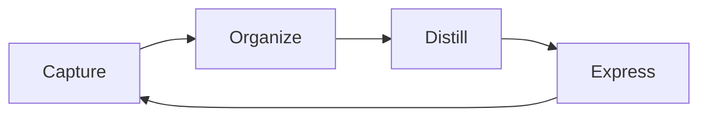

---
aliases:
  - CODE
date_created: 2026-10-16
date_modified: 2026-11-02
tags:
  - Pedagogical-Approaches
  - Conceptual-Frameworks
  - Lossless-Thinking
cf_last_run: 2026-11-02T17:41:20.520Z
cf_last_run_model: Perplexity sonar-pro
site_uuid: 16486ff2-0aaa-45c7-9abc-734824a69f49
publish: true
title: Capture, Organize, Distill, Express
slug: capture-organize-distill-express
at_semantic_version: 0.0.1.1
for_clients:
  - AI-Camp
  - Colearn
  - FullStackVC
  - Lossless
---

[[Sources/People/Influencers/Tiago Forte|Tiago Forte]]
[[Sources/Books/Building a Second Brain|Building a Second Brain]]
[[concepts/Explainers for AI/Company Brains|Company Brains]]

# Defining and Describing Capture, Organize, Distill, Express

_Capture, Organize, Distill, Express—usually abbreviated CODE—turns scattered information into useful work._

CODE is a four-stage workflow associated with Tiago Forte’s “Building a Second Brain” system.[1][5] It treats personal knowledge management as a production pipeline: capture information that matters, organize it for retrieval or action, distill it into increasingly concise forms, and express it through a tangible output.[6][7] The concept applies to research, writing, teaching, product development, meetings, and other knowledge-intensive work.[2][3]

# Uses in Context

- **Personal knowledge management:** CODE describes a workflow for moving from saved material to usable knowledge, rather than treating note-taking as an end in itself.[7]
- **Second-brain systems:** Practitioners use “Capture” for information that “resonates,” “Organize” for actionability, “Distill” for compression, and “Express” for finished work.[7]
- **Meeting intelligence:** Meeting tools apply the framework by capturing transcripts and notes, organizing them by entities or projects, distilling relevant context, and exporting results into documents or CRM systems.[2]
- **Writing and research:** The final stage converts notes into articles, decision memos, designs, code comments, or working theories.[3]
- **Teaching and knowledge sharing:** “Express” means applying stored knowledge in projects or teaching others, thereby converting passive notes into an active resource.[4]

# History of Use

## Origins

- The exact four-part formulation is attributed in the available sources to Tiago Forte, who packaged the practice as “CODE: Capture, Organize, Distill, Express.”[1]
- The framework emerged within Forte’s “[[Sources/Books/Building a Second Brain|Building a Second Brain]]” teaching system, which organized personal knowledge through the CODE workflow.[5]
- CODE is closely associated with PARA, Forte’s complementary method for organizing information into Projects, Areas, Resources, and Archives.[4][10]

## Evolution

- **2010s–2023 — Personal knowledge systems:** CODE was taught as part of Forte’s Building a Second Brain framework for organizing personal information and turning it into creative or professional output.[5]
- **Subsequent adoption — Action-oriented organization:** Explanations of the method emphasized organizing by actionability rather than by conventional subject categories.[6][7]
- **AI-era adaptation — Machine-assisted distillation:** Recent implementations increasingly use AI to extract context from transcripts, summarize notes, and help transform stored material into drafts or answers, while retaining the four-stage structure.[2][5][6]

# Best Real-World Examples

- [Building a Second Brain](https://fortelabs.com/blog/basboverview/) — Forte’s knowledge-management system that popularized CODE as a practical workflow.[5]
- [PARA](https://fortelabs.com/blog/para/) — [[Vocabulary/The PARA Method|PARA]] — An organizational structure commonly paired with CODE to place information according to projects, areas, resources, and archives.[4][10]
- [Granola](https://www.granola.ai/blog/second-brain-meetings-organizational-memory) — [[Tooling/AI-Toolkit/AI Interfaces/AI Workspaces/Vertical Wrappers/Granola|Granola]] — Applies CODE to meeting transcripts, notes, organizational memory, and downstream CRM or document workflows.[2]
- [Obsidian](https://obsidian.md/) — [[Tooling/Productivity/Advanced Documents/Obsidian|Obsidian]] — A knowledge-management environment frequently used by practitioners to support note capture, linking, distillation, and expression; one documented CODE use case describes Obsidian supporting a manuscript project.[9]
- [Notion](https://www.notion.so/) — [[Tooling/Productivity/Advanced Documents/Notion|Notion]] — Used in documented CODE applications for organizing notes and producing deliverables such as workshops.[9]
- [Dexio](https://dexio.wiki/guides/ai-second-brain/) — Describes an AI-assisted implementation in which distillation uses progressive summarization and expression produces drafts, decisions, and shipped work.[6]

# Case Studies

**Meeting knowledge systems.** Granola describes applying CODE to meetings by capturing notes and transcripts, organizing them by company, founder, and deal stage, distilling marked points with supporting context, and expressing the result through Notion, CRM systems, or synthesized queries.[2] The example shows how CODE extends beyond individual note-taking: the unit of value is not the transcript but the decision-relevant knowledge that can be reused across an organization.[2]

**A writing workflow in Obsidian.** A documented CODE challenge followed a writer using Obsidian to complete a manuscript about burnout while managing perfectionism.[9] In this setting, capture supplies source material, organization gives the material a workable structure, distillation reduces reading and review overhead, and expression becomes the manuscript itself.[6][9] The case illustrates CODE’s central test: a knowledge system succeeds when it helps produce an artifact, not merely when it accumulates notes.[3][7]

**AI-assisted second brains.** Recent implementations preserve the CODE sequence while shifting some distillation work from manual summarization to AI-assisted extraction and synthesis.[2][5] AI can help recover context from long transcripts and generate drafts or answers, but the conceptual endpoint remains human or organizational expression—writing, deciding, designing, teaching, or shipping work.[2][6] This adaptation shows that CODE functions less as a specific software recipe than as a durable model for converting information into action.

***

# Sources

[1]: 2026, Aug 28. [timeeting.com](https://timeeting.com/). [Keep a Second Brain That Ships Work, Not Folders](https://timeeting.com/second-brain). Updated: 2026, Oct 28. Generated: 2026, Nov 02. [Perplexity](https://www.perplexity.ai/) API response.
[2]: 2026, May 08. [granola.ai](https://www.granola.ai/). [Second brain for meetings: Why meeting search alone is ...](https://www.granola.ai/blog/second-brain-meetings-organizational-memory). Updated: 2026, Oct 09. Generated: 2026, Nov 02. [Perplexity](https://www.perplexity.ai/) API response.
[3]: 2026, May 12. [glukhov.org](https://www.glukhov.org/). [Second Brain Explained for Engineers and Knowledge Workers](https://www.glukhov.org/knowledge-management/foundations/second-brain/). Updated: 2026, Oct 03. Generated: 2026, Nov 02. [Perplexity](https://www.perplexity.ai/) API response.
[4]: 2026, Jun 23. [eltonlabs.org](https://eltonlabs.org/). [The three levels of EXPRESS: how to turn dead notes into a living knowledge base](https://eltonlabs.org/en/base/express-your-notes). Updated: 2026, Sep 30. Generated: 2026, Nov 02. [Perplexity](https://www.perplexity.ai/) API response.
[5]: 2026, Jun 01. [vectorize.io](https://vectorize.io/). [What Is an AI Second Brain That Actually Learns? (And Why ...](https://vectorize.io/articles/ai-second-brain-that-learns). Updated: 2026, Oct 05. Generated: 2026, Nov 02. [Perplexity](https://www.perplexity.ai/) API response.
[6]: 2026, Oct 09. [dexio.wiki](https://dexio.wiki/). [Second brain AI: tools compared, and when agents write | Dexio](https://dexio.wiki/guides/ai-second-brain/). Updated: 2026, Oct 28. Generated: 2026, Nov 02. [Perplexity](https://www.perplexity.ai/) API response.
[7]: 2026, Jul 20. [instantowl.com](https://instantowl.com/). [Second Brain Method: CODE, PARA, and Where Systems Die ...](https://instantowl.com/blog/second-brain). Updated: 2026, Oct 12. Generated: 2026, Nov 02. [Perplexity](https://www.perplexity.ai/) API response.
[8]: 2026, Feb 15. [self.md](https://self.md/). [what Tiago Forte got right (and what AI breaks) | self.md](https://self.md/articles/tiago-forte-second-brain-ai/). Updated: 2026, Oct 31. Generated: 2026, Nov 02. [Perplexity](https://www.perplexity.ai/) API response.
[9]: 2026, May 05. [optin.fortelabs.co](https://optin.fortelabs.co/). [The CODE Challenge Begins…](https://optin.fortelabs.co/posts/the-code-challenge-begins). Updated: 2026, Nov 02. Generated: 2026, Nov 02. [Perplexity](https://www.perplexity.ai/) API response.
[10]: 2026, Apr 06. [nemosapp.com](https://nemosapp.com/). [The 'Second Brain' System Behind 90,000 Handwritten Notes ...](https://nemosapp.com/blog/knowledge-management-system-personal/). Updated: 2026, Oct 31. Generated: 2026, Nov 02. [Perplexity](https://www.perplexity.ai/) API response.
