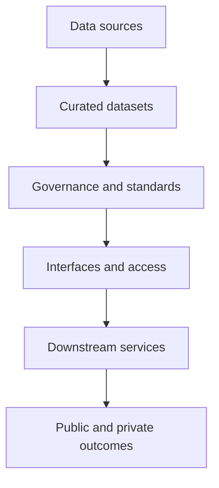

# Defining and Describing Data as Infrastructure

- _Data becomes infrastructure when other systems can reliably build on it, much as roads, electricity, or communications networks support activity beyond their immediate operators._
- “Data as infrastructure” treats data not merely as an organizational asset but as a foundational, reusable input for public and private services, algorithms, platforms, and social coordination. [^sp2obp] [^ppxfy8] The concept applies when data is broadly demanded, reusable by multiple actors, and embedded in downstream activities rather than consumed only by its original collector. [^ppxfy8] It matters because infrastructure-oriented thinking shifts attention toward interoperability, stewardship, access, maintenance, and public consequences. [^sp2obp] [^ppxfy8]

## Uses in Context

- **Policy and regulation:** Scholars use the term to analyze datasets and data flows as infrastructure with consequences for platform power, mobility, markets, and law. [^sp2obp]
- **Public-sector modernization:** Governments invoke data as public infrastructure to argue for interoperable, trusted data ecosystems that support AI-enabled services while protecting privacy, accountability, and equity. [^6a1sdj]
- **AI and machine learning:** The phrase describes the datasets, metadata, pipelines, and governance needed to make AI systems dependable and scalable rather than one-off demonstrations. [^6a1sdj]
- **Organizational architecture:** In technology practice, data infrastructure refers to systems that make data discoverable, governed, reusable, and available to many teams and applications. [^0so9c1] [^e9s66u]
- **Critical-infrastructure analysis:** The concept expands infrastructure beyond physical installations to include networked information systems and intangible resources that organize economic and social activity. [^sp2obp] [^ppxfy8]

# History of Use

## Origins

- The phrase belongs to a broader scholarly shift from treating infrastructure as physical installations toward analyzing digital communications, platforms, datasets, and other intangible resources as infrastructural. [^sp2obp]
- Brett Frischmann’s account of infrastructure provided an influential conceptual basis: infrastructure is characterized by non-rivalrous or partly non-rivalrous consumption, broad social demand, and use as an input into goods and services for many users. [^ppxfy8]
- Later scholarship explicitly applied those criteria to data, emphasizing that the same data can be used simultaneously by multiple actors and can support algorithmic processes, platform operations, communications, and services across sectors. [^ppxfy8]

## Evolution

- **2010s–2020s — From physical infrastructure to data flows:** Research increasingly treated networked information infrastructures, platforms, and datasets as objects of governance and contestation, especially where data flows shape movement, markets, and social coordination. [^sp2obp]
- **2020s — From organizational asset to public concern:** The concept expanded into public-sector debates about trusted data ecosystems, interoperability, privacy, institutional accountability, and equitable access. [^6a1sdj]
- **2020s — From storage to operating model:** Modern data-infrastructure practice increasingly emphasizes governed interfaces, reusable data products, distributed ownership, and systems capable of supporting AI at scale. [^0so9c1] [^e9s66u] [^co023d]

# Best Real-World Examples

- [OpenStreetMap](https://www.openstreetmap.org/) — An open, collaboratively maintained geographic dataset that functions as a reusable base layer for maps, humanitarian response, logistics, and civic applications.
- [Wikidata](https://www.wikidata.org/) — A community-maintained knowledge base designed for structured, multilingual reuse across Wikimedia projects and external applications.
- [Data Commons](https://datacommons.org/) — A public knowledge graph that integrates statistical data so applications and researchers can query common entities and indicators.
- [The World Wide Web Consortium’s Data on the Web work](https://www.w3.org/) — Standards activity that illustrates how metadata, interoperability, provenance, and machine-readable publication turn datasets into reusable infrastructure.
- [Apache Iceberg](https://iceberg.apache.org/) — An open-source table format that provides shared structural foundations for reliable analytical data across engines and storage systems.
- [DataHub](https://datahubproject.io/) — An open-source metadata platform that supports discovery, governance, lineage, and organizational reuse of data assets.
- [Indeed’s data platform](https://aws.amazon.com/solutions/case-studies/indeed-s3-tables-case-study/) — A large-scale operational example in which infrastructure supports governance across 18,000 datasets and approximately 190,000 daily queries. [^0so9c1]

# Case Studies

**Public data as a foundation for AI-enabled government.** A recent policy study examined data-as-infrastructure implementations across 45 jurisdictions using comparative policy analysis, technical assessment, and interviews with 87 stakeholders. [^6a1sdj] It identifies five linked dimensions—legal, technical, institutional, trust, and economic—as distinguishing infrastructure-oriented governance from conventional data management. [^6a1sdj] The study reports that jurisdictions using this approach achieved faster AI deployment, stronger cross-agency sharing, less duplicate collection, and higher citizen trust. [^6a1sdj] The case illustrates that data infrastructure is not only a technology stack: it is also a governance arrangement that determines who can reuse data, under what conditions, and with what safeguards.

**Indeed and governed analytical scale.** [[Tooling/Training/Indeed]] migrated parts of its platform to Amazon S3 Tables to reduce manual maintenance, simplify governance across 18,000 datasets, and support AI-oriented job matching while sustaining roughly 190,000 queries per day. [^0so9c1] The example shows the operational side of data as infrastructure: shared storage and table-management capabilities become foundational services for many analytical and product workflows rather than isolated databases. [^0so9c1] It also demonstrates a limitation of the concept: infrastructure can be technically reusable while remaining controlled by a large platform provider, making portability, standards, and governance important questions.

**Automotive startup and the data-mesh model.** A case study describes an automotive startup moving from a centralized data architecture to a decentralized [[concepts/Explainers for Tooling/Data Mesh]] while using cloud services and retaining cloud-agnostic principles. [^co023d] The shift represents a move from one central data team toward domain-oriented ownership and distributed data products. [^co023d] It shows how “data as infrastructure” can describe an organizational system as well as software: the infrastructure consists not only of pipelines and storage but also of ownership rules, interfaces, standards, and responsibilities that let multiple domains contribute reliable data.

***

# Sources

[^sp2obp]: [2 - Platforms, Data Infrastructures, and Infrastructure Stacks](https://www.cambridge.org/core/books/global-governance-by-data/platforms-data-infrastructures-and-infrastructure-stacks/428EEE4FEEC4599C56FFF8E5E3AAEE92)
[^6a1sdj]: [Data as Public Infrastructure: Unlocking AI-Driven Government ...](https://www.ijsrmt.com/index.php/ijsrmt/article/view/1288?articlesBySimilarityPage=17)
[^0so9c1]: [Indeed Case Study](https://aws.amazon.com/solutions/case-studies/indeed-s3-tables-case-study/)
[4]: [Data as Public Infrastructure: Unlocking AI-Driven ...](https://ijsrmt.com/index.php/ijsrmt/article/view/1288?articlesBySimilarityPage=26)
[^ppxfy8]: [rethinking the ethical foundations and functions of data protection in ...](https://www.nature.com/articles/s41599-026-08205-9?error=cookies_not_supported&code=c74dea25-6e98-4afa-8173-cf4089677903)
[6]: [Data as Public Infrastructure: Unlocking AI-Driven Government ...](https://ijsrmt.com/index.php/ijsrmt/article/view/1288?articlesBySimilarityPage=37)
[^e9s66u]: [Galaxy: Open Data Infrastructure for the… | Allsite Studio](https://www.allsite.pro/work/galaxy)
[8]: [Data as Public Infrastructure: Unlocking AI-Driven Government Services Through Trusted Data Ecosystems](https://ijsrmt.com/index.php/ijsrmt/article/view/1288?articlesBySimilarityPage=18)
[^co023d]: [From Centralized Data to Data Mesh: A Case Study of Scalable Data...](https://link.springer.com/chapter/10.1007/978-3-032-34571-4_8)
[10]: [Digital Infrastructures of Democracy | Oxford Research ...](https://academic.oup.com/edited-volume/63015/chapter/565958122)
