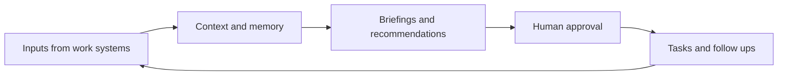

[[concepts/Explainers for AI/AI Assistants|AI Assistants]]

# Defining and Describing AI Chief of Staff

- [IMAGE 1: AI chief of staff workflow connecting email, calendar, meetings, documents, tasks, and approval gates]
- _An AI chief of staff turns scattered executive activity into a coordinated operating system while leaving consequential judgment with a human._
- An AI chief of staff is software that coordinates a leader’s workload across email, calendars, meetings, documents, messaging, customer systems, and project tools. Its core functions include briefing, meeting preparation, commitment tracking, task coordination, follow-up, and decision support. [^gn27ot] [^v6nvht] [^j5lh5z]
- The concept applies most directly to founders, executives, consultants, and operators whose work depends on maintaining context across many systems and people. [^v6nvht] [^gkp2f5]
- Unlike a conventional chatbot, an AI chief of staff is typically designed around persistent context, connected tools, recurring workflows, and execution with approval gates. [^gn27ot] [^v6nvht] [^416m3m]
- Human oversight remains a defining principle in several implementations: outbound actions are drafted or prepared, but a person approves them before execution. [^gn27ot] [^416m3m]

## Uses in Context

- **Executive briefing:** The system produces a daily view of priorities, meetings, commitments, blockers, and pending approvals. [^ld0zb6] [^v6nvht] [^416m3m]
- **Meeting intelligence:** It prepares meeting briefs from calendars, email, prior calls, and open issues, then extracts decisions and action items afterward. [^gn27ot] [^vwjsd0]
- **Commitment management:** It identifies promises made in meetings, messages, and documents, converts them into tasks, and tracks owners and dates. [^j5lh5z]
- **Inbox and workflow coordination:** It triages email, drafts responses, updates records, and coordinates follow-ups across connected applications. [^ld0zb6] [^v6nvht] [^vwjsd0]
- **Founder operating cadence:** It supports planning, fundraising, finance, team operations, and daily execution in one workspace. [^au0euz]
- **Build-your-own agent systems:** Practitioners use frameworks, business-context files, standard operating procedures, and tool protocols to create customized versions. [^vqjwi9] [^vwjsd0]

## History of Use

### Origins

The available sources do not establish a single academic paper or inventor for the exact phrase “AI chief of staff.” Instead, the term appears to have emerged as a product and practitioner label for combining executive-assistant functions with agentic workflow automation. Contemporary definitions consistently describe it as software that coordinates a leader’s work, retains organizational context, tracks commitments, and prepares actions for approval. [^gn27ot] [^v6nvht] [^j5lh5z]

- LEADBeyond uses the phrase for a “personal AI assistant” that performs the coordination work of a human chief of staff, including meeting preparation, decision support, and follow-up. [^gn27ot]
- Practitioner-built systems such as Coulson frame the concept as a network of agents that prepares replies, meetings, follow-ups, and end-of-day reporting, while requiring approval before anything is sent. [^416m3m]
- Open-source work described by Sliq presents another origin path: an individual or small team builds a tailored chief-of-staff framework using Claude Code and Model Context Protocol servers rather than buying a managed enterprise product. [^vwjsd0]

### Evolution

- **Early stage — meeting-centered assistance:** Products such as Ambient centered the category on calendar-linked meeting briefings, transcription, action-item extraction, and follow-up tracking. [^vwjsd0]
- **Expansion into operating systems:** Newer systems broadened the role from meetings to inboxes, calendars, tasks, documents, CRM data, Slack, project management, and organizational reporting. [^v6nvht] [^au0euz] [^vwjsd0]
- **Agentic execution with approval:** The concept increasingly shifted from summarization toward taking coordinated actions—such as scheduling follow-ups, updating CRM records, and assembling materials—while preserving human confirmation. [^gn27ot] [^416m3m] [^vwjsd0]

## Best Real-World Examples

- [Maverick](https://leadbeyond.de/insights/ai-chief-of-staff/) — LEADBeyond’s internal system for daily planning, meeting briefs, evidence-linked organizational memory, and approval-controlled follow-up. [^gn27ot]
- [Coulson](https://contra.com/community/5SnAyqWM-building-ai-chief-of-staff-systems-for-company) — a practitioner-built multi-agent system that presents revenue priorities, commitments, and approval queues each morning. [^416m3m]
- [Nerve](https://getsliq.com/blog/ai-chief-of-staff) — an action-oriented startup system that extracted sales-call next steps, prepared follow-ups, assembled security information, and updated Salesforce for confirmation. [^vwjsd0]
- [Ambient](https://getsliq.com/blog/ai-chief-of-staff) — a meeting-centered product combining daily context, secure notes, transcription, action extraction, and commitment tracking. [^vwjsd0]
- [Donna](https://getsliq.com/blog/ai-chief-of-staff) — a cross-tool assistant connecting systems such as Slack, Jira, Notion, GitHub, and Salesforce to produce a daily executive brief. [^vwjsd0]
- [Nautis](https://getnautis.com/guides/ai-chief-of-staff-vs-executive-assistant) — a startup-oriented operating system positioning its AI chief of staff around planning, fundraising, finance, team operations, and execution. [^au0euz]
- [Claude Chief of Staff](https://getsliq.com/blog/ai-chief-of-staff) — an open-source, build-your-own approach based on Claude Code and Model Context Protocol servers. [^vwjsd0]

## Case Studies

**LEADBeyond’s Maverick.** LEADBeyond, a boutique strategy consultancy, built Maverick for its own work rather than treating an AI chief of staff as a generic consumer assistant. [^gn27ot] The system begins with a daily conversation about priorities, deadlines, waiting items, and the next action; it also prepares meeting briefs from connected communications and searches organizational memory with evidence links. [^gn27ot] Its explicit refusal to act autonomously and its practice of flagging missing or conflicting evidence show that the concept is less about replacing executive judgment than about improving context quality and reducing coordination overhead. [^gn27ot]

**Nerve and action-oriented sales operations.** Nerve represented a more agentic interpretation of the category: after a sales call recorded in Gong, it could extract next steps, schedule a follow-up, assemble security information, update a Salesforce opportunity, and present the proposed actions for confirmation. [^vwjsd0] This moves the AI chief of staff beyond summarization into cross-system workflow execution, while the confirmation step preserves a human control boundary. [^vwjsd0] The case illustrates why action orchestration—not merely better notes—is central to the category’s emerging identity. [^j5lh5z] [^vwjsd0]

**Coulson and the practitioner-built operating layer.** A company operator described building Coulson as a daily control surface that puts revenue priorities, dated commitments, and approval requests on one page before email is opened. [^416m3m] Behind that surface, multiple agents draft replies, prepare meetings, pursue follow-ups, and generate an end-of-day report, but nothing is sent without approval. [^416m3m] The example demonstrates how smaller teams can assemble a customized AI chief of staff around their own operating cadence, business context, and repeatable workflows instead of adopting a single monolithic platform. [^416m3m] [^vqjwi9]

***

# Sources

[1]: 2026, Oct 23. [asana.com](https://asana.com/). [Keynote: Welcome to the future of human-agent teams • Asana](https://asana.com/on-demand-library/keynote-welcome-to-the-future-of-human-agent-teams). Updated: 2026, Nov 03. Generated: 2026, Nov 03. [Perplexity](https://www.perplexity.ai/) API response.
[^gn27ot]: 2026, Oct 27. [leadbeyond.de](https://leadbeyond.de/). [AI chief of staff: how we built our own AI executive assistant · LEADBeyond](https://leadbeyond.de/insights/ai-chief-of-staff/). Generated: 2026, Nov 03. [Perplexity](https://www.perplexity.ai/) API response.
[^ld0zb6]: 2026, Oct 22. [gravity.fast](https://gravity.fast/). [AI Chief of Staff: What It Can Take Off Your Plate, Priced ...](https://gravity.fast/blog/ai-chief-of-staff/). Updated: 2026, Nov 01. Generated: 2026, Nov 03. [Perplexity](https://www.perplexity.ai/) API response.
[^v6nvht]: 2026, Jun 06. [buda.im](https://buda.im/). [AI Chief of Staff: The Executive Workflow Layer Beyond Chatbots](https://buda.im/blog/ai-chief-of-staff). Updated: 2026, Nov 03. Generated: 2026, Nov 03. [Perplexity](https://www.perplexity.ai/) API response.
[^gkp2f5]: 2026, Oct 13. [thesarahai.com](https://thesarahai.com/). [What Is an AI Chief of Staff? A 2026 Guide for SME Founders](https://thesarahai.com/blog/what-is-an-ai-chief-of-staff). Updated: 2026, Oct 30. Generated: 2026, Nov 03. [Perplexity](https://www.perplexity.ai/) API response.
[^au0euz]: 2026, Oct 31. [getnautis.com](https://getnautis.com/). [AI chief of staff vs executive assistant: how to choose - Nautis](https://getnautis.com/guides/ai-chief-of-staff-vs-executive-assistant). Generated: 2026, Nov 03. [Perplexity](https://www.perplexity.ai/) API response.
[^416m3m]: 2026, Sep 26. [contra.com](https://contra.com/). [Building AI Chief-of-Staff Systems for Company Operations](https://contra.com/community/5SnAyqWM-building-ai-chief-of-staff-systems-for-company). Updated: 2026, Oct 17. Generated: 2026, Nov 03. [Perplexity](https://www.perplexity.ai/) API response.
[^j5lh5z]: 2026, May 20. [readywhen.ai](https://readywhen.ai/). [Best AI Chief of Staff Tools 2026: 15 options reviewed](https://readywhen.ai/blog/best-ai-chief-of-staff-tools-2026). Updated: 2026, Oct 07. Generated: 2026, Nov 03. [Perplexity](https://www.perplexity.ai/) API response.
[^vqjwi9]: 2026, Oct 12. [go.whitebeardstrategies.com](https://go.whitebeardstrategies.com/). [AI Chief of Staff™ Challenge Training](https://go.whitebeardstrategies.com/ai-training/ai-chiefofstaff-5133). Updated: 2026, Oct 08. Generated: 2026, Nov 03. [Perplexity](https://www.perplexity.ai/) API response.
[^vwjsd0]: 2026, Mar 10. [getsliq.com](https://getsliq.com/). [AI Chief of Staff: What Actually Exists Right Now - Sliq](https://getsliq.com/blog/ai-chief-of-staff). Updated: 2026, Sep 25. Generated: 2026, Nov 03. [Perplexity](https://www.perplexity.ai/) API response.
