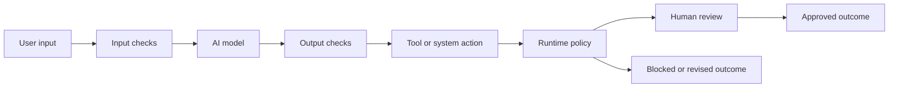

[[concepts/Explainers for AI/AI Safety|AI Safety]]
[[concepts/Explainers for AI/Sovereign AI|Sovereign AI]]

# Defining and Describing AI Guardrails

- _AI guardrails are the controls that keep AI systems operating within approved boundaries rather than merely producing plausible outputs._
- An AI guardrail is best understood as a **sociotechnical governance mechanism** combining policy, technical controls, workflows, runtime monitoring, and human review. [^6xpu5v] In practical terms, guardrails inspect what an AI system receives, produces, or attempts to do, then allow, modify, flag, reroute, or block activity that violates defined rules. [^an055a] [^hby05u]
- Guardrails apply across conventional LLM applications and agentic systems, where an AI model may retrieve data, call tools, modify records, or take external actions. [^olfc6d] [^beab1j] Their purpose includes reducing harmful content, prompt injection, privacy violations, unsupported claims, excessive autonomy, and untraceable decisions. [^m4ylqk] [^beab1j]
- Guardrails are not equivalent to model alignment alone: effective deployments place controls in code, access systems, data flows, approval processes, and audit logs outside the model itself. [^olfc6d] [^1b0hyo]

# Uses in Context

- **Content safety:** The term describes filters that detect, prevent, or correct unwanted or harmful model content. [^hby05u]
- **Prompt and data protection:** Guardrails inspect prompts, retrieved context, and outputs for malicious instructions, sensitive information, and unsupported claims. [^beab1j]
- **Agent control:** In agentic applications, guardrails monitor what an agent reads, says, and does on every request. [^an055a]
- **Enterprise governance:** Organizations use the term for combined policy, usage guidance, transparency language, technical restrictions, and accountability procedures. [^fre48a]
- **Workflow authorization:** Guardrails define autonomy levels, assign owners, restrict permissions, and require approval before high-risk actions. [^olfc6d]
- **Auditability:** Runtime controls can route non-compliant activity to designated human reviewers and preserve traceability to accountable decision-makers. [^6xpu5v]

# History of Use

## Origins

The supplied search results do not establish a definitive first appearance of the phrase **“AI guardrails”** or identify a single original coiner. They do show that the term emerged as a practical label for restrictions placed on models and users so systems operate as designers intend. [^hby05u] The concept’s documented intellectual basis is therefore distributed across AI safety, model governance, content moderation, access control, and human-in-the-loop workflow design rather than attributable here to one incumbent technology company. [^6xpu5v] [^hby05u] [^m4ylqk]

## Evolution

- **Early usage — model restrictions:** Guardrails were initially framed primarily as restrictions on model behavior intended to detect, prevent, or correct unwanted content. [^hby05u]
- **Runtime control — LLM applications:** The concept expanded into executable validators and middleware that inspect inputs and outputs, block unsafe requests, and enforce structured responses. [^an055a] [^beab1j]
- **Agentic governance — tool and workflow control:** With AI agents, guardrails broadened to include identity, permissions, action limits, approval gates, monitoring, and audit trails for external actions. [^olfc6d] [^m4ylqk] [^1b0hyo]
- **Sociotechnical governance — organizational accountability:** Recent formulations treat guardrails as coordinated policy, technical, and workflow components that encode organizational norms and involve human reviewers when systems depart from those norms. [^6xpu5v]

# Best Real-World Examples

- [Guardrails AI](https://github.com/guardrails-ai/guardrails) — an open-source Python framework using validators to constrain LLM inputs, outputs, and structured responses. [^an055a] [^beab1j]
- [NVIDIA NeMo Guardrails](https://github.com/NVIDIA-NeMo/Guardrails) — an open-source framework for programmable conversational and safety controls. [^beab1j]
- [Invariant](https://github.com/invariantlabs-ai/invariant) — a framework for monitoring and controlling agent behavior at runtime. [^an055a]
- [HOL Guard](https://indexagentica.com/compare/agent-guardrail-frameworks/) — an agent-oriented guardrail framework identified alongside Guardrails AI, NeMo Guardrails, and Invariant. [^an055a]
- [MITRE ATLAS](https://atlas.mitre.org/) — a knowledge base used to frame controls around attacks on AI systems, including prompt injection and unsafe agent actions. [^beab1j]
- [GuardBench](https://arxiv.org/) — an academic benchmark for evaluating guard models and defenses rather than a commercial API. [^beab1j]
- [AgentDojo](https://arxiv.org/) — a benchmark for testing agent defenses against security and instruction-following failures. [^beab1j]

# Case Studies

A representative enterprise pattern is governed sales-order automation for a manufacturer receiving purchase orders by email, portals, and PDFs. [^1b0hyo] Document AI extracts order fields, while data guardrails validate products, pricing, credit, delivery details, and customer records against authoritative master data. [^1b0hyo] Action guardrails route missing information, duplicates, or out-of-policy orders to authorized reviewers before anything reaches the ERP system. [^1b0hyo] The case illustrates that guardrails do not simply censor text; they convert business rules and approval responsibilities into executable workflow controls.

A smaller professional-services governance example involved GadellNet, which combined an AI policy, governance practices, usage guidance, organizational guardrails, and client-facing transparency language explaining how AI would and would not be used. [^fre48a] This approach demonstrates the sociotechnical character of guardrails: technical restrictions are paired with organizational norms and communication obligations. [^6xpu5v] [^fre48a] It also shows why guardrails matter even when an AI system does not autonomously execute transactions—the organization must still define acceptable use, disclose boundaries, and assign responsibility.

A broader agent-security pattern places controls outside the model: inventory every agent, tool, API, data store, and communication channel; assign autonomy levels and named owners; give each agent a distinct identity; remove unnecessary access; and enforce blocked actions and approval gates in code. [^olfc6d] This model treats an AI agent as an operational actor rather than merely a text generator. [^olfc6d] [^m4ylqk] Its central lesson is that reliable guardrails require defense in depth: model-level moderation is only one layer alongside permissions, runtime policy, human review, and audit logging. [^olfc6d] [^m4ylqk] [^1b0hyo]

***

# Sources

[^6xpu5v]: 2026, Aug 16. [link.springer.com](https://link.springer.com/). [Governing generative AI in organizations: a design theory and quasi ...](https://link.springer.com/article/10.1007/s11227-026-08760-7). Updated: 2026, Nov 01. Generated: 2026, Nov 07. [Perplexity](https://www.perplexity.ai/) API response.
[^fre48a]: 2026, Sep 02. [techpoint.org](https://techpoint.org/). [How GadellNet Helped Build Responsible AI Governance](https://techpoint.org/case-study-gadellnet-ai-governance/). Updated: 2026, Nov 06. Generated: 2026, Nov 07. [Perplexity](https://www.perplexity.ai/) API response.
[3]: 2026, Sep 30. [hcltech.com](https://www.hcltech.com/). [Responsible AI Governance for Enterprise AI](https://www.hcltech.com/case-study/responsible-ai-governance). Updated: 2026, Oct 29. Generated: 2026, Nov 07. [Perplexity](https://www.perplexity.ai/) API response.
[^olfc6d]: 2026, Nov 06. [deployflow.co](https://deployflow.co/). [AI Guardrails That Pass an Audit: Where the Controls Belong](https://deployflow.co/uae/insights/ai-guardrails/). Generated: 2026, Nov 07. [Perplexity](https://www.perplexity.ai/) API response.
[^an055a]: 2026, Nov 01. [indexagentica.com](https://indexagentica.com/). [Runtime guardrails for agents: Guardrails AI, NeMo Guardrails, Invariant and HOL Guard | Index Agentica](https://indexagentica.com/compare/agent-guardrail-frameworks/). Updated: 2026, Nov 06. Generated: 2026, Nov 07. [Perplexity](https://www.perplexity.ai/) API response.
[^hby05u]: 2026, Mar 10. [link.springer.com](http://link.springer.com/). [Generating the language of AI harms: mapping guardrails using critical code studies - AI & SOCIETY](http://link.springer.com/article/10.1007/s00146-026-02922-0). Updated: 2026, Nov 06. Generated: 2026, Nov 07. [Perplexity](https://www.perplexity.ai/) API response.
[^m4ylqk]: 2026, Jan 01. [dl.acm.org](https://dl.acm.org/). [Guardians of the Agents | Communications of the ACM](https://dl.acm.org/doi/10.1145/3777544). Updated: 2026, Nov 05. Generated: 2026, Nov 07. [Perplexity](https://www.perplexity.ai/) API response.
[^beab1j]: 2026, Oct 15. [aicompliancevendors.com](https://aicompliancevendors.com/). [aicompliancevendors.com · guides · ai-guardrailsAI Guardrails Explained: Types, Tools and LLM Guardrails](https://aicompliancevendors.com/guides/ai-guardrails). Updated: 2026, Nov 06. Generated: 2026, Nov 07. [Perplexity](https://www.perplexity.ai/) API response.
[^1b0hyo]: 2026, Oct 07. [ampcome.com](https://www.ampcome.com/). [AI Guardrails and Governance: The 2026 Enterprise Playbook](https://www.ampcome.com/post/ai-guardrails-and-governance). Updated: 2026, Nov 05. Generated: 2026, Nov 07. [Perplexity](https://www.perplexity.ai/) API response.
[10]: 2026, Nov 05. [crowdstrike.com](https://www.crowdstrike.com/). [When AI Guardrails Expose Vulnerabilities](https://www.crowdstrike.com/en-us/blog/when-ai-guardrails-expose-vulnerabilities/). Generated: 2026, Nov 07. [Perplexity](https://www.perplexity.ai/) API response.
