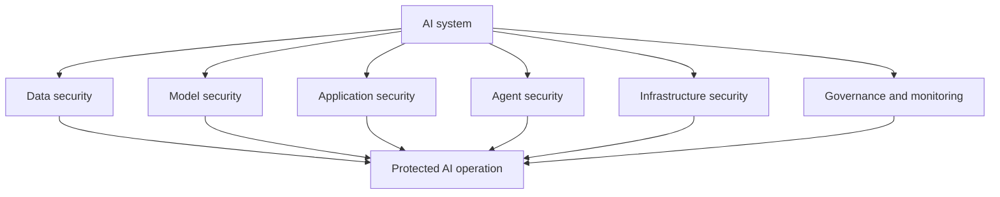

---
tags:
  - Secure-AI
  - Security-First
date_created: 2026-10-30
date_modified: 2026-11-05
cf_last_run: 2026-11-05T20:22:37.296Z
cf_last_run_model: Perplexity sonar-pro
---

# Defining and Describing AI Security

- _AI security protects intelligent systems from being manipulated, misused, or turned into sources of harm._
- AI security is the practice of securing artificial-intelligence and machine-learning systems across their lifecycle, including training data, model behavior, inference, retrieval, orchestration, and deployment. [^5uafpx] It applies both to conventional machine-learning systems and newer generative-AI applications, where threats include prompt injection, data leakage, model poisoning, excessive agency, and unbounded resource consumption. [^piagd7] [^5uafpx]
- Unlike ordinary application security, AI security must address probabilistic behavior, adversarial inputs, opaque training pipelines, model supply chains, and systems that can autonomously call tools or access sensitive data. [^piagd7] [^5uafpx]
- A practical program combines organizational risk management, adversary modeling, application testing, access control, monitoring, and lifecycle governance. NIST AI RMF supplies governance structure, MITRE ATLAS catalogs adversary tactics, and OWASP documents vulnerability classes for AI applications. [^piagd7] [^embtj9] [^5uafpx]

## Uses in Context

- **Enterprise risk management:** Organizations use “AI security” to describe controls for identifying, assessing, and managing risks throughout an AI system’s lifecycle. [^piagd7] [^5uafpx]
- **Application security:** Security teams use the term for defending [[Vocabulary/Large Language Models|LLM]] applications against prompt injection, sensitive-information disclosure, data and model poisoning, improper output handling, and excessive agency. [^piagd7] [^u2vz09]
- **Adversary simulation:** Red teams invoke AI security when testing tactics such as prompt injection, model evasion, extraction, poisoning, and abuse of connected tools. [^piagd7] [^5uafpx]
- **Agent governance:** In agentic systems, the term covers tool misuse, privilege abuse, unsafe inter-agent communication, memory poisoning, and cascading failures. [^piagd7]
- **Regulatory and compliance work:** AI security provides a shared technical vocabulary alongside AI governance and risk frameworks, especially through NIST AI RMF, MITRE ATLAS, and OWASP publications. [^u2vz09] [^embtj9]
- **Product assurance:** Startups and software teams use AI security assessments before launch to validate system prompts, API permissions, data boundaries, input handling, output filtering, and monitoring. [^hgn1sv]

## History of Use

### Origins

- The modern LLM-security conversation emerged from prompt-injection research and disclosure work in 2022. Preamble reportedly documented and responsibly disclosed prompt injection in May 2022, after which Simon Willison popularized the term; Perez and Ribeiro provided an early systematic academic treatment of goal hijacking and prompt leaking. [^20lpsl]
- The broader field predates the LLM era: AI security encompasses attacks on training data, model integrity, inference behavior, deployment infrastructure, and system interfaces, rather than only attacks on chatbots. [^5uafpx]
- MITRE ATLAS extended the established adversary-behavior approach of MITRE ATT&CK into AI-enabled systems, while OWASP translated emerging application risks into engineer-facing vulnerability taxonomies. [^piagd7] [^2cxttb]

### Evolution

- **2022 — Prompt injection becomes a named security problem:** Researchers and practitioners shifted attention from conventional model accuracy toward adversarial instructions that could override intended behavior, reveal prompts, or redirect system goals. [^20lpsl]
- **2023 — Lifecycle governance becomes institutionalized:** NIST AI RMF 1.0 introduced a voluntary, sector-agnostic process organized around **Govern, Map, Measure, and Manage**, giving organizations a structured way to manage AI risk. [^piagd7] [^embtj9]
- **2024 onward — Security expands to agents and connected systems:** As AI applications gained tool use, retrieval, memory, and autonomy, the attack surface expanded from the model itself to permissions, APIs, retrieved content, orchestration, inter-agent communication, and cascading actions. [^piagd7] [^20lpsl]

## Best Real-World Examples

- [MITRE ATLAS](https://atlas.mitre.org/) — an adversary knowledge base mapping tactics and techniques against AI-enabled systems. [^piagd7]
- [OWASP Top 10 for LLM Applications](https://owasp.org/www-project-top-10-for-large-language-model-applications/) — an application-layer taxonomy covering prompt injection, poisoning, information disclosure, excessive agency, and related risks. [^piagd7] [^u2vz09]
- [NIST AI Risk Management Framework](https://www.nist.gov/itl/ai-risk-management-framework) — a voluntary governance framework organized around Govern, Map, Measure, and Manage. [^piagd7] [^embtj9]
- [OWASP Agentic AI Top 10](https://owasp.org/www-project-top-10-for-agentic-applications/) — a threat taxonomy for tool misuse, identity and privilege abuse, memory poisoning, and cascading agent failures. [^piagd7]
- [Perez and Ribeiro prompt-injection research](https://arxiv.org/) — early systematic work demonstrating goal hijacking and prompt leaking in language-model systems. [^20lpsl]
- [Fortbridge LLM security assessment](https://fortbridge.co.uk/case-studies/) — a startup-focused assessment that found indirect prompt injection, system-prompt extraction, and unauthorized access to customer data. [^hgn1sv]
- [MITRE ATLAS and OWASP](https://www.speakeasy.com/resources/ai-security-frameworks) — complementary examples showing the field’s division between adversary modeling and vulnerability-focused engineering guidance. [^piagd7]

## Case Studies

A customer-support AI startup integrated an LLM with internal knowledge bases, customer records, and APIs before public launch. Security testers aligned their work with the OWASP LLM Top 10 and used adversarial prompts to examine prompt injection, training-data extraction, and privilege escalation. [^hgn1sv] They demonstrated an indirect prompt injection embedded in a crafted support ticket, causing the system to invoke internal APIs and disclose other customers’ personal data; they also extracted substantial portions of the system prompt, exposing API endpoints and access patterns. [^hgn1sv] The startup responded with input sanitization, output filtering, least-privilege access, allowlisted tool permissions, and monitoring for injection patterns. [^hgn1sv] The case shows that AI security is not merely model hardening: the surrounding data, tools, identities, and application logic can determine the severity of a model-level weakness.

Prompt injection research provides a second case study in how the field developed. Early disclosures and practitioner analysis identified the possibility that instructions supplied through user content or external data could compete with a system’s intended instructions. [^20lpsl] Subsequent academic work formalized attacks such as goal hijacking and prompt leaking, while later research demonstrated indirect prompt injection through retrieved content without requiring a direct attacker-facing interface. [^20lpsl] This progression changed the security model for retrieval-augmented generation: documents, webpages, tickets, and messages became potential instruction channels rather than passive data. The case illustrates how an attack pattern can move from informal practitioner discovery to systematic academic treatment and then into operational security frameworks.

A third case concerns the division of labor among modern security frameworks. NIST AI RMF treats AI security as an organizational risk-management process; MITRE ATLAS describes adversary tactics and techniques; and OWASP catalogs concrete vulnerability classes at application and agent layers. [^piagd7] [^embtj9] [^5uafpx] Their coexistence reflects the expansion of AI security from isolated model attacks to an enterprise discipline spanning governance, red teaming, software engineering, identity, data protection, and continuous monitoring. The resulting approach is layered rather than singular: no one framework fully specifies governance, adversary behavior, application flaws, and agent-system risks at once. [^piagd7]

***

# Sources

[^hgn1sv]: 2026, Feb 14. [fortbridge.co.uk](https://fortbridge.co.uk/). [Case Studies](https://fortbridge.co.uk/case-studies/). Updated: 2026, Oct 18. Generated: 2026, Nov 05. [Perplexity](https://www.perplexity.ai/) API response.
[^piagd7]: 2026, Nov 02. [speakeasy.com](https://www.speakeasy.com/). [AI security frameworks compared: NIST AI RMF vs MITRE ATLAS vs OWASP](https://www.speakeasy.com/resources/ai-security-frameworks). Updated: 2026, Nov 05. Generated: 2026, Nov 05. [Perplexity](https://www.perplexity.ai/) API response.
[^u2vz09]: 2026, Oct 20. [anaconda.com](https://www.anaconda.com/). [The State of AI Regulation Heading Into 2027 - Anaconda](https://www.anaconda.com/blog/state-ai-regulation-2027). Updated: 2026, Oct 22. Generated: 2026, Nov 05. [Perplexity](https://www.perplexity.ai/) API response.
[^embtj9]: 2026, Jul 30. [vamisec.com](https://vamisec.com/). [AI Security Frameworks at a Glance - OWASP, ATLAS, NIST](https://vamisec.com/en/wissen/agentic-ai-security/ai-security-frameworks). Updated: 2026, Oct 23. Generated: 2026, Nov 05. [Perplexity](https://www.perplexity.ai/) API response.
[^20lpsl]: 2026, Oct 21. [mdpi.com](https://www.mdpi.com/). [Below the Waterline: A Survey of Agentic AI Security ...](https://www.mdpi.com/2076-3417/16/20/10412). Updated: 2026, Nov 01. Generated: 2026, Nov 05. [Perplexity](https://www.perplexity.ai/) API response.
[6]: 2026, Oct 30. [isaca.org](https://www.isaca.org/). [Reframing Cloud Security Threats for the AI Era](https://www.isaca.org/resources/news-and-trends/industry-news/2026/reframing-cloud-security-threats-for-the-ai-era). Generated: 2026, Nov 05. [Perplexity](https://www.perplexity.ai/) API response.
[^5uafpx]: 2026, Apr 07. [snowflake.com](https://www.snowflake.com/). [AI Security Risks: How to Identify & Mitigate](https://www.snowflake.com/en/fundamentals/ai-security/risks/). Updated: 2026, Nov 04. Generated: 2026, Nov 05. [Perplexity](https://www.perplexity.ai/) API response.
[^2cxttb]: 2026, Jul 24. [ronaldbradford.com](https://ronaldbradford.com/). [Foundational Frameworks for GenAI Security Analysis](https://ronaldbradford.com/blog/2026-07-24-foundational-frameworks-for-genai-security-analysis/). Updated: 2026, Nov 02. Generated: 2026, Nov 05. [Perplexity](https://www.perplexity.ai/) API response.
[9]: 2026, Oct 05. [link.springer.com](https://link.springer.com/). [‘The science that celebrates itself’: the emergence of Biosecurity and Artificial Intelligence as a convergent public policy issue - BioSocieties](https://link.springer.com/article/10.1057/s41292-026-00399-0?code=b1193a93-6100-458a-a6ec-7f925d1d71e1&error=cookies_not_supported). Updated: 2026, Oct 14. Generated: 2026, Nov 05. [Perplexity](https://www.perplexity.ai/) API response.
[10]: 2026, Oct 01. [learn.microsoft.com](https://www.learn.microsoft.com/). [Summary - Training](https://www.learn.microsoft.com/en-us/training/modules/fundamentals-ai-security/10-summary/). Updated: 2026, Nov 01. Generated: 2026, Nov 05. [Perplexity](https://www.perplexity.ai/) API response.
