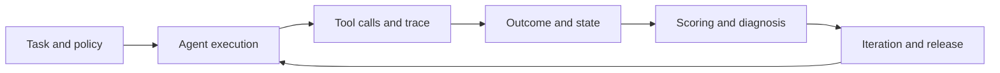

---
tags:
  - State-Of-The-Art-Practices
  - Best-Practices
  - Agentic-Engineering
  - Agent-Harnesses
  - Agent-Skills
  - Agentic-AI
  - Harness-Engineering
date_created: 2026-08-09
date_modified: 2026-11-23
for_clients:
  - Laerdal
  - Param
  - FullStackVC
  - Chroma
site_uuid: b1d70552-405d-4486-b562-4b1b931b0439
publish: true
title: Agent Evals
slug: agent-evals
at_semantic_version: 0.0.1.1
cf_last_run: 2026-11-23T21:59:40.997Z
cf_last_run_model: Perplexity sonar-pro
---

https://youtu.be/0vphxNt4wyk?is=Fql2hErpMmlRpWdV

# Defining and Describing Agent Evals

_Agent evals turn an agent’s apparently successful behavior into measurable evidence that it can reliably complete tasks, use tools, follow policies, and avoid harmful or costly failures._

Agent evals are evaluations designed for systems that take actions—such as calling APIs, browsing, editing files, or interacting with simulated users—rather than merely generating standalone answers. [^mp43s8] They typically combine task datasets, execution environments, traces, graders, and metrics to assess both the final outcome and the path taken to reach it. [^1umcrh] [^d9l3ph] They apply during model selection, prompt and workflow development, regression testing, safety review, and production monitoring. [^ocl0me] Their importance follows from the fact that an agent can produce a plausible final response while making an incorrect tool call, violating a policy, corrupting state, or failing inconsistently across repeated runs. [^ilj7qi] [^ocl0me]

## Uses in Context

- **Engineering quality assurance:** Teams use agent evals as regression tests for prompts, models, tools, and orchestration logic; open-source frameworks commonly represent an evaluation as a task, solver, and scorer. [^ilj7qi]
- **Tool-use validation:** The term describes tests in which an agent must select and correctly invoke tools, often under domain rules and with a simulated user. [^1umcrh] [^6hbo6f]
- **Production readiness:** Practitioners use evals to measure task success, policy adherence, latency, cost, and reliability before exposing an agent to real users. [^6hbo6f] [^ocl0me]
- **Safety and security testing:** Agent evals can place systems in sandboxes and test harmful behavior, tool misuse, or failure under adversarial conditions. [^1umcrh] [^6hbo6f]
- **Benchmarking research systems:** Researchers invoke the term for standardized environments spanning operating systems, databases, websites, games, coding tasks, and customer-service interactions. [^1umcrh] [^6hbo6f] [^04pnqs]
- **Continuous monitoring:** An eval may be rerun against saved traces and newly collected tasks so that an apparently improved system does not regress elsewhere. [^ocl0me]

## History of Use

### Origins

- The modern term grew out of the shift from language-model benchmarks toward evaluations of models acting as agents in environments. AgentBench, associated with an ICLR 2024 publication, evaluates language models across multiple environments rather than only on static question-answering tasks. [^1umcrh] [^04pnqs]
- The benchmark **τ-bench** made the tool–agent–user relationship explicit: an agent interacts with a simulated user, calls domain APIs, and follows written policies in realistic retail and airline scenarios. [^1umcrh] [^d9l3ph] [^6hbo6f]
- The UK AI Security Institute’s Inspect framework formalized a reusable evaluation architecture in which agent evaluations require models to take actions rather than simply answer questions. [^mp43s8]

### Evolution

- **2023–2024 — From answers to environments:** AgentBench and related work expanded evaluation from static model outputs to interactive environments, including operating systems, databases, web tasks, and games. [^1umcrh] [^6hbo6f]
- **2024–2025 — From single turns to policy-constrained interaction:** τ-bench emphasized multi-turn tool–agent–user interaction, domain policies, API calls, final database state, and repeated-run consistency. [^1umcrh] [^6hbo6f]
- **2025 onward — From benchmarks to maintained evaluation systems:** Current practice increasingly bundles task data, trace data, execution harnesses, and documentation so evaluations can be reproduced, inspected, and updated over time. [^ocl0me]

## Best Real-World Examples

- [Inspect AI](https://inspect.aisi.org.uk/) — an open-source evaluation framework with solvers, scorers, sandboxes, logs, and explicit support for agent action-taking. [^1umcrh] [^mp43s8]
- [Inspect Evals](https://github.com/UKGovernmentBEIS/inspect_evals) — a community-maintained collection of ready-to-run benchmark implementations for agent, coding, safety, and general evaluation tasks. [^d9l3ph] [^7radnh]
- [τ-bench](https://github.com/sierra-research/tau-bench) — Sierra’s tool–agent–user benchmark for policy-constrained customer-service interactions in retail and airline domains. [^1umcrh] [^6hbo6f]
- [AgentBench](https://github.com/THUDM/AgentBench) — a multi-environment benchmark for evaluating language models as agents across operating-system, database, web, game, and related tasks. [^1umcrh] [^04pnqs]
- [OpenAI Evals](https://github.com/openai/evals) — an open evaluation framework and registry that helped popularize reusable, repository-based evaluations for language-model systems. [^d9l3ph] [^04pnqs]
- [DeepEval](https://github.com/confident-ai/deepeval) — a testing-oriented framework offering metrics for agents, tools, safety, and conversations. [^7radnh]
- [BrowserGym](https://github.com/ServiceNow/BrowserGym) — [[BrowserGym]] a web-agent research environment that unifies browser tasks and benchmarks such as WebArena, VisualWebArena, and WorkArena. [^6hbo6f]

## Case Studies

**τ-bench and realistic customer-service agents.** Sierra’s τ-bench models customer-service work as a three-way interaction among a tool, an agent, and a user rather than as a one-shot response-generation problem. [^1umcrh] [^d9l3ph] The agent must converse with a simulated user, call retail or airline APIs, and obey written domain policies. [^1umcrh] [^6hbo6f] Evaluation can inspect the resulting database state and measure whether the system succeeds consistently across repeated trials, including a pass-to-the-$k$ style reliability measure. [^ilj7qi] [^6hbo6f] The case demonstrates why agent evals must score state changes and policy compliance, not just the fluency of the final message.

**Inspect and reproducible evaluation infrastructure.** Inspect, developed by the UK AI Security Institute, provides an open-source framework in which evaluations can combine datasets, solvers, scorers, tool use, and sandboxed execution. [^1umcrh] [^mp43s8] Its companion collection, Inspect Evals, supplies reusable implementations of established benchmarks and task suites. [^d9l3ph] [^7radnh] This changes agent evaluation from an ad hoc collection of scripts into a reproducible harness that can be rerun across models and configurations. The example also illustrates the innovation pattern behind agent evals: open-source researchers and public-interest institutions contribute infrastructure that larger vendors may subsequently adopt or popularize.

**The move from benchmark scores to maintained eval systems.** Recent guidance on building agentic evaluations recommends packaging the task dataset, trace dataset, execution harness, and accompanying paper or documentation as a coherent artifact. [^ocl0me] That approach treats an evaluation as a maintained system rather than a fixed leaderboard number: tasks can expose new failure modes, traces can reveal why an agent failed, and harnesses can preserve the execution conditions needed for comparison. [^ocl0me] The case shows how agent evals increasingly support the full engineering lifecycle—from development and release gates to regression detection and production learning—rather than serving only as research benchmarks.

# Images

_Source: https://arize.com/ai-agents/agent-evaluation/_

_Source: https://zapier.com/blog/ai-agent-evaluation/_

_Source: https://goclaw.sh/blog/test-ai-agents_

_Source: https://toloka.ai/blog/ai-agent-evaluation-methodologies-challenges-and-emerging-standards/_

_Source: https://aws.amazon.com/blogs/machine-learning/evaluate-ai-agents-systematically-with-agent-evalkit/_

_Source: https://www.couchbase.com/blog/evaluating-agentic-ai-workflows/_

***

# Sources

[^1umcrh]: 2026, Jul 16. [github.com](https://github.com/). [GitHub - aglio-lab/ai-evaluation-tools: The comprehensive ...](https://github.com/aglio-lab/ai-evaluation-tools). Updated: 2026, Nov 23. Generated: 2026, Nov 23. [Perplexity](https://www.perplexity.ai/) API response.
[^d9l3ph]: 2026, Mar 20. [github.com](https://github.com/). [pauldebdeep9/awesome-agentic-evaluation - GitHub](https://github.com/pauldebdeep9/awesome-agentic-evaluation). Updated: 2026, Nov 21. Generated: 2026, Nov 23. [Perplexity](https://www.perplexity.ai/) API response.
[^7radnh]: 2026, May 11. [github.com](https://github.com/). [Lhy723/awesome-ai-agent-evaluation: A curated list of ...](https://github.com/Lhy723/awesome-ai-agent-evaluation). Updated: 2026, Nov 10. Generated: 2026, Nov 23. [Perplexity](https://www.perplexity.ai/) API response.
[^ilj7qi]: 2026, Jun 24. [github.com](https://github.com/). [benchflow-ai/awesome-evals: A curated, non-BS library of the best ...](https://github.com/benchflow-ai/awesome-evals). Updated: 2026, Nov 22. Generated: 2026, Nov 23. [Perplexity](https://www.perplexity.ai/) API response.
[5]: 2026, Nov 16. [github.com](https://github.com/). [carveragents/awesome-system-verification: Curated list of ...](https://github.com/carveragents/awesome-system-verification). Updated: 2026, Nov 18. Generated: 2026, Nov 23. [Perplexity](https://www.perplexity.ai/) API response.
[^6hbo6f]: 2026, Jun 22. [github.com](https://github.com/). [github.com · serenakeyitan · awesome-ai-agent-benchmarksAwesome AI Agent Benchmarks - GitHub](https://github.com/serenakeyitan/awesome-ai-agent-benchmarks). Updated: 2026, Nov 21. Generated: 2026, Nov 23. [Perplexity](https://www.perplexity.ai/) API response.
[^04pnqs]: 2026, Jul 29. [github.com](https://github.com/). [royalpinto007/awesome-agent-evals: A curated list of tools, ...](https://github.com/royalpinto007/awesome-agent-evals). Updated: 2026, Nov 22. Generated: 2026, Nov 23. [Perplexity](https://www.perplexity.ai/) API response.
[8]: [arxiv.org](https://arxiv.org/). [𝜏^𝜏-Bench: An Environment for End-To-End, Realistic Agent ...](https://arxiv.org/html/2609.04611). Updated: 2026, Nov 22. Generated: 2026, Nov 23. [Perplexity](https://www.perplexity.ai/) API response.
[^mp43s8]: [inspect.aisi.org.uk](https://inspect.aisi.org.uk/). [Inspect](https://inspect.aisi.org.uk/?ref=vanja.io). Updated: 2026, Nov 22. Generated: 2026, Nov 23. [Perplexity](https://www.perplexity.ai/) API response.
[^ocl0me]: 2026, Nov 23. [huggingface.co](https://huggingface.co/). [How to build and maintain an agentic evaluation](https://huggingface.co/blog/agentic-evals). Generated: 2026, Nov 23. [Perplexity](https://www.perplexity.ai/) API response.
