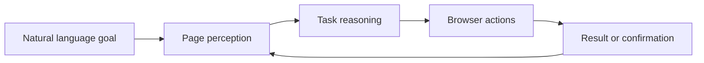

---
tags:
  - Agentic-Browsers
  - Agent-Native
  - Agentic-AI
  - Market-Categories
  - Investment-Categories
date_created: 2026-06-04
date_modified: 2026-11-24
site_uuid: 3a288c3b-a54e-4930-a533-d29b6d2b2b83
publish: true
title: Agentic Browsers
slug: agentic-browsers
at_semantic_version: 0.0.0.1
cf_last_run: 2026-11-24T07:14:14.133Z
cf_last_run_model: Perplexity sonar-pro
---

[[Tooling/Web Browsers/Dia Browser|Dia Browser]]
[[Tooling/Web Browsers/Aside|Aside]]
[[Tooling/Web Browsers/Fellou|Fellou]]

# Defining and Describing Agentic Browsers

- _Agentic browsers turn the browser from a passive document viewer into an operator that can pursue goals._
- An **agentic browser** is a browser, or browser layer, that accepts natural-language goals and executes multi-step web workflows—such as reading pages, clicking controls, filling forms, and extracting information—without requiring hand-written click-by-click scripts. [^2xduim] In more technical terms, it is a goal-driven system operating through a perception–reasoning–action loop. [^cvja6e]
- The concept applies when a user wants an outcome rather than a page: researching across sites, comparing products, completing forms, booking services, or working inside authenticated sessions. [^2xduim] [^n6tlie] Its significance lies in combining the web’s existing interfaces with language-model planning and action, while introducing new risks around authorization, privacy, prompt injection, and cross-site data movement. [^6p7dl0] [^wk7pu4]

## Uses in Context

- **Task automation:** The term describes systems that “clicks, types and fills forms” for users inside their signed-in sessions. [^qqmf5h]
- **Research and answer generation:** Agentic browsers combine web navigation with synthesis, allowing an agent to inspect multiple pages rather than merely return search links. [^qqmf5h] [^n6tlie]
- **Authenticated workflows:** The category is invoked for multi-step actions such as filling forms, comparing products, and making purchases. [^n6tlie]
- **AI-native browser design:** Analysts distinguish agentic browsers from conventional browsers with added chat features by emphasizing an AI model as the primary interaction surface and an agent mode capable of executing tasks. [^n6tlie]
- **Security analysis:** Researchers use the term for systems that can navigate across origins, interact with browser interfaces, and invoke integrated services, creating attack surfaces not present in ordinary browsing. [^wk7pu4]

## History of Use

## Origins

- The research lineage predates the product category. OpenAI’s **World of Bits** environment explored web-task interaction in 2017, while **WebGPT** used a text-based browser to answer questions in 2021. [^qqmf5h]
- Anthropic’s **Computer Use**, introduced in 2024, demonstrated a general-purpose language model operating a desktop through screenshots; this helped motivate browser-specific agents and commercial products. [^2xduim]
- The term’s modern market meaning consolidated around browser agents that combine natural-language objectives, page interpretation, planning, and direct interaction with live websites. [^2xduim] [^6p7dl0]

## Evolution

- **2017–2021 — Research environments:** Web agents moved from benchmark-style interaction in World of Bits toward browsing-assisted question answering with WebGPT. [^qqmf5h]
- **2024 — General computer control:** Computer-use systems expanded the scope from text-only web interaction to visual desktop operation, making browser control more general and accessible to product builders. [^2xduim]
- **2025 onward — Product category formation:** Commercial offerings such as Opera Browser Operator, Dia, and Perplexity Comet helped establish “agentic browsing” as a distinct browser and assistant category rather than merely a research capability. [^qqmf5h]

## Best Real-World Examples

- [Browser Use](https://www.browser-use.com/) — an open-source Python framework enabling language models to control browsers, cited as one of the category’s most active open-source projects. [^2xduim]
- [BrowserAgent](https://arxiv.org/html/2510.10666) — a research system proposing more interactive web agents built around human-inspired browser actions. [^gu90k1]
- [Perplexity Comet](https://www.perplexity.ai/comet) — an AI-native browser positioned around search, answers, and agentic tasks across authenticated sessions. [^2xduim] [^n6tlie]
- [Dia](https://www.diabrowser.com/) — The Browser Company’s AI-oriented browser, designed around conversational interaction with tabs and web content. [^n6tlie] [^jyo2ax]
- [Fellou](https://fellou.ai/) — a startup browser emphasizing persistent memory and personal-assistant-style interaction. [^2xduim]
- [Opera Neon](https://www.opera.com/neon) — an adopter and popularizer that organizes agentic browsing around conversational answers, task execution, and content creation. [^jyo2ax]
- [OpenAI Operator](https://openai.com/index/computer-using-agent/) — a major-platform implementation of browser and computer-use automation, illustrating how incumbents are distributing the capability through existing assistants. [^2xduim] [^qqmf5h]

## Case Studies

**Browser Use and the open-source route.** Browser Use exemplifies how a smaller, developer-oriented project can make agentic browsing accessible before the category is fully standardized. Its positioning as an MIT-licensed Python framework lowered the barrier for experimentation and helped create a community around connecting language models to browser controls. [^2xduim] The case shows that agentic browsers are not only consumer products: they are also infrastructure, libraries, and composable tools that let developers build task-specific agents.

**Research-to-product transition.** World of Bits and WebGPT established important research precedents for agents interacting with or browsing the web, while later computer-use work broadened the action space from text navigation to visual interaction. [^qqmf5h] [^2xduim] The resulting product category translated these capabilities into user-facing systems such as Comet, Dia, and Operator, which execute workflows against contemporary websites rather than operating only in controlled research environments. [^qqmf5h] [^n6tlie] This progression shows that “agentic browser” describes an accumulation of capabilities—perception, planning, navigation, action, and increasingly authentication-aware execution—rather than a single invention.

**Security as a defining constraint.** Agentic browsers can move across origins and combine information from several sites, which creates opportunities for prompt injection, cross-site confusion, unintended disclosure, and unauthorized actions. [^wk7pu4] Security research argues that these systems weaken some assumptions of traditional web isolation because a malicious page may influence an agent that is simultaneously handling the user’s instructions and data from other origins. [^wk7pu4] The case demonstrates that agentic browsing is not simply faster automation: it changes the trust model of the browser and requires explicit controls for permissions, confirmation, provenance, and sensitive actions. [^6p7dl0] [^cvja6e] [^wk7pu4]

***

# Sources

[^2xduim]: [browseract.com](https://www.browseract.com/). [The 2026 Agentic Browser Landscape: A Complete Market Map](https://www.browseract.com/blog/agentic-browser-landscape-2026). Updated: 2026, Nov 17. Generated: 2026, Nov 24. [Perplexity](https://www.perplexity.ai/) API response.
[^gu90k1]: [arxiv.org](https://arxiv.org/). [BrowserAgent: Building Web Agents with Human-Inspired Web ...](https://arxiv.org/html/2510.10666). Updated: 2026, Jul 28. Generated: 2026, Nov 24. [Perplexity](https://www.perplexity.ai/) API response.
[^6p7dl0]: [arxiv.org](https://arxiv.org/). [Building Browser Agents: Architecture, Security, and Practical Solutions](https://arxiv.org/html/2511.19477). Updated: 2026, Nov 15. Generated: 2026, Nov 24. [Perplexity](https://www.perplexity.ai/) API response.
[^qqmf5h]: 2026, Nov 13. [ppc.land](https://ppc.land/). [Agentic browser](https://ppc.land/agentic-browser/). Updated: 2026, Nov 23. Generated: 2026, Nov 24. [Perplexity](https://www.perplexity.ai/) API response.
[^cvja6e]: [arxiv.org](https://arxiv.org/). [Fortifying Web Applications Against AI Agents and Agentic Browsers](https://arxiv.org/html/2610.41181). Updated: 2026, Nov 09. Generated: 2026, Nov 24. [Perplexity](https://www.perplexity.ai/) API response.
[^n6tlie]: 2026, Jul 08. [the-agent-report.com](https://the-agent-report.com/). [The Agentic Browser Landscape in 2026: Comet, Atlas, Dia, and ...](https://the-agent-report.com/2026/07/agentic-browsers-landscape-2026-comet-atlas-dia/). Updated: 2026, Sep 19. Generated: 2026, Nov 24. [Perplexity](https://www.perplexity.ai/) API response.
[7]: [arxiv.org](https://arxiv.org/). [Internal APIs Are All You Need Shadow APIs, Shared ...](https://arxiv.org/html/2604.00694). Updated: 2026, Oct 31. Generated: 2026, Nov 24. [Perplexity](https://www.perplexity.ai/) API response.
[^wk7pu4]: [arxiv.org](https://arxiv.org/). [WAAA! Web Adversaries Against Agentic Browsers](https://arxiv.org/html/2605.05509). Updated: 2026, Jul 13. Generated: 2026, Nov 24. [Perplexity](https://www.perplexity.ai/) API response.
[^jyo2ax]: 2026, Apr 15. [vccafe.beehiiv.com](https://vccafe.beehiiv.com/). [The AI Browser Wars](https://vccafe.beehiiv.com/p/the-ai-browser-wars). Updated: 2026, Sep 28. Generated: 2026, Nov 24. [Perplexity](https://www.perplexity.ai/) API response.
[10]: 2026, Feb 13. [firecrawl.dev](https://www.firecrawl.dev/). [Which AI browser agent...](https://www.firecrawl.dev/blog/best-browser-agents). Updated: 2026, Nov 23. Generated: 2026, Nov 24. [Perplexity](https://www.perplexity.ai/) API response.
