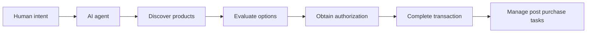

---
aliases:
  - Agent-to-agent commerce
  - Agent-to-Agent Commerce
  - Agent Commerce
  - Agentic E-Commerce
date_created: 2026-10-10
date_modified: 2026-11-05
site_uuid: 3e50d2a2-2a16-4d94-9559-5aab14d93e9d
publish: true
title: Agentic Commerce
slug: agentic-commerce
at_semantic_version: 0.0.0.1
cf_last_run: 2026-11-05T23:32:44.021Z
cf_last_run_model: Perplexity sonar-pro
---

[[vertical-toolkits/FinTech/Kite|Kite]]
[[Tooling/AI-Toolkit/Agentic AI/Kite Payments|Kite Payments]]

# Defining and Describing Agentic Commerce

_Agentic commerce shifts commerce from people operating storefronts and checkouts to AI agents acting within a buyer’s delegated intent._

Agentic commerce is a model in which an AI system discovers products or services, evaluates alternatives, recommends options, and may complete a transaction for a consumer or business. [^ne4xtk] [^v6x6tl] It applies when a customer interacts with an AI interface rather than navigating a conventional storefront, with the agent potentially handling search, comparison, negotiation, authorization, payment, and post-purchase tasks. [^ne4xtk] [^v6x6tl] [^9902c7] The central change is that the agent becomes an active participant in the commercial process, not merely a passive search or customer-service interface. [^b615sw] [^9902c7]

# Uses in Context

- **Conversational shopping:** The term describes commerce conducted through an AI chat interface in which the agent finds, compares, and recommends products based on a user’s request. [^ne4xtk] [^v6x6tl]
- **Delegated purchasing:** It refers to an agent identifying and buying within parameters established by the user, potentially without direct human intervention at checkout. [^9902c7] [^0ul53p]
- **Business procurement:** Companies use the concept for agents that research suppliers, compare terms, and execute purchasing tasks on behalf of an organization. [^v6x6tl] [^9902c7]
- **Machine-readable commerce:** The phrase increasingly denotes the infrastructure—product data, identity, authorization, payment, and checkout protocols—that allows agents to transact with merchants. [^xggwo8] [^xfi1r7]
- **Retail strategy:** Merchants invoke agentic commerce to describe adapting catalogs, checkout flows, and customer relationships for AI-mediated discovery rather than only human browsing. [^xggwo8] [^b615sw]

# History of Use

## Origins

The available sources describe agentic commerce as an emerging industry term rather than attributing its coinage to a single academic paper or founder. Morgan Stanley defines it broadly as e-commerce “initiated or shaped by an AI system” after a consumer interacts with an agent, while SAP describes autonomous or semi-autonomous agents helping discover, evaluate, recommend, and complete commerce tasks. [^ne4xtk] [^v6x6tl] The term grew out of the convergence of conversational AI, autonomous agents, digital commerce, and machine-readable payment systems rather than from one documented invention. [^v6x6tl] [^xggwo8]

## Evolution

- **Early formulation — AI-assisted discovery:** The concept initially emphasized agents helping consumers find and compare products, extending conversational search into shopping. [^ne4xtk] [^v6x6tl]
- **Expansion — delegated transactions:** It broadened to include recommendations, authorization, negotiation, checkout, and payment carried out on a customer’s behalf. [^9902c7] [^f8fxry]
- **Infrastructure phase — protocols and agent identity:** By the mid-2020s, attention shifted toward common standards for product discovery, agent-to-agent communication, identity, authorization, and payment; industry commentary compared the need for a common language to HTTP’s role on the web. [^xggwo8]

# Best Real-World Examples

- [Klarna Shopping Search](https://www.klarna.com/) — [[Klarna]] — an AI shopping-search experience inside ChatGPT that surfaces real-time prices and merchant listings across a large product catalog. [^fd3nsk]
- [Rye](https://www.rye.com/) — [[Rye]] — a startup example of infrastructure designed to enable universal checkout across fragmented merchants and storefronts. [^xggwo8]
- [Skyfire](https://www.skyfire.xyz/) — an agent-native identity and payments company building primitives for AI agents that need to transact. [^xggwo8]
- [Nekuda](https://www.nekuda.ai/) — a startup focused on identity and payment infrastructure for agentic commerce. [^xggwo8]
- [Catena Labs](https://www.catenalabs.com/) — an emerging infrastructure provider working on foundational components for autonomous transactions. [^xggwo8]
- [Mastercard Agent Pay](https://www.mastercard.com/) — a payment-network implementation intended to let agents conduct transactions using delegated, tokenized payment credentials. [^xggwo8] [^0ul53p]
- [Universal Commerce Protocol](https://www.google.com/) — a commerce standard promoted by Google and retail partners to support an end-to-end shopping journey from discovery through post-purchase service. [^xggwo8]

# Case Studies

**Klarna and conversational product discovery.** Klarna introduced an AI-powered shopping-search application inside [[Tooling/AI-Toolkit/AI Interfaces/Chat GPT|Chat GPT]] that uses a Product Search MCP server to surface current prices and merchant listings. [^fd3nsk] The model changes the entry point to shopping: rather than beginning with a retailer’s homepage or a conventional search-results page, the buyer begins with an intent expressed in natural language. [^ne4xtk] [^fd3nsk] This illustrates the discovery side of agentic commerce, where the agent filters a broad market and presents options before the user reaches a conventional checkout.

**Startup infrastructure versus incumbent storefronts.** Smaller companies such as Rye, Skyfire, Nekuda, and Catena Labs are targeting gaps that arise when autonomous agents must identify themselves, obtain permission, access merchant systems, and pay securely. [^xggwo8] Industry coverage characterizes these startups as building universal checkout, agent-native identity, and payment primitives while larger firms concentrate on protocols and distribution. [^xggwo8] The case demonstrates that agentic commerce is not simply an AI shopping feature; it is also an infrastructure layer in which startups can address interoperability problems before they are absorbed into mainstream platforms.

**Protocol competition and standardization.** The emerging ecosystem includes OpenAI and Stripe’s Agentic Commerce Protocol for checkout, Google’s Universal Commerce Protocol for a broader shopping journey, and payment-oriented systems associated with Mastercard, Visa, and other networks. [^xggwo8] [^0ul53p] The competing approaches reflect different definitions of the problem: some prioritize immediate checkout, while others address catalog discovery, post-purchase interactions, agent-to-agent communication, or payment authorization. [^xggwo8] This shows that the field remains unsettled: agentic commerce is evolving from a product experience into a standards and governance contest over how agents discover offers, represent user intent, prove authority, and execute transactions.

***

# Sources

[^ne4xtk]: 2026, Nov 04. [morganstanley.com](https://www.morganstanley.com/). [Agentic commerce: new frontiers | Morgan Stanley](https://www.morganstanley.com/im/en-us/financial-advisor/insights/global-equity-observer/agentic-commerce-new-frontiers.html). Updated: 2026, Nov 05. Generated: 2026, Nov 05. [Perplexity](https://www.perplexity.ai/) API response.
[^v6x6tl]: 2026, Aug 17. [sap.com](https://www.sap.com/). [What is agentic commerce | SAP](https://www.sap.com/resources/agentic-commerce). Updated: 2026, Oct 03. Generated: 2026, Nov 05. [Perplexity](https://www.perplexity.ai/) API response.
[^xggwo8]: 2026, Sep 23. [synaptic.com](https://synaptic.com/). [Shop Talk: Agentic Commerce - Synaptic](https://synaptic.com/resources/market-overviews/shop-talk-agentic-commerce). Updated: 2026, Oct 07. Generated: 2026, Nov 05. [Perplexity](https://www.perplexity.ai/) API response.
[^b615sw]: 2026, Apr 02. [pwc.com](https://www.pwc.com/). [Explore PwC’s perspective on agentic commerce](https://www.pwc.com/us/en/technology/alliances/library/agentic-commerce-is-your-business-ready.html). Updated: 2026, Oct 27. Generated: 2026, Nov 05. [Perplexity](https://www.perplexity.ai/) API response.
[^9902c7]: 2026, Jan 23. [ibm.com](https://ibm.com/). [What Is Agentic Commerce? | IBM](https://ibm.com/think/topics/agentic-commerce). Updated: 2026, Oct 27. Generated: 2026, Nov 05. [Perplexity](https://www.perplexity.ai/) API response.
[^0ul53p]: 2026, Oct 29. [Forbes](https://www.forbes.com/). [Agentic Commerce Is Here: Is Your Startup Ready To Sell To AI Agents?](https://www.forbes.com/sites/neha-mehra/2026/10/29/agentic-commerce-is-here-is-your-startup-ready-to-sell-to-ai-agents/). Generated: 2026, Nov 05. [Perplexity](https://www.perplexity.ai/) API response.
[^f8fxry]: 2026, Oct 01. [valantic.com](https://www.valantic.com/). [What is Agentic Commerce?](https://www.valantic.com/en/glossary/what-is-agentic-commerce/). Updated: 2026, Nov 05. Generated: 2026, Nov 05. [Perplexity](https://www.perplexity.ai/) API response.
[^xfi1r7]: 2026, Nov 04. [startuphub.ai](https://www.startuphub.ai/). [Companies ready for agentic commerce (2026)](https://www.startuphub.ai/agentic-commerce). Updated: 2026, Nov 05. Generated: 2026, Nov 05. [Perplexity](https://www.perplexity.ai/) API response.
[^fd3nsk]: 2026, Jul 24. [aiweekly.co](https://aiweekly.co/). [Agentic commerce: 8 real deployments](https://aiweekly.co/ai-use-cases/use/agentic-commerce). Updated: 2026, Oct 08. Generated: 2026, Nov 05. [Perplexity](https://www.perplexity.ai/) API response.
[10]: 2026, Apr 14. [codewave.com](https://codewave.com/). [How Agentic Commerce Will Transform Buying Decisions in 2026 -](https://codewave.com/insights/agentic-commerce-ai-shopping-agents/). Updated: 2026, Oct 27. Generated: 2026, Nov 05. [Perplexity](https://www.perplexity.ai/) API response.
