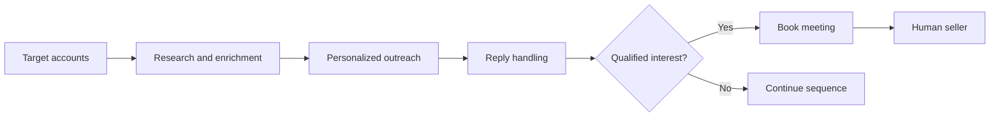

---
aliases:
  - autonomous SDR
date_created: 2026-10-04
date_modified: 2026-11-14
site_uuid: 10733ef6-aaf1-49ea-a821-55a38239a84f
publish: true
title: Autonomous SDRs
slug: autonomous-sdrs
at_semantic_version: 0.0.0.1
tags:
  - Sales-AI
  - GTM-Agents
cf_last_run: 2026-11-14T02:09:36.127Z
cf_last_run_model: Perplexity sonar-pro
---

[[Tooling/Enterprise Jobs-to-be-Done/ScoutNow|ScoutNow]]
[[Tooling/AI-Toolkit/Agentic AI/Agentic Workspaces/Narrow AI|Narrow AI]]

# Defining and Describing Autonomous SDRs

- 
- _Autonomous SDRs turn a traditionally human prospecting workflow into a software-run feedback loop._
- Autonomous SDRs are AI sales agents that perform some or all sales-development tasks, including finding prospects, researching accounts, writing and sending outreach, handling replies, qualifying leads, and booking meetings. [^2lj1qm] [^zbzw65] [^1f2vcp] Unlike assistive AI tools that draft content for a representative’s approval, fully autonomous systems can execute outreach and follow-up after initial configuration. [^un9kfa] [^rbi48b]
- The concept applies primarily to top-of-funnel B2B sales, especially when teams need to process large prospect lists, respond continuously, or coordinate multichannel campaigns. [^nnf31q] [^1f2vcp] Its significance lies in shifting SDR work from individual manual actions toward supervision, policy-setting, and exception handling. [^b8q5da] [^2lj1qm]

# Uses in Context

- **Outbound prospecting:** The term describes systems that identify accounts matching an ideal customer profile, enrich contact data, and initiate outreach. [^2lj1qm] [^nnf31q]
- **Automated sequencing:** Autonomous SDRs are invoked for software that sends follow-ups across email, social channels, or calling workflows without requiring a representative to trigger every step. [^nnf31q] [^1f2vcp]
- **Conversational qualification:** Some systems conduct qualification conversations, answer basic objections, and book meetings continuously. [^u9k4gk]
- **Human–AI division of labor:** The term distinguishes agents that execute the workflow from copilots that research and draft while a human retains sending control. [^b8q5da] [^zbzw65] [^rbi48b]
- **Pipeline generation:** Vendors use the label for systems intended to create qualified meetings and pipeline at lower operating cost than conventional SDR staffing. [^r06ep8]

# History of Use

## Origins

- The available search record does not establish a single academic paper, book, or independent practitioner as the first recorded origin of the exact phrase **“Autonomous SDRs.”** Instead, it shows the term emerging from the broader category of AI sales agents and AI SDR software. [^1f2vcp] [^un9kfa]
- Contemporary definitions center on an agent that “finds or receives leads, writes to them, handles the replies and books meetings,” making autonomy a workflow property rather than merely a content-generation capability. [^1f2vcp]
- The category is best attributed to startup and sales-automation ecosystems that productized agentic prospecting; incumbent platforms appear primarily as adopters or distribution environments rather than demonstrated originators. [^t0eqdk] [^2lj1qm] [^1f2vcp]

## Evolution

- **Early assistive phase:** AI first augmented human SDRs through account research, message drafting, and sales coaching, with the representative retaining control over calls and outbound decisions. [^b8q5da] [^zbzw65]
- **Workflow-automation phase:** Products expanded from drafting to prospect discovery, enrichment, sequencing, follow-up, reply handling, and meeting booking. [^2lj1qm] [^nnf31q]
- **Agentic phase:** Newer systems increasingly present themselves as autonomous workers that can run outbound campaigns end to end, while exposing configurable human oversight rather than requiring approval for every message. [^u9k4gk] [^r06ep8] [^rbi48b]

# Best Real-World Examples

- [Artisan Ava](https://www.artisan.co/) — an autonomous outbound agent positioned to source contacts, enrich records, conduct multichannel outreach, handle replies, and book meetings. [^r06ep8]
- [AiSDR](https://aisdr.com/) — a research-first autonomous SDR described as finding in-market buyers, writing email and LinkedIn outreach, handling replies, and booking meetings. [^1f2vcp]
- [11x](https://www.11x.ai/) — an example of the “AI worker” model, marketed for organizations deploying autonomous sales-development capacity rather than only augmenting human SDR headcount. [^2lj1qm]
- [Regie.ai](https://www.regie.ai/) — represents the hybrid end of the category by combining AI prospecting, research, enrichment, messaging, calling, and automation within an existing sales stack. [^zbzw65]
- [Salesforce Agentforce](https://www.salesforce.com/agentforce/) — an incumbent-platform example in which an agent emails and qualifies lower-intent leads, answers questions, books meetings, and hands ready buyers to human SDRs. [^t0eqdk]
- [Clay](https://www.clay.com/) — [[Tooling/AI-Toolkit/Data Augmenters/Clay|Clay]] — an infrastructure-oriented example that supplies data, enrichment, and workflow capabilities often used as the research layer behind AI SDR motions rather than as a complete autonomous representative. [^2lj1qm]

# Case Studies

**Artisan and the end-to-end outbound model.** Artisan’s Ava exemplifies the startup-led version of Autonomous SDRs: the product claims to combine a large B2B contact database, waterfall enrichment, intent signals, multichannel outreach, autonomous reply handling, and meeting booking. [^r06ep8] The change is architectural as much as operational: prospect sourcing, data preparation, messaging, and conversation management are presented as one agent-controlled workflow rather than separate point tools. [^r06ep8] The case shows how the category’s defining boundary is not simply “uses AI,” but “owns enough of the sequence to act without a human approving each step.” [^un9kfa] [^r06ep8]

**AiSDR and research-first outbound.** AiSDR is described as finding in-market buyers from live signals, researching each prospect, writing across email and LinkedIn, handling replies, and booking meetings. [^1f2vcp] This model shifts emphasis from generic mass automation toward signal-driven prioritization and individualized research before contact. [^1f2vcp] It demonstrates the category’s startup-oriented innovation path: a smaller specialist product can package prospect intelligence, generation, execution, and qualification around a narrow sales workflow, while larger platforms later absorb similar capabilities into broader suites. [^t0eqdk] [^1f2vcp]

**Salesforce Agentforce as adoption and institutionalization.** A documented deployment began using an Agentforce sales-development agent to work a backlog of lower-intent leads; the agent emailed leads, answered questions, booked meetings, and passed qualified buyers to human SDRs. [^t0eqdk] This illustrates how an incumbent can popularize and operationalize the concept at enterprise scale without establishing its original vocabulary or workflow. [^t0eqdk] It also shows a pragmatic boundary for autonomy: the agent handles repetitive qualification and scheduling, while human representatives receive warmer opportunities. [^b8q5da] [^t0eqdk]

***

# Sources

[^b8q5da]: 2026, Nov 09. [atlassian.com](https://www.atlassian.com/). [How AI is changing the SDR role, from our own SDR team](https://www.atlassian.com/blog/ai-at-work/in-sales-development-a-human-touch-stands-out). Updated: 2026, Nov 14. Generated: 2026, Nov 13. [Perplexity](https://www.perplexity.ai/) API response.
[^t0eqdk]: 2026, Apr 09. [case-studies.ai](https://case-studies.ai/). [B2B sales development with AI agents - case-studies.ai](https://case-studies.ai/use-cases/customer-engagement/CE-005-b2b-sales-development/). Updated: 2026, Nov 13. Generated: 2026, Nov 13. [Perplexity](https://www.perplexity.ai/) API response.
[^2lj1qm]: 2026, Oct 14. [rankite.com](https://rankite.com/). [Best AI SDR Software in 2026: 8 Tools Compared](https://rankite.com/blog/best-ai-sdr-software). Updated: 2026, Nov 05. Generated: 2026, Nov 13. [Perplexity](https://www.perplexity.ai/) API response.
[^nnf31q]: 2026, Sep 07. [probo.com](https://www.probo.com/). [The best AI SDR platforms for startup sales teams in 2026](https://www.probo.com/hub/best-ai-sdr-platforms-2026). Updated: 2026, Nov 10. Generated: 2026, Nov 13. [Perplexity](https://www.perplexity.ai/) API response.
[^zbzw65]: 2026, Nov 02. [6sense.com](https://6sense.com/). [10 Best AI SDR Software for B2B Teams in 2026](https://6sense.com/blog/best-ai-sdr-software). Updated: 2026, Nov 05. Generated: 2026, Nov 13. [Perplexity](https://www.perplexity.ai/) API response.
[^1f2vcp]: 2026, Nov 13. [agentmail.to](https://www.agentmail.to/). [The 10 Best AI Sales Agents in 2026: Buy an AI SDR or Build Your Own | AgentMail](https://www.agentmail.to/blog/best-ai-sales-agents-2026). Generated: 2026, Nov 13. [Perplexity](https://www.perplexity.ai/) API response.
[^u9k4gk]: 2026, Sep 01. [getbreakout.ai](https://getbreakout.ai/). [Faqs](https://getbreakout.ai/blog/ai-sdr-tools-ranked). Updated: 2026, Oct 27. Generated: 2026, Nov 13. [Perplexity](https://www.perplexity.ai/) API response.
[^un9kfa]: 2026, Oct 20. [cirrusinsight.com](https://www.cirrusinsight.com/). [What Is an AI SDR? How AI SDRs Work + Best AI SDR Tools 2026](https://www.cirrusinsight.com/blog/ai-sdr). Updated: 2026, Oct 21. Generated: 2026, Nov 13. [Perplexity](https://www.perplexity.ai/) API response.
[^r06ep8]: 2026, Aug 17. [artisan.co](https://www.artisan.co/). [The 12 best AI SDRs in 2026 - Artisan AI](https://www.artisan.co/blog/the-best-ai-sdrs). Updated: 2026, Nov 10. Generated: 2026, Nov 13. [Perplexity](https://www.perplexity.ai/) API response.
[^rbi48b]: 2026, Mar 16. [landing.amplemarket.com](https://landing.amplemarket.com/). [8 best AI sales agents and AI SDR tools in 2026, compared](https://landing.amplemarket.com/blog/best-ai-sales-agents). Updated: 2026, Oct 31. Generated: 2026, Nov 13. [Perplexity](https://www.perplexity.ai/) API response.
