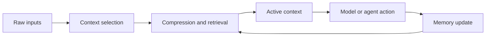

[[concepts/Explainers for AI/Context Layers|Context Layers]]
[[concepts/Explainers for AI/Memory Layers|Memory Layers]]
[[concepts/Explainers for AI/Artificial Intelligence|Enterprise AI]]
[[concepts/Market-Categories/Personal AI|Personal AI]]
[[Vocabulary/Agentic AI|Agentic AI]]
[[concepts/Explainers for AI/Multimodal AI Agents|Multimodal AI Agents]]

[[Glen]]

# Defining and Describing Context Management

- _Context management is the discipline of deciding what information an intelligent system should retain, retrieve, compress, prioritize, and present at the moment of action._
- In contemporary AI, the term commonly describes the orchestration of prompts, conversation history, retrieved documents, tool outputs, summaries, memory, and system instructions so that an agent operates within finite context limits. [^gvgo19] [^amm0xs]
- The concept applies whenever an AI system must reason over more information than can fit reliably into its active input, or when older information must be recovered selectively rather than replayed wholesale. [^gvgo19] [^9s38my]
- Context management matters because long inputs can dilute or obscure relevant information; research describes a “lost in the middle” effect in which information positioned in the middle of long contexts is used less effectively. [^a6trvz]
- In software and ubiquitous-computing traditions, context management also means collecting, interpreting, and distributing information about users, locations, devices, activities, and surrounding resources. [^vjf3lf] [^ws7ppw]

## Uses in Context

- **[[Vocabulary/Agentic AI|AI Agents]]:** Engineers use “context management” for paging relevant memories into the prompt and evicting less useful material into external storage. [^gvgo19]
- **Long-running conversations:** The term describes summarizing or compressing prior dialogue while preserving facts needed for future turns. [^amm0xs] [^o6cro4]
- **Retrieval-augmented generation:** Context management covers selecting, ranking, and inserting external knowledge into a model’s active input. [^8mopsc] [^9s38my]
- **Coding agents:** “Context engineering” is used for structuring and governing the knowledge available to an AI coding assistant, including repositories, conventions, tickets, and tool results. [^vjf3lf]
- **Context-aware computing:** Earlier usage concerned systems that adapt behavior using information such as “where you are, who you are with, and what resources are nearby.” [^vjf3lf]
- **Enterprise systems:** The concept is invoked when policies, customer records, regulations, and operational data must be assembled dynamically for a particular decision. [^ws7ppw]

# History of Use

## Origins

- The older intellectual roots lie in ubiquitous and context-aware computing. Mark Weiser’s 1991 work at Xerox PARC framed computing as embedded throughout everyday environments, while a 1994 framework by Schilit and colleagues defined context through a user’s location, companions, and nearby resources. [^vjf3lf]
- In AI-agent research, a particularly influential modern formulation came from Charles Packer and collaborators’ 2023 paper *MemGPT: Towards LLMs as Operating Systems*. The paper proposed “virtual context management,” drawing an explicit analogy between an LLM context window and main memory, with external storage functioning like a lower memory tier. [^gvgo19] [^b4182a]
- MemGPT’s contribution was not simply storing conversation history; it treated context as a managed resource that an agent could retrieve, paginate, and evict according to token constraints. [^gvgo19]

## Evolution

- **1991–1994 — Context-aware computing:** Research moved from ubiquitous-computing visions toward explicit frameworks for sensing and interpreting user and environmental context. [^vjf3lf]
- **2023–2024 — Virtual context management for agents:** MemGPT popularized an operating-system analogy in which agents page information into and out of limited context windows. [^gvgo19] [^b4182a]
- **2025 onward — Context engineering and operational memory:** The field expanded toward a broader discipline encompassing retrieval, memory, orchestration, compression, and governance, with surveys treating compression as a first-class capability in agent systems. [^amm0xs] [^ws7ppw]

# Best Real-World Examples

- [MemGPT](https://arxiv.org/html/2310.08560v2) — an agent architecture that pages information between active context and external memory, analogous to virtual memory. [^gvgo19]
- [Letta](https://github.com/dbrowneup/Linus/blob/main/docs/paper-notes/Letta-2310.08560.md) — [[Tooling/AI-Toolkit/Agentic AI/Letta|Letta]] — a productized framework associated with the MemGPT approach to persistent, self-managing agent memory. [^b4182a]
- [HINDSIGHT](https://aclanthology.org/2026.acl-demo.27.pdf) — a structured agent-memory system combining vector search, keyword matching, graph traversal, and temporal filtering. [^8mopsc]
- [Adaptive Focus Memory](https://arxiv.org/html/2511.12712v2) — a system that assigns past messages full, compressed, or placeholder fidelity according to relevance, recency, and importance. [^o6cro4]
- [ReMemR1](https://proceedings.iclr.cc/paper_files/paper/2026/file/7e0dc9ccba0f1333be13a3f9dc2b3138-Paper-Conference.pdf) — a memory-augmented agent that retrieves historical memories during long-document reasoning and incorporates retrieval into memory updating. [^qz123v]
- [SOCAM](https://atoms.dev/insights/99416c3506d04252bb436ca199e23bf2) — a context-aware middleware architecture using a context manager or interpreter to support adaptive applications. [^ws7ppw]
- [Context engineering for AI coding](https://packmind.com/context-engineering-ai-coding/history-context-engineering/) — an applied discipline for maintaining the repository and organizational knowledge available to coding agents. [^vjf3lf]

# Case Studies

**[[MemGPT]] and the operating-system model.** In 2023, Packer and collaborators proposed MemGPT to address the mismatch between an agent’s need for long-term information and the finite size of an LLM’s active context window. [^gvgo19] Their design separated a limited “main context” from external storage and allowed the agent to retrieve relevant historical material, evict lower-priority information, and paginate retrieval so that tool responses did not overflow the prompt. [^gvgo19] The case established a durable design pattern: context is not a static transcript but a managed hierarchy of memory. [^gvgo19] [^b4182a]

**[[Tooling/Software Development/Developer Experience/DevTools/Hindsight|Hindsight]] and structured agent memory.** HINDSIGHT demonstrates a later synthesis of context-management techniques for working-memory systems. [^8mopsc] It organizes long-term memory into four logical networks and exposes retain, recall, and reflect operations, combining vector search, keyword matching, graph traversal, and temporal filtering. [^8mopsc] The example shows that effective context management increasingly involves multiple retrieval strategies rather than relying on a single embedding search, especially when an agent must reason over semantic, temporal, and relational information. [^8mopsc]

**Adaptive Focus Memory and selective fidelity.** Adaptive Focus Memory represents another evolution: instead of treating every historical message as equally valuable, it assigns each message a full, compressed, or placeholder representation according to semantic relevance, temporal decay, and importance. [^o6cro4] This approach illustrates a central principle of context management—preserve high-value information at high resolution while reducing the prompt cost of material that is less relevant to the current task. [^o6cro4] More broadly, surveys of context compression frame this capability as an operational function in agent systems, alongside retrieval and orchestration. [^amm0xs]

***

# Sources

[^gvgo19]: [arxiv.org](https://arxiv.org/). [MemGPT: Towards LLMs as Operating Systems](https://arxiv.org/html/2310.08560v2). Updated: 2026, Nov 23. Generated: 2026, Nov 23. [Perplexity](https://www.perplexity.ai/) API response.
[^a6trvz]: 2026, Jun 13. [dl.acm.org](https://dl.acm.org/). [Ebbinghaus Forgetting Curve and Large Language Model ...](https://dl.acm.org/doi/full/10.1145/3803291.3803294). Updated: 2026, Nov 05. Generated: 2026, Nov 23. [Perplexity](https://www.perplexity.ai/) API response.
[^8mopsc]: [aclanthology.org](https://aclanthology.org/). [HINDSIGHT: Structured Agent Memory that Retains, Recalls, and …](https://aclanthology.org/2026.acl-demo.27.pdf). Updated: 2026, Nov 23. Generated: 2026, Nov 23. [Perplexity](https://www.perplexity.ai/) API response.
[^b4182a]: 2026, Apr 22. [github.com](https://github.com/). [Linus/docs/paper-notes/Letta-2310.08560.md at main](https://github.com/dbrowneup/Linus/blob/main/docs/paper-notes/Letta-2310.08560.md). Updated: 2026, Oct 29. Generated: 2026, Nov 23. [Perplexity](https://www.perplexity.ai/) API response.
[^qz123v]: [proceedings.iclr.cc](https://proceedings.iclr.cc/). [LOOK BACK TO REASON FORWARD: REVISITABLE MEMORY FOR ...](https://proceedings.iclr.cc/paper_files/paper/2026/file/7e0dc9ccba0f1333be13a3f9dc2b3138-Paper-Conference.pdf). Updated: 2026, Nov 23. Generated: 2026, Nov 23. [Perplexity](https://www.perplexity.ai/) API response.
[^amm0xs]: [aclanthology.org](https://aclanthology.org/). [Context Compression for LLM Agents: A Survey of Methods, Failure...](https://aclanthology.org/2026.emnlp-main.2396.pdf). Updated: 2026, Nov 23. Generated: 2026, Nov 23. [Perplexity](https://www.perplexity.ai/) API response.
[^9s38my]: [arxiv.org](https://arxiv.org/). [arxiv.org › html › 2605Episodic-Semantic Memory Architecture for Long-Horizon ...](https://arxiv.org/html/2605.17625). Updated: 2026, Nov 21. Generated: 2026, Nov 23. [Perplexity](https://www.perplexity.ai/) API response.
[^vjf3lf]: 2026, Apr 03. [packmind.com](https://packmind.com/). [Context engineering for AI coding : a complete history](https://packmind.com/context-engineering-ai-coding/history-context-engineering/). Updated: 2026, Oct 08. Generated: 2026, Nov 23. [Perplexity](https://www.perplexity.ai/) API response.
[^ws7ppw]: 2025, Dec 15. [atoms.dev](https://atoms.dev/). [Context Engineering: Foundations, Architectures, Applications, and Future Trends](https://atoms.dev/insights/99416c3506d04252bb436ca199e23bf2). Updated: 2026, Nov 05. Generated: 2026, Nov 23. [Perplexity](https://www.perplexity.ai/) API response.
[^o6cro4]: 2026, Aug 24. [arxiv.org](https://arxiv.org/). [Adaptive Focus Memory for Language Models - arXiv](https://arxiv.org/html/2511.12712v2). Updated: 2026, Nov 11. Generated: 2026, Nov 23. [Perplexity](https://www.perplexity.ai/) API response.
