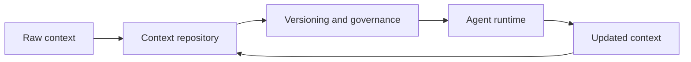

[[concepts/Explainers for AI/Context Management|Context Managers]]
[[Tooling/Software Development/Cloud Infrastructure/Cloudflare|Cloudflare]]
[[concepts/Explainers for Tooling/Distributed File Systems|Distributed File Systems]]
[[Tooling/AI-Toolkit/Agentic AI/Letta|Letta]]

# Defining and Describing Context Repositories

 

_Context repositories turn an AI agent’s context into a persistent, governed, and version-controlled asset rather than leaving it trapped inside a single prompt or session._

A **context repository** is a bounded store of information, rules, semantic definitions, or memory that an AI agent can retrieve and update for a particular domain or use case. [^mxao8p] [^et3r14] [^6zqpcj] The term currently describes at least two closely related patterns: Git-backed repositories for agent memory and portable semantic layers that define organizational data for AI systems. [^mxao8p] [^et3r14] [^05muwj] The shared idea is to externalize context so it can persist across sessions, be governed, reused across agents, and evolve independently of a model’s immediate context window. [^6zqpcj] [^oabsu4] [^0t45uv]

# Uses in Context

- **Agent memory:** Letta uses the term for local files stored in Git repositories; agents can modify, commit, and push those files so memory persists beyond one machine or session. [^mxao8p] [^05muwj]
- **Semantic data definition:** Atlan defines a context repository as “the canonical definition of what your data means for one use case” and describes it as a “portable semantic layer.” [^et3r14] [^oabsu4]
- **Governed organizational knowledge:** Context repositories can package semantic models, business logic, verified question-and-SQL pairs, and related assets for an agent. [^bj1f6v]
- **Cross-agent portability:** The concept is used for context that can be shared across agents and runtimes rather than being tied to one model or execution environment. [^0t45uv]
- **Context engineering:** Persistent repositories support the assembly, delivery, evaluation, and evolution of heterogeneous context under token constraints. [^tic36s]

# History of Use

## Origins

- The clearest documented introduction of the exact term in the available sources is Letta’s February 2026 announcement, “Introducing Context Repositories: Git-based Memory for Coding Agents.” Letta presents the concept as a redesign of agent memory based on programmatic context management and Git-backed versioning. [^05muwj]
- Sarah Wooders, a Letta researcher, described the design as storing an agent’s context in local files inside Git repositories, with changes committed and pushed before being recompiled into system prompts. [^mxao8p]
- The approach builds on earlier ideas in persistent external memory, programmatic context management, and repository-level software understanding, but the available search results do not establish a definitive earlier first use of the exact phrase. [^60f1d6] [^km4it6] [^tic36s]

## Evolution

- **2026 — Git-backed agent memory:** Letta expanded memory beyond opaque model-managed state by making context editable as files, automatically versioned through informative commits, and usable by multiple memory subagents through Git-based coordination. [^mxao8p] [^05muwj]
- **2026 — Governed semantic layers:** Atlan applied the term to bounded, use-case-specific packages containing definitions, metrics, relationships, rules, and verified examples that can be published to different data engines. [^et3r14] [^oabsu4] [^bj1f6v]
- **2026 — Persistent context infrastructure:** Research and open-source work broadened the concept toward file-system abstractions and persistent context repositories that mount, govern, assemble, and validate heterogeneous context artifacts. [^tic36s]

# Best Real-World Examples

- [Letta Context Repositories](https://www.letta.com/blog/context-repositories/) — Git-backed memory for coding agents, with versioned context and programmable memory skills. [^05muwj]
- [Atlan Context Engineering Studio](https://docs.atlan.com/product/capabilities/governance/context-engineering-studio) — Use-case-specific semantic repositories containing metrics, dimensions, relationships, and business rules. [^oabsu4]
- [Atlan Agent Memory Layer](https://docs.atlan.com/agents/concepts/memory-layer) — Governed context repositories served to agents through the Atlan MCP server. [^bj1f6v]
- [AIGNE Framework](https://github.com/AIGNE-io/aigne-framework) — An open-source implementation of persistent context infrastructure based on a file-system abstraction. [^tic36s]
- [Scroll](https://arxiv.org/html/2608.21690) — A research context manager that treats each session as a persistent executable environment backed by an event log and Python kernel. [^60f1d6]
- [Repository-level multimodal agents](https://dl.acm.org/doi/10.1145/3832783.3834363) — Research showing that visual structural context can help agents understand software repositories while reducing token consumption. [^km4it6]

# Case Studies

**[[Tooling/AI-Toolkit/Agentic AI/Letta|Letta]]’s Git-backed memory for coding agents.** In February 2026, Letta introduced Context Repositories as a redesign of memory in Letta Code. [^05muwj] The system stores context as files in Git repositories, allowing agents or subagents to modify memory programmatically and preserve changes through commits. [^mxao8p] [^05muwj] Because the repository can be pushed and synchronized, memory is no longer tied to a single machine; [[Tooling/Products/Git|Git]] also supplies version history and a mechanism for resolving competing updates. [^mxao8p] [^05muwj] The case shows how context repositories make agent memory inspectable, editable, portable, and collaborative rather than treating it as an opaque feature of a model runtime.

**Atlan’s semantic context repositories.** Atlan uses context repositories as the basic unit of work in Context Engineering Studio. [^et3r14] Each repository defines what data means for a specific use case and functions as a portable semantic layer containing elements such as metrics, dimensions, relationships, rules, and references to governed data assets. [^oabsu4] Atlan also positions these repositories as a memory layer for agents, delivered through its MCP server and distinguished from a vector database or conventional retrieval-augmented generation system. [^bj1f6v] [^0t45uv] This case demonstrates a second interpretation of the concept: not personal agent memory, but a governed package of organizational meaning that improves the reliability and portability of AI-generated answers.

**AIGNE’s persistent context infrastructure.** The AIGNE-related work proposes an agentic file-system abstraction inspired by the principle that “everything is a file.” [^tic36s] Its architecture provides uniform mounting, metadata, access control, and a pipeline for constructing, loading, and evaluating context under token constraints. [^tic36s] The persistent context repository acts as external infrastructure that captures, structures, and evolves context across sessions. [^tic36s] This case shows how the concept can expand from a storage convention into an operational layer for assembling heterogeneous context while preserving governance and verifiability.

***

# Sources

[^mxao8p]: 2026, Feb 13. [linkedin.com](https://www.linkedin.com/). [Introducing Context Repositories for Agent Memory Management](https://www.linkedin.com/posts/wooders_with-memgptletta-weve-always-tried-to-activity-7427894075543969792-F02y). Updated: 2026, Sep 20. Generated: 2026, Nov 24. [Perplexity](https://www.perplexity.ai/) API response.
[^et3r14]: [docs.atlan.com](https://docs.atlan.com/). [What is Context Engineering Studio?](https://docs.atlan.com/product/capabilities/governance/context-engineering-studio/concepts/what-is-context-engineering-studio). Updated: 2026, Nov 14. Generated: 2026, Nov 24. [Perplexity](https://www.perplexity.ai/) API response.
[^6zqpcj]: [docs.atlan.com](https://docs.atlan.com/). [llms.txt](https://docs.atlan.com/llms/platform/agents/set-up-a-memory-layer-for-ai-agents/llms.txt). Updated: 2026, Nov 22. Generated: 2026, Nov 24. [Perplexity](https://www.perplexity.ai/) API response.
[^05muwj]: 2026, Feb 12. [letta.com](https://www.letta.com/). [Introducing Context Repositories: Git-based Memory for Coding Agents](https://www.letta.com/blog/context-repositories/?ref=runtimewire). Updated: 2026, Oct 25. Generated: 2026, Nov 24. [Perplexity](https://www.perplexity.ai/) API response.
[^60f1d6]: [arxiv.org](https://arxiv.org/). [Context as an Environment: Programmatic Context Management for Long-Horizon Agents](https://arxiv.org/html/2608.21690). Updated: 2026, Aug 25. Generated: 2026, Nov 24. [Perplexity](https://www.perplexity.ai/) API response.
[^oabsu4]: [docs.atlan.com](https://docs.atlan.com/). [Context Engineering Studio](https://docs.atlan.com/product/capabilities/governance/context-engineering-studio). Updated: 2026, Nov 14. Generated: 2026, Nov 24. [Perplexity](https://www.perplexity.ai/) API response.
[^bj1f6v]: [docs.atlan.com](https://docs.atlan.com/). [Memory layer for AI agents | Atlan Documentation](https://docs.atlan.com/agents/concepts/memory-layer). Updated: 2026, Nov 05. Generated: 2026, Nov 24. [Perplexity](https://www.perplexity.ai/) API response.
[^km4it6]: 2026, Oct 07. [dl.acm.org](https://dl.acm.org/). [LLM Agents Can See Code Repositories | Proceedings of the 41st IEEE/ACM International Conference on Automated Software Engineering](https://dl.acm.org/doi/10.1145/3832783.3834363). Updated: 2026, Oct 29. Generated: 2026, Nov 24. [Perplexity](https://www.perplexity.ai/) API response.
[^0t45uv]: [docs.atlan.com](https://docs.atlan.com/). [Context layer](https://docs.atlan.com/agents/faq/context-layer). Updated: 2026, Oct 23. Generated: 2026, Nov 24. [Perplexity](https://www.perplexity.ai/) API response.
[^tic36s]: [arxiv.org](https://arxiv.org/). [Agentic File System Abstraction for Context Engineering - arXiv](https://arxiv.org/html/2512.05470). Updated: 2026, Apr 16. Generated: 2026, Nov 24. [Perplexity](https://www.perplexity.ai/) API response.
