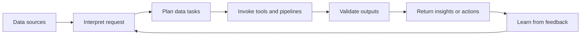

[[concepts/Data Augmentation Workflows|Data-Augmenters]]
[[Tooling/AI-Toolkit/Agentic AI/Agentic Workspaces/casuaLens|casuaLens]]
[[concepts/Explainers for AI/Agentic Employees|Agentic Employees]]
[[AI Data Teams]]

# Defining and Describing Data Agents

- _Data agents turn data work from a manual sequence of steps into an adaptive, semi-autonomous system._
- A data agent is an autonomous or semi-autonomous system that can perceive structured, semi-structured, and unstructured data, plan and execute data-management or analytical tasks, interact with people through natural language, and improve through feedback. [^e06lc8]
- Typical capabilities include semantic data organization, tool use, pipeline orchestration, memory, feedback-driven refinement, and proactive adaptation. [^ida5he]
- The term applies when software does more than answer a fixed query: it selects operations, invokes databases or analytical tools, checks intermediate outputs, and coordinates a workflow toward a goal. [^ida5he] [^e06lc8]
- Current usage remains inconsistent; the label may describe anything from a natural-language query assistant to a system intended to orchestrate end-to-end data workflows. [^ax64v1] [^dwkat8]

# Uses in Context

- **Natural-language analytics:** A user asks a business question, and the agent translates it into queries, charts, and an explanation; open-source projects describe this as turning plain-language questions into “SQL, a chart, and an explanation.” [^umg893]
- **Data preparation:** Agents can automate cleaning, transformation, inspection, and preparation tasks that traditionally require manual scripting. [^ax64v1]
- **Business intelligence:** An agent may build dashboards, monitor metrics, send alerts, and investigate anomalies rather than merely generate a one-time answer. [^2xv8lx]
- **Data science:** The term can refer to systems that act as autonomous data scientists, generating data, evaluating results, and revising their methods. [^mwqb4s]
- **Proactive discovery:** Newer systems frame analytics as a continuous loop in which agents generate hypotheses, compile executable analyses, validate artifacts, and produce visualizations or applications. [^92xg3b]
- **Data-system orchestration:** In broader usage, data agents coordinate semantic organization, operators, pipelines, memory, and feedback across a data lifecycle. [^ida5he]

# History of Use

## Origins

- The modern research usage of “data agent” is associated with the emergence of large-language-model-based systems that combine natural-language interaction with tool-using autonomy; recent surveys describe the field as an emerging paradigm for orchestrating “Data + AI ecosystems.” [^dwkat8]
- A 2026 research proposal explicitly defines the Data Agent as a paradigm for managing, processing, and analyzing data with minimal human intervention. [^ida5he]
- The concept’s early formalization is therefore better attributed to recent academic and open-source work on agentic data systems than to incumbent software vendors; the literature itself emphasizes that the terminology is still unsettled and inconsistently adopted. [^ax64v1] [^dwkat8]

## Evolution

- **Early LLM era:** Data agents initially appeared as specialized assistants for querying, preparing, and analyzing data, with autonomy concentrated in individual tasks rather than complete workflows. [^ax64v1] [^dwkat8]
- **Workflow orchestration:** Research expanded the concept to systems that plan multi-step pipelines, use semantic operators, retain memory, incorporate feedback, and optimize execution. [^ida5he] [^e06lc8]
- **Proactive and generative systems:** More recent work proposes discovery-driven analytics, in which agents generate and validate analytical objectives themselves, alongside taxonomies extending from no autonomy at Level 0 to fully autonomous or generative systems at Level 5. [^92xg3b] [^ax64v1] [^dwkat8]

# Best Real-World Examples

- [MinusX](https://hokai.io/hub/agents/minusx) — an open-source agentic BI platform that builds dashboards, answers questions, sends alerts, and investigates metric failures. [^2xv8lx]
- [Data-Analysis-Agent](https://github.com/Zafer-Liu/Data-Analysis-Agent) — an open-source assistant that accepts Excel, CSV, or database inputs and converts natural-language questions into SQL, charts, and explanations. [^umg893]
- [Datalayer](https://pydantic.dev/case-studies/datalayer) — a small startup building AI-powered data-analysis tools for Jupyter users and integrating agents directly into notebook workflows. [^m7w324]
- [Discovery Agents for Real-Time Analytics](https://arxiv.org/html/2605.27571) — a research architecture that continuously generates hypotheses, executable analytics, validation reports, visualizations, and deployable applications. [^92xg3b]
- [Autodata](https://arxiv.org/html/2606.25996v2) — a research framework in which an agent generates synthetic data, evaluates it with task-specific signals, and improves its data-generation recipe. [^mwqb4s]
- [Data Agents: Agentic Data Systems](https://arxiv.org/abs/2609.24137) — a proposed general architecture combining semantic organization, operators, orchestration, feedback, memory, and adaptation. [^ida5he]

# Case Studies

**MinusX and agent-centered business intelligence.** MinusX illustrates the shift from an analytics tool that waits for human commands to an agent-centered BI environment. Its platform is described as enabling an agent to answer questions, build dashboards, send alerts, and operate through Slack or an MCP connection; dashboards and reports are treated as files the agent can read and write, while scheduled jobs monitor metrics and investigate failures. [^2xv8lx] The example shows that a data agent is defined not only by language generation but by persistent artifacts, scheduled observation, and the ability to act across an analytical workspace. [^2xv8lx]

**Datalayer and notebook-native data science.** Datalayer is a five-person startup founded by Eric Charles, an open-source contributor associated with Apache and Jupyter. [^m7w324] The company builds AI-powered data-analysis tools on top of Jupyter, allowing data scientists to work with agents inside notebooks rather than moving analysis into a separate proprietary environment. [^m7w324] Its adoption of Pydantic AI and Logfire supported a multi-protocol agent platform with observability and integrations spanning AG-UI, ACP, [[Tooling/Software Development/Cloud Infrastructure/Vercel|Vercel]] AI, and [[Vocabulary/Agent2Agent Protocol|A2A]]. [^m7w324] The case demonstrates how smaller, open-source-oriented teams are embedding agents into established scientific workflows while emphasizing interoperability and traceability. [^m7w324]

**Discovery agents and proactive analytics.** The Discovery Agents research system describes a multi-agent architecture for real-time streams that continuously generates hypotheses, compiles them into executable analytics, validates the resulting artifacts, and produces visualizations or deployable applications. [^92xg3b] This approach explicitly reframes analytics from “task-driven” work, in which a human supplies the objective, toward “discovery-driven” work, in which the system helps generate, test, and refine objectives. [^92xg3b] The case marks a conceptual expansion of data agents from responsive assistants into systems that monitor changing data and propose investigations, while still making validation a central part of the workflow. [^92xg3b]

***

# Sources

[^ida5he]: 2026, Sep 21. [arxiv.org](https://arxiv.org/). [\[2609.24137\] Data Agents: Agentic Data Systems](https://arxiv.org/abs/2609.24137). Updated: 2026, Nov 04. Generated: 2026, Nov 06. [Perplexity](https://www.perplexity.ai/) API response.
[^e06lc8]: 2026, Aug 01. [dl.acm.org](https://dl.acm.org/). [Data Agents: Rethinking Data Systems in the AI Agent Era](https://dl.acm.org/doi/10.14778/3827998.3838708). Updated: 2026, Nov 04. Generated: 2026, Nov 06. [Perplexity](https://www.perplexity.ai/) API response.
[^92xg3b]: 2026, May 18. [arxiv.org](https://arxiv.org/). [Discovery Agents for Real-Time Analytics: Toward Proactive Insight Systems](https://arxiv.org/html/2605.27571). Updated: 2026, Jun 13. Generated: 2026, Nov 06. [Perplexity](https://www.perplexity.ai/) API response.
[^ax64v1]: 2026, May 30. [dl.acm.org](https://dl.acm.org/). [Data Agents: Levels, State of the Art, and Open Problems](https://dl.acm.org/doi/10.1145/3788853.3801878). Updated: 2026, Oct 28. Generated: 2026, Nov 06. [Perplexity](https://www.perplexity.ai/) API response.
[^mwqb4s]: 2026, Aug 24. [arxiv.org](https://arxiv.org/). [Autodata: An agentic data scientist to create high quality synthetic data](https://arxiv.org/html/2606.25996v2). Updated: 2026, Sep 15. Generated: 2026, Nov 06. [Perplexity](https://www.perplexity.ai/) API response.
[^dwkat8]: 2026, Feb 24. [searcharxiv.com](https://searcharxiv.com/). [A Survey of Data Agents: Emerging Paradigm or Overstated Hype ...](https://searcharxiv.com/abs/2510.23587). Updated: 2026, Nov 04. Generated: 2026, Nov 06. [Perplexity](https://www.perplexity.ai/) API response.
[7]: 2026, Sep 03. [opensourceforu.com](https://www.opensourceforu.com/). [www.opensourceforu.com › 2026 › 09DataAgent Raises $10M to Automate Kubernetes Repairs](https://www.opensourceforu.com/2026/09/dataagent-raises-10m-to-automate-kubernetes-repairs/). Updated: 2026, Nov 06. Generated: 2026, Nov 06. [Perplexity](https://www.perplexity.ai/) API response.
[^2xv8lx]: 2026, Oct 23. [hokai.io](https://hokai.io/). [MinusX Review: Open Source AI Data Agent for BI (2026)](https://hokai.io/hub/agents/minusx). Updated: 2026, Nov 02. Generated: 2026, Nov 06. [Perplexity](https://www.perplexity.ai/) API response.
[^umg893]: 2026, Apr 21. [github.com](https://github.com/). [GitHub - Zafer-Liu/Data-Analysis-Agent: 你的私人数据分析助手。通...](https://github.com/Zafer-Liu/Data-Analysis-Agent/tree/main). Updated: 2026, Nov 03. Generated: 2026, Nov 06. [Perplexity](https://www.perplexity.ai/) API response.
[^m7w324]: 2026, Mar 03. [pydantic.dev](https://pydantic.dev/). [How Datalayer uses Pydantic AI and Logfire to power AI agents for ...](https://pydantic.dev/case-studies/datalayer). Updated: 2026, Nov 06. Generated: 2026, Nov 06. [Perplexity](https://www.perplexity.ai/) API response.
