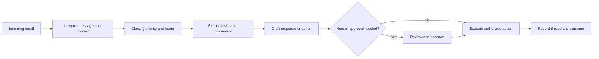

[[Tooling/AI-Toolkit/Agentic AI/Slashy|Slashy]]

[[concepts/Explainers for AI/Agentic Employees|Agentic Employees]]

[[concepts/Explainers for AI/AI Assistants|AI Assistants]]

[[concepts/Explainers for AI/AI Chief of Staff|AI Chief of Staff]]

# Defining and Describing Email Assistant Agents

- _Email assistant agents turn the inbox from a passive archive into an operational workspace._
- An **email assistant agent** is software that interprets incoming messages and can take actions such as prioritizing, labeling, summarizing, extracting tasks, drafting replies, and—when authorized—sending messages on a user’s behalf. [^k2oh9p] Unlike conventional filters, agents can combine email processing with calendars, notes, task lists, research workflows, or other business systems. [^k2oh9p]
- The concept applies wherever email contains recurring coordination work: executive support, customer operations, recruiting, sales, research, scheduling, and internal task management. [^qt3utl] [^mqof7v] Its significance lies in shifting email automation from classification toward goal-directed, multi-step execution. [^mqof7v] [^ds9pfa]

# Uses in Context

- **Inbox triage:** The agent “automatically prioritize, [s] label, [s] and sort[s] emails” to reduce manual inbox management. [^k2oh9p]
- **Message understanding:** It summarizes long conversations and extracts action items, decisions, attachments, and deadlines. [^qt3utl] [^mqof7v]
- **Response drafting:** It prepares contextually appropriate replies for review or sends them under defined permissions. [^qt3utl] [^mqof7v]
- **Scheduling and coordination:** Broader productivity agents connect email with calendars and can support scheduling workflows. [^k2oh9p] [^uq6iin]
- **Research administration:** A research agent can ask approved questions, process replies, follow up for clarification, and compile findings into a structured report. [^mqof7v]
- **Agent-to-person communication:** Infrastructure platforms give software agents dedicated email identities, inboxes, threading, parsing, and webhooks for two-way communication. [^ds9pfa] [^j7wtid]

# History of Use

## Origins

The available evidence does not identify a single academic paper or inventor who first coined the exact phrase **“Email Assistant Agents.”** The term appears to be a descriptive category formed from two earlier traditions: AI email assistants that summarize, organize, and draft messages, and autonomous agents that pursue tasks through external tools. [^k2oh9p] [^uq6iin] Recent infrastructure startups have extended the category from assisting a human’s mailbox to giving an AI agent its own email identity and conversational state. [^ds9pfa] [^j7wtid]

- Early contemporary product descriptions framed the assistant as a productivity layer inside an existing inbox, combining organization, writing, search, and scheduling. [^uq6iin]
- Newer agent-oriented systems describe email as an API-controlled environment in which an agent can send, receive, maintain threads, parse attachments, and manage permissions. [^mqof7v] [^ds9pfa] [^j7wtid]

## Evolution

- **Productivity-assistant phase:** Email AI initially emphasized summarization, smart organization, search, drafting, and scheduling for a human user. [^k2oh9p] [^uq6iin]
- **Workflow-agent phase:** Systems expanded from one-shot assistance to multi-step operations such as extracting action items, following up, tracking responses, and compiling results. [^qt3utl] [^mqof7v]
- **Agent-infrastructure phase:** Dedicated services began treating email as an operating channel for autonomous agents, with separate inboxes, webhooks, semantic search, attachment extraction, threading, and deliverability controls. [^ds9pfa] [^j7wtid] [^tqtq6x]

# Best Real-World Examples

- [Shortwave](https://www.shortwave.com/) — AI email productivity software for organizing, scheduling, writing, and searching by prompt. [^k2oh9p] [^uq6iin]
- [AgentMail](https://www.agentmail.to/) — API-first infrastructure that gives AI agents dedicated email addresses and inboxes. [^ds9pfa] [^j7wtid] [^tqtq6x]
- [Robotomail](https://robotomail.com/) — permission-aware research email agents that communicate with consenting participants and preserve conversation context. [^mqof7v]
- [Gumloop](https://www.gumloop.com/) — workflow automation platform whose email agents can triage, summarize, label, and reply across productivity workflows. [^k2oh9p]
- [Superhuman](https://superhuman.com/) — AI-native email software offering inbox assistance, triage, and faster response workflows. [^n7m1uh]
- [AppyAI Violet](https://appy.ai/channels/email) — email-based routing system that directs work to specialized AI capabilities based on message context and subject instructions. [^gqu6us]
- [Inbox Zero](https://github.com/elie222/inbox-zero) — open-source inbox-management project listed among email-agent alternatives. [^ds9pfa]

# Case Studies

**Robotomail and research correspondence.** Robotomail illustrates an email assistant agent designed around bounded autonomy rather than unrestricted outreach. A researcher supplies a brief and contacts who have explicitly agreed to participate; the agent then sends approved requests, processes replies and attachments, asks focused follow-up questions, tracks permitted reminders, and stops when permission is withdrawn. [^mqof7v] The system also gives the agent a stable email identity and preserves the conversation thread for the researcher’s review. [^mqof7v] This shows that a useful email agent is not defined only by language generation: permission scope, identity, continuity, and human oversight are part of the product itself. [^mqof7v]

**AgentMail and the infrastructure shift.** AgentMail represents a move from assistants operating inside a person’s mailbox to agents operating as first-class email participants. Its described infrastructure provides each agent with an inbox, supports sending and receiving, preserves threads, parses attachments, exposes real-time events, and enables semantic search across conversations. [^ds9pfa] [^j7wtid] The change is architectural: instead of forcing every agent to share a human’s OAuth-connected mailbox, the system supplies an email-native interface designed around autonomous software. [^ds9pfa] [^j7wtid] This case demonstrates how email assistants are becoming components in larger agent systems rather than merely features in consumer mail applications.

**AI email assistants as workflow products.** Products such as Shortwave, Superhuman, and Gumloop show the user-facing path: the inbox becomes a command surface for triage, summarization, drafting, search, and scheduling. [^k2oh9p] [^uq6iin] [^n7m1uh] Their category positioning reflects a gradual expansion from reducing reading and writing time to coordinating related work across calendars, notes, tasks, and other productivity tools. [^k2oh9p] [^uq6iin] The broader lesson is that email assistant agents gain value when they convert messages into decisions and executable work, while retaining review controls for consequential actions. [^qt3utl] [^mqof7v]

***

# Sources

[^qt3utl]: 2026, Oct 23. [shipsquad.ai](https://shipsquad.ai/). [ShipSquad — Your AI Squad, Your Mission](https://shipsquad.ai/mission/build-ai-email-assistant). Updated: 2026, Nov 03. Generated: 2026, Nov 03. [Perplexity](https://www.perplexity.ai/) API response.
[^mqof7v]: 2026, Sep 23. [robotomail.com](https://robotomail.com/). [AI Research Assistant Email Agent | Robotomail](https://robotomail.com/use-cases/research-assistant). Updated: 2026, Sep 24. Generated: 2026, Nov 03. [Perplexity](https://www.perplexity.ai/) API response.
[^k2oh9p]: 2026, Sep 03. [gumloop.com](https://www.gumloop.com/). [7 best AI email agent tools I've tested in 2026 - gumloop.com](https://www.gumloop.com/blog/ai-email-agent). Updated: 2026, Oct 28. Generated: 2026, Nov 03. [Perplexity](https://www.perplexity.ai/) API response.
[^ds9pfa]: 2026, Mar 18. [producthunt.com](https://www.producthunt.com/). [AgentMail Competitors & Alternatives (2026) | Product Hunt](https://www.producthunt.com/products/agentmail/alternatives). Updated: 2026, Nov 03. Generated: 2026, Nov 03. [Perplexity](https://www.perplexity.ai/) API response.
[^uq6iin]: 2026, Oct 01. [tooliverse.ai](https://tooliverse.ai/). [Best AI Research Assistance Tools 2026 - Tooliverse](https://tooliverse.ai/use-cases/research-assistance). Updated: 2026, Oct 31. Generated: 2026, Nov 03. [Perplexity](https://www.perplexity.ai/) API response.
[^j7wtid]: 2026, Sep 24. [aicoolies.com](https://aicoolies.com/). [AgentMail: Features, Pricing & Alternatives — aicoolies](https://aicoolies.com/tools/agentmail). Updated: 2026, Oct 15. Generated: 2026, Nov 03. [Perplexity](https://www.perplexity.ai/) API response.
[^n7m1uh]: 2026, Sep 25. [startuphub.ai](https://www.startuphub.ai/). [Superhuman - $108M Raised - Reviews & Alternatives](https://www.startuphub.ai/startups/superhuman). Updated: 2026, Nov 02. Generated: 2026, Nov 03. [Perplexity](https://www.perplexity.ai/) API response.
[^gqu6us]: 2026, Oct 27. [appy.ai](https://appy.ai/). [AI Agents for Email | Appy.AI](https://appy.ai/channels/email). Updated: 2026, Oct 28. Generated: 2026, Nov 03. [Perplexity](https://www.perplexity.ai/) API response.
[^tqtq6x]: 2026, Mar 11. [theravitshow.com](https://www.theravitshow.com/). [AgentMail Secures $6M to Build a Dedicated Email Service ...](https://www.theravitshow.com/blogs/agentmail-secures-6m-to-build-a-dedicated-email-service-for-ai-agents). Updated: 2026, Nov 03. Generated: 2026, Nov 03. [Perplexity](https://www.perplexity.ai/) API response.
[10]: 2026, Nov 02. [rightaichoice.com](https://rightaichoice.com/). [Email & Inbox Management AI Tools — Compare Options & Pricing (2026)](https://rightaichoice.com/categories/email-inbox). Generated: 2026, Nov 03. [Perplexity](https://www.perplexity.ai/) API response.
