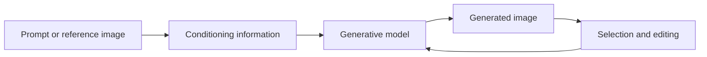

:::tool-showcase
- [[Tooling/AI-Toolkit/Model Producers/Midjourney|Midjourney]]
- [[Tooling/AI-Toolkit/Generative AI/Runway|Runway]]
- [[Tooling/AI-Toolkit/AI Interfaces/AI Workspaces/Ideogram|Ideogram]]
- [[Tooling/AI-Toolkit/Generative AI/Recraft|Recraft]]
- [[Tooling/AI-Toolkit/Generative AI/Flix AI|Flix AI]]
- [[Tooling/AI-Toolkit/Generative AI/Krea AI|Krea AI]]
- [[Tooling/AI-Toolkit/Generative AI/Higgsfield|Higgsfield]]
:::

https://youtu.be/275L653HXS0?si=-enGG-4YhMehTd7g

# Defining and Describing Image Generators

- _Image generators are systems that learn the visual structure of images and produce new images from noise, text, or other inputs._
- Image generators are a class of generative-AI systems that synthesize visual content rather than merely classify or retrieve it. Common approaches include generative adversarial networks, autoregressive transformers, and diffusion models. [^9sndmo] [^zubm22] [^sdxgd6]
- In a typical text-to-image workflow, a text encoder represents the prompt, a generative model constructs an image representation, and a decoder or upsampler produces the final image. DALL·E 2 used CLIP-related representations and a hierarchical diffusion pipeline, while Imagen used a large pretrained T5 text encoder with cascaded diffusion. [^sdxgd6] [^1cl278]
- Diffusion-based generators begin with random noise and iteratively remove it, learning to reverse a process that gradually corrupts an image with Gaussian noise. [^9sndmo] [^sdxgd6] [^exix41]
- The concept applies to creative production, design exploration, visual prototyping, advertising, entertainment, education, and research. Its importance comes from reducing the time and cost required to create or iterate visual material, while introducing concerns about provenance, bias, copyright, and misuse. [^aj79zu] [^z161mq]

# Uses in Context

- **Creative ideation:** Designers invoke image generators to explore multiple visual directions from a short description or reference image. Krea.ai, for example, is described as offering real-time image and video generation for artists and marketers. [^z161mq]
- **Text-to-Image production:** The term commonly refers to systems that convert natural-language prompts into images, including DALL·E, Imagen, and [[Tooling/AI-Toolkit/Models/Stable Diffusion|Stable Diffusion]]. [^aj79zu] [^6dblzh]
- **Image variation and editing:** Generators can create variations, extend compositions, or modify selected regions rather than producing an image entirely from scratch. The broader development of text-to-image systems has expanded image generation beyond unconditional synthesis. [^6dblzh] [^1cl278]
- **Commercial content creation:** Businesses use generators for marketing imagery, product concepts, campaign exploration, and other visual assets; startup and digital-native use cases include personalized model training and real-time creative tools. [^z161mq]
- **Technical research:** In machine learning, “image generation” describes experiments in modeling image distributions, comparing fidelity, diversity, controllability, and sampling efficiency. [^9sndmo] [^zubm22] [^exix41]

# History of Use

## Origins

- The modern technical lineage includes variational autoencoders, generative adversarial networks, and diffusion models. The GAN framework was introduced by Ian Goodfellow and collaborators in the 2014 paper *Generative Adversarial Nets*, which defined a generator that creates samples and a discriminator that distinguishes generated samples from real data. [^zubm22] [^zp3ni2]
- Diffusion-based generation traces to Sohl-Dickstein and collaborators’ 2015 formulation, which framed generation as reversing a fixed Gaussian noising process. [^9sndmo]
- Ho, Jain, and Abbeel formalized denoising diffusion probabilistic models in 2020 by training a network to predict noise and sampling through iterative denoising. [^zubm22]
- Text-to-image generation became a distinct mainstream research direction with OpenAI’s *Zero-Shot Text-to-Image Generation*, which described DALL·E as a 12-billion-parameter autoregressive transformer modeling text and discrete image tokens in a single sequence. [^1cl278]

## Evolution

- **2014 — Adversarial generation:** GANs introduced a generator–discriminator competition that produced sharp synthetic images, especially in relatively narrow domains such as faces. [^zubm22] [^1cl278]
- **2020–2021 — Diffusion overtakes GAN-based synthesis:** Diffusion models offered a comparatively stable training objective and strong image quality, although their iterative sampling initially made them slower. [^w27tlx] [^exix41]
- **2021–2022 — Latent and language-conditioned systems:** Latent diffusion moved denoising into a compressed representation, reducing computational requirements; DALL·E 2, Imagen, and related systems demonstrated high-quality text-conditioned generation. [^6dblzh] [^sdxgd6] [^1cl278]
- **2022 onward — Accessible and open generation:** Stable Diffusion helped bring high-quality generation to consumer hardware through latent diffusion, while diffusion systems such as DALL·E 2 and Imagen became prominent research and product reference points. [^7e2v4k] [^1cl278]

# Best Real-World Examples

- [Generative Adversarial Networks](https://arxiv.org/abs/1406.2661) — The foundational adversarial framework introduced by Goodfellow and collaborators in 2014. [^zubm22] [^zp3ni2]
- [Denoising Diffusion Probabilistic Models](https://arxiv.org/abs/2006.11239) — A diffusion formulation that generates images through repeated denoising steps. [^zubm22] [^exix41]
- [DALL·E](https://arxiv.org/abs/2102.12092) — An autoregressive text-to-image model that represented text and discrete image tokens in one sequence. [^1cl278]
- [DALL·E 2](https://openai.com/index/dall-e-2/) — A text-to-image system using CLIP-related representations and a hierarchical diffusion pipeline. [^sdxgd6]
- [Imagen](https://arxiv.org/abs/2205.11487) — A text-to-image system combining a large T5 text encoder with cascaded diffusion upsampling. [^sdxgd6] [^1cl278]
- [Stable Diffusion](https://arxiv.org/abs/2112.10752) — A latent-diffusion approach designed to make high-resolution synthesis more computationally accessible. [^1cl278]
- [Krea.ai](https://www.krea.ai/) — A creative suite offering real-time image and video generation and personalized model training for artists and marketers. [^z161mq]

# Case Studies

**[[Sources/People/Ian Goodfellow]]’s GAN framework, 2014.** Ian Goodfellow and collaborators introduced a two-network training setup in which a generator produced synthetic samples while a discriminator attempted to identify them as fake. [^zubm22] [^zp3ni2] The adversarial objective made it possible to learn sharp image distributions without directly specifying a pixel-by-pixel reconstruction target. GANs subsequently became a major approach for realistic image synthesis, particularly in constrained domains such as faces, although later diffusion methods addressed important limitations in training stability and distribution coverage. [^w27tlx] [^1cl278] The case shows that a foundational image-generation innovation originated in an academic research collaboration rather than as a product announcement from a large platform company.

**Latent diffusion and [[Tooling/AI-Toolkit/Models/Stable Diffusion|Stable Diffusion]], 2021–2022.** Rombach and collaborators’ latent-diffusion approach moved the diffusion process from raw pixels into a compressed latent space, lowering the computational burden of image synthesis. [^1cl278] Stable Diffusion became a prominent example of this approach and helped make high-quality text-to-image generation practical on consumer hardware. [^1cl278] Its significance was not only image quality but also accessibility: the underlying method demonstrated how representation compression could broaden participation in image-generation development beyond organizations with the largest compute budgets. The case illustrates how an academic method and an openly distributed implementation can accelerate adoption across creative and technical communities.

**[[Tooling/AI-Toolkit/Generative AI/Krea AI|Krea AI]] and real-time creative tooling.** Krea.ai represents a later application-oriented direction in which image generation is integrated into a broader creative suite rather than presented only as a standalone research model. [^z161mq] The service is described as supporting real-time image and video generation and personalized model training for artists and marketers. [^z161mq] This shifts the practical meaning of “image generator” from a prompt-to-picture tool toward an interactive workflow for exploration, iteration, and brand-specific production. The case demonstrates how smaller creative-tool companies can adapt underlying generative research into specialized interfaces and workflows for professional users. [^z161mq]

***

# Sources

[^9sndmo]: [Unconditional Image Generation Models | AI Wiki](https://aiwiki.ai/wiki/unconditional_image_generation_models)
[^aj79zu]: [An Analysis of Text-to-image Models of OpenAI, Stability AI, and Google](https://drpress.org/ojs/index.php/mmaa/article/view/33768)
[^6dblzh]: [2302/2302.13153.md · huggingchat/papers-content](https://huggingface.co/buckets/huggingchat/papers-content/tree/2302/2302.13153.md)
[^w27tlx]: [GANs, Explained — The Counterfeiter and the Detective | Vibe Engines](https://vibeengines.com/paper/gans)
[^7ejg0d]: [Understanding Multimodal Learning Models | PDF - Scribd](https://www.scribd.com/document/967476253/Multi-Models)
[^zubm22]: [GAN | AI Wiki](https://aiwiki.ai/wiki/gan)
[^7e2v4k]: [Exploring the evolution of generative adversarial network ...](https://link.springer.com/article/10.1007/s44163-026-01991-w?error=cookies_not_supported&code=d6645b2e-e659-4f20-8f4e-4a4a71178e7e)
[^2kq2na]: [nielsr/arxiv-chandra-ocr-full-markdown-20260406](https://huggingface.co/buckets/nielsr/arxiv-chandra-ocr-full-markdown-20260406/tree/2408/2408.07009.md)
[^z161mq]: [150 AI use cases from leading startups and digital natives](https://cloud.google.com/blog/topics/startups/150-ai-use-cases-leading-startups-and-digital-natives)
[^sdxgd6]: [Image Generation Models: A Technical History | Home](https://rozbeh.github.io/myposts/2026/03/08/image-generation-models.html)
[^zp3ni2]: [Generative adversarial network | AI Wiki](https://www.aiwiki.ai/wiki/generative_adversarial_network)
[^3jif6w]: [The Principles of Diffusion Models | alphaXiv](https://www.alphaxiv.org/abs/2510.21890)
[^1cl278]: [Text-to-Image Generation Explained | MemX](https://memx.app/glossary/text-to-image/)
[^exix41]: [Beyond image generation: visual data analysis with diffusion models ...](https://link.springer.com/article/10.1007/s10462-026-11615-5?error=cookies_not_supported&code=5895c3e9-244b-4754-aebb-8486b46134a2)
[^2awiud]: [PatrickWiloak/genai-research-papers-summarized - GitHub](https://github.com/PatrickWiloak/genai-research-papers-summarized)

# Defining and Describing Image Generators

- 

_Image generators are systems that turn learned visual patterns into new images, often from text, reference images, sketches, or other controls._

Image generators are machine-learning models or applications that synthesize visual content rather than merely retrieve existing pictures. Modern systems commonly use diffusion, generative adversarial, autoregressive, or related architectures; text-to-image systems additionally align language with visual con [^9sndmo] [^aj79zu][1][2] They apply when users need novel imagery, variations, edits, mockups, illustrations, or synthetic training data, and they matter because they move parts of visual production from manual construction toward prompt-based generation and iterative sele [^9sndmo]o [^exix41]][14]

# Uses in Context

- In **creative production**, “text-to-image” describes systems that convert natural-language prompts into visual outputs, including DALL-E 2, Stable Diffusion, and I [^6dblzh]en.[3]
- In **design**, image generators are used for ideation, visual exploration, concept art, and rapid variations before a final human-directed design is prod. [^exix41][14]
- In **image editing**, the same model family can support controlled modification, inpainting, outpainting, and composition changes rather than only generating an image from no [^9sndmo]ng.[1]
- In **research**, image generators are evaluated as generative models that learn a data distribution and sample new images from it; GANs do this through competition between a generator and discrimi [^aj79zu]o [^3jif6w]][12]
- In **synthetic-data production**, generated images can provide additional visual examples for computer-vision systems and experiments, although their usefulness depends on fidelity, diversity, and lice [^9sndmo]ng.[1]
- In **popular culture**, “AI-generated art” commonly refers to images made with systems such as Midjourney, Stable Diffusion, and other prompt-driven tools that became broadly visible in [^7e2v4k]22.[7]

# History of Use

## Origins

- The modern technical lineage includes variational autoencoders, generative adversarial networks, normalizing flows, autoregressive models, transformers, and diffusion me [^9sndmo]ds.[1]
- Ian Goodfellow and collaborators introduced **generative adversarial networks** in the 2014 paper *Generative Adversarial Nets*. The approach uses a generator that creates samples and a discriminator that attempts to distinguish generated samples from real [^6dblzh]t [^3jif6w]][12]
- Diffusion-based generation was introduced in foundational form by Sohl-Dickstein and collaborators in 2015, while denoising diffusion probabilistic models later provided a practical route to high-quality image synth [^sdxgd6] [^exix41]][14]
- Early AI visual-art work also predates contemporary neural image generators: Harold Cohen began developing the AARON system in the late [^7e2v4k]0s.[7]

## Evolution

- **2014 — Adversarial generation:** GANs made it possible to generate visually convincing images by training a generator and discriminator in competition, though training could be unstable and prone to mode collap[^z [^6dblzh]mq][3][9]
- **2020–2021 — Diffusion and language–vision alignment:** DDPM-style denoising and language–image representation methods established the technical basis for later high-quality text-to-image system [^exix41]][14]
- **2022 — Consumer-scale text-to-image generation:** DALL-E 2, Imagen, Midjourney, and Stable Diffusion brought prompt-driven image synthesis into widespread public use; Stable Diffusion’s latent-diffusion approach was released through work involving Stability AI, CompVis, and Runwa [^exix41]][14]

# Best Real-World Examples

- [Stable Diffusion](https://stability.ai/) — a source-available latent-diffusion image generator associated with Stability AI, CompVis, and R [^7e2v4k]ay.[7]
- [Midjourney](https://www.midjourney.com/) — a 2022 text-to-image service that helped popularize prompt-driven visual cre [^7e2v4k]on.[7]
- [DALL-E](https://openai.com/dall-e-3) — an autoregressive and later diffusion-based family demonstrating controlled text-to-image gener [^zubm22]o [^exix41]][14]
- [Imagen](https://imagen.research.google/) — a text-to-image diffusion system reported by Google researchers in [^aj79zu] [^6dblzh][2][3]
- [VQGAN-CLIP](https://github.com/nerdyrodent/VQGAN-CLIP) — an open-source approach that combined a visual generator with CLIP-based text guidance and influenced early creator experiment [^7e2v4k]on.[7]
- [GANs](https://papers.nips.cc/paper/5423-generative-adversarial-nets) — the generator–discriminator framework that shaped image synthesis research during the 2. [^3jif6w][12]
- [DreamFusion](https://dreamfusion3d.github.io/) — a research finding showing how a pretrained text-to-image model could guide optimization of 3D representations from . [^sdxgd6][10]

# Case Studies

**Stable Diffusion and the shift from laboratory research to accessible tooling.** In 2022, Stable Diffusion emerged from latent-diffusion research associated with the CompVis group, Stability AI, and R [^7e2v4k]ay.[7] Latent diffusion reduces the computational burden by performing the denoising process in a compressed representation rather than directly in full-resolution pixel space, while retaining text conditioning through language–image representa [^zubm22]n [^exix41]][14] Its source-available distribution enabled broader experimentation, customization, and fine-tuning than a purely closed hosted service, including later use of techniques such as LoRA for adapta. [^2awiud][15] The case shows how an open or source-available release can change an image generator from a specialist research artifact into a general-purpose creative platform.

**GANs and the first major neural image-generation paradigm.** Goodfellow and collaborators’ 2014 work framed image synthesis as a minimax game: the generator sought to produce convincing samples while the discriminator sought to identify generated [^aj79zu]e [^3jif6w]][12] This design produced strikingly realistic outputs, particularly in constrained domains such as human faces, but adversarial training could be unstable and susceptible to mode collap[^z [^6dblzh]mq][3][9] Diffusion models later displaced GANs as the dominant approach for many high-quality image-generation tasks because iterative denoising offered a more stable and scalable training pa[^z [^2kq2na]mq][8][9] The case illustrates that “image generator” names a changing family of methods rather than one permanent architecture.

**Text-to-image systems and mass adoption in 2022.** DALL-E 2, Imagen, Midjourney, and Stable Diffusion appeared or gained major visibility during the same period, combining language conditioning with generative image synthesis.[ [^exix41]][14] Their significance was not only technical performance: natural-language prompting made visual generation accessible to people without conventional illustration or 3D-production skills. The resulting transition expanded image generators from research benchmarks into design ideation, entertainment, marketing, and everyday creative experimentation, while also raising questions about training data, authorship, resemblance, and the boundary between generation and editing.

***

# Sources

[^9sndmo]: [[2603.07455] Image Generation Models: A Technical History - arXiv](https://arxiv.org/abs/2603.07455)
[^aj79zu]: [Exploring the evolution of generative adversarial network architectures for text to image synthesis a comprehensive review - Discover Artificial Intelligence](https://link.springer.com/article/10.1007/s44163-026-01991-w?error=cookies_not_supported&code=e72b8566-b015-4802-a452-7a07db90976d)
[^6dblzh]: [www.frontiersin.org › journals › artificial-intelligenceWhat you see is not what you get anymore: a mixed-methods ... -...](https://www.frontiersin.org/journals/artificial-intelligence/articles/10.3389/frai.2025.1707336/full)
[^w27tlx]: [IJEM V14 N1 - Generation of Images from Text Using AI: A Study on GANs](https://www.studocu.com/in/document/srm-university/btech/ijem-v14-n1-generation-of-images-from-text-using-ai-a-study-on-gans/144866534?origin=related-document)
[^7ejg0d]: [Exploring the evolution of generative adversarial network ...](https://link.springer.com/article/10.1007/s44163-026-01991-w?error=cookies_not_supported&code=56d2c1e1-d8f3-4bd0-b16e-73b761645c2a)
[^zubm22]: [Image Generation Models: A Technical History | alphaXiv](https://www.alphaxiv.org/abs/2603.07455)
[^7e2v4k]: [Artificial intelligence visual art](https://www.dl1.en-us.nina.az/Artificial_intelligence_art.html)
[^2kq2na]: [A Comparative Analysis of Text-to-Image Generation Models](https://www.ijraset.com/research-paper/comparative-analysis-of-text-to-image-generation-models)
[^z161mq]: [An Evolution from Atomic Mapping to Agentic World Modeling](https://arxiv.org/html/2604.28185v2)
[^sdxgd6]: [A survey of generation, segmentation and editing by artificial ...](https://academic.oup.com/jcde/article/13/1/1/8340357)
[^zp3ni2]: [AI-Driven Visual Generation: Generative Adversarial Neural Network ...](https://portalinvestigacion.udc.gal/documentos/69679e649e41074a91301748)
[^3jif6w]: [GAN Paper Deep Dive: How Generative Adversarial Networks Ushered in the Era of AI-Generated Content](https://www.youngju.dev/blog/ai-papers/gan_generative_adversarial_networks.en)
[^1cl278]: [画像生成モデルの歴史｜DopingConsomme - note](https://note.com/dopingconsomme/n/n5a8f875e541c)
[^exix41]: [3. Autoregressive Models](https://www.tapflare.com/articles/ai-image-generation-models)
[^2awiud]: [Images: Our selection of the best generative AI tools of 2025](https://aivancity.ai/en/blog/images-notre-selection-des-meilleurs-outils-ia-generatives-de-2025/?amp=1)

# Defining and Describing Image Generators

- [IMAGE 1: A text-to-image generation interface showing a prompt, model settings, and several generated outputs]
- _Image generators turn written or other structured instructions into visual outputs by learning statistical patterns from image–text data._
- An image generator is an artificial-intelligence system that creates or transforms images from inputs such as text prompts, reference images, masks, sketches, or structured controls. Modern systems commonly use diffusion: they begin with noise and iteratively denoise it into a coh [^aj79zu] [^2kq2na]image.[2][8]
- Diffusion models became prominent because their iterative denoising process offered greater training stability and image quality than earlier generative [^aj79zu]proaches.[2]
- The concept applies to illustration, photography simulation, design exploration, editing, visualization, and research; its importance lies in lowering the cost and technical barrier of producing visual drafts while raising questions about authorship, training data, and market subs[^zubm22 [^6dblzh] [^sdxgd6][3][6][10]

# Uses in Context

- **Creative ideation:** Designers and artists invoke image generators to produce rapid visual alternatives before committing to a final composition; diffusion systems are especially suited to iterative synthesis [^aj79zu] [^2kq2na]noise.[2][8]
- **Text-to-image production:** A user describes a scene, subject, style, or composition in natural language, and the system generates candidate images from that [^7ejg0d]cription.[5]
- **Image editing:** Systems can modify an existing image through masking, conditioning, or related controls rather than creating an entirely [^aj79zu]w canvas.[2]
- **Commercial visualization:** Organizations use generated imagery for concepts, advertising experiments, product mockups, and other visual-development tasks; the resulting use can create legal questions when training data or outputs resemble protect[^z [^6dblzh]22]works.[3][6]
- **Public discourse about authorship:** The phrase often appears in debates over whether prompting constitutes sufficient human creativity, with legal outcomes differing across jurisdi [^7ejg0d]dxgd6]ns.[5][10]

# History of Use

## Origins

- Diffusion-based image generation grew from work on stochastic processes and non-equilibrium thermodynamics, later adapted into machine learning; Ho and collaborators formalized a practical framework in *Denoising Diffusion Probabilis [^2kq2na] Models*.[8]
- Ho et al.’s 2020 work introduced diffusion models as an image-generation approach based on iterative denoising, while later work by Dhariwal and Nichol demonstrated that diffusion models could surpass GANs in im [^aj79zu] quality.[2]
- Early high-capacity systems required substantial computing resources, which initially concentrated development among organizations able to train large models; later open-source releases broadened access to th [^aj79zu]echnique.[2]

## Evolution

- **2020–2021 — Diffusion becomes a leading image-synthesis method:** The denoising formulation of Ho et al. and subsequent quality improvements established diffusion as a central approach to image [^aj79zu] [^2kq2na]ation.[2][8]
- **2021–2022 — Text conditioning expands the medium:** Systems such as DALL-E and other text-to-image models connected natural-language prompts with image synthesis, making image generation accessible beyond specialist machine-learnin [^aj79zu]orkflows.[2]
- **2022 onward — Open and commercial ecosystems mature:** Stable Diffusion helped make text-to-image generation available through an open model ecosystem, while disputes over scraped training images, attribution, and output copyright became central to t [^zubm22]field [^7e2v4k]dxgd6][6][7][10]

# Best Real-World Examples

- [Stable Diffusion](https://stability.ai/stable-image) — an open model ecosystem that made text-to-image generation broadly accessible and became a focal point in copyright li [^zubm22] [^7ejg0d]e2v4k]on.[5][6][7]
- [DALL-E](https://openai.com/dall-e-3) — a text-to-image system representing the transition from research-scale generation to widely used prompt-based ima [^aj79zu]creation.[2]
- [Midjourney](https://www.midjourney.com/) — a commercial image-generation service frequently discussed alongside Stability AI and other model developers in disputes over training data and art [^zubm22]ic style.[6]
- [Imagen](https://imagen.research.google/) — a diffusion-based text-to-image research system cited as an important example of high-quality text-conditione [^w27tlx]ynthesis.[4]
- [DreamFusion](https://dreamfusion3d.github.io/) — a research finding that used a pretrained 2D diffusion model to guide 3D generation without an explicit 3D-im [^w27tlx] dataset.[4]
- [LAION-5B](https://laion.ai/blog/laion-5b/) — a large image–text dataset associated with the open model ecosystem and cited in litigation concerning the use of internet-scraped artworks f [^zubm22]training.[6]
- [Beijing Internet Court Stable Diffusion case](https://www.wipo.int/web-publications/learning-machines-an-introduction-to-ai-and-ip-for-small-and-medium-sized-enterprises/en/the-ai-and-ip-landscape.html) — a legal example in which the court treated a prompted AI-generated image as an original work under Chinese copy [^sdxgd6]t law.[10]

# Case Studies

**Stable Diffusion and the opening of image generation.** Stability AI’s Stable Diffusion exemplified a shift from closed, resource-intensive systems toward a more accessible model ecosystem. Its use of text prompts to produce images made the technology available to a much wider group of artists, developers, and small teams, while also enabling derivative tools and workflows built around an openly distribut[^z [^7ejg0d]22]model.[5][6] The same openness intensified disputes about training data: artists alleged that models connected with Stability AI, Midjourney, DeviantArt, and Runway had been trained on billions of scraped artworks, including material associated wi [^zubm22]LAION-5B.[6] The case shows that democratizing access to a generative tool can expand experimentation while transferring unresolved questions about consent, provenance, and compensation into the wider ecosystem.

**Diffusion models and the replacement of GAN-centered workflows.** Ho et al.’s 2020 diffusion formulation reframed image synthesis as a controlled denoising process, and later work by Dhariwal and Nichol showed that diffusion models could achieve superior image qual [^aj79zu] [^2kq2na] GANs.[2][8] This technical progression changed the field’s default architecture: rather than treating image generation primarily as one-shot adversarial competition, researchers increasingly treated it as iterative refinement from noise. The case demonstrates how an academic method can become an industry-wide paradigm when it combines stable optimization with strong percept [^aj79zu] results.[2]

**Stable Diffusion and authorship in court.** In a 2023 Beijing Internet Court case, a plaintiff used Stable Diffusion to create a portrait through multiple positive and negative textual prompts, published it online, and later challenged another person’s reuse of the [^7ejg0d]dxgd6]ge.[5][10] The court treated the generated image as copyrightable and recognized the prompting process as evidence of human creative contribution under Chine [^7ejg0d]dxgd6]aw.[5][10] This outcome does not establish a universal rule: legal treatment varies by jurisdiction, and other disputes focus on whether training models on copyrighted works or generating substantially similar outputs infringes existin[^z [^6dblzh]22] [^7e2v4k]ts.[3][6][7] The case illustrates that image generators are not merely production tools; they also test established definitions of authorship, originality, copying, and fair use.

***

# Sources

[^9sndmo]: 2026, Oct 08. [dl.acm.org](https://dl.acm.org/). [Tracing the roots | Proceedings of the 39th International Conference on Neural Information Processing Systems](https://dl.acm.org/doi/10.52202/085713-3339). Updated: 2026, Oct 30. Generated: 2026, Nov 05. [Perplexity](https://www.perplexity.ai/) API response.
[^aj79zu]: 2026, Jun 18. [link.springer.com](https://link.springer.com/). [Beyond image generation: visual data analysis with diffusion models ...](https://link.springer.com/article/10.1007/s10462-026-11615-5?error=cookies_not_supported&code=5895c3e9-244b-4754-aebb-8486b46134a2). Updated: 2026, Sep 22. Generated: 2026, Nov 05. [Perplexity](https://www.perplexity.ai/) API response.
[^6dblzh]: 2026, Nov 02. [lawnews.nz](https://lawnews.nz/). [Why copyright has become a major legal minefield in the age of AI - Law News](https://lawnews.nz/intellectual-property/why-copyright-has-become-a-major-legal-minefield-in-the-age-of-ai/). Updated: 2026, Nov 04. Generated: 2026, Nov 05. [Perplexity](https://www.perplexity.ai/) API response.
[^w27tlx]: 2026, Jan 02. [academic.oup.com](https://academic.oup.com/). [A survey of generation, segmentation and editing by artificial ...](https://academic.oup.com/jcde/article/13/1/1/8340357). Updated: 2026, Nov 05. Generated: 2026, Nov 05. [Perplexity](https://www.perplexity.ai/) API response.
[^7ejg0d]: 2026, Nov 02. [cambridge.org](https://www.cambridge.org/). [Digital Alchemy? Rethinking Copyright in the Age of AI- ...](https://www.cambridge.org/core/journals/german-law-journal/article/digital-alchemy-rethinking-copyright-in-the-age-of-aigenerated-content-lessons-and-reflections-from-the-ai-value-chain/F0FBA77196AEE8E24D6DABAF17CD8BE3). Generated: 2026, Nov 05. [Perplexity](https://www.perplexity.ai/) API response.
[^zubm22]: 2026, Mar 16. [Reuters](https://www.reuters.com/). [COMMENTARY: Copyright Law in 2025: Courts begin to draw lines around AI training, piracy, and market harm](https://www.reuters.com/legal/legalindustry/copyright-law-2025-courts-begin-draw-lines-around-ai-training-piracy-market-harm--pracin-2026-03-16/). Updated: 2026, Sep 30. Generated: 2026, Nov 05. [Perplexity](https://www.perplexity.ai/) API response.
[^7e2v4k]: 2026, May 18. [orfonline.org](https://www.orfonline.org/). [AI, Copyright, and the Future of Creativity](https://www.orfonline.org/research/ai-copyright-and-the-future-of-creativity). Updated: 2026, Nov 02. Generated: 2026, Nov 05. [Perplexity](https://www.perplexity.ai/) API response.
[^2kq2na]: 2026, Aug 17. [news.climate.columbia.edu](https://www.news.climate.columbia.edu/). [how diffusion models work in ai image generation](https://www.news.climate.columbia.edu/ai-image-generation-f7b568). Updated: 2026, Oct 29. Generated: 2026, Nov 05. [Perplexity](https://www.perplexity.ai/) API response.
[^z161mq]: 2026, Feb 05. [academic.oup.com](https://academic.oup.com/). [TDiff-HSI: Tucker-guided diffusion for high-dimensional RGB-to-HSI image generation](https://academic.oup.com/jcde/article/13/2/197/8454921?guestAccessKey=). Updated: 2026, Oct 23. Generated: 2026, Nov 05. [Perplexity](https://www.perplexity.ai/) API response.
[^sdxgd6]: 2026, Jul 08. [wipo.int](https://www.wipo.int/). [Learning Machines: An introduction to AI and IP for small and medium-sized enterprises - The AI and IP landscape](https://www.wipo.int/web-publications/learning-machines-an-introduction-to-ai-and-ip-for-small-and-medium-sized-enterprises/en/the-ai-and-ip-landscape.html). Updated: 2026, Oct 26. Generated: 2026, Nov 05. [Perplexity](https://www.perplexity.ai/) API response.
