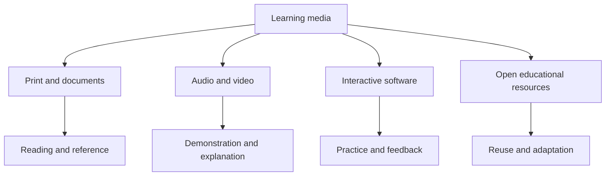

---
aliases:
  - Tutorials
  - Online Courses
date_created: 2026-07-24
date_modified: 2026-10-13
site_uuid: e8547419-5652-4c15-af84-9d5eae703ded
publish: true
title: Learning Media
slug: learning-media
at_semantic_version: 0.0.0.1
tags:
  - Course-Generators
  - Data-Formats
  - Document-Formats
cf_last_run: 2026-10-13T20:19:42.550Z
cf_last_run_model: Perplexity sonar-pro
---

# Defining and Describing Learning Media

- [IMAGE 1: Collage showing a textbook, instructional video, educational podcast, interactive simulation, and open educational resource]
- _Learning media is the set of channels, formats, and artifacts that carry instructional content and make learning possible._
- In educational usage, media include components of a learner’s environment that stimulate learning, while instructional media specifically communicate messages or contain material intended to teach. [^k3fezo] The category therefore spans print, audio, video, diagrams, animation, software, simulations, quizzes, digital books, and learning platforms. [^k3fezo] [^jd1w3z] [^5wkqe9]
- Learning media applies wherever teaching depends on representation or mediation rather than direct experience: formal classrooms, online courses, workplace training, informal communities, and self-directed study. [^xbn57u] [^pf5b9p] [^e7w5sf]
- Its significance lies in matching representation to learning purpose: diagrams can clarify scientific ideas, video can demonstrate processes, audio can support pronunciation, and interactive formats can provide practice and feedback. [^jd1w3z] [^5wkqe9]

# Uses in Context

- **Classroom instruction:** Educators use broadcast clips, historical footage, and television programmes to supply context, prompt discussion, and generate coursework ideas. [^2o81ms]
- **Digital courses:** E-learning commonly refers to employee learning delivered partly or entirely through digital technology, often through an LMS or web-based training environment. [^e7w5sf]
- **Microlearning:** Short instructional videos paired with retrieval quizzes are used to teach one concept at a time in corporate training. [^pf5b9p]
- **Interactive learning:** Educational apps can combine text, images, audio, animation, and quizzes in a single learning experience. [^5wkqe9]
- **Open education:** Freely licensed images, videos, audio recordings, maps, diagrams, presentations, and scanned documents can be incorporated into lessons across disciplines. [^jd1w3z]
- **Informal learning:** Social-media platforms have enabled classroom backchannels, professional learning networks, and communities of practice, even though learning was not necessarily their original design purpose. [^xbn57u]

# History of Use

## Origins

- The term’s conceptual roots lie in the broader idea of media as an intermediary or carrier. A commonly cited educational formulation defines media as “various types of components in the learner’s environment that can stimulate learning,” while instructional media transmit learning messages or content. [^k3fezo]
- The available sources do not establish a single first publication or uncontested individual origin for the exact English term **Learning Media**. Instead, the concept developed within educational-media theory, where communication channels and learning materials were analyzed according to their ability to support instruction. [^k3fezo]

## Evolution

- **1990s–2000s — From materials to designed learning environments:** Definitions expanded beyond physical teaching aids toward any environmental component capable of stimulating learning, including organized instructional content and mediated experiences. [^k3fezo]
- **2010s — Multimedia and mobile delivery:** Learning products increasingly combined text, images, audio, animation, and interactive quizzes, including Android-based educational applications. [^5wkqe9]
- **2020s — Networked, open, and adaptive ecosystems:** Learning media now includes social platforms, open-license repositories, microlearning sequences, simulations, and data-informed digital training rather than a single file or channel. [^xbn57u] [^pf5b9p] [^jd1w3z] [^zdgf49]

# Best Real-World Examples

- [Wikimedia Commons](https://commons.wikimedia.org/) — an open repository whose images, videos, audio, maps, diagrams, presentations, and scanned documents can support lessons across disciplines. [^jd1w3z]
- [Sumber Pembelajaran Terbuka](https://diff.wikimedia.org/2026/06/22/wikimedia-commons-turning-everyday-media-into-shared-learning/) — an initiative curating openly licensed Wikimedia images, videos, and 3D models for science education. [^jd1w3z]
- [Wiki Loves Fish](https://diff.wikimedia.org/2026/06/22/wikimedia-commons-turning-everyday-media-into-shared-learning/) — a participatory project in which students identify, photograph, and upload fish images for educational use. [^jd1w3z]
- [Smart Apps Creator history application](https://journal.uns.ac.id/index.php/ijolii/article/view/3608) — an Android learning application combining historical text, images, audio, animation, and interactive quizzes. [^5wkqe9]
- [BBC educational broadcasts](https://era.org.uk/teacher-resources/case-studies/) — broadcast material used to provide historical context, stimulate discussion, and inspire interest in engineering and robotics. [^2o81ms]
- [Microlearning deployment](https://www.ppsinternational.net/resources/case-studies/digital-microlearning-a-case-study) — short explanatory videos followed by retrieval quizzes in corporate training. [^pf5b9p]

# Case Studies

**Open media as participatory learning.** Wikimedia Commons can function not merely as a repository but as a learning medium when students create and contribute materials. In the Wiki Loves Fish initiative, students learned to identify fish species, photograph them, and upload their images for educational use. [^jd1w3z] The activity changes media from a finished instructional object into a cycle of observation, documentation, publication, and reuse. It demonstrates that learning media can support production and knowledge-sharing as well as consumption. [^jd1w3z]

**Multimedia history learning on Android.** A study of an Android-based history-learning product describes an application built with Smart Apps Creator and containing historical materials, images, audio, animations, and interactive quizzes. [^5wkqe9] This design integrates several representational modes inside one portable application rather than treating text, audiovisual material, and assessment as separate resources. [^5wkqe9] The case illustrates how learning media increasingly combines explanation, demonstration, and learner interaction in a single digital environment.

**Broadcast media in classroom practice.** Educational broadcasters and teachers have used programmes such as *Inside the Factory*, historical television clips, and *Robot Wars* to save planning time, prompt classroom discussion, provide historical context, and inspire interest in robotics. [^2o81ms] The instructional value comes from the teacher’s framing and the learner activity surrounding the clip, not simply from the existence of video. [^2o81ms] This case shows that learning media is best understood as part of a pedagogical arrangement: content, channel, teacher mediation, and learner response work together. [^2o81ms]

***

# Sources

[^xbn57u]: [Editorial: Rethinking the Role of Social Media in Learning](https://www.frontiersin.org/journals/education/articles/10.3389/feduc.2026.2015852/full)
[2]: [Interactive Software...](https://www.firstmedia.co.uk/blog/interactive-elearning-examples/)
[^k3fezo]: [Media Pembelajaran: Definisi, Manfaat, dan Perkembangannya](https://www.studocu.id/id/document/universitas-amikom-purwokerto/interactive-learning-media/media-pembelajaran-definisi-manfaat-dan-perkembangannya/158224566)
[^pf5b9p]: [Microlearning Examples: A Real Deployment Case Study](https://www.ppsinternational.net/resources/case-studies/digital-microlearning-a-case-study)
[^2o81ms]: [Case Studies, Ideas and Guides](https://era.org.uk/teacher-resources/case-studies/)
[^jd1w3z]: [Wikimedia Commons: Turning Everyday Media into Shared ...](https://diff.wikimedia.org/2026/06/22/wikimedia-commons-turning-everyday-media-into-shared-learning/)
[^5wkqe9]: [Multimedia Development Android-based Learning of History at SMP ...](https://journal.uns.ac.id/index.php/ijolii/article/view/3608)
[^e7w5sf]: [7 e learning best practices for Effective Corporate Training - Selleo](https://selleo.com/blog/e-learning-best-practices)
[^zdgf49]: [Pemanfaatan Media Interaktif sebagai Inovasi Pembelajaran ...](https://journal.appisi.or.id/index.php/wissen/article/view/1562)
[10]: [Animation in education: unlocking the power of visual learning](https://bluecarrot.io/blog/animation-in-education/)
