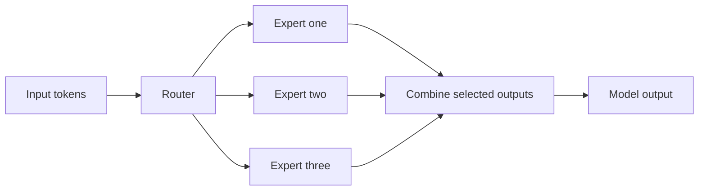

# Defining and Describing Mixture of Experts

- _Mixture of Experts lets one model behave like a team of specialists while computing with only the specialists needed for each input._
- A **Mixture of Experts (MoE)** is a machine-learning architecture composed of multiple expert networks and a gating or routing mechanism that determines how much each expert contributes to an output. [^jnedr9] [^ui9kpg] In the original formulation, experts specialized in different regions of the input space, while a gate assigned input-dependent weights. [^c4tcev] [^jnedr9]
- Modern **sparse MoE** systems route each token to only a small subset of experts rather than evaluating every expert, allowing a model to contain substantially more total parameters without proportional per-token computation. [^3h91x9] [^9qok5b]
- The architecture matters because it combines specialization with scalability: different experts can learn different linguistic, visual, or task-specific patterns while the router controls computational allocation. [^3h91x9] [^ui9kpg]

## Uses in Context

- **Large language models:** MoE describes language models in which a router activates only selected feed-forward experts for each token, reducing computation relative to a dense model with the same total parameter count. [^3h91x9] [^9qok5b]
- **Specialization:** The term is invoked when separate subnetworks learn different regions of an input distribution or different subtasks. [^c4tcev] [^jnedr9]
- **Efficient scaling:** Researchers use MoE to increase parameter capacity while keeping active computation comparatively constrained. [^3h91x9] [^9qok5b]
- **Multimodal and heterogeneous data:** MoE systems can allocate different data types or domains to suitable experts, including language, vision, healthcare, and autonomous-system workloads. [^3h91x9]
- **Model deployment:** The architecture is associated with lower computational overhead and potentially lower inference costs because only a subset of experts is activated for each input. [^3h91x9]

## History of Use

## Origins

- The concept was introduced by Robert A. Jacobs, Michael I. Jordan, Steven J. Nowlan, and Geoffrey E. Hinton in the 1991 paper **“Adaptive Mixtures of Local Experts,”** published in *Neural Computation*. [^c4tcev] [^jnedr9]
- The original system divided a vowel-discrimination task into subtasks that could be handled by simple expert networks; a gating network learned how to distribute responsibility among them. [^c4tcev]
- Unlike a single monolithic predictor, the framework used multiple networks whose specialization emerged through competition for training examples. [^jnedr9] [^i14nba]

## Evolution

- **1991 — Adaptive mixtures of local experts:** The foundational architecture paired several expert networks with a learned gate that produced a probability distribution over experts. [^c4tcev] [^jnedr9]
- **2017 — Sparsely gated MoE:** Shazeer and collaborators extended MoE to very large neural networks by activating only a small number of experts per input, establishing the sparse-gating approach used by later language models. [^i7h1wq]
- **2021–2024 — Token-level routing:** Switch Transformers used one selected expert per token, while Mixtral used top-two routing among eight experts per layer; Mixtral was described as having 47 billion total parameters with approximately 13 billion active per token. [^i7h1wq]

## Best Real-World Examples

- [Adaptive Mixtures of Local Experts](https://theconceptlibrary.com/concept/mixture-of-experts) — The 1991 research system that established expert specialization and learned gating. [^c4tcev]
- [Sparsely-Gated Mixture-of-Experts Layer](https://arxiv.org/abs/1701.06538) — The 2017 architecture that demonstrated sparse expert activation for scaling neural networks. [^i7h1wq]
- [Switch Transformer](https://www.jmlr.org/papers/v23/21-0998.html) — A sparse-routing design that selected one expert per token to simplify and reduce routing computation. [^i7h1wq]
- [Mixtral 8x7B](https://mistral.ai/news/mixtral-of-experts) — An open model using eight experts per layer and selecting two experts for each token. [^i7h1wq]
- [Hummingbird](https://github.com/fundamentalvision/hummingbird) — An open-source runtime project aimed at deploying large MoE language models with lightweight infrastructure. [^3vbev1]
- [MoE vision systems](https://www.nvidia.com/en-eu/glossary/mixture-of-experts/) — Vision applications use specialized experts for functions such as detection, segmentation, and classification. [^3h91x9]

## Case Studies

**Adaptive Mixtures of Local Experts, 1991.** Jacobs, Jordan, Nowlan, and Hinton applied the architecture to multi-speaker vowel discrimination by dividing the task among local expert networks. [^c4tcev] [^i14nba] A gating network learned which expert should receive responsibility for each input, and the authors described the method as dividing the task into subtasks solvable by simple expert networks. [^c4tcev] This case established the central MoE idea: specialization can be learned rather than manually assigned. [^c4tcev] [^jnedr9]

**Sparsely-Gated MoE, 2017.** Shazeer and collaborators adapted MoE to much larger neural networks by introducing sparse gating, in which only one or two experts process an input rather than all experts. [^i7h1wq] The approach made it possible to expand total parameter capacity while limiting the computation associated with each input. [^9qok5b] [^i7h1wq] Its significance lies in turning MoE from a modular supervised-learning technique into a practical scaling strategy for modern neural networks. [^i7h1wq]

**Mixtral 8x7B.** Mixtral illustrates the open-model evolution of sparse MoE: the system contains eight experts in each layer and routes every token to two of them. [^i7h1wq] The reported configuration has 47 billion total parameters but approximately 13 billion active parameters per token. [^i7h1wq] The example shows how sparse routing can provide a large parameter pool while keeping inference closer to the computational profile of a much smaller active model. [^i7h1wq]

***

# Sources

[^7pcqn4]: 2024, Apr 01. "[Understanding LLMs: Mixture of Experts | DEV Community](https://dev.to/rogiia/understanding-llms-mixture-of-experts-jbm)". other experts fitting their weights to their own task.. [DEV Community](https://dev.to).
[^g18z6u]: 2024, Mar 30. "[Understanding LLMs: Mixture of Experts | Roger Oriol](https://ruxu.dev/articles/ai/mixture-of-experts/)". Roger Oriol. [Roger Oriol](https://ruxu.dev).
[^q00lis]: 2025, Jan 27. "[Mixture-of-Experts (MoE) LLMs | Cameronrwolfe](https://cameronrwolfe.substack.com/p/moe-llms)". Cameron R. Wolfe, Ph.D.. [Cameronrwolfe](https://cameronrwolfe.substack.com).
[^c4tcev]: 2026, Sep 14. [theconceptlibrary.com](https://theconceptlibrary.com/). [Mixture of Experts](https://theconceptlibrary.com/concept/mixture-of-experts). Updated: 2026, Oct 13. Generated: 2026, Nov 06. [Perplexity](https://www.perplexity.ai/) API response.
[^jnedr9]: 2026, Apr 06. [github.com](https://github.com/). [MoE/wiki/papers/adaptive-mixtures-1991.md at main ... - GitHub](https://github.com/thewertzgroup/MoE/blob/main/wiki/papers/adaptive-mixtures-1991.md). Updated: 2026, Oct 24. Generated: 2026, Nov 06. [Perplexity](https://www.perplexity.ai/) API response.
[^3h91x9]: 2026, Sep 17. [nvidia.com](https://www.nvidia.com/). [What Is Mixture of Experts (MoE) and How It Works? | NVIDIA Glossary](https://www.nvidia.com/en-eu/glossary/mixture-of-experts/). Updated: 2026, Nov 01. Generated: 2026, Nov 06. [Perplexity](https://www.perplexity.ai/) API response.
[^ui9kpg]: 2026, Mar 18. [aiwiki.ai](https://aiwiki.ai/). [Mixture of Experts (MoE) - AI Wiki](https://aiwiki.ai/wiki/mixture_of_experts). Updated: 2026, Nov 06. Generated: 2026, Nov 06. [Perplexity](https://www.perplexity.ai/) API response.
[^i14nba]: 2026, Jul 18. [nishbhana.com](https://nishbhana.com/). [Mixture of Experts: Trillions of Parameters, a Fraction at a Time ...](https://nishbhana.com/Mixture-Of-Experts/). Updated: 2026, Oct 09. Generated: 2026, Nov 06. [Perplexity](https://www.perplexity.ai/) API response.
[^9qok5b]: 2026, Nov 02. [alanhou.org](https://alanhou.org/). [Multi-View MoE: Letting Every Router Shape Expert Computation / Multi-View MoE：让每一个路由器协同塑造专家计算与表征 | Alan Hou](https://alanhou.org/blog/arxiv-multi-view-moe-router-shaped-computation/). Generated: 2026, Nov 06. [Perplexity](https://www.perplexity.ai/) API response.
[^i7h1wq]: 2026, Oct 17. [intuitivepapers.ai](https://intuitivepapers.ai/). [Mixture of Experts explained — the sparsely-gated MoE layer](https://intuitivepapers.ai/outrageously-large-neural-networks-the-sparsely/). Updated: 2026, Oct 19. Generated: 2026, Nov 06. [Perplexity](https://www.perplexity.ai/) API response.
[^3vbev1]: 2026, Oct 02. [github.com](https://github.com/). [mixture-of-experts · GitHub Topics](https://github.com/topics/mixture-of-experts?l=c++). Updated: 2026, Nov 06. Generated: 2026, Nov 06. [Perplexity](https://www.perplexity.ai/) API response.
[9]: 2026, Nov 04. [models.inteligile.com](https://models.inteligile.com/). [Mixture of Experts (MoE)](https://models.inteligile.com/techniques/mixture-of-experts-moe.html). Updated: 2026, Nov 05. Generated: 2026, Nov 06. [Perplexity](https://www.perplexity.ai/) API response.
[10]: 2026, Oct 10. [intl.cloud.baidu.com](https://intl.cloud.baidu.com/). [World's Largest Open-Source Model Released - Baidu AI Cloud](https://intl.cloud.baidu.com/en/article/9156325). Updated: 2026, Nov 03. Generated: 2026, Nov 06. [Perplexity](https://www.perplexity.ai/) API response.
[^eenf75]: "[LLM Mixture of Experts Explained — A 2026 Field Guide | TensorOps | TensorOps](https://www.tensorops.ai/post/what-is-mixture-of-experts-llm)". Soumith Chintala. That gives a headline figure of ~1.76T parameters. [TensorOps](https://www.tensorops.ai).