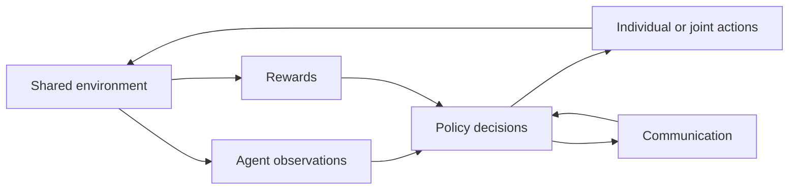

---
aliases:
  - MARL
tags: [Agentic-AI]
date_created: 2026-10-09
date_modified: 2026-10-10
cf_last_run: "2026-10-10T17:05:12.173Z"
cf_last_run_model: "Perplexity sonar-pro"
site_uuid: 57fcf671-a06d-4b0e-9b2d-c5cdcb0b45d8
publish: true
title: "Multi-Agent Reinforcement Learning"
slug: multi-agent-reinforcement-learning
at_semantic_version: 0.0.0.1
---

[[Vocabulary/Multi-Agent Automation|Multi-Agent Systems]]
[[concepts/Explainers for AI/Reinforcement Learning|Reinforcement Learning]]

# Defining and Describing Multi-Agent Reinforcement Learning

 

- _Multi-Agent Reinforcement Learning (MARL) is the study of multiple learning agents that make decisions in a shared environment while adapting to one another._
- MARL extends reinforcement learning to settings with multiple interacting agents, which may cooperate, compete, or do both. [^id9a71] Each agent learns a policy from its observations, potentially using communication, shared information, or joint training. [^id9a71] The environment is commonly formalized as a **[[Vocabulary/Markov Decision Process|Markov Decision Process]] game**, an extension of the Markov decision process to multi-agent systems. [^b0rdsi]
- MARL matters when a single controller cannot efficiently represent distributed decision-making—for example, in teams of robots, autonomous vehicles, networked systems, or competitive games. Its central technical difficulties include partial observability, non-stationarity caused by changing policies, credit assignment, coordination, and scalability. [^psucd3] [^b0rdsi]

# Uses in Context

- **Cooperative control:** MARL describes teams of agents learning coordinated behavior, such as autonomous vehicles negotiating traffic or robots completing a shared task. [^id9a71] [^lugd5t]
- **Competitive decision-making:** The term is used for environments in which agents optimize against opponents, including board games, real-time strategy games, and multiplayer online battle arenas. [^psucd3]
- **Mixed-motive systems:** MARL also covers settings where agents cooperate with allies while competing with other agents, a structure common in team sports and strategic games. [^id9a71] [^psucd3]
- **Distributed autonomy:** In transportation research, MARL is applied to traffic-signal control, drone navigation, air-traffic management, and autonomous ship navigation. [^id9a71]
- **Scalable agent training:** Researchers invoke MARL to describe self-play and large-scale simulation methods for training agents beyond the experience available from a single learner. [^psucd3] [^b0rdsi]

# History of Use

## Origins

- The foundational formulation most often associated with MARL is Michael L. Littman’s **“Markov games as a framework for multi-agent reinforcement learning,”** published in 1994. [^m5d66v] [^dbp48q] [^kphnf9] The work framed multi-agent interaction through stochastic or Markov games, providing a formal setting in which several agents learn while influencing a common environment. [^m5d66v] [^kphnf9]
- The Markov-game formulation extended the single-agent Markov decision process to multi-agent systems, making explicit that an agent’s outcome depends not only on its own policy but also on the policies of other agents. [^b0rdsi]

## Evolution

- **1994 — Formal game-theoretic foundation:** Littman’s Markov-games framework established a standard mathematical model for multi-agent reinforcement learning. [^m5d66v] [^kphnf9]
- **2010s — Deep and scalable MARL:** Advances in deep reinforcement learning enabled agents to learn from high-dimensional observations and supported large-scale self-play in complex games. A report on MARL identifies long-term control objectives, Markov games, and challenges such as non-stationarity and coordination as central concerns. [^b0rdsi]
- **Late 2010s–2020s — Expansion beyond games:** MARL research broadened into transportation, robotics, autonomous systems, and other dynamic environments, with growing attention to offline learning, meta-learning, adaptability, and scalability. [^id9a71] [^lugd5t]

# Best Real-World Examples

- [AlphaStar](https://deepmind.google/discover/blog/alphastar-mastering-the-real-time-strategy-game-starcraft-ii/) — a multi-agent learning system associated with superhuman-level StarCraft II performance through self-play and deep reinforcement learning. [^psucd3]
- [OpenAI Five](https://openai.com/index/openai-five/) — a team-based reinforcement-learning system trained for five-versus-five Dota 2 matches. [^psucd3] [^vp0hqx]
- [Rocket League MARL research](https://transactions.games/spotlight/may-2026-spotlight-paper) — an example of applying multi-agent learning to coordinated vehicle-sports gameplay. [^psucd3]
- [Minecraft multi-agent research](https://transactions.games/spotlight/may-2026-spotlight-paper) — a sandbox environment used to study cooperation, exploration, and coordination among agents. [^psucd3]
- [Traffic-signal control](https://link.springer.com/article/10.1007/s42979-025-04475-3) — MARL methods are studied for adaptive control across complex transportation networks. [^id9a71]
- [Autonomous-drone coordination](https://link.springer.com/article/10.1007/s42979-025-04475-3) — multiple-agent learning is applied to navigation and coordination in dynamic airspace. [^id9a71]
- [Cooperative robotics](https://www.studocu.com/in/document/jc-bose-university-of-science-and-technology-ymca/operations-research/a-comprehensive-survey-on-multi-agent-cooperative-decision-making-approaches/160074093) — MARL is used as a framework for robot teams, automation, and disaster-response scenarios. [^lugd5t]

# Case Studies

**AlphaStar and StarCraft II.** [[organizations/DeepMind|DeepMind]]’s AlphaStar illustrates how MARL can address a partially observable, adversarial, real-time environment. Research on modern game applications identifies AlphaStar as a landmark example in which self-play, supervised learning, and deep reinforcement learning supported performance at or beyond professional human play. [^psucd3] The case demonstrates that effective MARL requires more than independent agents optimizing isolated rewards: agents must reason about opponents, coordinate behavior over long horizons, and learn under changing strategic conditions. It also shows why games have been important experimental environments for MARL: they provide repeatable simulations, explicit objectives, and measurable competition. [^psucd3] [^b0rdsi]

**OpenAI Five and Dota 2.** [[Tooling/AI-Toolkit/Model Producers/OpenAI|OpenAI]] Five applied deep reinforcement learning to a five-agent team in Dota 2, a continuous multiplayer environment with partial information, delayed consequences, and complex coordination requirements. [^psucd3] [^vp0hqx] The system is cited as a landmark example of team-based MARL and is associated with defeating world-class human competition in full five-versus-five matches. [^vp0hqx] Its significance lies in demonstrating that learning coordinated behavior can scale beyond two-player games when training uses extensive simulation, self-play, and distributed computation. The example also exposes MARL’s limitations: success in a tightly specified game does not automatically transfer to environments with different rules, incentives, or safety requirements. [^psucd3] [^b0rdsi]

**Transportation and autonomous systems.** Recent MARL research applies the framework to traffic-signal control, drone navigation, air-traffic management, and autonomous ships. [^id9a71] In these settings, each vehicle, intersection, or control unit can be modeled as an agent with local observations and actions, while the overall system must satisfy shared performance objectives such as throughput, safety, and adaptability. Surveyed work highlights offline reinforcement learning and meta-reinforcement learning as approaches intended to improve MARL scalability and adaptation across scenarios. [^id9a71] This case shows the shift from benchmark games toward infrastructure and physical systems, where coordination quality, robustness, interpretability, and safe deployment matter as much as raw task performance. [^id9a71] [^lugd5t]

***

# Sources

[^m5d66v]: [Self-Compression of Chain-of-Thought via Multi-Agent ...](https://www.alphaxiv.org/abs/2601.21919v1)
[^id9a71]: [A Survey on Multi-agent Reinforcement Learning for Adaptive ...](https://link.springer.com/article/10.1007/s42979-025-04475-3?error=cookies_not_supported&code=82122a71-bc16-469c-8cc7-c6e613d8643f)
[^dbp48q]: [Michael L. Littman | Rankless](https://www.rankless.org/authors/michael-l-littman)
[^kphnf9]: [xxzcc/awesome-llm-mas-rl - GitHub](https://github.com/xxzcc/awesome-llm-mas-rl)
[^psucd3]: [May 2026 - Spotlight Paper | IEEE Transactions on Games](https://transactions.games/spotlight/may-2026-spotlight-paper)
[6]: [Adversarial Locomotion and Motion Imitation for Humanoid ...](https://www.alphaxiv.org/abs/2504.14305)
[7]: [Aikipedia: Multiagent Learning Algorithms - Champaign Magazine](https://champaignmagazine.com/2026/02/27/aikipedia-multiagent-learning-algorithms/)
[8]: [Coordination Matters: Evaluation of Cooperative Multi-Agent ...](https://pith.science/paper/2605.06557)
[9]: [A_Comprehensive_Review_of_...](https://www.scribd.com/document/963405579/A-Comprehensive-Review-of-Multi-Agent-Reinforcement-Learning-in-Video-Games)
[^b0rdsi]: [Multi-Agent Reinforcement Learning: A Report on Challenges and Approaches](https://arxiv.org/html/1807.09427v1)
[11]: [Reinforcement Learning for LLM-based Multi-Agent Systems ...](https://pith.science/paper/2605.02801)
[12]: [A nonzero-sum game with reinforcement learning under mean ...](https://www.cambridge.org/core/journals/astin-bulletin-journal-of-the-iaa/article/abs/nonzerosum-game-with-reinforcement-learning-under-meanvariance-framework/CC07CD4A77507183201699F7A5F58207)
[^vp0hqx]: [Distributed Reinforcement Learning for Scalable High-Performance Policy Optimization](https://towardsdatascience.com/distributed-reinforcement-learning-for-scalable-high-performance-policy-optimization/)
[^lugd5t]: [A Comprehensive Survey on Multi-Agent Cooperative ...](https://www.studocu.com/in/document/jc-bose-university-of-science-and-technology-ymca/operations-research/a-comprehensive-survey-on-multi-agent-cooperative-decision-making-approaches/160074093)
[15]: [The Surprising Effectiveness of PPO in Cooperative Multi-Agent ...](https://www.scribd.com/document/983709004/1)
