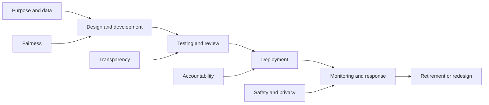

[[concepts/Explainers for AI/AI Safety|AI Safety]]
[[concepts/Explainers for AI/AI Governance|AI Governance]]
[[concepts/Explainers for AI/Artificial Intelligence|Artificial Intelligence]]
[[Vocabulary/Machine Learning|Machine Learning]]
[[concepts/Explainers for AI/Foundation Models in AI|Foundation Models]]
[[Tooling/AI-Toolkit/Model Producers/Anthropic|Anthropic]]

# Defining and Describing Responsible AI

- _Responsible AI means building and using AI so that innovation remains accountable to the people affected by it._
- Responsible AI is the practice of designing, developing, deploying, and governing AI systems in ways that are ethical, transparent, fair, accountable, safe, privacy-preserving, and human-centered.[^iyt1zz] It applies across the full AI lifecycle—from ideation and design through deployment, maintenance, and retirement.[^bn3f31] Its purpose is to reduce harms such as discrimination, privacy violations, unsafe behavior, and unaccountable automated decisions while preserving useful innovation.[^bn3f31][^iyt1zz]

# Uses in Context

- **Product development:** Organizations use “responsible AI” to describe incorporating fairness, safety, privacy, explainability, and accountability into product design rather than addressing them only after deployment.[^l844jd][^iyt1zz]
- **Governance:** The term can refer to organizational frameworks that assign owners, document decisions, maintain audit trails, and establish escalation procedures for AI-related harms.[^l844jd][^h192qs]
- **Risk management:** Practitioners invoke responsible AI when identifying, measuring, and managing risks across an AI system’s lifecycle; NIST’s framework organizes this work around “Govern, Map, Measure, and Manage.”[^n7op87]
- **Regulatory compliance:** Responsible AI is used to connect ethical commitments with obligations arising from frameworks such as the EU AI Act, OECD AI Principles, and NIST AI Risk Management Framework.[^l844jd][^n7op87]
- **Public communication:** Companies and institutions use the phrase to signal that AI systems should respect human rights, avoid harm, and remain under meaningful human oversight.[^iyt1zz]

# History of Use

## Origins

- Responsible AI did not originate as a single invention by one technology company; it developed from longer traditions of computing ethics, information ethics, cybernetics, human rights, and applied ethics.[^bn3f31]
- Early AI-ethics work focused on risks including unfair bias, privacy breaches, security failures, and the need to consider responsibility across the entire AI lifecycle.[^bn3f31]
- The modern phrase became a broad umbrella for translating those ethical concerns into operational principles and governance practices, including fairness, transparency, accountability, safety, explainability, and privacy.[^l844jd][^esn9qc]

## Evolution

- **Before the contemporary AI boom:** The conceptual foundations grew from computing and information ethics, with concern centered on human rights, discrimination, privacy, and security.[^bn3f31]
- **2010s–early 2020s:** Responsible AI expanded from ethical discussion into organizational practice, emphasizing lifecycle governance, human oversight, documentation, testing, and monitoring.[^bn3f31][^iyt1zz]
- **2020s:** Formal frameworks increasingly linked responsible AI to standards and regulation, including NIST’s AI Risk Management Framework, the OECD AI Principles, and the EU AI Act.[^l844jd][^n7op87]

# Best Real-World Examples

- [NIST AI Risk Management Framework](https://www.nist.gov/itl/ai-risk-management-framework) — a lifecycle-oriented framework organized around governing, mapping, measuring, and managing AI risk.[^n7op87]
- [OECD AI Principles](https://oecd.ai/en/ai-principles) — principles emphasizing inclusive growth, human-centered values, transparency, robustness, and accountability.[^n7op87]
- [EU AI Act](https://digital-strategy.ec.europa.eu/en/policies/regulatory-framework-ai) — a risk-based regulatory approach that connects AI governance with legal obligations.[^l844jd][^n7op87]
- [Responsible AI Institute](https://www.responsible.ai/) — an independent organization focused on practical assessment, governance, and responsible AI implementation; it was founded by Manoj Saxena.[^65871k]
- [Liner](https://liner.ai/) — a Korea-based AI software company that partnered with the Responsible AI Institute to strengthen governance and responsible development as its products and usage expanded.[^zpbx3p]
- [ISO/IEC 42001](https://www.iso.org/standard/81230.html) — an AI management-system standard cited as a foundation for organizational governance and continuous oversight.[^h192qs]
- [AI Risk Management Framework community](https://www.nist.gov/itl/ai-risk-management-framework) — an example of standards-oriented, cross-sector work that turns broad ethical goals into repeatable organizational processes.[^n7op87]

# Case Studies

**Liner and the Responsible AI Institute.** Liner, a Korea-based global AI software company producing productivity and search tools, sought stronger governance as its AI capabilities and user base expanded.[^zpbx3p] The company partnered with the Responsible AI Institute to embed responsible AI into system design, review, and improvement rather than treating governance as a one-time compliance exercise.[^zpbx3p] Its membership provided access to practical tools, expert knowledge, and structured resources for AI governance and responsible development.[^zpbx3p] The case illustrates how a smaller specialist AI company can operationalize responsible AI through lifecycle oversight, external expertise, and repeatable review practices.[^zpbx3p]

**NIST’s AI Risk Management Framework.** NIST translated broad trustworthy-AI goals into a practical risk-management structure organized around four functions: Govern, Map, Measure, and Manage.[^n7op87] The framework is intended to help organizations identify context and risks, evaluate system performance and impacts, establish governance, and respond to problems over time.[^n7op87] This approach changed responsible AI from a largely aspirational label into a set of recurring organizational activities tied to documentation, testing, monitoring, and accountability.[^l844jd][^n7op87] It demonstrates that responsible AI is not a single technical feature but an ongoing management discipline.

**From principles to institutional governance.** Major frameworks increasingly align responsible AI around recurring requirements: fairness, transparency, accountability, safety, privacy, and governance.[^l844jd][^h192qs][^iyt1zz] Their convergence shows how the field has moved beyond abstract statements about ethical technology toward named owners, audit trails, disclosure of AI involvement, bias testing, lifecycle monitoring, and safe failure or rollback procedures.[^l844jd][^h192qs] The broader lesson is that responsible AI depends less on a model’s branding than on the institutions, processes, and people responsible for its effects.

# Gemini Response

Responsible AI is the practice of designing, developing, deploying, and governing artificial intelligence systems based on ethical principles to ensure safety, fairness, and trust. Organizations use it to guide AI workflows and minimize harms such as algorithmic bias and data privacy leaks while maximizing social benefit. [^867ulf] [^ccp62k] [^h7hwlv]

Core Principles

- Fairness: AI systems must treat people equitably and avoid reinforcing or amplifying discrimination or bias against protected groups. [^zmn1ap] [^yrf87h]
- Reliability and Safety: Systems must operate consistently, perform as designed, handle unexpected situations safely, and resist tampering. [^u5dulp] [^yrf87h]
- Transparency and Explainability: Users and stakeholders should be able to understand how an AI model makes decisions or generates outputs. [^q172i2] [^u5dulp]
- Privacy and Security: Personal data must be protected through data minimization, encryption, and clear user consent controls. [^yrf87h] [^q172i2]
- Inclusiveness: Technology must be built to empower diverse populations and remain accessible to underserved communities. [^vzqms9] [^yrf87h]
- Accountability: Humans must retain meaningful control over high-stakes decisions, and clear organizational roles must govern who is responsible when an AI system fails. [^q1lq8a] [^u5dulp]

Common Frameworks & Standards

- NIST AI Risk Management Framework: A structured guide that helps organizations govern, map, measure, and manage AI risks.
- OECD AI Principles: International policy standards for trustworthy and human-centered AI.
- EU AI Act: A comprehensive, risk-based legislative framework governing AI deployment across the European Union.
- Microsoft Responsible AI Standard: A corporate blueprint implementing six core trust principles across product lifecycles.
- [[Tooling/AI-Toolkit/Models/IBM Watson|IBM Watson]]x & Responsible AI Institute: Independent toolsets and assessment groups that help audit and verify models against safety and equity benchmarks. [^8mhbu2] [^1kmhnq] [^q172i2] [^u5dulp]
Would you like to explore how to build a responsible AI governance checklist for a specific project, or look into tools for testing model bias?

[^867ulf]: [https://www.ibm.com/think/topics/responsible-ai](https://www.ibm.com/think/topics/responsible-ai)
[^ccp62k]: [https://www.snowflake.com/en/artificial-intelligence/ai-governance/responsible-ai/](https://www.snowflake.com/en/artificial-intelligence/ai-governance/responsible-ai/)
[^h7hwlv]: [https://hai.stanford.edu/ai-definitions/what-is-responsible-ai](https://hai.stanford.edu/ai-definitions/what-is-responsible-ai)
[^zmn1ap]: [https://www.microsoft.com/en-us/ai/responsible-ai](https://www.microsoft.com/en-us/ai/responsible-ai)
[^yrf87h]: [https://www.youtube.com/watch?v=vYQOXE5VaRk&t=16](https://www.youtube.com/watch?v=vYQOXE5VaRk&t=16)
[^u5dulp]: [https://learn.microsoft.com/en-us/azure/machine-learning/concept-responsible-ai?view=azureml-api-2](https://learn.microsoft.com/en-us/azure/machine-learning/concept-responsible-ai?view=azureml-api-2)
[^q172i2]: [https://ischool.syracuse.edu/what-is-responsible-ai/](https://ischool.syracuse.edu/what-is-responsible-ai/)
[^vzqms9]: [https://support.microsoft.com/en-us/privacy/what-is-responsible-ai](https://support.microsoft.com/en-us/privacy/what-is-responsible-ai)
[^q1lq8a]: [https://professional.dce.harvard.edu/blog/building-a-responsible-ai-framework-5-key-principles-for-organizations/](https://professional.dce.harvard.edu/blog/building-a-responsible-ai-framework-5-key-principles-for-organizations/)
[^8mhbu2]: [https://www.responsible.ai/](https://www.responsible.ai/)
[^1kmhnq]: [https://www.coursera.org/articles/responsible-ai](https://www.coursera.org/articles/responsible-ai)

***

# Sources

[^bn3f31]: [a review | AI and Ethics | Springer Nature Link](https://link.springer.com/article/10.1007/s43681-026-01418-3)
[^l844jd]: [atlan.com › know › ai-readinessResponsible AI Framework: NIST, EU AI Act & OECD Compared [2026]](https://atlan.com/know/ai-readiness/responsible-ai-framework-principles/)
[^zpbx3p]: [Liner Strengthens AI Governance with RAI Institute ...](https://www.responsible.ai/news/case-study-liner/)
[4ck8h3]: [Deconstructing 'Responsible AI': An Examination of Legal and ...](https://link.springer.com/article/10.1007/s11196-025-10388-4?error=cookies_not_supported&code=72c1b572-3611-42f3-b5f0-a90711cb1275)
[^esn9qc]: [Responsible AI Governance in Multi-Modal Enterprise Systems: Ethical Risk Management, Compliance, and Operational Accountability](https://www.academia.edu/167486190/Responsible_AI_Governance_in_Multi_Modal_Enterprise_Systems_Ethical_Risk_Management_Compliance_and_Operational_Accountability)
[^65871k]: [Case Studies Archives](https://www.responsible.ai/news/category/case-studies/)
[^h192qs]: [Responsible AI Framework: 6-Pillar Model for Enterprises - Alice Labs](https://alicelabs.ai/en/insights/responsible-ai-framework)
[^iyt1zz]: [Responsible AI: Definition, Principles, and Examples](https://monday.com/blog/ai-agents/responsible-ai/)
[9bhqs4]: [Responsible AI: the good, the bad, the AI - AI and Ethics](https://link.springer.com/article/10.1007/s43681-026-01243-8?error=cookies_not_supported&code=477a6ea6-e467-467c-98c3-cc12b50ed504)
[^n7op87]: [www.teachfloor.com › blog › responsible-aiResponsible AI: Principles, Frameworks, and Implementation](https://www.teachfloor.com/blog/responsible-ai)
[^6h19zm]: "[What is Responsible AI? | Stanford HAI | Hai](https://hai.stanford.edu/ai-definitions/what-is-responsible-ai)". prioritizing responsible AI. [Hai](https://hai.stanford.edu).
