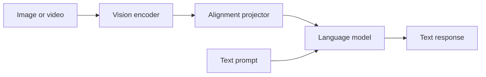

# Defining and Describing Vision-Language Models

- _Vision-language models connect visual perception and language generation so machines can interpret images and respond in words._
- A vision-language model (VLM) combines an image or video encoder with a language model, allowing the system to process visual inputs alongside text and produce language-based answers or actions. [^qv9xl5] [^s4ofoe] Typical capabilities include image captioning, visual question answering, instruction following, document analysis, and conversational image understanding. [^qv9xl5] [^s4ofoe]
- Many modern VLMs use a modular architecture: a pretrained vision encoder produces visual tokens, an alignment or projection layer maps those tokens into the language model’s representation space, and an autoregressive language model generates the response. [^qv9xl5] [^i91eka]
- VLMs apply when a task requires both perception and linguistic reasoning—for example, answering questions about a photograph, extracting information from a chart, interpreting a document, or discussing multiple images. [^qv9xl5] [^s4ofoe]

## Uses in Context

- **Visual question answering:** A user asks a question about an image, and the model identifies relevant objects, text, relationships, or events before answering. [^qv9xl5] [^s4ofoe]
- **Image conversation:** VLMs support multi-turn dialogue in which users discuss an image through successive questions and instructions. [^s4ofoe]
- **Document and chart analysis:** Models can interpret visual documents and return structured explanations or extracted information. [^qv9xl5]
- **Instruction following:** Visual instruction tuning adapts models from simple captioning or question answering to more complex, conversational requests. [^qv9xl5] [^i91eka]
- **GUI and agent interfaces:** The same visual-instruction capabilities can support interaction with interfaces and other environments requiring image-based reasoning. [^qv9xl5]

# History of Use

## Origins

- The modern VLM lineage grew from academic work on joint vision-language pretraining, including models such as BLIP and BLIP-2, which sought more efficient alignment between image representations and language models. [^cvhla6]
- DeepMind’s *Flamingo* demonstrated few-shot visual-language learning by combining visual inputs with a language model, helping establish the pattern of adapting large language models to multimodal prompts. [^ux6g14] [^cvhla6]
- The open-source LLaVA project, introduced by Haotian Liu, Chunyuan Li, Qingyang Wu, and Yong Jae Lee in 2023, connected a CLIP vision encoder to a Vicuna/LLaMA language model through a learned projection and trained it on synthetic visual-instruction examples. [^qv9xl5] [^i91eka]
- LLaVA’s authors described their work as “Visual Instruction Tuning,” using GPT-4-generated multimodal instruction data to teach a language model to follow conversational visual requests. [^qv9xl5] [^ux6g14]

## Evolution

- **2022 — Few-shot multimodal prompting:** *Flamingo* extended language-model-style few-shot learning to visual inputs, demonstrating that a model could generalize across image-and-text examples. [^ux6g14] [^cvhla6]
- **2023 — Efficient modular alignment:** BLIP-2 and related systems emphasized connecting frozen or pretrained vision and language components rather than training a complete multimodal model from scratch. [^i91eka] [^cvhla6]
- **2023 onward — Open visual assistants:** LLaVA popularized a lightweight, reproducible recipe based on a CLIP encoder, a projection layer, a language model, and synthetic instruction data; later open-source projects expanded this direction to broader multimodal benchmarks and model families. [^qv9xl5] [^k60a0y] [^934d6f] [^i91eka]

# Best Real-World Examples

- [LLaVA](https://llava-vl.github.io/) — Open-source visual assistant combining CLIP-style visual encoding with a large language model for image conversation and instruction following. [^qv9xl5] [^s4ofoe] [^i91eka]
- [BLIP-2](https://arxiv.org/abs/2301.12597) — A vision-language system designed to bridge pretrained image encoders and large language models efficiently. [^i91eka] [^cvhla6]
- [Flamingo](https://arxiv.org/abs/2204.14198) — A research model demonstrating few-shot learning from interleaved visual and textual inputs. [^ux6g14] [^cvhla6]
- [LLaVA-Gemma](https://github.com/visheratin/llava-gemma) — An open multimodal model family combining the LLaVA framework with Gemma language models. [^k60a0y]
- [LLaVA-OneVision-2](https://arxiv.org/html/2605.25979) — An open-source successor in the LLaVA-OneVision line targeting stronger performance across multimodal benchmarks. [^osaq1i] [^934d6f]
- [LAVIS](https://github.com/salesforce/LAVIS) — An open framework for training and evaluating vision-language models, including BLIP-family systems. [^cvhla6]
- [LLaVA-VLA](https://arxiv.org/abs/2602.22663) — A research direction that extends a VLM backbone toward vision-language-action control for robotic systems. [^h8eonq]

# Case Studies

**[[Tooling/AI-Toolkit/Models/LLaVa|LLaVa]] and the open visual-assistant recipe.** In 2023, Haotian Liu, Chunyuan Li, Qingyang Wu, and Yong Jae Lee introduced LLaVA as an attempt to make language models follow visual instructions rather than merely caption images. [^qv9xl5] [^ux6g14] The system used a frozen CLIP ViT-L/14 vision encoder, a trainable linear projection, and a Vicuna/LLaMA language model. [^qv9xl5] [^i91eka] Its training pipeline used GPT-4 to generate approximately 158,000 visual-instruction examples from image captions and region information. [^qv9xl5] [^i91eka] The case shows how a relatively simple connector and carefully designed instruction data could turn existing unimodal components into a useful conversational VLM, helping open-source researchers reproduce and extend multimodal assistants. [^qv9xl5] [^i91eka]

**Flamingo and few-shot visual learning.** [[organizations/DeepMind|DeepMind]]’s Flamingo research demonstrated a different path: rather than focusing primarily on open visual chat, it investigated how a language model could learn visual tasks from a small number of multimodal examples. [^ux6g14] [^cvhla6] The work helped establish interleaved image-and-text prompting as an important VLM pattern and influenced later systems that adapt language-model interfaces to visual inputs. [^ux6g14] [^cvhla6] Its significance lies in showing that multimodal models could inherit the flexible, prompt-based behavior associated with large language models while incorporating images. [^ux6g14] [^cvhla6]

**From VLMs to embodied action.** More recent work extends VLMs beyond answering questions toward controlling agents and robots. LLaVA-VLA describes a vision-language-action system built around a compact VLM backbone, adding multi-view perception, proprioceptive inputs, and action chunking for navigation and manipulation. [^h8eonq] The transition illustrates a broader redefinition of the concept: a VLM is no longer limited to producing text about an image but can serve as the perceptual and reasoning component of an embodied system that selects actions. [^h8eonq]

***

# Sources

[^h8eonq]: 2026, Feb 26. [arxiv.org](https://arxiv.org/). [Rethinking the Practicality of Vision-language-action Model: A Comprehensive Benchmark and An Improved Baseline](https://arxiv.org/abs/2602.22663). Updated: 2026, Apr 22. Generated: 2026, Nov 14. [Perplexity](https://www.perplexity.ai/) API response.
[^osaq1i]: 2026, May 25. [arxiv.org](https://arxiv.org/). [LLaVA-OneVision-2: Towards Next-Generation Perceptual Intelligence](https://arxiv.org/html/2605.25979). Updated: 2026, Jun 14. Generated: 2026, Nov 14. [Perplexity](https://www.perplexity.ai/) API response.
[^qv9xl5]: 2026, Nov 05. [github.com](https://github.com/). [AI-ML-research-papers/06-multimodal-and-vision-language/02_llava_visual_instruction_tuning_2023.md at main · KESHAV100-tech/AI-ML-research-papers](https://github.com/KESHAV100-tech/AI-ML-research-papers/blob/main/06-multimodal-and-vision-language/02_llava_visual_instruction_tuning_2023.md). Updated: 2026, Nov 07. Generated: 2026, Nov 14. [Perplexity](https://www.perplexity.ai/) API response.
[^ux6g14]: 2026, Nov 08. [app.cochat.ai](https://app.cochat.ai/). [Visual Instruction Tuning – Citation check](https://app.cochat.ai/papers/10.48550/arxiv.2304.08485). Updated: 2026, Nov 12. Generated: 2026, Nov 14. [Perplexity](https://www.perplexity.ai/) API response.
[^k60a0y]: 2026, Nov 13. [alphaxiv.org](https://www.alphaxiv.org/). [Matthew L Olson on alphaXiv](https://www.alphaxiv.org/@matthew-l-olson). Updated: 2026, Nov 14. Generated: 2026, Nov 14. [Perplexity](https://www.perplexity.ai/) API response.
[^s4ofoe]: 2026, Feb 26. [github.com](https://github.com/). [dr-claw/skills/multimodal/llava/SKILL.md at 3456bb4cfa534b491ca0f826a8c7e29919a8aaf4 · OpenLAIR/dr-claw](https://github.com/OpenLAIR/dr-claw/blob/3456bb4cfa534b491ca0f826a8c7e29919a8aaf4/skills/multimodal/llava/SKILL.md). Updated: 2026, Nov 14. Generated: 2026, Nov 14. [Perplexity](https://www.perplexity.ai/) API response.
[7]: 2026, Mar 24. [alphaxiv.org](https://www.alphaxiv.org/). [VISion On Request: Enhanced VLLM efficiency with sparse, dynamically selected, vision-language interactions](https://www.alphaxiv.org/ro/abs/2603.23495). Updated: 2026, Nov 14. Generated: 2026, Nov 14. [Perplexity](https://www.perplexity.ai/) API response.
[^934d6f]: 2026, Aug 10. [ar5iv.labs.arxiv.org](https://ar5iv.labs.arxiv.org/). [LLaVA-OneVision-2: Towards Next-Generation Perceptual Intelligence](https://ar5iv.labs.arxiv.org/html/2605.25979). Updated: 2026, Nov 04. Generated: 2026, Nov 14. [Perplexity](https://www.perplexity.ai/) API response.
[^i91eka]: 2026, Sep 17. [awesome.papernotes.org](https://awesome.papernotes.org/). [Visual Instruction Tuning](https://awesome.papernotes.org/en/era5_genai_explosion/2023_llava/). Updated: 2026, Oct 13. Generated: 2026, Nov 14. [Perplexity](https://www.perplexity.ai/) API response.
[^cvhla6]: 2026, Jan 23. [github.com](https://github.com/). [Awesome-Multimodal-Models/README.md at master · arrdel/Awesome-Multimodal-Models](https://github.com/arrdel/Awesome-Multimodal-Models/blob/master/README.md). Updated: 2026, Nov 03. Generated: 2026, Nov 14. [Perplexity](https://www.perplexity.ai/) API response.
