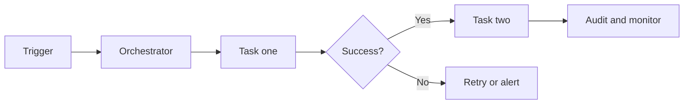

[[Vocabulary/iPaaS|iPaaS]]
[[Vocabulary/Workflow Automations|Workflow Automation]]
[[Agentic Workforces]]
[[concepts/Explainers for AI/Agentic Employees|Agentic Employees]]

# Defining and Describing Workflow Orchestration

- _Workflow orchestration turns a collection of separate actions into one observable, recoverable process._
- Workflow orchestration is the automated coordination of a multistep process by a central system—the orchestrator. [^i1p56d] It runs interdependent tasks in the required order, tracks execution state, handles dependencies and conditional branches, and can retry or alert when work fails. [^llpwv9] [^kdsp2w]
- The concept applies when a process crosses multiple services, machines, teams, or human decision points. Unlike a task scheduler that launches isolated jobs, an orchestrator manages the end-to-end execution path, including sequencing, state, failure handling, and visibility. [^qb0f7l] [^kdsp2w]
- In data engineering, workflows are often represented as directed acyclic graphs, or DAGs, in which nodes are tasks and edges express dependencies. [^i1p56d] In newer agentic-AI systems, orchestration is increasingly discussed as a way to coordinate agents and tools while preserving an explicit execution model. [^vrz8vl] [^j9x7r1]

## Uses in Context

- **Data pipelines:** Teams use workflow orchestration to coordinate extraction, transformation, loading, validation, and downstream publishing in dependency order. [^i1p56d] [^q9xo6p]
- **IT and business automation:** The term describes processes that combine automated tasks, systems, and human steps across an end-to-end operation. [^kdsp2w] [^q9xo6p]
- **Reliability engineering:** Orchestration conveys state tracking, retries, failure recovery, alerting, and operational visibility rather than simple task execution. [^llpwv9] [^kdsp2w]
- **Microservices and distributed systems:** An orchestrator directs a process across services, with one component owning the overall sequence and failure behavior. [^qb0f7l] [^j9x7r1]
- **Agentic AI:** The term is used for coordinating multiple AI agents, tools, and decisions; the emerging framing connects agent workflows with state-machine execution models. [^vrz8vl] [^j9x7r1]
- **Enterprise governance:** Organizations invoke orchestration to emphasize auditability, scheduling, environment separation, and control across complex workflows. [^kli2wc]

## History of Use

### Origins

- The broader workflow concept predates the modern phrase “workflow orchestration.” The Workflow Management Coalition’s 1996 glossary defined workflow as “the automation of a business process, in whole or part,” in which documents, information, or tasks move between participants according to procedural rules. [^llpwv9]
- The modern orchestration vocabulary was strongly shaped by web-services research. Chris Peltz’s 2003 *IEEE Computer* article distinguished orchestration—an executable process controlled by one party—from choreography, in which participants coordinate without a single central conductor. [^j9x7r1]
- There is no reliably documented single inventor or first paper for the narrower modern usage of “workflow orchestration” in data and platform engineering; the term was repurposed as workflow tools became prominent from roughly 2014 onward. [^llpwv9]

### Evolution

- **1993–1996 — Workflow standardization:** The Workflow Management Coalition emerged as a standards body, and its glossary formalized workflow as rule-based business-process automation. [^llpwv9]
- **2003 — Web-services orchestration:** Peltz’s orchestration-versus-choreography distinction established the influential idea of an executable process with a coordinating owner. [^j9x7r1]
- **2010s–2020s — Data and platform engineering:** Open-source systems such as [[Tooling/Software Development/Developer Experience/DevOps/Apache Airflow|Apache Airflow]] popularized DAG-based orchestration for scheduled and triggered data pipelines; Airflow was originally developed at Airbnb for scheduling and monitoring those pipelines. [^i1p56d] [^q9xo6p]
- **2020s — [[concepts/Explainers for AI/Agentic Workflows|Agentic Workflows]]:** Research and industry practice began extending workflow ideas toward autonomous or [[Vocabulary/Multi-Agent Automation|Multi-Agent Systems]], with state machines providing a common execution foundation for traditional workflows and AI agents. [^vrz8vl]

## Best Real-World Examples

- [Apache Airflow](https://airflow.apache.org/) — [[Tooling/Software Development/Developer Experience/DevOps/Apache Airflow|Apache Airflow]] — an open-source orchestrator that represents workflows as DAGs of dependent tasks. [^i1p56d] [^q9xo6p]
- [Temporal](https://temporal.io/) — [[Tooling/Software Development/Cloud Infrastructure/Temporal|Temporal]] — a durable workflow platform exemplifying stateful execution, retries, and recovery across distributed services. [^kli2wc]
- [Kestra](https://kestra.io/) — [[Tooling/AI-Toolkit/Agentic AI/Agentic Workspaces/Kestra|Kestra]] — a workflow-orchestration project positioned around coordinating tasks within domains such as data pipelines and IT automation. [^9tv8q5]
- [Orkes Conductor](https://orkes.io/) — [[Tooling/AI-Toolkit/Agentic AI/Orkes]] — an orchestration layer used to schedule, coordinate, and audit complex application flows. [^kli2wc]
- [Stepwork](https://stepwork.co/) — a smaller automation company that adopted orchestration infrastructure to run repeatable, multi-application UI workflows. [^kli2wc]
- [Workflow Management Coalition](https://www.wfmc.org/) — an early standards community that helped formalize workflow interoperability and terminology. [^llpwv9]
- [Agentic scientific workflows](https://dl.acm.org/doi/10.1145/3731599.3767580) — a research direction that unifies conventional workflows and AI agents through state-machine execution. [^vrz8vl]

## Case Studies

**Stepwork and Orkes Conductor.** Stepwork built deterministic interface automation for repeatable workflows across applications, including systems without APIs. [^kli2wc] Its flows could extend 10–20 steps, pass data between services, target particular users or devices, and run across customer clouds and local machines. [^kli2wc] A homegrown scheduler initially supported the “happy path,” but increasing workflow complexity made maintenance and failure diagnosis more expensive. [^kli2wc] Stepwork therefore adopted Orkes Conductor for scheduling, orchestration, and auditability, allowing the product team to focus on customer-facing automation rather than maintaining orchestration infrastructure. [^kli2wc] The case demonstrates that orchestration becomes a distinct infrastructure concern when workflows span heterogeneous environments and need reliable recovery and observability. [^kli2wc]

**Apache Airflow and data-pipeline practice.** Airflow was originally developed at Airbnb to schedule and monitor data pipelines, using Python-defined DAGs to express task dependencies. [^q9xo6p] Its significance lies less in automating one operation than in making an entire pipeline explicit: upstream work must complete before downstream work begins, and operators can inspect execution state and failures. [^i1p56d] [^q9xo6p] Airflow helped popularize DAG-based workflow orchestration in open-source data engineering, while illustrating the limits of a fixed dependency graph when processes require richer state, long-running actions, or dynamic decisions. [^i1p56d]

**Scientific workflows and agentic AI.** Recent research frames traditional scientific workflows and emerging AI-agent systems as related forms of state-machine execution. [^vrz8vl] In this view, conventional workflows provide explicit steps, dependencies, and repeatability, while agents add adaptive decision-making and potentially autonomous discovery. [^vrz8vl] The evolution shows how orchestration is expanding from scheduled data movement toward systems that coordinate tools, agents, and experiments without abandoning traceable execution state. [^vrz8vl] [^j9x7r1] The broader lesson is that “agent orchestration” is not a replacement for workflow orchestration; it is an extension of the same coordination problem into more adaptive computational systems. [^vrz8vl] [^j9x7r1]

***

# Sources

[^vrz8vl]: 2025, Nov 15. [dl.acm.org](https://dl.acm.org/). [The (R)evolution of Scientific Workflows in the Agentic AI Era](https://dl.acm.org/doi/10.1145/3731599.3767580). Updated: 2026, Nov 04. Generated: 2026, Nov 14. [Perplexity](https://www.perplexity.ai/) API response.
[^i1p56d]: 2026, Oct 03. [glossary.cloud](https://glossary.cloud/). [What is workflow orchestration?](https://glossary.cloud/terms/workflow-orchestration/). Updated: 2026, Nov 13. Generated: 2026, Nov 14. [Perplexity](https://www.perplexity.ai/) API response.
[^llpwv9]: 2026, Oct 04. [getorchestra.io](https://www.getorchestra.io/). [The Complete Guide to Workflow Orchestration Platforms](https://www.getorchestra.io/knowledge-hub/glossary/workflow-orchestration-platforms). Updated: 2026, Oct 05. Generated: 2026, Nov 14. [Perplexity](https://www.perplexity.ai/) API response.
[^qb0f7l]: 2026, Oct 27. [workflowengine.io](https://workflowengine.io/). [What Is Workflow Orchestration and How It Works · Optimajet - Workflow Engine](https://workflowengine.io/blog/what-is-workflow-orchestration/). Updated: 2026, Nov 02. Generated: 2026, Nov 14. [Perplexity](https://www.perplexity.ai/) API response.
[^kli2wc]: 2026, Oct 15. [orkes.io](https://orkes.io/). [Orkes Case Study | Stepwork](https://orkes.io/case-study/stepwork). Updated: 2026, Oct 22. Generated: 2026, Nov 14. [Perplexity](https://www.perplexity.ai/) API response.
[^kdsp2w]: 2026, Jun 03. [wrike.com](https://www.wrike.com/). [Workflow orchestration tools: The 7 best options in 2026](https://www.wrike.com/workflow-guide/workflow-orchestration-tools/). Updated: 2026, Oct 27. Generated: 2026, Nov 14. [Perplexity](https://www.perplexity.ai/) API response.
[^j9x7r1]: 2026, Nov 01. [getorchestra.io](https://www.getorchestra.io/). [Multi-Agent Orchestration: Everything You Need to Know | Orchestra](https://www.getorchestra.io/knowledge-hub/glossary/multi-agent-orchestration). Updated: 2026, Nov 06. Generated: 2026, Nov 14. [Perplexity](https://www.perplexity.ai/) API response.
[^q9xo6p]: 2026, Oct 07. [domo-webflow.domo.com](https://domo-webflow.domo.com/). [Workflow Orchestration Guide: Tools, Patterns, Models](https://domo-webflow.domo.com/fr/glossary/workflow-orchestration). Updated: 2026, Nov 06. Generated: 2026, Nov 14. [Perplexity](https://www.perplexity.ai/) API response.
[^9tv8q5]: 2026, Sep 22. [kestra.io](https://kestra.io/). [Unified Orchestration: Definition, Requirements, & Benefits](https://kestra.io/resources/orchestration/unified-orchestration). Updated: 2026, Nov 04. Generated: 2026, Nov 14. [Perplexity](https://www.perplexity.ai/) API response.
[10]: 2026, Apr 24. [github.com](https://github.com/). [What is Workflow Orchestration? · GitHub](https://github.com/resources/articles/what-is-workflow-orchestration/). Updated: 2026, Oct 08. Generated: 2026, Nov 14. [Perplexity](https://www.perplexity.ai/) API response.
