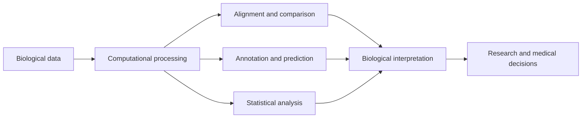

[[concepts/Market-Categories/TechBio vs Biotech|TechBio vs Biotech]]

# Defining and Describing Bioinformatics

- _Bioinformatics turns biological information into computable knowledge._
- Bioinformatics is a scientific subdiscipline that uses computational technology to collect, store, analyze, and disseminate biological data, including DNA and amino-acid sequences and their annotations. [^g228y2] It combines biology with computer science, statistics, mathematics, and related quantitative methods to interpret increasingly large datasets. [^g228y2] [^1m2ivj]
- The field is used wherever biological measurements become too numerous, complex, or interconnected for manual analysis, including genomics, transcriptomics, proteomics, structural biology, evolutionary research, and biomedical care. [^g228y2] [^1m2ivj]
- Its central activities include sequence alignment, gene prediction, variant calling, structural modeling, functional annotation, database construction, and systems-level network analysis. [^1m2ivj]

## Uses in Context

- Researchers use “bioinformatics” to describe computational analysis of DNA, RNA, protein sequences, and their annotations. [^g228y2]
- In genomics, the term commonly refers to workflows that align sequencing reads, identify variants, assemble genomes, and annotate genes. [^1m2ivj]
- In biomedical research, bioinformatics supports the organization and interpretation of health and disease data. [^g228y2]
- In structural biology, it includes computational prediction of three-dimensional protein structures and molecular interactions. [^li58l4]
- In software development, “bioinformatics tools” can mean command-line programs, databases, programming libraries, statistical packages, or machine-learning systems designed for biological data. [^li58l4] [^32x0as]

# History of Use

## Origins

- The term **bioinformatics** was coined in 1970 by Dutch theoretical biologists Paulien Hogeweg and Ben Hesper. [^li58l4] [^zu3t4v] Their formulation described the field as “the study of informatic processes in biotic systems.” [^27mw6u] [^t125wb]
- The concept predates the name: Margaret Dayhoff developed early computational approaches for protein sequence assembly and alignment between 1950 and 1970, helping establish methods later central to bioinformatics. [^li58l4]
- Early bioinformatics emerged from theoretical biology and information processing rather than from a single technology company; its initial concern was understanding biological systems through formal representations and computation. [^li58l4] [^t125wb]

## Evolution

- **1950–1970 — Computational molecular biology:** Margaret Dayhoff’s protein databases, amino-acid coding work, and sequence-alignment methods helped create practical foundations for computational biological analysis. [^li58l4]
- **1970 — Naming of the field:** Hogeweg and Hesper introduced “bioinformatics” as a framework for studying information processes in living systems. [^li58l4] [^27mw6u]
- **1990s–2000s — Large-scale sequence analysis:** Tools such as BLAST, Clustal W, and EMBOSS made sequence comparison and analysis accessible through command-line workflows, while the Human Genome Project generated data at a scale that demanded computational infrastructure. [^li58l4] [^32x0as]
- **2020s — Machine-learning expansion:** AlphaFold’s success at CASP14 in 2020 and the subsequent release of AlphaFold2 expanded bioinformatics from sequence analysis toward high-accuracy protein-structure prediction; AlphaFold3 later extended predictions to DNA, RNA, and ligand interactions. [^li58l4] [^32x0as]

# Best Real-World Examples

- [BLAST](https://blast.ncbi.nlm.nih.gov/) — a sequence-comparison system whose heuristic search made local similarity analysis practical at scale. [^li58l4] [^32x0as]
- [Bioconductor](https://bioconductor.org/) — an open-source ecosystem of R packages for genomic and biological-data analysis. [^32x0as]
- [Biopython](https://biopython.org/) — an open-source Python library for sequence handling, file parsing, and connections to external bioinformatics tools. [^32x0as]
- [EMBOSS](https://emboss.sourceforge.net/) — a collection of command-line programs for sequence analysis and related biological computation. [^li58l4]
- [Folding@home](https://foldingathome.org/) — a distributed-computing project founded in 2000 that uses volunteer computing resources for large-scale protein-folding simulations. [^li58l4]
- [AlphaFold](https://alphafold.ebi.ac.uk/) — a machine-learning system that substantially advanced prediction of protein structures from amino-acid sequences. [^li58l4] [^32x0as]
- [Human Genome Project](https://www.genome.gov/human-genome-project) — a landmark data-generating project that helped catalyze modern bioinformatics by creating unprecedented requirements for computational analysis. [^li58l4]

# Case Studies

**The Human Genome Project and the rise of data-intensive biology.** The Human Genome Project produced biological data on a scale that made manual interpretation impractical and helped catalyze modern bioinformatics. [^li58l4] Researchers required databases, sequence-alignment algorithms, annotation systems, and distributed computational infrastructure to transform raw sequence into a usable genome reference. [^li58l4] The project shows that bioinformatics is not merely a supporting software function: when measurement technologies change the scale of biological data, computational methods become part of the scientific method itself. [^g228y2] [^li58l4]

**BLAST and practical sequence comparison.** Stephen Altschul, Warren Gish, Webb Miller, Eugene Myers, and David Lipman introduced BLAST as a heuristic approach to local sequence alignment. [^32x0as] Rather than exhaustively calculating every possible alignment, BLAST searches for short high-scoring matches and extends promising candidates, making large-scale similarity searches computationally practical. [^32x0as] Its impact illustrates how an algorithmic approximation can become more useful than an exact method when biological datasets are large and researchers need fast, statistically interpretable results. [^32x0as]

**[[Vocabulary/AlphaFold|AlphaFold]] and machine-learning-driven structural biology.** Google DeepMind’s AlphaFold achieved a major result at the CASP14 protein-structure-prediction assessment in 2020, and AlphaFold2 was subsequently released and reported to predict many protein structures with near-atomic accuracy. [^li58l4] [^32x0as] Later systems expanded prediction beyond proteins to include DNA, RNA, and ligand interactions. [^li58l4] The case demonstrates how bioinformatics is broadening from databases and sequence comparison into predictive modeling, while also showing that high-impact innovation can emerge from a research laboratory’s published computational work rather than from routine adoption by incumbent technology companies. [^li58l4]

***

# Sources

[^g228y2]: 2026, Sep 24. [beta.nih.gov](https://beta.nih.gov/). [Bioinformatics | NIH](https://beta.nih.gov/genetics-glossary/Bioinformatics). Updated: 2026, Oct 27. Generated: 2026, Nov 05. [Perplexity](https://www.perplexity.ai/) API response.
[^li58l4]: 2026, Jul 03. [academic.oup.com](https://academic.oup.com/). [Eras of bioinformatics technologies from command-line ...](https://academic.oup.com/bib/article/27/4/bbag256/8732103). Updated: 2026, Nov 05. Generated: 2026, Nov 05. [Perplexity](https://www.perplexity.ai/) API response.
[^zu3t4v]: 2026, Apr 07. [press.asimov.com](https://press.asimov.com/). [A Brief History of Bioinformatics Software](https://press.asimov.com/articles/bioinformatics). Updated: 2026, Oct 04. Generated: 2026, Nov 05. [Perplexity](https://www.perplexity.ai/) API response.
[^27mw6u]: 2025, Nov 10. [technologynetworks.com](https://www.technologynetworks.com/). [Bioinformatics: Tools, Uses and Real-World Impact](https://www.technologynetworks.com/informatics/articles/an-introduction-to-bioinformatics-bioinformatics-tools-and-applications-406723). Updated: 2026, Nov 05. Generated: 2026, Nov 05. [Perplexity](https://www.perplexity.ai/) API response.
[^t125wb]: 2026, Jun 14. [geschichte-der-informatik.de](https://www.geschichte-der-informatik.de/). [Bioinformatics and the Human Genome](https://www.geschichte-der-informatik.de/articles/bioinformatics_and_the_human_genome/). Updated: 2026, Oct 03. Generated: 2026, Nov 05. [Perplexity](https://www.perplexity.ai/) API response.
[6]: 2026, Jul 15. [linkedin.com](https://www.linkedin.com/). [Bioinformatics Disciplines and Applications](https://www.linkedin.com/posts/fahad-almsned_fahaddata-learnforfree-bioinformatics-activity-7483172121955745793-FAmo). Updated: 2026, Jul 21. Generated: 2026, Nov 05. [Perplexity](https://www.perplexity.ai/) API response.
[7]: 2026, Feb 19. [scribd.com](https://www.scribd.com/). [Chapter 2_Access to Sequence Data and Related ...](https://www.scribd.com/document/982504904/Chapter-2-Access-to-Sequence-Data-and-Related-Information). Generated: 2026, Nov 05. [Perplexity](https://www.perplexity.ai/) API response.
[^32x0as]: 2026, Jul 24. [aiwiki.ai](https://aiwiki.ai/). [Bioinformatics | AI Wiki](https://aiwiki.ai/wiki/bioinformatics). Updated: 2026, Oct 31. Generated: 2026, Nov 05. [Perplexity](https://www.perplexity.ai/) API response.
[^1m2ivj]: 2026, Nov 03. [phys.org](https://phys.org/). [Bioinformatics — Research News & Scientific Publications - Phys.org](https://phys.org/concepts/bioinformatics/). Updated: 2026, Nov 05. Generated: 2026, Nov 05. [Perplexity](https://www.perplexity.ai/) API response.
[10]: 2025, Nov 20. [linkedin.com](https://www.linkedin.com/). [Bridging the gap between biologists and computationalists in research](https://www.linkedin.com/posts/shael-brown-ph-d-979a3a147_i-recently-spoke-with-a-researcher-about-activity-7397281619381989377-OEjK). Updated: 2026, Mar 19. Generated: 2026, Nov 05. [Perplexity](https://www.perplexity.ai/) API response.
