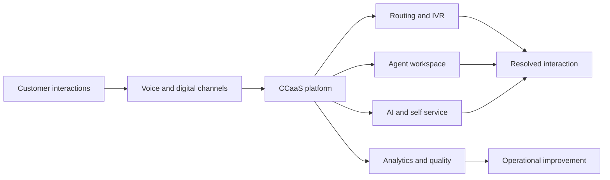

---
aliases:
  - contact center‑as‑a‑service
  - Contact Center as a Service
  - Contact Center‑as‑a‑Service
  - CCaaS
date_created: 2026-10-07
date_modified: 2026-11-05
tags:
  - Helpdesk-AI
cf_last_run: 2026-11-05T22:37:26.016Z
cf_last_run_model: Perplexity sonar-pro
---

[[concepts/Explainers for AI/Helpdesk AI|Helpdesk AI]]
[[Phone Agents]]
[[Vocabulary/Virtual Phone Systems|Virtual Phone Systems]]

# Defining and Describing Contact Center‑as‑a‑Service

- _Contact Center‑as‑a‑Service turns the contact center from owned infrastructure into an on-demand operating capability._
- Contact Center‑as‑a‑Service, commonly abbreviated **CCaaS**, is a cloud delivery model in which an organization subscribes to contact-center software rather than purchasing and maintaining its own telephony and server infrastructure. [^sxm4ya] [^96dt4g] Typical capabilities include automatic call distribution, interactive voice response, digital channels, workforce management, quality management, recording, reporting, and analytics. [^guy7xj] [^sxm4ya] [^96dt4g]
- The model applies when organizations need to manage customer or constituent interactions across voice and digital channels while scaling capacity, supporting distributed agents, or adding automation without rebuilding the underlying platform. [^sxm4ya] [^96dt4g]
- CCaaS matters because it shifts contact-center technology from a capital-intensive, hardware-managed system toward subscription access, browser-based operations, integrated data, and increasingly AI-assisted service. [^sxm4ya] [^96dt4g]

## Uses in Context

- **Cloud migration:** “CCaaS” describes replacing premises-based contact-center equipment with vendor-hosted software delivered through a subscription. [^sxm4ya] [^96dt4g]
- **Omnichannel service:** The term denotes a unified environment for telephone, email, chat, social messaging, recording, routing, and reporting. [^sxm4ya]
- **Remote and distributed work:** CCaaS is invoked when agents need browser-based access to customer-service tools from different locations. [^96dt4g]
- **Automation:** Modern CCaaS refers not only to telephony but also to self-service, AI assistants, agent assistance, analytics, and automated workflows. [^guy7xj] [^b9wzcp]
- **Operating-model change:** Businesses use the term to describe outsourcing the platform layer while retaining responsibility for service design, staffing, policies, and customer outcomes. [^sxm4ya] [^96dt4g]

## History of Use

### Origins

The underlying lineage begins with call centers developed from the 1960s onward, followed by automatic call distribution, interactive voice response in the 1980s, and broader contact-center channels during the internet expansion of the 2000s. [^guy7xj] The specific CCaaS category emerged from early cloud contact-center offerings associated with providers such as inContact and Five9 during approximately 2005–2012, initially targeting smaller organizations and facing enterprise concerns about voice quality and reliability. [^96dt4g] Available sources do not establish a single person or publication as the definitive first coiner of the term; instead, they document its emergence as an industry category alongside cloud delivery.

### Evolution

- **1960s–1980s — From call handling to managed routing:** Early call centers adopted voice systems, automatic call distributors, and later interactive voice response, creating the technical foundation for scalable contact operations. [^guy7xj]
- **1990s–2000s — From calls to contacts:** Contact centers expanded beyond telephone interactions to letters, email, live chat, and social media; the term “contact” replaced “call” as the channel set widened. [^sxm4ya]
- **2005–2021 — Cloud adoption and acceleration:** Early cloud offerings appeared in the mid-2000s, enterprise adoption expanded during the 2010s, and the COVID-19 shift to remote work accelerated demand for browser-based contact-center access. [^96dt4g]
- **2020s — AI-enabled CCaaS:** Next-generation platforms increasingly combine human agents with chatbots, generative AI, speech analytics, automation, and self-service rather than serving merely as hosted telephony. [^guy7xj] [^b9wzcp]

## Best Real-World Examples

- [Five9](https://www.five9.com/) — [[Five9]] — An early cloud contact-center provider associated with the 2005–2012 emergence of CCaaS offerings. [^96dt4g]
- [inContact](https://www.nice.com/) — An early cloud contact-center platform identified in accounts of CCaaS’s formative period. [^96dt4g]
- [Genesys Cloud](https://www.genesys.com/genesys-cloud) — A 2015 enterprise cloud-platform launch that helped normalize CCaaS for larger organizations. [^96dt4g]
- [NICE CXone](https://www.nice.com/products/cxone) — A broad CCaaS platform combining routing, digital engagement, workforce tools, quality, and analytics. [^96dt4g]
- [Google Cloud Contact Center as a Service](https://cloud.google.com/contact-center) — An example of a large technology company adopting and popularizing cloud contact-center infrastructure with generative-AI capabilities. [^b9wzcp]
- [Tollanis AI Cloud Contact Center](https://tollanis.com/cases-studies/ai-cloud-contact-center-case-study-retail-cost-reduction) — A smaller-provider example combining remote-first operations, AI automation, and cloud delivery. [^jl2dmr]
- [Verint Open Platform](https://www.verint.com/) — An example of CCaaS integrated with speech analytics, quality management, workforce tools, and customer-experience measurement. [^2r6l2f] [^g32cbf]

## Case Studies

**Cox Communications and Google Cloud.** Cox migrated its virtual assistant, “Oliver,” to Google’s CCaaS environment and combined deterministic automation with agentic generative-AI capabilities. [^b9wzcp] The resulting program reportedly improved first-contact resolution by 10% within a week and by 17% within a year, while chatbot-channel usage increased eightfold. [^b9wzcp] Self-service resolved more than 30% of selected requests, and appointment-related inquiries reached a 32% resolution rate in the first month. [^b9wzcp] The case shows how CCaaS is evolving from hosted routing software into an orchestration layer for human service, bots, customer context, and measurable resolution outcomes. [^guy7xj] [^b9wzcp]

**A U.S. retail brand and Tollanis.** A rapidly growing retailer facing rising volumes for orders, returns, and product support implemented a remote-first, AI-powered cloud contact center. [^jl2dmr] The reported deployment reduced operating costs by 45%, handled 72% of customer queries through AI automation, and achieved a 100% call-answer rate. [^jl2dmr] The case illustrates the appeal of CCaaS for organizations that need peak-demand scalability without adding equivalent premises infrastructure or staffing overhead, although the provider-reported figures should be treated as vendor case-study claims rather than independently audited results. [^jl2dmr]

**HomeServe and Verint.** HomeServe used Verint’s open platform and speech-analytics reporting to identify opportunities for call reduction and service improvement. [^2r6l2f] The organization reported a 22% increase in customer satisfaction and identified more than 13% potential call reduction or deflection opportunities. [^2r6l2f] This example demonstrates a broader CCaaS pattern: value does not come only from moving software to the cloud, but from converting interaction data into operational changes, training priorities, and self-service opportunities. [^2r6l2f] [^g32cbf]

***

# Sources

[^guy7xj]: 2026, Jul 07. [verint.com](https://www.verint.com/). [What is CCaaS? A Guide to Contact Center as a Service](https://www.verint.com/blog/what-is-ccaass/). Updated: 2026, Nov 04. Generated: 2026, Nov 05. [Perplexity](https://www.perplexity.ai/) API response.
[^b9wzcp]: 2026, Aug 14. [cognizant.com](https://www.cognizant.com/). [Cox Communications' bold vision redefines the contact ...](https://www.cognizant.com/us/en/case-studies/cox-communications-bold-vision-redefines-the-contact-center-experience). Updated: 2026, Oct 27. Generated: 2026, Nov 05. [Perplexity](https://www.perplexity.ai/) API response.
[^jl2dmr]: 2026, Sep 30. [tollanis.com](https://tollanis.com/). [AI Cloud Contact Center Case Study | 45% Cost Reduction with ...](https://tollanis.com/cases-studies/ai-cloud-contact-center-case-study-retail-cost-reduction). Updated: 2026, Oct 26. Generated: 2026, Nov 05. [Perplexity](https://www.perplexity.ai/) API response.
[4]: 2026, Oct 05. [verint.com](https://www.verint.com/). [Cognizant Elevates Customer Experience for One of the World's ...](https://www.verint.com/pt-br/case-studies/cognizant-elevates-customer-experience-for-one-of-the-worlds-largest-athletic-footwear-and-apparel-brands/). Updated: 2026, Oct 16. Generated: 2026, Nov 05. [Perplexity](https://www.perplexity.ai/) API response.
[5]: 2026, Aug 03. [concentrix.com](https://www.concentrix.com/). [Transforming Collections With AI-Enabled Dialers, Omnichannel ...](https://www.concentrix.com/insights/case-studies/transforming-collections-with-ai-enabled-omnichannel-engagement/). Updated: 2026, Nov 04. Generated: 2026, Nov 05. [Perplexity](https://www.perplexity.ai/) API response.
[6]: 2026, Apr 28. [callcenterstudio.com](https://callcenterstudio.com/). [Why Call Center Studio is the Ultimate Sandbox for Modern ...](https://callcenterstudio.com/blog/why-call-center-studio-is-the-ultimate-sandbox-for-modern-cx-leaders/). Updated: 2026, Nov 04. Generated: 2026, Nov 05. [Perplexity](https://www.perplexity.ai/) API response.
[^2r6l2f]: 2026, Oct 05. [verint.com](https://www.verint.com/). [HomeServe ofrece una experiencia de cliente excepcional ...](https://www.verint.com/es/case-studies/homeserve-delivers-exceptional-cx-with-verint/). Updated: 2026, Oct 30. Generated: 2026, Nov 05. [Perplexity](https://www.perplexity.ai/) API response.
[^sxm4ya]: 2026, Oct 05. [knowmax.ai](https://knowmax.ai/). [What Is a Contact Center? Meaning, Types and How It Works](https://knowmax.ai/blog/what-is-a-contact-center/). Updated: 2026, Oct 27. Generated: 2026, Nov 05. [Perplexity](https://www.perplexity.ai/) API response.
[^96dt4g]: 2026, May 17. [wiki.wfmlabs.org](https://wiki.wfmlabs.org/). [Contact Center as a Service](https://wiki.wfmlabs.org/wiki/UCaaS_and_CCaaS_Convergence). Updated: 2026, May 20. Generated: 2026, Nov 05. [Perplexity](https://www.perplexity.ai/) API response.
[^g32cbf]: 2026, Oct 05. [verint.com](https://www.verint.com/). [Harel Group Implements Best-of-Breed Verint Open CCaaS Platform ...](https://www.verint.com/fr/case-studies/harel-group-implements-best-of-breed-verint-open-ccaas-platform-solutions-for-seamless-call-monitoring-and-analysis/). Updated: 2026, Oct 30. Generated: 2026, Nov 05. [Perplexity](https://www.perplexity.ai/) API response.
