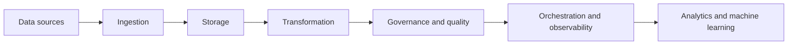

[[Vocabulary/Data Pipelines|Data Pipelines]]
[[Tooling/Software Development/Cloud Infrastructure/Snowflake|Snowflake]]
[[Tooling/Data Utilities/DataBricks|DataBricks]]
[[concepts/Explainers for Tooling/Databases|Databases]]
[[concepts/Explainers for Tooling/Databases-as-a-Service|Databases-as-a-Service]]
[[Tooling/Data Utilities/Bruin|Bruin]]
[[Tooling/Software Development/Databases/Clickhouse|Clickhouse]]
[[Tooling/Software Development/Developer Experience/DevOps/Apache Airflow|Apache Airflow]]
[[Tooling/Data Utilities/Apache Iceberg|Apache Iceberg]]

# Defining and Describing Data Infrastructure

_Data infrastructure is the connective tissue that turns scattered data into a dependable organizational capability._

Data infrastructure comprises the systems, services, standards, and operating practices used to collect, move, store, transform, govern, observe, and serve data. It applies wherever data must support reporting, operational decisions, experimentation, artificial intelligence, or machine learning. Its importance lies in making data accessible and reusable while controlling reliability, latency, security, cost, and duplication; modern lakehouse architectures, for example, aim to let one shared dataset serve business intelligence, large-scale analytics, and AI or machine-learning workloads. [^agz9nn] [^2c00cy]

## Uses in Context

- **Analytics foundation:** Organizations use “data infrastructure” to describe the pipelines, warehouses, lakes, and governance controls that make trusted reporting possible. [^agz9nn] [^2c00cy]
- **AI and machine learning substrate:** The term often refers to the systems that prepare, serve, and monitor the data required by models, including real-time sensor streams and historical datasets. [^9hsc4w]
- **Operational scale:** Infrastructure language emphasizes dependable ingestion, processing, and serving when systems must handle high-volume or low-latency workloads. [^2sbady] [^9hsc4w]
- **Data-platform ownership:** Teams invoke the term when consolidating pipelines, transformation, orchestration, monitoring, and debugging into an environment they can operate directly. [^dsrxx5]
- **Interoperability and reduced duplication:** Open data infrastructure commonly means shared storage and formats that allow multiple engines to use the same data without repeated copies or reformatting. [^agz9nn] [^0r4z28]

## History of Use

### Origins

“Data infrastructure” is best understood as an umbrella term rather than a single invention with one universally accepted origin. Its technical lineage runs through data warehouses, cloud object-storage data lakes, distributed processing, workflow orchestration, and open table formats. A major documented transition occurred when data lakes emerged on cloud object storage in the early 2000s, complementing structured warehouses by allowing raw data to be stored and accessed by multiple analytical systems. [^agz9nn] Apache Iceberg provides a more specific origin story within modern lakehouse infrastructure: it was created at Netflix in 2017 to address the operational problems of petabyte-scale data lakes and contributed to the Apache Software Foundation in 2018. [^agz9nn]

### Evolution

- **Early 2000s — From warehouse-only systems to data lakes:** Cloud object storage enabled organizations to retain raw, varied data in a shared repository, expanding infrastructure beyond conventional structured warehouses. [^agz9nn]
- **Late 2010s — Lakehouse convergence:** Organizations increasingly operated warehouses and lakes in parallel, creating duplication and movement; lakehouse architectures emerged to combine flexible storage with warehouse-like governance and performance. [^agz9nn] [^2c00cy]
- **2017–2018 onward — Open table formats:** Apache Iceberg introduced capabilities such as safe concurrent writes, schema evolution, and transactional behavior to lake-based systems, while its open design enabled different engines to work with the same data. [^agz9nn] [^0r4z28]

## Best Real-World Examples

- [Apache Iceberg](https://iceberg.apache.org/) — [[Tooling/Data Utilities/Apache Iceberg|Apache Iceberg]] — an open table format created at Netflix for large-scale data lakes and later contributed to the Apache Software Foundation. [^agz9nn]
- [Apache Airflow](https://airflow.apache.org/) — [[Tooling/Software Development/Developer Experience/DevOps/Apache Airflow|Apache Airflow]] — an open-source orchestration system exemplified by organizations standardizing workflows and enabling engineers to contribute data pipelines without managing underlying infrastructure. [^t0vdz7]
- [dbt](https://www.getdbt.com/) — a transformation and data-development tool used to bring modeling, testing, debugging, and pipeline ownership into a unified workflow. [^dsrxx5]
- [ClickHouse](https://clickhouse.com/) — [[Tooling/Software Development/Databases/Clickhouse|Clickhouse]] — an analytical database associated with lakehouse architectures that use open formats and shared storage across business intelligence, analytics, and AI workloads. [^2c00cy]
- [Greenlyte Carbon Technologies](https://www.greenlyte.com/) — a climate-technology startup whose pilot-plant sensor data supports a real-time lakehouse and predictive experimentation. [^9hsc4w]
- [Zeta Global](https://zetaglobal.com/) — [[Tooling/AI-Toolkit/AI Interfaces/AI Workspaces/Vertical Wrappers/Zeta Global|Zeta Global]] — an example of a large data user applying an open lakehouse architecture to petabyte-scale marketing data and near-real-time insights. [^r64iqv]
- [Razor Group](https://www.razor-group.com/) — an example of replacing tool-specific copies with a single open-format data lake queried by multiple purpose-built engines. [^0r4z28]

## Case Studies

**Greenlyte Carbon Technologies and real-time experimental infrastructure.** Greenlyte, a direct-air-capture startup, generated continuous measurements including flow rates, humidity, temperature, and pressure across pilot-plant processes. [^9hsc4w] Its data platform unified real-time ingestion with historical analysis in a lakehouse architecture, while predictive models used initial conditions and live readings to anticipate experimental outcomes. [^9hsc4w] The case shows that data infrastructure is not merely back-office storage: for a research-intensive startup, it can shorten experimental feedback loops and connect physical operations to machine-learning-assisted decisions. [^9hsc4w]

**Razor Group and the move from duplicated data to a shared source of truth.** Razor Group’s earlier architecture maintained separate copies of data for different tools, whereas its newer design placed data in one open-format lake that multiple compute engines could query. [^0r4z28] Apache Iceberg supplied features including transactions, schema evolution, time travel, and reduced dependence on a single vendor’s storage format. [^0r4z28] The case illustrates a central infrastructure principle: separating storage from workload-specific compute can improve interoperability and reduce unnecessary movement or duplication. [^0r4z28]

**INSIDER and internal ownership of the data platform.** INSIDER used Fivetran and dbt to bring transformation workflows in-house, with a small team taking responsibility for pipelines, models, orchestration, monitoring, and debugging. [^dsrxx5] The consolidation gave the team direct operational ownership of the platform and was associated with a reported 98% reduction in continuous-integration cycle time. [^dsrxx5] The example demonstrates how data infrastructure also concerns organizational design: tools matter, but so do ownership boundaries, development workflows, and the ability to operate the system without external dependence. [^dsrxx5]

***

# Sources

[^r64iqv]: 2026, Nov 05. [aws.amazon.com](https://aws.amazon.com/). [How Zeta Global delivers near real-time, AI-powered ...](https://aws.amazon.com/solutions/case-studies/zeta-global-s3-tables/). Updated: 2026, Nov 06. Generated: 2026, Nov 07. [Perplexity](https://www.perplexity.ai/) API response.
[^agz9nn]: 2026, Oct 26. [aws.amazon.com](https://aws.amazon.com/). [A technical decision-maker’s guide to open data architectures with Apache Iceberg](https://aws.amazon.com/tw/data/resources/open-data-architecture-apache-iceberg-guide/). Updated: 2026, Oct 13. Generated: 2026, Nov 07. [Perplexity](https://www.perplexity.ai/) API response.
[^t0vdz7]: 2026, Jul 14. [astronomer.io](https://www.astronomer.io/). [How Astro Helps Agents Build Together AI's Data Warehouse](https://www.astronomer.io/case-studies/together-ai/). Updated: 2026, Nov 06. Generated: 2026, Nov 07. [Perplexity](https://www.perplexity.ai/) API response.
[4]: 2026, Apr 28. [prosperspark.com](https://www.prosperspark.com/). [AI Fintech Data Architecture Planning Case Study](https://www.prosperspark.com/case-study-ai-fintech-data-architecture/). Updated: 2026, Aug 16. Generated: 2026, Nov 07. [Perplexity](https://www.perplexity.ai/) API response.
[^2sbady]: 2026, Mar 19. [automat-it.com](https://www.automat-it.com/). [Lumigo Scale Observability and Cost-Efficiency with AWS ...](https://www.automat-it.com/case-studies/lumigo-scale-observability-and-cost-efficiency-with-aws-automat-it/). Updated: 2026, Nov 06. Generated: 2026, Nov 07. [Perplexity](https://www.perplexity.ai/) API response.
[^dsrxx5]: 2026, Nov 04. [courses.getdbt.com](https://courses.getdbt.com/). [How INSIDER took ownership of its data platform and cut CI cycles by 98% with Fivetran + dbt Labs | dbt Labs](https://courses.getdbt.com/case-studies/insider). Updated: 2026, Nov 05. Generated: 2026, Nov 07. [Perplexity](https://www.perplexity.ai/) API response.
[^2c00cy]: 2026, Apr 17. [clickhouse.com](https://clickhouse.com/). [What is a data lakehouse? | Engineering | ClickHouse Resource Hub](https://clickhouse.com/resources/engineering/data-lakehouse). Updated: 2026, Nov 06. Generated: 2026, Nov 07. [Perplexity](https://www.perplexity.ai/) API response.
[^9hsc4w]: 2026, Nov 04. [datamax.ai](https://www.datamax.ai/). [Accelerating Climate Innovation at Greenlyte — Building an AI ...](https://www.datamax.ai/en/case-studies/greenlyte-direct-air-capture). Updated: 2026, Oct 16. Generated: 2026, Nov 07. [Perplexity](https://www.perplexity.ai/) API response.
[9]: 2026, Nov 02. [crustdata.com](https://www.crustdata.com/). [Customer Case Studies | Crustdata](https://www.crustdata.com/casestudies). Updated: 2026, Nov 01. Generated: 2026, Nov 07. [Perplexity](https://www.perplexity.ai/) API response.
[^0r4z28]: 2026, Aug 28. [aws.amazon.com](https://aws.amazon.com/). [Razor Group’s journey to a modern data lakehouse on AWS | Amazon Web Services](https://aws.amazon.com/blogs/big-data/razor-groups-journey-to-a-modern-data-lakehouse-on-aws/). Updated: 2026, Oct 15. Generated: 2026, Nov 07. [Perplexity](https://www.perplexity.ai/) API response.
