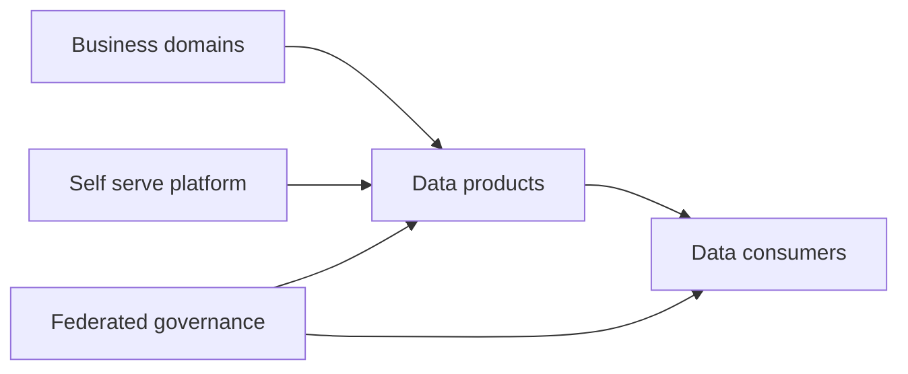

[[Tooling/Data Utilities/Bruin|Bruin]]

# Defining and Describing Data Mesh

- _Data mesh makes data ownership a distributed product responsibility rather than a central-team bottleneck._
- Data mesh is a decentralized data-architecture and operating model in which business domains own, manage, and publish analytical data as discoverable, reusable data products. [^a9r0xt] It combines domain ownership with shared platform capabilities and centrally coordinated standards for interoperability, security, and consistency. [^xtn4zg]
- The approach applies most strongly in large or complex organizations where a centralized data team struggles to understand many business contexts or satisfy growing demand for analytics. [^a9r0xt]
- Its central proposition is organizational as much as technical: the teams closest to source data become accountable for its quality, documentation, interfaces, and ongoing evolution. [^a9r0xt]

# Uses in Context

- Organizations use “data mesh” to describe a shift from centralized data ownership toward domain-oriented responsibility. [^a9r0xt]
- Architecture teams invoke the term for systems in which marketing, finance, logistics, product, or other domains independently publish analytical data products. [^a9r0xt]
- Data leaders use it to frame data as a product with documentation, discoverability, reuse, and defined consumers rather than as an undifferentiated technical by-product. [^a9r0xt]
- Platform teams use the concept to describe shared capabilities for ingestion, cataloging, lineage, access control, quality, and self-service publishing. [^7fyvwj]
- Governance discussions use “federated computational governance” to mean common, enforceable rules that coordinate autonomous domain teams. [^4ipsgu]

# History of Use

## Origins

- Zhamak Dehghani introduced data mesh in 2019 while working at Thoughtworks, presenting it as an alternative to centralized data architectures and grounding it in domain-driven design and distributed-systems ideas. [^a9r0xt] [^xtn4zg]
- The originating context was the difficulty of scaling centralized data platforms: domain experts were separated from data ownership, while central teams became queues for data requests and quality decisions. [^4ipsgu] [^xtn4zg]
- The initial formulation centered on four principles: domain-oriented ownership, data as a product, a self-serve data platform, and federated computational governance. [^4ipsgu]

## Evolution

- **2019 — Conceptual proposal:** Data mesh emerged as a domain-oriented alternative to centralized data architecture, with business domains responsible for analytical data products. [^a9r0xt] [^xtn4zg]
- **Subsequent adoption — Platform interpretation:** Implementations expanded the concept from organizational design into platform capabilities for discovery, ingestion, quality, lineage, access control, and self-service publishing. [^7fyvwj]
- **Current practice — Hybrid operating models:** Organizations increasingly combine decentralized domain ownership with central platform teams, product ownership, governance councils, and shared architectural foundations. [^w1uq7v] [^4ipsgu]

# Best Real-World Examples

- [DataHub](https://datahub.com/blog/what-is-data-mesh/) — An open-source metadata and discovery platform commonly used to catalog, document, and discover distributed data products. [^a9r0xt] [^7fyvwj]
- [Canonical Data Mesh](https://canonical.com/blog/canonical-data-mesh-scaling-data-governance) — An open-source-oriented reference architecture combining Airbyte, DataHub, Trino, and Apache Ranger across ingestion, metadata, querying, and policy enforcement. [^7fyvwj]
- [Scalefocus beverage-company platform](https://www.scalefocus.com/case-studies/cutting-analytics-lead-time-with-a-self-serve-data-platform) — A domain-oriented platform enabling commercial, finance, and supply-chain teams to create and evolve their own data products. [^vlo8v2]
- [Scalefocus Databricks architecture](https://www.scalefocus.com/blog/data-mesh-in-databricks) — A practical implementation that combines domain ownership with shared rules for interoperability, security, and consistency. [^xtn4zg]
- [Simor Consulting insurance implementation](https://simorconsulting.com/blog/data-mesh-in-practice-year-2-retrospective) — A model in which business units own claims, underwriting, and actuarial data products while a platform team supplies publishing, discovery, and access tooling. [^4ipsgu]
- [ACA Group banking proof of concept](https://acagroup.be/en/cases?services=data_solutions) — A bank modernization project using domain-oriented ownership and a self-service platform to address limitations of centralized architecture. [^kvf2xq]
- [Automotive-startup case study](https://link.springer.com/chapter/10.1007/978-3-032-34571-4_8) — A reported transition from centralized data architecture to a cloud-based, decentralized mesh that improved team autonomy and reduced storage and query costs. [^4obvpk]

# Case Studies

A multinational beverage company worked with Scalefocus to build a data-mesh and advanced-analytics platform on [[Tooling/Data Utilities/DataBricks|DataBricks]] and Azure. [^vlo8v2] The design moved ownership toward commercial, finance, and supply-chain domains, allowing those teams to create and evolve data products while shared automation and visibility maintained common standards. [^vlo8v2] The case illustrates that data mesh is not simply a distributed storage topology: it is an operating model that pairs domain accountability with reusable platform capabilities. [^vlo8v2]

An insurance organization described a second-year implementation in which each business unit received a data-product owner and the central data team was restructured around self-service enablement. [^4ipsgu] The platform team built tools for publishing, discovery, and access control, while domains owned claims, underwriting, and actuarial products according to their own source systems, consumers, and quality requirements. [^4ipsgu] The reported change was the removal of a central request queue, allowing units to publish on their own timelines; the case shows how domain boundaries can make ownership operationally sustainable when they match real business responsibilities. [^4ipsgu]

A startup automotive case study reports a transition from centralized architecture to a decentralized data mesh using AWS services while retaining cloud-agnostic principles. [^4obvpk] The reported outcomes included lower storage and query costs, faster delivery of new data products, and greater autonomy for data teams; a credit-approval model served as an example of self-service access enabling faster experimentation. [^4obvpk] This case presents data mesh as a scaling strategy for smaller innovators as well as large enterprises, provided that domain ownership and platform autonomy are designed together. [^4obvpk]

***

# Sources

[^vlo8v2]: 2026, Jun 30. [scalefocus.com](https://www.scalefocus.com/). [Self-Serve Data Mesh on Databricks | Scalefocus](https://www.scalefocus.com/case-studies/cutting-analytics-lead-time-with-a-self-serve-data-platform). Updated: 2026, Jun 17. Generated: 2026, Nov 05. [Perplexity](https://www.perplexity.ai/) API response.
[^4obvpk]: 2026, Oct 06. [link.springer.com](https://link.springer.com/). [From Centralized Data to Data Mesh: A Case Study of Scalable Data...](https://link.springer.com/chapter/10.1007/978-3-032-34571-4_8). Updated: 2026, Oct 26. Generated: 2026, Nov 05. [Perplexity](https://www.perplexity.ai/) API response.
[3]: 2026, Jul 21. [digetiers.com](https://www.digetiers.com/). [Data Governance & Data Domains – Case Study | digetiers](https://www.digetiers.com/en/engagements/data-governance-management-organisation). Updated: 2026, Sep 12. Generated: 2026, Nov 05. [Perplexity](https://www.perplexity.ai/) API response.
[^w1uq7v]: 2026, Apr 07. [ltm.com](https://www.ltm.com/). [Data Mesh Implementation for Engineering & Construction](https://www.ltm.com/insights/case-studies/data-mesh-empowering-an-engineering-and-construction-company). Updated: 2026, Oct 27. Generated: 2026, Nov 05. [Perplexity](https://www.perplexity.ai/) API response.
[5]: 2026, Jul 12. [coforge.com](https://www.coforge.com/). [AI-Driven Data Mesh Platform for Enterprise Agility | Case Studies](https://www.coforge.com/success-stories/driving-enterprise-agility-with-an-ai-driven-data-mesh-platform). Updated: 2026, Oct 27. Generated: 2026, Nov 05. [Perplexity](https://www.perplexity.ai/) API response.
[^4ipsgu]: 2026, Jun 16. [simorconsulting.com](https://simorconsulting.com/). [Data mesh in practice: year 2 retrospective](https://simorconsulting.com/blog/data-mesh-in-practice-year-2-retrospective). Updated: 2026, Oct 31. Generated: 2026, Nov 05. [Perplexity](https://www.perplexity.ai/) API response.
[^a9r0xt]: 2026, Mar 20. [datahub.com](https://datahub.com/). [What Is Data Mesh? | DataHub](https://datahub.com/blog/what-is-data-mesh/). Updated: 2026, Oct 30. Generated: 2026, Nov 05. [Perplexity](https://www.perplexity.ai/) API response.
[^kvf2xq]: 2026, Aug 07. [acagroup.be](https://acagroup.be/). [Cases | Read our customer cases | ACA Group](https://acagroup.be/en/cases?services=data_solutions). Updated: 2026, Oct 28. Generated: 2026, Nov 05. [Perplexity](https://www.perplexity.ai/) API response.
[^xtn4zg]: 2026, Aug 21. [scalefocus.com](https://www.scalefocus.com/). [Data Mesh in Databricks: Architecture](https://www.scalefocus.com/blog/data-mesh-in-databricks). Updated: 2026, Aug 22. Generated: 2026, Nov 05. [Perplexity](https://www.perplexity.ai/) API response.
[^7fyvwj]: 2026, Aug 31. [canonical.com](https://canonical.com/). [Canonical Data Mesh: scaling data governance](https://canonical.com/blog/canonical-data-mesh-scaling-data-governance). Updated: 2026, Oct 28. Generated: 2026, Nov 05. [Perplexity](https://www.perplexity.ai/) API response.
