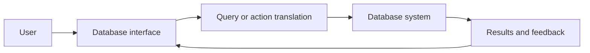

:::tool-showcase
- [[Tooling/Software Development/Lego-Kit Engineering Tools/Backend-as-a-Service/Outerbase|Outerbase]]
- [[Tooling/Enterprise Jobs-to-be-Done/Rocketadmin|Rocketadmin]]
:::
# Defining and Describing Database Interfaces

- _A database interface is the boundary that lets people inspect, query, modify, and administer stored data without requiring the same level of knowledge as the underlying database system._
- Database interfaces translate human actions—such as filling in forms, selecting icons, navigating relationships, or writing queries—into database operations. Early research emphasized that interfaces had to serve nontechnical users, while later systems expanded toward graphical browsing, multimodal interaction, and natural-language access. [^oy2fh8] [^bwovf4] [^3ct0z3]
- The concept applies wherever users need to work with structured data: business applications, engineering systems, personal databases, research tools, and administrative software. Its central design problem is balancing expressive power with learnability, accuracy, and protection against invalid or unintended operations. [^1a08wb] [^oy2fh8] [^3ct0z3]

# Uses in Context

- **Business applications:** Forms and tables let staff create, maintain, and manipulate relational data without directly writing formal queries. [^1a08wb]
- **Exploratory search:** Browsing interfaces help users investigate vague information needs when a precise query is difficult to formulate. [^bwovf4]
- **Visual querying:** Icons, diagrams, and graphical schema views represent database objects and relationships in ways intended to reduce dependence on query-language expertise. [^p4n1do] [^n5p9lu]
- **Engineering design:** Interfaces can combine constraints, examples, pointing at graphical parts, and query language in a multimodal workstation environment. [^3ct0z3]
- **Natural-language access:** Natural-language interfaces attempt to let users express requests in ordinary language, although experiments found that natural-language users could produce more unanswerable queries than users of artificial query languages. [^oy2fh8] [^pbv8db]
- **Casual-user access:** Graphical interfaces are designed for users who may lack formal database training or familiarity with database organization. [^bwovf4] [^c0sif2]

# History of Use

## Origins

- The modern research agenda emerged from human-factors work on database interaction. Ben Shneiderman’s 1978 paper argued that the spread of information systems to nontechnically trained users required “a new approach” to database-interface design and proposed controlled experiments comparing natural and artificial query languages. [^oy2fh8]
- Earlier relational-interface research explored ways to make databases usable through browsing rather than formal query specification. The 1986 BAROQUE system presented a relational database as a semantic-network-like environment and supported exploratory retrieval with few formal skills. [^bwovf4]
- The concept was also shaped by entity-relationship and graphical interaction research. The 1984 Living in a Database system used a bit-mapped display and mouse interaction for an entity-relationship database, while noting the implementation difficulty of dynamic displays and the challenge of operating on sets of instances. [^xuhcp0]

## Evolution

- **1978–1984 — Human factors and graphical interaction:** Research shifted from treating database access primarily as query formulation toward studying usability, visual presentation, dynamic displays, and the needs of nontechnical users. [^oy2fh8] [^xuhcp0]
- **1986–1990 — Browsing, icons, and graphical query construction:** Systems such as BAROQUE and IconicBrowser made exploratory retrieval and object selection central interaction modes; IconicBrowser used icons for classes and objects and interpreted combinations of overlapping icons as database operations. [^bwovf4] [^p4n1do]
- **Late 1980s onward — Domain-specific and multimodal interfaces:** Database interfaces expanded beyond business-style text interaction to engineering environments combining graphics, constraints, examples, and specialized query languages, while form-based systems mapped familiar screen layouts onto normalized relational structures. [^3ct0z3] [^1a08wb]

# Best Real-World Examples

- [BAROQUE](http://dl.acm.org/doi/10.1145/6168.6172) — a relational-database browser designed for exploratory search when users could not specify precise queries. [^bwovf4]
- [IconicBrowser](http://dl.acm.org/doi/10.1016/S1045-926X(05)80034-5) — an icon-based object-oriented database retrieval system that translated visual combinations into database operations. [^p4n1do]
- [Living in a Database](https://dl.acm.org/doi/10.1145/971697.602273) — an early graphical entity-relationship interface using a bit-mapped display and mouse pointer. [^xuhcp0]
- [A user interface for database creation, use and maintenance](http://dl.acm.org/doi/10.1145/62453.62490) — a form-and-table interface that allowed users to manipulate relational data through screen images rather than direct relational operations. [^1a08wb]
- [A graphical database interface for casual, naive users](https://dl.acm.org/doi/10.1016/0306-4573(86)90102-0) — research focused explicitly on making database access practical for casual and inexperienced users. [^c0sif2]
- [A Graphical Interface to a Complex-Object Database Management System](https://link.springer.com/chapter/10.1007/978-1-4471-3423-7_12) — a graphical system that displayed schemas, formulated queries visually, and presented results as navigable complex-object graphs. [^n5p9lu]
- [A practical natural language interface to databases](http://dl.acm.org/doi/10.5555/65686.65692) — an early applied treatment of translating ordinary-language requests into database access. [^pbv8db]

# Case Studies

**BAROQUE and exploratory retrieval.** Published in 1986, BAROQUE addressed a limitation of formal query systems: users often know the general area of information they want but cannot express the target precisely in advance. [^bwovf4] Its designers created a browser that represented schema and data together in a semantic-network-like view and supported scanning, navigation, and access by value. [^bwovf4] The result was an interface that treated browsing as a legitimate retrieval strategy rather than as a fallback for failed querying. [^bwovf4] The case shows that database interfaces can lower the cost of uncertainty by helping users discover both the data and the structure of the database while searching.

**IconicBrowser and visual query composition.** IconicBrowser, published in 1990, targeted object-oriented databases whose query languages were considered difficult for casual users. [^p4n1do] It represented classes and objects with icons; users specified queries by overlapping icons, after which the system interpreted the combination as database operations and generated predicate-based queries for other applications. [^p4n1do] This approach moved part of query construction from symbolic language into spatial manipulation. [^p4n1do] The case demonstrates how an interface can preserve the expressive capabilities of a complex database model while presenting users with a more concrete interaction vocabulary.

**Form-based relational interaction.** The 1988 form-and-table interface addressed people who were accustomed to collecting and maintaining information in forms or tables but were not professionally trained in computer science. [^1a08wb] Users worked through screen images of tables or forms while the system mapped those views to a relational database whose underlying structure was normalized. [^1a08wb] The research focused on the mappings required to connect familiar visual representations with relational operations. [^1a08wb] This case illustrates a recurring pattern in interface design: the visible model can be shaped around users’ work practices even when the underlying data model is more abstract and technically constrained.

***

# Sources

[^1a08wb]: 2026, Nov 08. [dl.acm.org](http://dl.acm.org/). [A user interface for database creation use and maintenance | Proceedings of the 1988 ACM SIGSMALL/PC symposium on ACTES](http://dl.acm.org/doi/10.1145/62453.62490). Updated: 2026, Nov 11. Generated: 2026, Nov 16. [Perplexity](https://www.perplexity.ai/) API response.
[^p4n1do]: 2026, Nov 11. [dl.acm.org](http://dl.acm.org/). [IconicBrowser: An iconic retrieval system for object-oriented databases: Journal of Visual Languages and Computing: Vol 1, No 1](http://dl.acm.org/doi/10.1016/S1045-926X(05)80034-5). Updated: 2026, Nov 14. Generated: 2026, Nov 16. [Perplexity](https://www.perplexity.ai/) API response.
[^bwovf4]: 2026, Nov 12. [dl.acm.org](http://dl.acm.org/). [BAROQUE: a browser for relational databases | ACM Transactions on Information Systems](http://dl.acm.org/doi/10.1145/6168.6172). Updated: 2026, Nov 15. Generated: 2026, Nov 16. [Perplexity](https://www.perplexity.ai/) API response.
[^xuhcp0]: 2026, Oct 20. [dl.acm.org](https://dl.acm.org/). [Lessons from a "living in a database" graphical query interface](https://dl.acm.org/doi/10.1145/971697.602273). Updated: 2026, Oct 23. Generated: 2026, Nov 16. [Perplexity](https://www.perplexity.ai/) API response.
[^oy2fh8]: 2026, Nov 11. [dl.acm.org](http://dl.acm.org/). [Improving the human factors aspect of database interactions | ACM Transactions on Database Systems](http://dl.acm.org/doi/10.1145/320289.320295). Updated: 2026, Nov 14. Generated: 2026, Nov 16. [Perplexity](https://www.perplexity.ai/) API response.
[6]: 2026, Nov 11. [dl.acm.org](http://dl.acm.org/). [The proteus bibliography: Representation and interactive display in databases | ACM SIGMOD Record](http://dl.acm.org/doi/10.1145/15833.15838). Updated: 2026, Nov 14. Generated: 2026, Nov 16. [Perplexity](https://www.perplexity.ai/) API response.
[^c0sif2]: 2026, Nov 08. [dl.acm.org](https://dl.acm.org/). [A graphical database interface for casual, naive users | Information Processing and Management: an International Journal](https://dl.acm.org/doi/10.1016/0306-4573(86)90102-0). Updated: 2026, Nov 11. Generated: 2026, Nov 16. [Perplexity](https://www.perplexity.ai/) API response.
[^3ct0z3]: 2026, Nov 11. [dl.acm.org](https://dl.acm.org/). [User interfaces for structural engineering relational data base | Engineering with Computers](https://dl.acm.org/doi/10.1007/BF01213985). Updated: 2026, Nov 14. Generated: 2026, Nov 16. [Perplexity](https://www.perplexity.ai/) API response.
[^pbv8db]: 2026, Nov 09. [dl.acm.org](http://dl.acm.org/). [A practical natural language interface to databases | Perspectives in artificial intelligence vol. 2: machine translation, NLP, databases and computer-aided instruction](http://dl.acm.org/doi/10.5555/65686.65692). Updated: 2026, Nov 13. Generated: 2026, Nov 16. [Perplexity](https://www.perplexity.ai/) API response.
[^n5p9lu]: 2026, May 03. [link.springer.com](https://link.springer.com/). [A Graphical Interface to a Complex-Object Database Management ...](https://link.springer.com/chapter/10.1007/978-1-4471-3423-7_12). Updated: 2026, Nov 13. Generated: 2026, Nov 16. [Perplexity](https://www.perplexity.ai/) API response.
