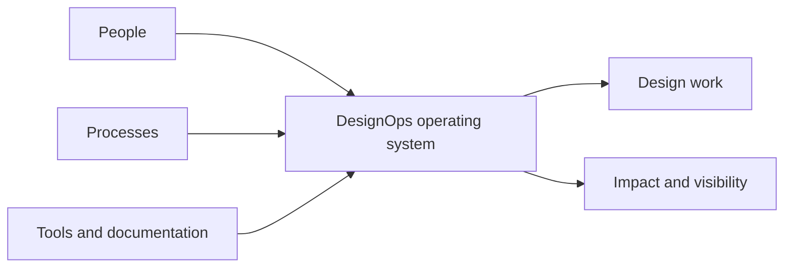

[[concepts/Design Systems|Design Systems]]
[[Tooling/Software Development/Design/Figma|Figma]]
[[Vocabulary/User Interface|User Interface]]
[[Vocabulary/User Experience|User Experience Design]]

# Defining and Describing Design Ops

- _Design Ops makes the system around designers work as deliberately as the design itself._
- Design Ops, or design operations, is the practice of organizing the people, processes, tools, documentation, and shared context that allow design teams to work effectively at scale. [^bfxh1b] [^7755kk] It applies when growing teams face coordination costs, inconsistent workflows, fragmented tools, or difficulty demonstrating design’s value. [^7755kk] [^13avur] The discipline is inward-facing: rather than directly designing the product, it improves the conditions under which product and service design happens. [^4muzzq] [^21b03d]

## Uses in Context

- **Scaling design organizations:** DesignOps establishes repeatable systems for onboarding, role clarity, career development, collaboration, and team structure. [^21b03d]
- **Managing work intake:** Teams use intake forms, briefs, prioritization, review stages, and definitions of done to turn incoming demand into trackable work. [^13avur]
- **Governing design systems:** DesignOps defines contribution guidelines, review workflows, component governance, and shared standards. [^7755kk]
- **Reducing operational friction:** The practice coordinates process, people, and tooling so designers can spend more time on “high-value creative work.” [^bfxh1b]
- **Measuring design impact:** Practitioners track indicators such as cycle time, quality, adoption, reuse, stakeholder feedback, and team health. [^21b03d]
- **Applying DevOps-style thinking to design:** The term adapts the idea that the system surrounding makers deserves deliberate operational attention. [^7755kk] [^21b03d]

# History of Use

## Origins

- The term is generally attributed to interaction designer **Dave Malouf**, who coined “DesignOps” in 2014 while adapting operational ideas associated with DevOps to design organizations. [^4muzzq] [^21b03d]
- Its commonly cited definition is “the orchestration and optimization of people, processes, and craft in order to amplify design’s value and impact at scale.” [^4muzzq] [^21b03d]
- The early concept addressed a practical problem: design teams were expanding faster than their informal methods for coordinating work, tools, standards, and organizational context. [^7755kk] [^4muzzq]

## Evolution

- **2014 — Naming the discipline:** Malouf’s formulation gave a name to the operational layer surrounding design work and framed it as a distinct practice rather than ordinary administration. [^4muzzq] [^21b03d]
- **2017 — Community formation:** The first DesignOps Summit was held in New York, helping establish DesignOps as a recognizable discipline with its own practitioner community and body of practice. [^4muzzq]
- **2020s — Operating-system expansion:** DesignOps broadened beyond workflow coordination to include research operations, design-system governance, tooling and licensing, onboarding, career frameworks, accessibility checks, metrics, and cross-functional delivery. [^czyp3l] [^21b03d]

# Best Real-World Examples

- [DesignOps Handbook](https://www.designopshandbook.com/) — a practitioner-oriented resource focused on operational practices for scaling design teams. [^kln6mf] [^jo4v4i]
- [GitLab DesignOps](https://handbook.gitlab.com/handbook/upstream-studios/design-strategy/designops/) — defines DesignOps as the operational core supporting systems, practices, tooling, documentation, and shared context across a distributed organization. [^bfxh1b]
- [BMW Group DesignOps](https://www.futurice.com/case-studies/bmw-desops) — a case in which a UX department invested in a dedicated function to improve designers’ working conditions and protect time for design. [^qio7mf]
- [Spotify design-system operations](https://www.stellae.design/en/ux/designops-advanced) — an example of contribution workflows, design-token distribution, adoption tracking, and automated accessibility checks being treated as operational infrastructure. [^czyp3l]
- [Airbnb design-system dashboards](https://www.stellae.design/en/ux/designops-advanced) — an example of monitoring component usage, design-to-code consistency, and deviations from established patterns. [^czyp3l]
- [Figma design operations guidance](https://www.figma.com/resource-library/design-operations/) — a popular account of DesignOps as the processes and infrastructure that keep design teams working well as they scale. [^7755kk]

# Case Studies

**BMW Group and Futurice.** BMW Group’s UX department treated DesignOps as a dedicated investment in the conditions surrounding design work rather than as another layer of management. [^qio7mf] The stated goal was to help designers focus on “designing” by improving the operational environment in which they worked. [^qio7mf] This case shows how DesignOps can function as an enabling capability: its success is measured less by the artifacts it creates than by the friction it removes for the wider design organization. [^qio7mf]

**[[Spotify]]’s shared design-system operations.** A reported Spotify model combines contribution workflows, automated design-token distribution, adoption metrics, and accessibility checks for a large design community. [^czyp3l] The operating layer helps more than a hundred designers contribute to a shared system without creating conflicting or inconsistent implementations. [^czyp3l] The example illustrates a central DesignOps trade-off: governance must create enough consistency to support reuse while preserving enough access for product teams to contribute. [^czyp3l]

**[[organizations/AirBnB|AirBnB]]’s design-system measurement.** Airbnb is described as using internal dashboards to monitor component usage, design-to-code consistency, and pages that diverge from established patterns. [^czyp3l] Product teams can use adoption scores to identify where custom implementations might be replaced with shared components. [^czyp3l] This demonstrates the shift from DesignOps as workflow administration toward evidence-based system stewardship, in which operational data informs design quality, reuse, and maintenance decisions. [^czyp3l]

***

# Sources

[^qio7mf]: 2026, Aug 21. [futurice.com](https://www.futurice.com/). [BMW Group: Building a lasting DesignOps practice](https://www.futurice.com/case-studies/bmw-desops). Updated: 2026, Aug 26. Generated: 2026, Nov 05. [Perplexity](https://www.perplexity.ai/) API response.
[^bfxh1b]: 2026, Jul 14. [handbook.gitlab.com](https://handbook.gitlab.com/). [DesignOps | The GitLab Handbook](https://handbook.gitlab.com/handbook/upstream-studios/design-strategy/designops/). Updated: 2026, Nov 05. Generated: 2026, Nov 05. [Perplexity](https://www.perplexity.ai/) API response.
[^kln6mf]: 2025, Dec 21. [github.com](https://github.com/). [serhatbahceliler/awesome-product-design](https://github.com/serhatbahceliler/awesome-product-design). Updated: 2026, Oct 16. Generated: 2026, Nov 05. [Perplexity](https://www.perplexity.ai/) API response.
[^7755kk]: 2026, Jul 27. [figma.com](https://www.figma.com/). [Design Operations: What It Is and Why It Matters](https://www.figma.com/resource-library/design-operations/). Updated: 2026, Oct 27. Generated: 2026, Nov 05. [Perplexity](https://www.perplexity.ai/) API response.
[5]: 2026, Sep 24. [rosenverse.rosenfeldmedia.com](https://rosenverse.rosenfeldmedia.com/). [From Research to Knowledge UX and product desig - Rosenverse](https://rosenverse.rosenfeldmedia.com/videos/from-research-to-knowledge). Updated: 2026, Oct 16. Generated: 2026, Nov 05. [Perplexity](https://www.perplexity.ai/) API response.
[^13avur]: 2026, Oct 12. [marq.com](https://www.marq.com/). [DesignOps frameworks and examples for scaling teams](https://www.marq.com/blog/intro-to-designops/). Updated: 2026, Oct 28. Generated: 2026, Nov 05. [Perplexity](https://www.perplexity.ai/) API response.
[^4muzzq]: 2026, Apr 09. [designops.tools](https://designops.tools/). [What is DesignOps? Complete Guide — DesignOps Tools](https://designops.tools/designops/). Updated: 2026, Oct 03. Generated: 2026, Nov 05. [Perplexity](https://www.perplexity.ai/) API response.
[^czyp3l]: 2026, Mar 18. [stellae.design](https://www.stellae.design/). [DesignOps (Advanced)](https://www.stellae.design/en/ux/designops-advanced). Updated: 2026, Oct 21. Generated: 2026, Nov 05. [Perplexity](https://www.perplexity.ai/) API response.
[^21b03d]: 2026, Sep 12. [moonb.io](https://www.moonb.io/). [Design Ops: What It Is and Who Runs It](https://www.moonb.io/blog/design-ops). Updated: 2026, Nov 03. Generated: 2026, Nov 05. [Perplexity](https://www.perplexity.ai/) API response.
[^jo4v4i]: 2025, Dec 21. [github.com](https://github.com/). [awesome-product-design/README.md at main - GitHub](https://github.com/serhatbahceliler/awesome-product-design/blob/main/README.md). Updated: 2026, Oct 16. Generated: 2026, Nov 05. [Perplexity](https://www.perplexity.ai/) API response.
