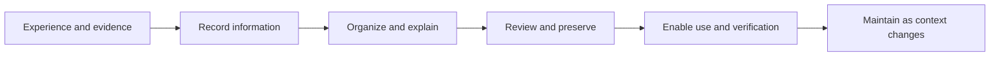

[[concepts/Documentation First Development|Documentation First Development]]

%% [[Tooling/Software Development/Developer Experience/DevOps/Documentation Engines/Paligo|Paligo]] is part of the [[client-content/Laerdal/Explorations/Current Stack|Laerdal Stack]]. %%

:::tool-showcase
- [[Tooling/Software Development/Developer Experience/DevOps/Documentation Engines/Docusaurus|Docusaurus]]
- [[Tooling/Software Development/Developer Experience/DevOps/Documentation Engines/Starlight|Starlight]]
- [[Tooling/Software Development/Developer Experience/DevOps/Documentation Engines/Paligo|Paligo]]
:::

# Defining and Describing Documentation

_Documentation turns experience, evidence, and instructions into knowledge that can be preserved, checked, shared, and acted upon._ [^qx435d] [^10c4lq]

Documentation is the act and result of creating, organizing, preserving, and communicating recorded information. [^qx435d] [^10c4lq] [^dd9vkm] It may refer to documentary evidence, historical records, operating instructions, technical specifications, or explanatory material for a product or system. [^qx435d] In software and engineering, documentation helps people understand, use, maintain, verify, and modify complex systems. [^10c4lq] The concept applies whenever information must remain accessible beyond the moment or person in which it originated. [^10c4lq]

## Uses in Context

- **Evidence and compliance:** “Documentation” can mean documents supplied to substantiate a claim or authenticate an event. [^qx435d]
- **Historical preservation:** Historians use documentation as a body of records through which past events, institutions, and practices can be examined. [^qx435d] [^10c4lq]
- **Product and system use:** Software and hardware documentation commonly means “instructions, comments, and information” for using a particular system. [^qx435d]
- **Operational continuity:** Organizations document procedures, decisions, requirements, and maintenance information so work can be repeated and transferred across people and time. [^vtb7pm] [^10c4lq]
- **Knowledge management:** Documentation involves “gathering, organizing, selecting, disseminating, and using” information. [^dd9vkm]
- **Human-centered software explanation:** Literate documentation interweaves prose and code in an order designed for human understanding rather than compiler execution. [^xa1kvb] [^wq1eyz]

## History of Use

### Origins

The modern English noun *documentation* is recorded as first used in 1884. [^qx435d] Its underlying practice is much older: early societies preserved information through inscriptions, clay tablets, manuscripts, administrative records, religious texts, and trade documents. [^10c4lq] Writing systems expanded documentation from short-lived oral transmission into durable records that could support legal agreements, economic transactions, governance, cultural continuity, and technical observation. [^10c4lq]

### Evolution

- **1884 — Documentary evidence:** The term entered recorded English use in a sense associated with furnishing, authenticating, or substantiating information with documents. [^qx435d]
- **Industrial and technical systems — Instructional documentation:** As products and systems became more complex, documentation increasingly encompassed manuals, specifications, maintenance instructions, and system records intended to guide operation and repair. [^qx435d] [^10c4lq]
- **Digital and software era — Maintained information systems:** Digital documentation moved beyond static paper records into electronic repositories, software references, readme files, architecture records, and workflows that must be revised as products and processes change. [^vtb7pm] [^10c4lq]
- **Literate programming and its descendants — Explanation linked to implementation:** Literate-programming practice treats software explanation as a narrative for readers, with code presented inside the conceptual explanation rather than merely in execution order. [^xa1kvb] [^wq1eyz]

## Best Real-World Examples

- [README files](https://github.com/jordanhubbard/literate-ai/blob/main/README.md) — concise project documents that explain purpose, components, usage, and rationale; the Literate AI README explicitly connects readable specifications with code, tests, and evidence. [^xa1kvb]
- [User manuals](https://www.merriam-webster.com/dictionary/documentation?pronunciation&lang=en_us&dir=d&file=docume12) — instructions and supporting information for operating software or hardware. [^qx435d]
- [Engineering specifications](https://easyknow.org/documented/index.html) — structured descriptions of system requirements, properties, and constraints. [^10c4lq]
- [Maintenance instructions](https://easyknow.org/documented/index.html) — operational records that help users maintain and improve technical systems. [^10c4lq]
- [System architecture records](https://easyknow.org/documented/index.html) — documentation that explains the structure and relationships of complex systems. [^10c4lq]
- [Literate programming](https://github.com/petekp/agent-skills/blob/main/skills/literate-guide/SKILL.md) — a documentation approach that orders code and prose around human comprehension. [^wq1eyz]
- [Controlled documentation workflows](https://mtfinstitute.com/insights/technical-writing-documentation-work-united-states-115-vacancies-2026/) — processes that establish reader needs, gather and challenge source information, coordinate review, publish through an authorized channel, and maintain the result as the underlying system changes. [^vtb7pm]

## Case Studies

**Open-source README documentation.** The README has become a compact entry point for software projects: it can state what a project does, explain its components, connect readers to installation or usage information, and provide evidence about how the project is organized. [^xa1kvb] The Literate AI project presents documentation as a bridge between readable specifications, code, builds, tests, and evidence. [^xa1kvb] This demonstrates that effective documentation is not merely an appendix to implementation; it can serve as the surface through which users and contributors understand the project’s purpose and structure. [^xa1kvb]

**Literate programming and human-readable code.** Literate programming reorganizes software presentation around the reader’s need to understand the system. [^wq1eyz] Instead of forcing readers to follow file layout or compiler order, a literate guide interweaves explanatory prose with relevant code and presents concepts in a deliberate narrative sequence. [^wq1eyz] The approach shows how documentation can become part of the design method itself: explanation clarifies responsibilities and decisions, while implementation remains traceable to that explanation. [^xa1kvb] [^wq1eyz]

**Documentation as an operational system.** Contemporary technical-writing practice treats documentation as a connected workflow rather than a single act of writing. [^vtb7pm] The workflow includes identifying what a reader must do, collecting and challenging source information, choosing an information structure, coordinating review, publishing through an authorized channel, and maintaining the result when the product, process, service, or obligation changes. [^vtb7pm] This case demonstrates the central organizational insight of documentation: its value depends not only on initial accuracy, but also on governance, discoverability, review, and continued maintenance. [^vtb7pm] [^10c4lq]

# Images

_Source: https://www.altexsoft.com/blog/user-manuals-documentation/_

_Source: https://www.altexsoft.com/blog/user-manuals-documentation/_

_Source: https://herothemes.com/blog/software-user-manual-guide-examples/_

_Source: https://herothemes.com/blog/software-user-manual-guide-examples/_

.png)
_Source: https://www.drexplain.com/press/articles/how_to_write_user_documentation_for_software_best_programs_and_services/_

_Source: https://typemill.net/solutions/user-manual_

***

# Sources

[^qx435d]: 2026, Feb 16. [merriam-webster.com](https://www.merriam-webster.com/). [Definition of DOCUMENTATION](https://www.merriam-webster.com/dictionary/documentation?pronunciation&lang=en_us&dir=d&file=docume12). Updated: 2026, Feb 17. Generated: 2026, Nov 16. [Perplexity](https://www.perplexity.ai/) API response.
[^vtb7pm]: 2026, Sep 11. [mtfinstitute.com](https://mtfinstitute.com/). [Technical Writing: Evidence from 115 U.S. Vacancies](https://mtfinstitute.com/insights/technical-writing-documentation-work-united-states-115-vacancies-2026/). Updated: 2026, Oct 14. Generated: 2026, Nov 16. [Perplexity](https://www.perplexity.ai/) API response.
[^10c4lq]: 2026, Jul 18. [easyknow.org](https://easyknow.org/). [Documented](https://easyknow.org/documented/index.html). Updated: 2026, Jul 23. Generated: 2026, Nov 16. [Perplexity](https://www.perplexity.ai/) API response.
[^xa1kvb]: 2026, Sep 30. [github.com](https://github.com/). [literate-ai/README.md at main · jordanhubbard/literate-ai](https://github.com/jordanhubbard/literate-ai/blob/main/README.md). Updated: 2026, Nov 11. Generated: 2026, Nov 16. [Perplexity](https://www.perplexity.ai/) API response.
[5]: 2026, Sep 02. [studylib.net](https://studylib.net/). [Technical Writing for Engineers & Scientists 4th Ed.](https://studylib.net/doc/28863068/technical-writing-for-engineers-and-scientists-textbook). Updated: 2026, Sep 19. Generated: 2026, Nov 16. [Perplexity](https://www.perplexity.ai/) API response.
[^dd9vkm]: 2025, Nov 22. [telum.umc.edu.dz](https://telum.umc.edu.dz/). [MTU-SM: chapter 1](https://telum.umc.edu.dz/mod/page/view.php?id=147938&lang=it). Updated: 2026, Jan 26. Generated: 2026, Nov 16. [Perplexity](https://www.perplexity.ai/) API response.
[7]: 2026, Oct 23. [scribd.com](https://www.scribd.com/). [Document - Wikipedia | PDF - Scribd](https://www.scribd.com/document/990543759/Document-Wikipedia). Generated: 2026, Nov 16. [Perplexity](https://www.perplexity.ai/) API response.
[8]: 2026, Oct 12. [pageloop.ai](https://www.pageloop.ai/). [What is technical documentation? Types, examples and how to write it](https://www.pageloop.ai/blog/what-is-technical-documentation). Updated: 2026, Nov 16. Generated: 2026, Nov 16. [Perplexity](https://www.perplexity.ai/) API response.
[9]: 2026, Jun 30. [scribbright.com](https://scribbright.com/). [What is Technical Writing? - Scribbright](https://scribbright.com/glossary/technical-writing/). Updated: 2026, Sep 04. Generated: 2026, Nov 16. [Perplexity](https://www.perplexity.ai/) API response.
[^wq1eyz]: 2026, Jan 20. [github.com](https://github.com/). [agent-skills/skills/literate-guide/SKILL.md at main · petekp/agent-skills](https://github.com/petekp/agent-skills/blob/main/skills/literate-guide/SKILL.md). Updated: 2026, Oct 26. Generated: 2026, Nov 16. [Perplexity](https://www.perplexity.ai/) API response.
