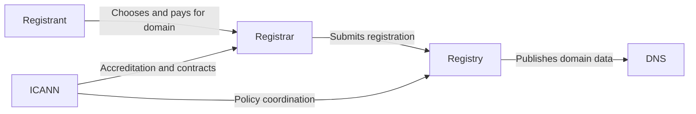

[[Vocabulary/Cloud Infrastructure|Cloud Infrastructure]]

# Defining and Describing Domain Registrars

- _A domain registrar is the customer-facing intermediary that turns a chosen domain name into a managed entry in the Domain Name System._
- A registrar is an organization authorized to sell domain names and maintain direct relationships with domain-name registries. [^y8ovvp] For generic top-level domains such as `.com`, `.net`, and `.org`, registrars generally operate under accreditation and contractual requirements established by [[organizations/Internet Corporation for Assigned Names and Numbers|ICANN]]. [^ry1giu] [^s081g4] The registrar submits registrations to the relevant registry, records registrant information, manages renewals and transfers, and commonly provides DNS management, privacy features, and related web services. [^y8ovvp] [^o7koe1] The concept applies whenever an individual, business, nonprofit, or public institution needs to register or administer a domain rather than merely resolve one.

## Uses in Context

- **Domain purchasing:** “Registrar” identifies the service through which a customer searches for, buys, renews, or transfers a domain name. [^y8ovvp]
- **Internet governance:** In policy and contractual contexts, the term refers to an ICANN-accredited organization that processes domain-name registrations. [^o7koe1]
- **Technical operations:** A registrar is distinguished from a registry: the registrar interacts with customers and registries, while the registry maintains the authoritative database for a top-level domain. [^y8ovvp]
- **Business comparison:** Hosting, website-building, email, and DNS products are often compared separately from the registrar function, even when one provider bundles them together. [^y8ovvp]
- **Compliance and accountability:** Registrar accreditation signals that the organization has met specified business and technical requirements and has accepted ICANN’s registrar agreement. [^ry1giu] [^y8ovvp]

# History of Use

## Origins

- The modern commercial registrar model began with the [[National Science Foundation]]’s 1992 solicitation for network services and its 1993 cooperative agreement with InterNIC; Network Solutions became the sole registration service for `.com`, `.net`, and `.org`. [^e9sqv7]
- From 1993 to 1998, Network Solutions functioned simultaneously as registrar and registry operator for those major generic top-level domains. [^y8ovvp]
- Early registration was therefore centralized rather than competitive: Network Solutions became the global registrar for major top-level domains in January 1993. [^nbx9li] [^ev0na5]

## Evolution

- **1998:** The U.S. Department of Commerce recognized ICANN as the private nonprofit organization responsible for coordinating the technical management of the DNS. [^y8ovvp]
- **1999:** The Shared Registry System separated registry operations from customer-facing registrar competition, allowing multiple registrars to become accredited rather than leaving registration with a single provider. [^y8ovvp]
- **2001 onward:** ICANN’s Registrar Accreditation Agreement formalized continuing obligations between ICANN and accredited registrars, creating a contractual framework for registrar operations. [^y8ovvp]

# Best Real-World Examples

- [Network Solutions](https://www.networksolutions.com) — the original dominant registrar and registry operator for `.com`, `.net`, and `.org` under the NSF arrangement. [^e9sqv7] [^y8ovvp]
- [InterNIC](https://www.internic.net) — the early network-information service associated with the first centralized domain-registration regime. [^e9sqv7] [^nbx9li]
- [ICANN-accredited registrars](https://www.internic.net/accredited-list.html) — the broad class of organizations authorized to act as registrars for one or more generic top-level domains. [^s081g4]
- [PublicDomainRegistry.com](https://publicdomainregistry.com) — an example listed in ICANN’s registrar records as a registrar organization. [^aomfb1]
- [NordName](https://nordname.net) — an example of a registrar listed in ICANN’s certified registrar data. [^1ev215]
- [Advanced Internet Technologies](https://www.ait.com) — a registrar appearing in ICANN’s registrar records with an assigned IANA number. [^779shx]

# Case Studies

**Network Solutions and the centralized era.** In 1992, the National Science Foundation solicited proposals for network services that included domain-name registration. [^e9sqv7] A 1993 cooperative agreement with InterNIC made Network Solutions the sole registration service for `.com`, `.net`, and `.org`. [^e9sqv7] The arrangement combined registry and registrar functions in one organization, so customers had no competitive registrar market for those domains. [^y8ovvp] This case shows that the registrar category emerged from infrastructure administration before it became a consumer-facing software market.

**The Shared Registry System and competition.** The 1998 restructuring required Network Solutions to continue as registry operator while implementing a Shared Registry System by June 1999. [^y8ovvp] The system enabled multiple registrars to receive accreditation through a new DNS-governance framework rather than forcing every customer through one incumbent provider. [^y8ovvp] This changed the registrar from a singular institutional role into a competitive intermediary category, with providers differentiated by price, support, interfaces, transfers, privacy tools, and bundled services.

**Accreditation as institutional infrastructure.** ICANN’s registrar model links commercial access to contractual and technical obligations. [^ry1giu] [^y8ovvp] ICANN’s public records identify accredited organizations by name, country or territory, contact information, and IANA number, making the registrar ecosystem auditable at the institutional level. [^aomfb1] [^779shx] The case illustrates that a registrar is not simply a retail website: for covered top-level domains, it is part of a layered governance system connecting registrants, registries, DNS operations, and policy contracts. [^ry1giu] [^s081g4] [^o7koe1]

***

# Sources

[^1ev215]: [newgtlds.icann.org](https://newgtlds.icann.org/). [CertifiedRegistrarList](https://newgtlds.icann.org/sites/default/files/db-registrar-certified-17jul25-en.pdf). Updated: 2025, Dec 06. Generated: 2026, Nov 24. [Perplexity](https://www.perplexity.ai/) API response.
[^ry1giu]: [internic.net](http://www.internic.net/). [ICANN](http://www.internic.net/accreditation-qualified-list.html). Updated: 2026, Nov 10. Generated: 2026, Nov 24. [Perplexity](https://www.perplexity.ai/) API response.
[^s081g4]: [internic.net](https://www.internic.net/). [ICANN | ICANN-Accredited Registrars](https://www.internic.net/accredited-list.html). Updated: 2026, Oct 31. Generated: 2026, Nov 24. [Perplexity](https://www.perplexity.ai/) API response.
[^aomfb1]: [icann.org](https://www.icann.org/). [Download results to .csv file - icann](https://www.icann.org/en/contracted-parties/accredited-registrars/list-of-accredited-registrars/csvdownload?filter-letter=c&page=1&sort-param=name&sort-direction=asc). Updated: 2026, Oct 31. Generated: 2026, Nov 24. [Perplexity](https://www.perplexity.ai/) API response.
[^e9sqv7]: [digital.library.unt.edu](https://digital.library.unt.edu/). [CRS Report for Congress](https://digital.library.unt.edu/ark:/67531/metadc812463/m2/1/high_res_d/97-868_2009Aug10.pdf). Updated: 2026, Nov 20. Generated: 2026, Nov 24. [Perplexity](https://www.perplexity.ai/) API response.
[^y8ovvp]: 2026, Jul 08. [icannwiki.org](https://icannwiki.org/). [Registrar - ICANNWiki](https://icannwiki.org/registrar). Updated: 2026, Sep 21. Generated: 2026, Nov 24. [Perplexity](https://www.perplexity.ai/) API response.
[^779shx]: [icann.org](https://www.icann.org/). [https://www.icann.org/fr/contracted-parties/accred...](https://www.icann.org/fr/contracted-parties/accredited-registrars/list-of-accredited-registrars/csvdownload?sort-param=country&sort-direction=asc&page=148). Updated: 2026, Nov 18. Generated: 2026, Nov 24. [Perplexity](https://www.perplexity.ai/) API response.
[^nbx9li]: [cs.stanford.edu](https://cs.stanford.edu/). [The InterNIC and NSI](https://cs.stanford.edu/people/eroberts/cs181/projects/domain-names/background/internic.html). Updated: 2026, Nov 16. Generated: 2026, Nov 24. [Perplexity](https://www.perplexity.ai/) API response.
[^ev0na5]: [cs.stanford.edu](https://cs.stanford.edu/). [The InterNIC and NSI](https://cs.stanford.edu/people/eroberts/courses/cs181/projects/domain-names/background/internic.html). Updated: 2026, Jul 26. Generated: 2026, Nov 24. [Perplexity](https://www.perplexity.ai/) API response.
[^o7koe1]: [lists.iana.org](https://lists.iana.org/). [Microsoft Word - Section III.docx](https://lists.iana.org/hyperkitty/list/lac-discuss-es@icann.org/message/NXHABVRFRNBSAJN3MZORCXRDB4GAUSZE/attachment/2/final-report-appendix-background-glossary-11may12-en.pdf). Updated: 2026, Nov 17. Generated: 2026, Nov 24. [Perplexity](https://www.perplexity.ai/) API response.
