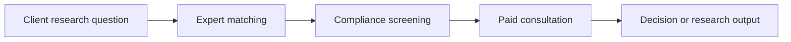

# Defining and Describing Expert Networks

- _Expert networks turn firsthand experience into decision-grade intelligence by putting the people who have done the work directly in front of the people making the decision._
- An **expert network** is a service that connects investors, consultants, corporations, and researchers with vetted specialists who possess firsthand knowledge of a market, company, technology, or operating function. [^eo0v8b] [^6assc3] Engagements commonly involve a paid telephone or video consultation, but may also include surveys, written research, moderated interviews, or longer advisory projects. [^eo0v8b] [^s3f9ji]
- The model is most useful when public filings, published research, and conventional databases cannot answer a time-sensitive question about how an industry actually operates. [^6assc3] [^s3f9ji] Its central value is access to “primary human intelligence”—practical knowledge gathered from people who have worked inside the relevant system. [^s3f9ji]
- Expert networks operate as intermediaries rather than as ordinary social networks: they recruit and screen experts, identify suitable matches, arrange interactions, and impose compliance procedures intended to prevent disclosure or use of material nonpublic information. [^gh64vz] [^1fy552]

## Uses in Context

- **Investment research:** Hedge funds and private-equity teams use expert calls to test market assumptions, understand customer behavior, and assess companies beyond what securities filings disclose. [^6assc3] [^s3f9ji]
- **Management consulting:** Consultants use specialists to validate market size, purchasing processes, competitive dynamics, and operational benchmarks during client engagements. [^6assc3]
- **Corporate strategy and M&A:** Corporate teams use expert networks as an “always-on primary research layer” to reduce acquisition risk and bring unindexed expert insights into internal workflows. [^r8178g]
- **Healthcare and life sciences:** Research teams consult physicians, researchers, administrators, and industry operators about treatment adoption, clinical practice, reimbursement, and commercialization. [^6assc3]
- **Technology and product research:** Teams seek current practitioners who can explain implementation realities, vendor selection, buyer priorities, and emerging technical markets. [^eo0v8b]
- **Compliance discourse:** In securities-law discussions, the phrase often appears alongside “mosaic theory,” which permits analysts to assemble insights from public and legitimately obtained private sources, provided they do not receive material nonpublic information in breach of a duty. [^gh64vz]

# History of Use

## Origins

- The commercial model emerged in the **late 1990s and early 2000s**, initially serving hedge funds and private-equity firms that wanted rapid access to former executives and operating insiders. [^6assc3]
- Early expert-network engagements were comparatively simple: a buy-side analyst was connected by telephone with a former executive or industry specialist for a private consultation. [^6assc3]
- The concept was commercialized to address a specific research gap: analysts needed firsthand operating intelligence that securities filings and published analyst reports did not contain. [^s3f9ji]
- Available sources describe the emergence of the model as an industry development rather than attributing its invention to a single academic paper or universally recognized founder. [^6assc3] [^s3f9ji]

## Evolution

- **2000s — rapid commercialization:** Expert networks expanded as investors recognized the value of direct conversations with practitioners, and the model became a recognizable research service for hedge funds and private equity. [^6assc3]
- **2009–2013 — compliance transformation:** A wave of U.S. insider-trading investigations and prosecutions involving experts, clients, and network employees forced the industry to strengthen expert screening, call monitoring, certifications, and client controls. [^1fy552] [^olzbo4]
- **2010s–2020s — expansion and digitization:** The model moved beyond finance into consulting, corporate strategy, biopharmaceuticals, and technology, while some providers added searchable transcript libraries and software-enabled research workflows. [^eo0v8b] [^6assc3]

# Best Real-World Examples

- [GLG](https://glginsights.com/) — A large expert-network provider connecting clients with practitioners for consultations and research projects. [^eo0v8b]
- [AlphaSights](https://www.alphasights.com/) — An expert-access service used by investment, consulting, and corporate research teams. [^eo0v8b]
- [Third Bridge](https://www.thirdbridge.com/) — A provider combining expert consultations with a library of more than 100,000 moderated interview transcripts. [^eo0v8b]
- [Guidepoint](https://www.guidepoint.com/) — An established network offering access to industry specialists for investment and strategic research. [^eo0v8b]
- [AlphaSense](https://www.alpha-sense.com/) — A research platform that absorbed transcript provider Tegus in 2024, illustrating the convergence of expert calls, searchable content, and AI-assisted research. [^eo0v8b]
- [Primary Global Research](https://www.sec.gov/) — A prominent historical example associated with the 2011 insider-trading enforcement wave involving consultants and network employees. [^1fy552] [^olzbo4]
- [Third Bridge corporate intelligence platform](https://www.thirdbridge.com/en-us/about-us/media/perspectives/case-study-expert-insights-for-corporate-m-and-a) — A contemporary example of expert-network research integrated into corporate M&A and strategy workflows. [^r8178g]

# Case Studies

**Primary Global Research and the 2011 enforcement wave.** In February 2011, the Securities and Exchange Commission charged technology-company employees who allegedly moonlighted as consultants for Primary Global Research, along with two company employees, over disclosures involving firms including AMD, Apple, Dell, Flextronics, and Marvell. [^1fy552] The case did not establish that paying an expert for lawful industry knowledge was inherently illegal; rather, the alleged violations centered on confidential information passed by people who owed duties and on clients trading on that information. [^1fy552] The episode changed the operating model by making expert vetting, confidentiality controls, call restrictions, and monitoring central features of a credible network. [^gh64vz] [^1fy552]

**CR Intrinsic and the limits of the network model.** The enforcement period from 2011 to 2013 also included the CR Intrinsic matter, which ended in a settlement exceeding \$600 million, according to an industry account of the case. [^1fy552] The significance was structural: regulators treated the misuse of material nonpublic information—not the existence of an expert-network intermediary—as the core misconduct. [^1fy552] The episode showed why clients must distinguish permissible “mosaic” research from information obtained through a breach of trust or confidentiality, and why advisers need controls both before and after expert conversations. [^gh64vz] [^1fy552]

**Third Bridge and corporate M&A research.** A Third Bridge case study describes a corporate strategy team using the company’s platform to establish an always-on primary-research layer, surface expert insights that were not indexed in conventional sources, and reduce acquisition risk earlier in the process. [^r8178g] This represents the sector’s expansion beyond its original hedge-fund and private-equity customer base into corporate development and strategic planning. [^r8178g] [^6assc3] It also shows how the concept is evolving from a one-off phone call into a persistent workflow combining expert access, searchable interview content, and internal research systems. [^r8178g] [^eo0v8b]

***

# Sources

[^r8178g]: 2026, Nov 01. [thirdbridge.com](https://www.thirdbridge.com/). [Accelerating corporate M&A and strategic growth with ...](https://www.thirdbridge.com/en-us/about-us/media/perspectives/case-study-expert-insights-for-corporate-m-and-a). Updated: 2026, Nov 03. Generated: 2026, Nov 06. [Perplexity](https://www.perplexity.ai/) API response.
[^gh64vz]: 2026, May 13. [mcdermottlaw.com](https://www.mcdermottlaw.com/). [Expert Networks: New Commentary by SEC Officials About ...](https://www.mcdermottlaw.com/insights/expert-networks-new-commentary-by-sec-officials-about-insider/). Updated: 2026, Nov 04. Generated: 2026, Nov 06. [Perplexity](https://www.perplexity.ai/) API response.
[^1fy552]: 2026, Oct 28. [botminds.ai](https://www.botminds.ai/). [Expert networks and the SEC](https://www.botminds.ai/solutions/expert-network-compliance/expert-networks-sec-history). Updated: 2026, Nov 02. Generated: 2026, Nov 06. [Perplexity](https://www.perplexity.ai/) API response.
[^olzbo4]: 2026, Oct 04. [quantumexperts.com](https://quantumexperts.com/). [Expert Network Enforcement, 15 Years On: The Evidence](https://quantumexperts.com/expert-network-enforcement-evidence/). Updated: 2026, Oct 15. Generated: 2026, Nov 06. [Perplexity](https://www.perplexity.ai/) API response.
[^eo0v8b]: 2026, Jul 29. [rossdawson.com](https://rossdawson.com/). [15 leading companies using AI to reshape the expert ...](https://rossdawson.com/futurist/companies-creating-future/ai-expert-network-companies/). Updated: 2026, Sep 23. Generated: 2026, Nov 06. [Perplexity](https://www.perplexity.ai/) API response.
[^6assc3]: 2026, Sep 14. [katrium.eu](https://katrium.eu/). [What Is an Expert Network? How It Works and Why ...](https://katrium.eu/what-is-an-expert-network/). Updated: 2026, Nov 02. Generated: 2026, Nov 06. [Perplexity](https://www.perplexity.ai/) API response.
[7]: 2026, Jun 24. [studocu.com](https://www.studocu.com/). [Expert Networks and Insider Trading: Legal Insights and ...](https://www.studocu.com/row/document/university-of-nairobi/commercial-law/expert-networks-and-insider-trading-legal-insights-and-compliance-strategies/166520711). Updated: 2026, Oct 04. Generated: 2026, Nov 06. [Perplexity](https://www.perplexity.ai/) API response.
[^s3f9ji]: 2026, Apr 14. [nexusexpertresearch.co](https://nexusexpertresearch.co/). [What Research and Strategy Firms Actually Use Expert Networks](https://nexusexpertresearch.co/blog/what-research-firms-use-expert-networks-for/). Updated: 2026, Nov 06. Generated: 2026, Nov 06. [Perplexity](https://www.perplexity.ai/) API response.
[9]: 2026, Aug 24. [fieldsignalhq.com](https://fieldsignalhq.com/). [10b5-1 Plans and Expert Network Compliance | FieldSignal](https://fieldsignalhq.com/resources/blog/10b5-1-plans-and-expert-network-compliance). Updated: 2026, Sep 05. Generated: 2026, Nov 06. [Perplexity](https://www.perplexity.ai/) API response.
[10]: 2026, Jul 25. [fieldsignalhq.com](https://fieldsignalhq.com/). [Expert Network Compliance: Standards, Risks, and Vendor Vetting](https://fieldsignalhq.com/resources/blog/expert-network-compliance-standards-risks-and-vendor-vetting). Updated: 2026, Oct 17. Generated: 2026, Nov 06. [Perplexity](https://www.perplexity.ai/) API response.
