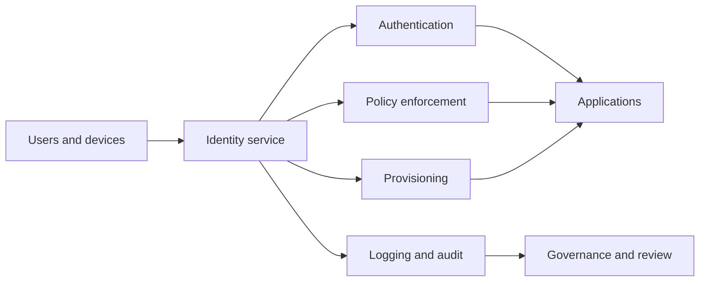

---
aliases:
  - IDaaS
date_created: 2026-10-18
date_modified: 2026-11-05
cf_last_run: 2026-11-05T22:20:12.455Z
cf_last_run_model: Perplexity sonar-pro
tags:
  - Authorization
  - Lego-Kit-Engineering-Tools
for_clients:
  - Laerdal
  - Edviro
site_uuid: af13c715-120c-4130-96a5-0f682aa59cde
publish: true
title: Identity as a Service
slug: identity-as-a-service
at_semantic_version: 0.0.1.1
---

# Defining and Describing Identity as a Service

- _Identity as a Service moves the identity control plane into the cloud, but not the responsibility for deciding who should have access._
- Identity as a Service (IDaaS) is a cloud-delivered model for authentication and access management. [^o8lvzx] It commonly centralizes single sign-on, multifactor authentication, authorization policy, logging, provisioning, and account lifecycle operations. [^o8lvzx] [^e2v1kc] [^1jz2l3]
- IDaaS is a **delivery model for identity and access management**, rather than a separate identity discipline: the provider operates much of the infrastructure, while the customer remains responsible for configuration, access policy, integrations, ownership, reviews, and offboarding. [^e2v1kc] [^o8lvzx]
- The model applies when an organization needs to connect users, applications, devices, partners, or customers across distributed environments without operating every identity server itself. [^e2v1kc] [^1jz2l3]
- Common integrations use standards such as SAML, OpenID Connect, and SCIM. [^e2v1kc]

## Uses in Context

- **Enterprise access:** Organizations invoke IDaaS to provide centralized authentication, authorization, single sign-on, and account management across applications. [^o8lvzx] [^9ri8tn]
- **Workforce modernization:** Teams use the term when replacing or supplementing on-premises identity infrastructure with a subscription cloud service. [^e2v1kc] [^1jz2l3]
- **Developer identity:** Application developers use IDaaS platforms to add authentication and authorization to web, mobile, and legacy applications rather than building those functions from scratch. [^vjkfz2]
- **Lifecycle management:** Security and IT teams associate IDaaS with provisioning, deprovisioning, credential rotation, and access reviews. [^o8lvzx] [^e2v1kc]
- **Hybrid architecture:** Architects use IDaaS to describe cloud identity capabilities that coexist with in-house or on-premises IAM components. [^s0f6l6]
- **Business enablement:** Service providers frame IDaaS as a way to improve scalability, flexibility, control, and cost efficiency in IAM operations. [^frw20b]

## History of Use

### Origins

- The available sources do not establish a reliably documented first appearance of the phrase “Identity as a Service,” nor do they identify a single original inventor or foundational academic paper. [^o8lvzx] [^e2v1kc]
- The concept is best understood as an extension of the broader “as-a-service” delivery model applied to identity and access management: directory, authentication, SSO, provisioning, and related controls are delivered by a provider while the customer consumes them through standards-based integrations. [^e2v1kc] [^1jz2l3]
- This history should not be attributed to a major incumbent without stronger primary documentation; the available search results primarily describe the model retrospectively rather than documenting its coinage. [^o8lvzx] [^e2v1kc]

### Evolution

- **Cloud delivery:** IDaaS evolved from conventional IAM by moving infrastructure operation, patching, scaling, and availability responsibilities to a cloud provider while leaving policy and integration decisions with the customer. [^e2v1kc]
- **Developer-oriented identity:** Platforms such as Auth0 broadened the model from workforce access toward embedded authentication and authorization for web, mobile, and legacy applications. [^vjkfz2]
- **Hybrid and composable IAM:** More recent architecture guidance emphasizes separating IAM capabilities, retaining some functions in-house, and reducing vendor lock-in and single points of failure. [^s0f6l6]

## Best Real-World Examples

- [Auth0](https://auth0.com/) — [[Tooling/Software Development/Lego-Kit Engineering Tools/Auth0|Auth0]] — developer-focused IDaaS for adding authentication and authorization to web, mobile, and legacy applications. [^vjkfz2]
- [Okta](https://www.okta.com/) — [[Tooling/Enterprise Jobs-to-be-Done/Okta|Okta]] — a pure-play identity provider commonly described as delivering IDaaS to organizations. [^eqadz3]
- [OLOID](https://www.oloid.com/) — cloud-delivered identity capabilities spanning authentication, authorization, provisioning, and governance. [^1jz2l3]
- [Capgemini IDaaS](https://www.capgemini.com/) — managed IAM architecture combining identity, access governance, administration, deployment, monitoring, logging, and analytics. [^frw20b]
- [OpenID Connect](https://openid.net/developers/how-connect-works/) — an identity layer used by IDaaS integrations to communicate authentication information through modern web protocols. [^e2v1kc]
- [SCIM](https://www.rfc-editor.org/rfc/rfc7644) — a provisioning protocol used in IDaaS integrations to automate account and group lifecycle operations. [^e2v1kc]
- [NIST SP 800-53](https://csrc.nist.gov/pubs/sp/800/53/r5/upd1/final) — a governance reference whose identification, authenticator-management, and account-management controls map directly to IDaaS responsibilities. [^o8lvzx]

## Case Studies

**Auth0 and developer-first identity.** Auth0 was founded in 2013 by Eugenio Pace and Matias Woloski as a developer-oriented identity platform, and it was acquired by Okta in 2021. [^vjkfz2] Its model placed authentication and authorization behind APIs and hosted services so application teams could integrate identity into web, mobile, and legacy products without implementing the entire identity stack themselves. [^vjkfz2] The case shows how IDaaS expanded beyond employee [[Vocabulary/Single Sign-On|SSO]] into an application-development component, with the service provider handling core identity infrastructure while developers controlled application integration and policy. [^e2v1kc] [^vjkfz2]

**Managed IAM as a layered service.** Capgemini’s IDaaS materials describe a layered service that combines identity, access governance and administration, platform deployment, logging, monitoring, analytics, testing, and related operational functions. [^frw20b] This approach treats IDaaS not merely as a login screen but as a managed operating model for identity controls across channels and devices. [^frw20b] The case illustrates the enterprise-services interpretation of IDaaS: organizations outsource portions of IAM operations while retaining governance and business decisions about access. [^o8lvzx] [^frw20b]

**Hybrid identity architecture.** Architecture guidance on hybrid and cloud-based identity services recommends deciding which capabilities should be delivered through subscription cloud services and which should remain in-house or on-premises. [^s0f6l6] It also warns that tightly coupling IAM capabilities can create inflexibility, technical debt, vendor lock-in, and single points of failure. [^s0f6l6] This case demonstrates the mature interpretation of IDaaS: adoption does not require placing every identity function with one provider, and effective implementation depends on reference architecture, ownership, lifecycle controls, and deliberate service boundaries. [^o8lvzx] [^s0f6l6]

***

# Sources

[^o8lvzx]: 2026, May 31. [nhimg.org](https://nhimg.org/). [nhimg.org › glossary › identity-as-a-serviceWhat Is Identity as a Service? Definition & Examples](https://nhimg.org/glossary/identity-as-a-service/). Updated: 2026, Nov 01. Generated: 2026, Nov 05. [Perplexity](https://www.perplexity.ai/) API response.
[^eqadz3]: 2026, Mar 18. [siit.co](https://siit.co/). [TOP 6 COMPANIES TRANSFORMING DIGITAL IDENTITY ...](https://siit.co/blog/top-6-companies-transforming-digital-identity-technology/52056). Updated: 2026, Oct 30. Generated: 2026, Nov 05. [Perplexity](https://www.perplexity.ai/) API response.
[^e2v1kc]: 2026, Oct 17. [startwithidentity.com](https://startwithidentity.com/). [Identity as a Service (IDaaS): Meaning and Definition](https://startwithidentity.com/glossary/idaas/). Updated: 2026, Oct 31. Generated: 2026, Nov 05. [Perplexity](https://www.perplexity.ai/) API response.
[^frw20b]: 2026, Mar 06. [scribd.com](https://www.scribd.com/). [Cyber Security - IDaaS and IAM FastTrack - External Sales Slides ...](https://www.scribd.com/presentation/971530790/Cyber-Security-IDaaS-and-IAM-FastTrack-External-Sales-Slides-English). Generated: 2026, Nov 05. [Perplexity](https://www.perplexity.ai/) API response.
[^9ri8tn]: 2026, Oct 04. [studocu.com](https://www.studocu.com/). [CLOUD COMPUTING Lecture Part 4: SOA, IDaaS, and CaaS Overview](https://www.studocu.com/in/document/maulana-abul-kalam-azad-university-of-technology/btech-cse/cloud-computing-lecture-part-4-soa-idaas-and-caas-overview/174280761?origin=course-new-1). Generated: 2026, Nov 05. [Perplexity](https://www.perplexity.ai/) API response.
[^vjkfz2]: 2026, Nov 04. [devtune.ai](https://devtune.ai/). [Prompt-Level Results](https://devtune.ai/verticals/authentication-identity/auth0). Updated: 2026, Nov 05. Generated: 2026, Nov 05. [Perplexity](https://www.perplexity.ai/) API response.
[7]: 2026, Oct 04. [skycloak.io](https://skycloak.io/). [What Is IDaaS? Identity as a Service Explained](https://skycloak.io/blog/what-is-idaas/). Updated: 2026, Nov 04. Generated: 2026, Nov 05. [Perplexity](https://www.perplexity.ai/) API response.
[^1jz2l3]: 2026, May 14. [oloid.com](https://www.oloid.com/). [What is IDaaS (Identity as a Service)? A Complete Guide - OLOID](https://www.oloid.com/blog/what-is-idaas). Updated: 2026, Nov 04. Generated: 2026, Nov 05. [Perplexity](https://www.perplexity.ai/) API response.
[^s0f6l6]: 2025, Nov 20. [techvisionresearch.com](https://techvisionresearch.com/). [Hybrid Identity Data...](https://techvisionresearch.com/knowledge-base/architecting-and-managing-hybrid-and-cloud-based-identity-services/). Updated: 2026, Oct 27. Generated: 2026, Nov 05. [Perplexity](https://www.perplexity.ai/) API response.
[10]: 2026, Oct 20. [hexnode.com](https://www.hexnode.com/). [IdP vs. SSO: Understanding Their Roles - Hexnode](https://www.hexnode.com/blogs/idp-vs-sso-understanding-their-roles/). Updated: 2026, Nov 03. Generated: 2026, Nov 05. [Perplexity](https://www.perplexity.ai/) API response.
