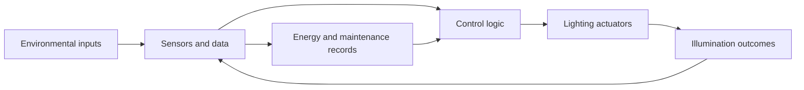

[[NICOR]]
[[concepts/Market-Categories/Building Management Systems|Building Management Systems]]
[[organizations/BACnet|BACnet]]

# Defining and Describing Illumination Management Systems

_Illumination management systems coordinate sensors, luminaires, software, and control rules to deliver the right light where and when it is needed._

An illumination management system is an integrated approach to monitoring and controlling lighting conditions across a room, building, campus, public space, or installation. It can combine occupancy detection, daylight sensing, illuminance measurement, wireless communication, dimming, scheduling, and automated fault diagnosis to balance visual comfort, safety, energy use, and maintenance. Recent systems increasingly use IoT networks, image-based illuminance estimation, optimization algorithms, and AI-enabled building-management platforms. [^1k5rca] [^g9kjyt] [^5o8ju0]

# Uses in Context

- In [[content-areas/AI-Factories-Datacenters/Concepts/Smart Buildings|Smart Buildings]], the term describes systems that adjust lighting in response to occupancy, daylight, activity, or measured illuminance to reduce unnecessary energy consumption. [^1k5rca] [^g9kjyt] [^cff43o]
- In offices and campuses, it can refer to localized dimming that maintains target illumination around occupied zones rather than lighting an entire space uniformly. [^bdm3vv]
- In galleries and museums, illumination management encompasses spectral control, glare reduction, visual performance, and protection of light-sensitive materials. [^i4s0wl]
- In public art and urban installations, it describes responsive LED control that changes brightness or creates illuminated pathways according to pedestrian position and density. [^q2s3s6]
- In facilities management, the concept includes automated fault detection and maintenance workflows for lighting infrastructure. [^5o8ju0]
- In sustainability programs, illumination management can form part of a broader building-energy-management or Lighting-as-a-Service model. [^1k5rca] [^o0rup2]

# History of Use

## Origins

- The modern technical idea is rooted in automated lighting-control research rather than a single universally documented invention. A 2010 study on occupancy-based LED control formulated illumination management as an optimization problem: minimize power consumption while maintaining uniform illumination around occupied zones. [^bdm3vv]
- Earlier work also combined natural-light monitoring, occupancy control, wireless lamp-mounted devices, and user preferences; one reported implementation achieved up to 69.6% energy savings and 30.5% avoided carbon-dioxide emissions in its tested scenarios. [^bdm3vv]
- The concept therefore emerged from the convergence of energy-efficient solid-state lighting, sensor networks, occupancy research, and building automation rather than from the product strategy of one dominant technology company. [^bdm3vv]

## Evolution

- **2010:** Occupancy-based LED control formalized localized illumination and dimming as an optimization problem, shifting lighting management from simple on/off switching toward spatially targeted control. [^bdm3vv]
- **2023:** IoT-based automated fault diagnostics expanded the concept from real-time illumination control to lifecycle maintenance and failure detection. [^5o8ju0]
- **2025–2026:** Research broadened systems toward distributed multi-state campus lighting, sensorless indoor illuminance maps, AI- and [[Vocabulary/Internet of Things|IoT]]-integrated building-energy management, and adaptive urban light installations. [^q2s3s6] [^1k5rca] [^eb68d2] [^g9kjyt]

# Best Real-World Examples

- [Occupancy-based LED illumination control](https://doi.org/10.1177/1477153510374703) — optimizes dimming levels around occupied areas while maintaining a specified illumination target. [^bdm3vv]
- [Distributed multi-state campus lighting](https://doi.org/10.1109/iSES67504.2025.00030) — uses active, dim, and idle states driven by real-time occupancy detection. [^eb68d2]
- [Image-based indoor illuminance mapping](https://pmc.ncbi.nlm.nih.gov/articles/PMC13517736/) — estimates illumination at indoor points without dedicated light-measurement sensors and reported a mean absolute percentage error of 11%. [^g9kjyt]
- [IoT-based automated fault diagnostics](https://iris.polito.it/handle/11583/3017269) — applies connected monitoring to lighting maintenance and fault identification. [^5o8ju0]
- [Adaptive urban LED light-art control](https://link.springer.com/article/10.1007/s10791-026-10453-x) — adjusts brightness according to pedestrian location, velocity, and density while balancing uniformity and energy use. [^q2s3s6]
- [Material-specific gallery lighting strategies](https://academic.oup.com/ijlct/article/doi/10.1093/ijlct/ctag077/8726792) — integrates spectral distribution, wavelength-dependent damage, glare control, visual performance, and energy optimization. [^i4s0wl]
- [Building Energy Management Systems](https://www.mdpi.com/1996-1073/18/24/6522) — provides the wider building-automation context in which intelligent lighting, sensors, IoT, and AI are integrated. [^1k5rca]

# Case Studies

An occupancy-based LED-control study published in 2010 treated lighting as a constrained optimization problem. Instead of illuminating an entire office uniformly, the system used localized occupancy information to determine appropriate dimming levels around occupied zones while preserving a required illumination level. The study’s central contribution was to connect occupancy sensing with mathematical optimization, showing how illumination management could become spatially responsive rather than merely scheduled. [^bdm3vv]

A later campus-oriented system distributed control across interconnected LED luminaires and assigned each unit three operating states: active, dim, and idle. Occupancy sensors continuously supplied information, while inter-node communication coordinated lighting along pathways and shared spaces. This case shows how illumination management can scale beyond an individual room: the system manages both energy demand and continuity of coverage, reducing lighting where it is unnecessary without sacrificing safety or usability. [^eb68d2]

Recent work on sensorless indoor illuminance mapping illustrates another expansion of the concept. Rather than installing light sensors throughout a living space, the proposed method uses images to estimate illumination at specific points; the reported model achieved an 11% mean absolute percentage error. This case demonstrates that illumination management is moving toward software-defined measurement, where visual data can supplement or replace some dedicated sensing hardware. [^g9kjyt]

***

# Sources

[^q2s3s6]: 2026, Aug 24. [link.springer.com](https://link.springer.com/). [Optimization control of urban light art installation LED lighting...](https://link.springer.com/article/10.1007/s10791-026-10453-x). Updated: 2026, Oct 21. Generated: 2026, Nov 17. [Perplexity](https://www.perplexity.ai/) API response.
[^i4s0wl]: 2026, Jan 27. [academic.oup.com](https://academic.oup.com/). [Material-specific lighting requirements and contemporary ...](https://academic.oup.com/ijlct/article/doi/10.1093/ijlct/ctag077/8726792). Updated: 2026, Nov 16. Generated: 2026, Nov 17. [Perplexity](https://www.perplexity.ai/) API response.
[^1k5rca]: 2025, Dec 12. [mdpi.com](https://www.mdpi.com/). [A Systematic Review of Building Energy Management ...](https://www.mdpi.com/1996-1073/18/24/6522). Updated: 2026, Nov 17. Generated: 2026, Nov 17. [Perplexity](https://www.perplexity.ai/) API response.
[^eb68d2]: 2025, Dec 01. [computer.org](https://www.computer.org/). [A Distributed Multi-State LED Lighting Control System for Energy Optimization in Academic Campuses](https://www.computer.org/csdl/proceedings-article/ises/2025/536600a104/2gdrxAqdGog). Updated: 2026, Nov 04. Generated: 2026, Nov 17. [Perplexity](https://www.perplexity.ai/) API response.
[^g9kjyt]: 2026, Aug 19. [pmc.ncbi.nlm.nih.gov](https://pmc.ncbi.nlm.nih.gov/). [A Method for Generating Real-Time Indoor Illuminance Maps ...](https://pmc.ncbi.nlm.nih.gov/articles/PMC13517736/). Updated: 2026, Nov 08. Generated: 2026, Nov 17. [Perplexity](https://www.perplexity.ai/) API response.
[^5o8ju0]: 2026, Oct 30. [iris.polito.it](https://iris.polito.it/). [PORTO @ Archivio Istituzionale della Ricerca](https://iris.polito.it/handle/11583/3017269). Updated: 2026, Nov 04. Generated: 2026, Nov 17. [Perplexity](https://www.perplexity.ai/) API response.
[^o0rup2]: 2026, Sep 16. [link.springer.com](https://link.springer.com/). [Assessing Critical Success Factors for Lighting-as-a-Service Implementation in Circular Lighting Systems: An Integrated ISM–MICMAC–MEREC–MARCOS Framework - Process Integration and Optimization for Sustainability](https://link.springer.com/10.1007/s41660-026-00883-x). Updated: 2026, Oct 10. Generated: 2026, Nov 17. [Perplexity](https://www.perplexity.ai/) API response.
[8]: 2026, May 25. [link.springer.com](http://link.springer.com/). [From simulation to implementation: bridging academia and industry to enhance energy efficiency, sustainability and human centricity in warehouse lighting systems - Operations Management Research](http://link.springer.com/article/10.1007/s12063-026-00599-8). Updated: 2026, Nov 05. Generated: 2026, Nov 17. [Perplexity](https://www.perplexity.ai/) API response.
[^bdm3vv]: 2025, Dec 29. [academia.edu](https://www.academia.edu/). [Occupancy-based illumination control of LED lighting ...](https://www.academia.edu/145657919/Occupancy_based_illumination_control_of_LED_lighting_systems). Updated: 2026, Jan 29. Generated: 2026, Nov 17. [Perplexity](https://www.perplexity.ai/) API response.
[^cff43o]: 2026, Apr 07. [preprints.org](https://www.preprints.org/). [Re-Thinking Lighting in Educational Buildings: A Climate ...](https://www.preprints.org/manuscript/202604.0465). Updated: 2026, Nov 17. Generated: 2026, Nov 17. [Perplexity](https://www.perplexity.ai/) API response.
