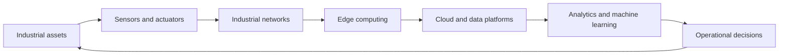

---
aliases:
  - Industrial Internet of Things
  - IIoT
date_created: 2026-10-29
date_modified: 2026-11-03
site_uuid: 260356fb-0d4a-4fe5-b253-cbe7b391abee
publish: true
title: Industrial Internet of Things
slug: industrial-internet-of-things
at_semantic_version: 0.0.0.1
cf_last_run: 2026-11-03T22:41:23.176Z
cf_last_run_model: Perplexity sonar-pro
tags:
  - Industrial-AI
  - Physical-AI
  - Internet-Of-Things
for_clients:
  - Edviro
---

# Defining and Describing Industrial Internet of Things

_The Industrial Internet of Things turns machinery into a continuously observed, data-driven operational system._

The **Industrial Internet of Things (IIoT)** is the connection of industrial equipment—such as machines, vehicles, utilities, and infrastructure—to sensors, communications networks, computing systems, and analytics. [^a4u4h8] It applies Internet-connected technologies to factories, energy systems, logistics, transportation, and other operational environments so organizations can monitor conditions, optimize processes, detect anomalies, and anticipate failures. [^a4u4h8] [^kptd7g] Unlike consumer IoT, IIoT generally emphasizes operational continuity, safety, traceability, reliability, and integration with industrial control systems. [^83nfqi] [^kptd7g]

A typical IIoT system links physical assets to sensing and control devices, edge or fog computing, communications networks, cloud services, and analytical applications. [^2xpaio] [^kptd7g]

## Uses in Context

- **Smart manufacturing:** IIoT describes production environments where machines continuously report status, exchange data, and support automated or human-supervised decisions. [^kptd7g]
- **Predictive maintenance:** The term is invoked when sensor data and machine-learning models identify abnormal behavior or estimate remaining useful life before equipment fails. [^2xpaio] [^kptd7g]
- **Industrial logistics:** IIoT connects assets, facilities, vehicles, and supply-chain systems to improve tracking, coordination, and material flow. [^83nfqi] [^kptd7g]
- **Energy and utilities:** IIoT refers to connected infrastructure used for energy supervision, operational monitoring, and resource management. [^83nfqi]
- **Digital twins and cyber-physical systems:** IIoT provides the continuous physical-world data exchange required to represent industrial assets digitally and connect operational processes with software systems. [^kptd7g]
- **Service transformation:** Machine builders use IIoT to move from selling equipment alone toward remote monitoring, condition-based service, and predictive maintenance offerings. [^prg5nr]

## History of Use

## Origins

- The phrase **“Industrial Internet”** is generally attributed to General Electric in 2012, when it described the convergence of industrial machinery, network connectivity, and data analytics. [^a4u4h8]
- The later term **Industrial Internet of Things** positioned industrial connectivity within the broader IoT and cyber-physical-systems vocabulary, emphasizing connected sensors, equipment, computing applications, and industrial decision-making. [^83nfqi] [^kptd7g]
- The concept’s technical foundations, however, draw on earlier academic and engineering traditions—including industrial automation, machine-to-machine communication, embedded systems, supervisory control, cyber-physical systems, and distributed computing—rather than originating solely with a later corporate label. [^kptd7g] [^g023po]

## Evolution

- **2012 — Industrial Internet framing:** General Electric popularized “Industrial Internet” as a description of connected industrial machines and analytics. [^a4u4h8]
- **2014 — Ecosystem institutionalization:** The Industrial Internet Consortium was formed by companies including AT&T, Cisco, GE, IBM, and Intel, helping establish shared discussions around industrial architectures, interoperability, and implementation. [^a4u4h8]
- **2020s — Expansion toward edge AI and integrated operations:** IIoT increasingly combined edge or fog processing, machine learning, cloud analytics, digital twins, predictive maintenance, logistics, energy management, and sustainability applications. [^2xpaio] [^kptd7g]

## Best Real-World Examples

- [SPALECK condition-monitoring system](https://www.iotusecase.com/en/podcast/condition-monitoring-proactive-service-mechanical-engineering) connects vibratory conveyors and screens through edge routers, cloud data, and machine-learning models to identify faults earlier and support service decisions. [^prg5nr]
- [Gencor Industries connected asphalt equipment](https://aiformanufacturing.org/case-studies/gencor-industries-paves-new-roads-with-iiot-connected-asphalt-equipment) embeds sensors and edge-connected hardware in asphalt-plant machinery to monitor temperatures, material flows, and equipment health. [^ynf089]
- [NASA C-MAPSS predictive-maintenance research](https://tj-es.com/ojs/index.php/tjes/article/view/2706) demonstrates an IIoT-style condition-based-maintenance pipeline combining data collection, edge or fog processing, machine learning, and remaining-useful-life prediction. [^2xpaio]
- [STM32 vibration-monitoring platform](https://www.adequateinfosoft.com/case-study/embedded-systems) illustrates a smaller embedded-systems implementation using vibration and temperature sensing, wireless connectivity, edge AI, and cloud analytics. [^502hnk]
- [ADAMOS](https://www.loot-drop.io/startup/2272-adamos) exemplifies an open manufacturing-IoT platform intended to connect heterogeneous factory equipment and support predictive maintenance and production optimization. [^xsx34p]
- [EdgePLC](https://m.bliiot.com/cases/aiotindustrial-ai) represents an open-source industrial-hardware approach for hosting industrial operating systems and local AI agents. [^apsj5v]

## Case Studies

**SPALECK: from condition monitoring to proactive service.** SPALECK, a machine builder serving recycling, chemical, and food-processing operations, connected vibratory equipment through edge routers and exposed machine data in the cloud. [^prg5nr] Machine-learning software was then used to build predictive-maintenance workflows, including model comparison, labeling, and retraining. [^prg5nr] The implementation supported earlier fault detection, remote access, and clearer service alerts while preserving interoperability through interfaces such as OPC UA, PROFINET, and APIs. [^prg5nr] The case shows that IIoT is not merely a sensor deployment: its value emerges when machine data becomes an operational and service process.

**Gencor Industries: connected asphalt plants.** Gencor undertook a multiyear effort to place connected sensors directly on asphalt-plant equipment and capture variables including temperature, material flow, and equipment-health indicators. [^ynf089] Edge-connected hardware and industrial analytics provided continuous visibility into plant performance, allowing maintenance teams to shift from reactive responses toward predictive maintenance. [^ynf089] The example demonstrates how IIoT can extend beyond factory-floor discrete manufacturing into heavy equipment and infrastructure-related industries, where physical conditions and equipment availability directly affect project schedules.

**NASA C-MAPSS: predictive maintenance as a research benchmark.** A condition-based-maintenance framework built around the NASA C-MAPSS dataset combined data acquisition, edge or fog processing, machine learning, and cloud functions to estimate remaining useful life. [^2xpaio] Its LSTM model was used to predict degradation and support real-time monitoring and maintenance decisions. [^2xpaio] Although the dataset is a research benchmark rather than a single deployed plant, the case illustrates the analytical core of IIoT: transforming streams of equipment measurements into forecasts that can guide intervention before failure.

***

# Sources

[^a4u4h8]: 2026, Jun 25. [cnicsolutions.com](https://cnicsolutions.com/). [What Is the Industrial Internet of Things (IIoT)? - CNiC Solutions](https://cnicsolutions.com/ai-emerging-technology/iot-connected-devices/what-is-the-industrial-internet-of-things-iiot/). Updated: 2026, Nov 02. Generated: 2026, Nov 03. [Perplexity](https://www.perplexity.ai/) API response.
[^83nfqi]: 2026, Jul 11. [link.springer.com](https://link.springer.com/). [A systematic survey of blockchain-enabled artificial intelligence for industrial IoT: recent advances, integration challenges, and future prospects - Artificial Intelligence Review](https://link.springer.com/article/10.1007/s10462-026-11612-8?fromPaywallRec=true). Updated: 2026, Oct 27. Generated: 2026, Nov 03. [Perplexity](https://www.perplexity.ai/) API response.
[^xsx34p]: 2026, Jan 31. [loot-drop.io](https://www.loot-drop.io/). [ADAMOS | Failed Startup Case Study - Loot Drop](https://www.loot-drop.io/startup/2272-adamos). Updated: 2026, Apr 03. Generated: 2026, Nov 03. [Perplexity](https://www.perplexity.ai/) API response.
[^2xpaio]: 2025, Dec 27. [tj-es.com](https://tj-es.com/). [Case Study on LSTM RUL Prediction with NASA C-MAPSS](https://tj-es.com/ojs/index.php/tjes/article/view/2706). Updated: 2026, Nov 01. Generated: 2026, Nov 03. [Perplexity](https://www.perplexity.ai/) API response.
[^ynf089]: 2026, Mar 17. [aiformanufacturing.org](https://aiformanufacturing.org/). [Gencor Industries Paves New Roads with IIoT-Connected…](https://aiformanufacturing.org/case-studies/gencor-industries-paves-new-roads-with-iiot-connected-asphalt-equipment). Updated: 2026, Nov 03. Generated: 2026, Nov 03. [Perplexity](https://www.perplexity.ai/) API response.
[^apsj5v]: 2026, Oct 30. [m.bliiot.com](https://m.bliiot.com/). [Industrial AI & AIoT](https://m.bliiot.com/cases/aiotindustrial-ai). Updated: 2026, Nov 01. Generated: 2026, Nov 03. [Perplexity](https://www.perplexity.ai/) API response.
[^502hnk]: 2026, Oct 23. [adequateinfosoft.com](https://www.adequateinfosoft.com/). [Embedded Systems Portfolio and Case Studies](https://www.adequateinfosoft.com/case-study/embedded-systems). Updated: 2026, Oct 26. Generated: 2026, Nov 03. [Perplexity](https://www.perplexity.ai/) API response.
[^prg5nr]: 2026, Feb 18. [iotusecase.com](https://www.iotusecase.com/). [From Condition Monitoring to Proactive Machine Service](https://www.iotusecase.com/en/podcast/condition-monitoring-proactive-service-mechanical-engineering). Updated: 2026, Aug 04. Generated: 2026, Nov 03. [Perplexity](https://www.perplexity.ai/) API response.
[^kptd7g]: 2026, Jun 11. [mdpi.com](https://www.mdpi.com/). [Internet of Things for Industry 4.0: A Systematic Literature Review of ...](https://www.mdpi.com/2624-831x/7/2/46). Updated: 2026, Nov 03. Generated: 2026, Nov 03. [Perplexity](https://www.perplexity.ai/) API response.
[^g023po]: 2026, Feb 25. [studocu.com](https://www.studocu.com/). [A Survey on IIoT: Cyber-Physical Systems Perspective (CPS)](https://www.studocu.com/in/document/guru-gobind-singh-indraprastha-university/electrical-and-electronics/a-survey-on-iiot-cyber-physical-systems-perspective-cps/154336640). Updated: 2026, Mar 19. Generated: 2026, Nov 03. [Perplexity](https://www.perplexity.ai/) API response.
