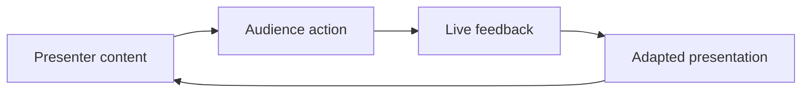

# Defining and Describing Interactive Presentations

- _Interactive presentations turn an audience from a group of listeners into an active part of the presentation._
- An interactive presentation is a presentation designed for active audience participation rather than one-way delivery. [^gjchr0] It creates two-way communication through activities such as polls, quizzes, questions, reactions, word clouds, discussion, or decision-making. [^ziw1oz] [^e39v52]
- The concept applies to classrooms, conferences, meetings, sales demonstrations, training sessions, workshops, and virtual events. Its defining feature is not merely visual animation: the audience contributes during delivery, and that contribution can influence the session’s direction or content. [^1qvqz3] [^5jca60]
- Interactivity may be **technological**, using live polling, digital Q&A, quizzes, and audience-response platforms, or **structural**, using pair discussions, scenarios, ranking exercises, and audience-led sections. [^1qvqz3]
- In digital slide software, interactivity can also mean non-linear navigation, clickable controls, hyperlinks, and triggers that let presenters or viewers choose their path through content. [^gxhry2]

## Uses in Context

- **Teaching and learning:** Instructors use interactive presentations to collect answers, test understanding, and adjust explanations based on immediate feedback. [^e79i8p]
- **Business meetings:** Facilitators use polls, ranking exercises, and questions to surface opinions and support group decisions. [^1qvqz3]
- **Conferences and events:** Speakers use audience-response tools to replace passive listening with live participation from attendees’ phones or laptops. [^ziw1oz] [^e39v52]
- **Training:** Trainers use quizzes, scenarios, and application exercises so participants practice concepts during the session rather than only receiving information. [^83irqc]
- **Remote and hybrid work:** Presenters use digital Q&A, reactions, and collaborative inputs to create a two-way channel across distributed audiences. [^e39v52]
- **Interactive storytelling:** Designers use branching navigation and clickable elements to let audiences explore information in different sequences. [^gxhry2]

## History of Use

### Origins

The phrase “interactive presentation” does not have a single clearly documented founding paper or universally accepted inventor in the available sources. Its underlying practice developed from the broader shift away from a presenter speaking continuously toward sessions in which audiences “actively respond during the session rather than passively watching.” [^ziw1oz] The concept combines older participatory teaching and facilitation methods with digital audience-response systems, live polling, and presentation software that can react to user input. [^e39v52] [^1qvqz3]

### Evolution

- **Participatory delivery:** The presentation moved from a fixed, one-way sequence toward a two-way exchange in which audiences ask questions, contribute ideas, and make decisions during delivery. [^gjchr0] [^1qvqz3]
- **Digital audience response:** Live polls, quizzes, word clouds, reactions, and mobile Q&A made participation scalable for classrooms, meetings, and events. [^ziw1oz] [^e39v52]
- **Adaptive and nonlinear presentation:** More recent tools emphasize feedback loops, in which audience input is acknowledged or changes what happens next, alongside clickable navigation and user-controlled exploration. [^5jca60] [^e8qixc] [^gxhry2]

## Best Real-World Examples

- [Mentimeter](https://www.mentimeter.com/) — [[Tooling/Creative/Mentimeter|Mentimeter]] — audience polling, quizzes, word clouds, and questions submitted in real time. [^e39v52] [^e79i8p]
- [Slido](https://www.slido.com/) — live Q&A, polls, quizzes, and audience participation through connected devices. [^e39v52]
- [Prezi](https://prezi.com/) — visually dynamic presentations that incorporate polls, quizzes, Q&A, and feedback during delivery. [^e79i8p]
- [Google Slides](https://slides.google.com/) — widely used presentation software that can support interactive classroom and meeting formats. [^e79i8p]
- [Microsoft PowerPoint](https://www.microsoft.com/microsoft-365/powerpoint) — supports interactive presentation structures through hyperlinks, buttons, triggers, and non-linear navigation. [^gxhry2]
- [Kahoot!](https://kahoot.com/) — quiz-centered participation that turns presentation content into live audience challenges. [^e39v52]
- [Audience-response systems](https://en.wikipedia.org/wiki/Audience_response) — a broader category of classroom and event technologies that collect responses and display feedback during a session. [^ziw1oz] [^e79i8p]

## Case Studies

**Live polling and Q&A in events.** In the digital event model, participants use phones or laptops to vote, submit open-ended responses, ask questions, and react while a presenter is speaking. [^ziw1oz] [^e39v52] The presenter receives immediate information about comprehension, sentiment, or priorities and can adapt the delivery accordingly. [^e79i8p] This shows that interactivity is a feedback loop rather than a decorative slide feature: the audience supplies input, and the presentation acknowledges or uses it in real time. [^5jca60] [^e8qixc]

**Interactive lectures.** Educational presenters use polls, quizzes, and question sessions to move students from passive listening to active participation. [^e79i8p] The approach can expose misconceptions during the lesson, give instructors evidence about what requires further explanation, and connect presentation content with learner responses. [^e79i8p] Its significance is methodological: the presentation becomes part explanation, part assessment, and part discussion.

**Nonlinear digital presentations.** Interactive PowerPoint-style presentations use hyperlinks, buttons, animation triggers, and interactive regions to let users choose what to explore and in what order. [^gxhry2] This changes the presenter’s role from narrator of a fixed sequence to designer of a navigable information environment. The example demonstrates that “interactive” can describe both social participation and interface-level control, although audience-response interaction and clickable navigation are distinct forms of the broader concept. [^1qvqz3] [^gxhry2]

***

# Sources

[^gjchr0]: 2026, Jun 23. [ukbodytalk.com](https://ukbodytalk.com/). [How to Make a Presentation Interactive: Engage Your Audience](https://ukbodytalk.com/resources/blogs/how-to-make-a-presentation-interactive/). Updated: 2026, Nov 12. Generated: 2026, Nov 13. [Perplexity](https://www.perplexity.ai/) API response.
[^ziw1oz]: 2026, Jun 19. [slidea.com](https://slidea.com/). [How to Make A Presentation Interactive in 5 Steps | Slidea](https://slidea.com/blog/presentation-tips/how-to-make-a-presentation-interactive/). Updated: 2026, Nov 10. Generated: 2026, Nov 13. [Perplexity](https://www.perplexity.ai/) API response.
[^e39v52]: 2026, Jun 16. [slidea.com](https://slidea.com/). [What Is an Interactive Presentation, Exactly? | Slidea](https://slidea.com/blog/presentation-tips/what-is-an-interactive-presentation-definition-examples-tools-and-best-practices/). Updated: 2026, Nov 11. Generated: 2026, Nov 13. [Perplexity](https://www.perplexity.ai/) API response.
[^e79i8p]: 2026, Feb 13. [prezi.com](https://prezi.com/). [Engaging Interactivity in Presentations - Prezi](https://prezi.com/p/gpobxauig8lf/engaging-interactivity-in-presentations/). Updated: 2026, Nov 03. Generated: 2026, Nov 13. [Perplexity](https://www.perplexity.ai/) API response.
[^1qvqz3]: 2026, Sep 13. [prezent.ai](https://www.prezent.ai/). [10 Interactive presentation techniques: design, tools and ...](https://www.prezent.ai/blog/interactive-presentation-techniques). Updated: 2026, Nov 06. Generated: 2026, Nov 13. [Perplexity](https://www.perplexity.ai/) API response.
[^5jca60]: 2026, Jun 19. [slidea.com](https://slidea.com/). [Interactive Presentation Ideas for Any Setting | Slidea](https://slidea.com/blog/presentation-tips/interactive-presentation-ideas-for-meetings-classrooms-training-events/). Updated: 2026, Nov 10. Generated: 2026, Nov 13. [Perplexity](https://www.perplexity.ai/) API response.
[^83irqc]: 2026, Sep 22. [effectivepresentations.com](https://www.effectivepresentations.com/). [5 Steps to Make a Presentation Interactive](https://www.effectivepresentations.com/5-steps-to-make-a-presentation-interactive/). Updated: 2026, Nov 07. Generated: 2026, Nov 13. [Perplexity](https://www.perplexity.ai/) API response.
[^e8qixc]: 2026, Jun 02. [presentations.ai](https://www.presentations.ai/). [How to Make an Interactive Presentation: 2026 Guide](https://www.presentations.ai/blog/make-an-interactive-presentation). Updated: 2026, Nov 05. Generated: 2026, Nov 13. [Perplexity](https://www.perplexity.ai/) API response.
[9]: 2026, Apr 17. [aippt.com](https://www.aippt.com/). [20 Interactive Presentation Ideas for More Engaging Slides](https://www.aippt.com/blog/interactive-presentation-ideas). Updated: 2026, Nov 12. Generated: 2026, Nov 13. [Perplexity](https://www.perplexity.ai/) API response.
[^gxhry2]: 2026, Mar 18. [slidor.agency](https://www.slidor.agency/). [Interactive PowerPoint: creation and features - Slidor](https://www.slidor.agency/blog/interactive-powerpoint). Updated: 2026, Nov 11. Generated: 2026, Nov 13. [Perplexity](https://www.perplexity.ai/) API response.
