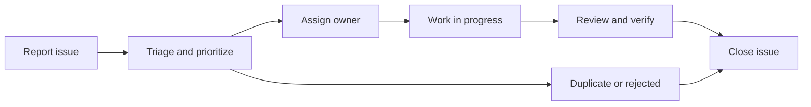

[[Tooling/Software Development/Developer Experience/Jira|Jira]]
[[Tooling/Software Development/Developer Experience/Linear|Linear]]
[[Plane]]
[[Tooling/AI-Toolkit/Generative AI/Code Generators/CodeRabbit|CodeRabbit]]

# Defining and Describing Issue Trackers

_Issue trackers turn scattered problems and requests into visible, accountable work._

An **issue tracker** is a software system for recording, prioritizing, assigning, and following defects, feature requests, tasks, and other work through a defined workflow.[^ph7eoc][^p6sfvp] It applies wherever teams need a shared record of work, ownership, status, discussion, dependencies, and resolution history.[^q75p24][^1025nu] Unlike bug tracking, which focuses specifically on software defects, issue tracking covers a broader range of product and engineering work.[^p6sfvp]

# Uses in Context

- **Software development:** Teams use issue trackers to record bugs, feature requests, maintenance tasks, failed tests, and technical obstacles.[^ph7eoc][^p6sfvp]
- **Project management:** Teams assign owners, attach milestones, break large issues into sub-issues, and identify blocking dependencies.[^9p9x85]
- **Support and feedback:** User reports can become searchable work records rather than remaining in disconnected conversations.[^ph7eoc][^p6sfvp]
- **Knowledge preservation:** Comments, status changes, and decisions create a historical record explaining how work progressed.[^1025nu][^ph7eoc]
- **Open-source collaboration:** Public repositories use issues to coordinate contributors, discuss proposed changes, and track work alongside pull requests.[^q75p24][^0c8i11]

# History of Use

## Origins

- The modern issue-tracker concept developed from software **bug-tracking systems**, whose purpose was to record defects and follow them through resolution; the broader term now includes requests, tasks, and engineering work beyond bugs.[^ph7eoc][^p6sfvp]
- The defining operational idea is a shared system of record: each item receives structured information such as an identifier, state, owner, priority, and history.[^ph7eoc]
- Contemporary issue-tracker documentation frames the concept around tracking “ideas and work,” rather than only defects.[^q75p24]

## Evolution

- **From defect logs to general work management:** Issue trackers expanded from bug reports to include feature requests, technical obstacles, failed tests, and maintenance work.[^ph7eoc][^p6sfvp]
- **From flat lists to structured workflows:** Systems increasingly model states, transitions, audit trails, priorities, and ownership so teams can follow an item from report to verified outcome.[^ph7eoc][^p6sfvp]
- **From individual records to work hierarchies:** Modern tools support labels, milestones, sub-issues, projects, and dependencies, allowing teams to represent complex work structures.[^9p9x85]

# Best Real-World Examples

- [GitHub Issues](https://github.com/features/issues) — tracks ideas, feedback, tasks, bugs, labels, milestones, sub-issues, and dependencies.[^q75p24][^0c8i11][^9p9x85]
- [GitHub Docs issue tracker](https://github.com/github/docs/issues/) — demonstrates a public repository using issues to manage real documentation work.[^efx07o]
- [Bug tracking systems](https://webiano.digital/knowledge-base/software/software-quality/issue-tracker/) — exemplify the original defect-centered form of issue tracking.[^ph7eoc]
- [Product-engineering issue tracking](https://ones.com/blog/what-is-issue-tracking-software-used-for-in-product-engineering-in-2026/) — extends tracking to failed tests, technical obstacles, and product work.[^p6sfvp]
- [Milestone-based planning](https://docs-internal.github.com/en/enterprise-server@3.19/issues/tracking-your-work-with-issues/learning-about-issues/quickstart) — connects issues to date-based targets and progress monitoring.[^9p9x85]
- [Dependency-aware issue management](https://docs-internal.github.com/en/enterprise-server@3.19/issues/tracking-your-work-with-issues/learning-about-issues/quickstart) — represents work that blocks or depends on other work.[^9p9x85]

# Case Studies

**GitHub Issues as repository-level coordination.** GitHub positions Issues as a way to track ideas and work within a repository.[^q75p24] Its workflow supports labels, issue types, milestones, assignees, projects, and sub-issues, letting teams add progressively richer metadata as work becomes more complex.[^9p9x85] Public repositories such as `github/docs` expose issue tracking as an observable collaboration practice rather than a private project-management database.[^efx07o] The case shows how an issue tracker can combine discussion, responsibility, planning, and repository context in one place.

**Hierarchical planning with sub-issues.** A large task can be divided into smaller issues, while multiple levels of sub-issues represent the amount of detail appropriate to a project.[^9p9x85] Dependency relationships identify work that is blocked by, or blocks, another issue.[^9p9x85] This changes the tracker from a flat queue into a lightweight model of project structure: teams can connect a broad objective to implementable units and inspect the relationships that affect delivery.

**Issue history as organizational memory.** An issue record can preserve discussions and decisions that explain why work was performed and how it evolved.[^1025nu] A mature tracker also records transitions, comments, and field changes in an audit trail.[^ph7eoc] That history helps teams recover context after handoffs, evaluate recurring defect patterns, and understand the reasoning behind a change.[^1025nu][^ph7eoc] The case demonstrates that issue trackers are not merely inboxes for bugs; they are durable records of collaborative decision-making.

***

# Sources

[^q75p24]: 2026, Jan 01. [docs-internal.github.com](https://docs-internal.github.com/). [Tracking your work with issues - GitHub Docs](https://docs-internal.github.com/en/issues/tracking-your-work-with-issues). Updated: 2026, Feb 21. Generated: 2026, Nov 18. [Perplexity](https://www.perplexity.ai/) API response.
[^efx07o]: 2026, Nov 18. [github.com](https://github.com/). [Issues · github/docs](https://github.com/github/docs/issues/). Generated: 2026, Nov 18. [Perplexity](https://www.perplexity.ai/) API response.
[3]: 2026, Jun 18. [github.com](https://github.com/). [github.com › AnubhavKiroula › github-docsgithub-docs/content/issues/tracking-your-work-with-issues ...](https://github.com/AnubhavKiroula/github-docs/blob/main/content/issues/tracking-your-work-with-issues/using-issues/filtering-and-searching-issues-and-pull-requests.md). Updated: 2026, Oct 15. Generated: 2026, Nov 18. [Perplexity](https://www.perplexity.ai/) API response.
[^0c8i11]: 2026, Jan 01. [docs-internal.github.com](https://docs-internal.github.com/). [GitHub Issues documentation - GitHub Docs](https://docs-internal.github.com/en/issues?Tag=schedule). Updated: 2026, Jan 10. Generated: 2026, Nov 18. [Perplexity](https://www.perplexity.ai/) API response.
[^1025nu]: 2026, Jan 01. [docs-internal.github.com](https://docs-internal.github.com/). [Planning and tracking work for your team or project](https://docs-internal.github.com/en/issues/tracking-your-work-with-issues/learning-about-issues/planning-and-tracking-work-for-your-team-or-project). Updated: 2026, Feb 24. Generated: 2026, Nov 18. [Perplexity](https://www.perplexity.ai/) API response.
[6]: 2026, Jan 01. [docs-internal.github.com](https://docs-internal.github.com/). [About Search Terms](https://docs-internal.github.com/en/enterprise-server@3.15/issues/tracking-your-work-with-issues/using-issues/filtering-and-searching-issues-and-pull-requests). Updated: 2026, Jan 23. Generated: 2026, Nov 18. [Perplexity](https://www.perplexity.ai/) API response.
[^ph7eoc]: 2026, Nov 16. [webiano.digital](https://webiano.digital/). [Issue tracker – Software](https://webiano.digital/knowledge-base/software/software-quality/issue-tracker/). Updated: 2026, Nov 18. Generated: 2026, Nov 18. [Perplexity](https://www.perplexity.ai/) API response.
[^p6sfvp]: 2026, Nov 08. [ones.com](https://ones.com/). [What Is Issue Tracking Software Used for in Product Engineering in 2026?](https://ones.com/blog/what-is-issue-tracking-software-used-for-in-product-engineering-in-2026/). Updated: 2026, Nov 13. Generated: 2026, Nov 18. [Perplexity](https://www.perplexity.ai/) API response.
[^9p9x85]: 2026, Jan 01. [docs-internal.github.com](https://docs-internal.github.com/). [Quickstart for GitHub Issues](https://docs-internal.github.com/en/enterprise-server@3.19/issues/tracking-your-work-with-issues/learning-about-issues/quickstart). Updated: 2026, Jan 15. Generated: 2026, Nov 18. [Perplexity](https://www.perplexity.ai/) API response.
[10]: 2026, Jan 01. [docs-internal.github.com](https://docs-internal.github.com/). [문제 및 끌어오기 요청 필터링 및 검색 - GitHub 문서](https://docs-internal.github.com/ko/issues/tracking-your-work-with-issues/using-issues/filtering-and-searching-issues-and-pull-requests). Updated: 2026, Jan 12. Generated: 2026, Nov 18. [Perplexity](https://www.perplexity.ai/) API response.
