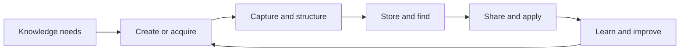

[[Tooling/AI-Toolkit/AI Interfaces/AI Workspaces/Mem.ai|Mem.ai]]
[[Glen]]

[[concepts/Organizational Change Management|Change Management]]
[[concepts/Emergent Innovation|Emergent Innovation]]
[[concepts/Cognitive, Collaborative Tooling|Cognitive, Collaborative Tooling]]

# Defining and Describing Knowledge Management

- _Knowledge management turns what an organization knows into something people can find, share, improve, and use._
- Knowledge management (KM) is the structured practice of creating, capturing, organizing, KMsharing, applying, and retaining organizational knowledge. [^up9y7h] It combines organizational processes, human collaboration, information practices, and technology to support institutional objectives. [^up9y7h]
- The field is multidisciplinary, drawing on organizational science, cognitive science, library and information science, information systems, and management research. [^e0e3v0]
- KM applies wherever knowledge must move between people, teams, systems, or organizational generations—for example, during innovation, [[onboarding]], expert [[concepts/Business Process Handoffs|Handoffs]], mergers, compliance work, and operational improvement. [^i6jjcv] [^up9y7h]

## Uses in Context

- **Organizational learning:** KM describes practices that help employees generate, exchange, and reuse knowledge rather than repeatedly solving the same problems. [^i6jjcv] [^88utxh]
- **Knowledge repositories:** The term can refer to systems that collect documents, records, expertise, taxonomies, metadata, and other organizational information in findable forms. [^up9y7h]
- **Expertise transfer:** KM is invoked when organizations need to surface tacit expertise and transfer it through communities, mentoring, collaboration, documentation, or structured workflows. [^i6jjcv] [^88utxh]
- **Search and discovery:** In technology contexts, KM includes enterprise search, semantic classification, linked data, autoclassification, and taxonomies that improve findability. [^tflzc8] [^up9y7h]
- **Innovation management:** KM describes the conversion of individual and collective knowledge into new products, services, processes, and organizational capabilities. [^88utxh]
- **Risk and continuity:** Organizations use KM to preserve knowledge during staff turnover, restructuring, mergers, and other disruptions. [^k0ttei] [^up9y7h]

## History of Use

### Origins

- The modern KM literature is commonly associated with Karl Wiig’s *[[Knowledge Management Foundations]]* (1993), which examined how people and organizations create, represent, and use knowledge, and with Ikujiro Nonaka and Hirotaka Takeuchi’s *[[The Knowledge-Creating Company]]* (1995). [^dapcd1]
- Nonaka and Takeuchi developed the SECI model, describing organizational knowledge creation as the continual transformation of tacit and explicit knowledge. [^88utxh]
- The concept did not originate from a single discipline or institution; its development reflects converging work on organizational learning, tacit knowledge, information management, cognition, and innovation. [^e0e3v0] [^88utxh]

### Evolution

- **1960s–1980s:** Management thinkers increasingly treated knowledge as a strategic organizational resource, while research on tacit knowledge and organizational learning supplied conceptual foundations for later KM. [^a1fty9] [^88utxh]
- **1993–1995:** Wiig formalized KM as a field concerned with creating, representing, and using knowledge, while Nonaka and Takeuchi connected knowledge creation to innovation through the SECI model. [^dapcd1] [^88utxh]
- **2000s–present:** KM expanded from repositories and intranets toward semantic technologies, taxonomies, linked data, enterprise search, process mining, collaboration platforms, and AI-assisted discovery. [^tflzc8] [^i6jjcv] [^up9y7h]

## Best Real-World Examples

- [Apache Jena](https://jena.apache.org/) — an open-source framework used for semantic web and linked-data applications within KM architectures. [^tflzc8]
- [Apache Solr](https://solr.apache.org/) — an open-source search platform used in KM systems to improve retrieval across organizational repositories. [^tflzc8]
- [Alfresco Community Edition](https://www.alfresco.com/) — an open-source content and records-management component used in a KM technology stack. [^tflzc8]
- [Smartlogic Semaphore](https://www.smartlogic.com/) — a semantic platform used for taxonomy management and autoclassification in knowledge repositories. [^tflzc8] [^8yxfcy]
- [Talend](https://www.talend.com/) — a data-integration component used to connect information sources in a KM architecture. [^tflzc8]
- [MySQL](https://www.mysql.com/) — a relational database used as part of a KM data backbone. [^tflzc8]
- [SECI model](https://doi.org/10.1057/palgrave.ek.1410126) — a research framework explaining how tacit and explicit knowledge interact during organizational knowledge creation. [^88utxh]

## Case Studies

The Bridgeway Foundation illustrates KM as an architecture rather than a single application. Its existing environment combined structured business intelligence, a relational database, collaboration tools, cloud storage, and sensitive field-based intelligence; the recommended roadmap integrated these capabilities with open-source and commercial components for transcription, linked data, enterprise search, content management, taxonomy management, autoclassification, and data integration. [^tflzc8] The proposed implementation was organized into four phases over 12–14 months, with open-source software used extensively to preserve resources for the foundation’s mission. [^tflzc8] The case shows that KM depends on connecting processes, information structures, search, classification, and governance—not merely installing a repository.

A federal-proposal organization faced knowledge fragmentation after a rapid series of mergers, with proposal content distributed across more than 20 disconnected repositories. [^k0ttei] The KM challenge was therefore operational: make dispersed institutional knowledge available when teams needed to respond to requests for proposals. [^k0ttei] The case demonstrates how KM supports reuse, continuity, and coordinated work after organizational change, especially when valuable knowledge is trapped in disconnected systems.

A top-10 accounting firm moved from KM strategy to working software by implementing and testing semantic autoclassification across its principal knowledge repositories. [^8yxfcy] The project used semantic classification to improve the organization and retrieval of repository content rather than relying solely on manual filing. [^8yxfcy] This illustrates the field’s evolution toward machine-assisted organization, while preserving the central KM objective: making institutional knowledge easier to find and apply.

***

# Sources

[^k0ttei]: 2026, Aug 27. [iknow.us](https://iknow.us/). [Knowledge Management for Federal Proposals and RFPs](https://iknow.us/case-studies/how-to-leverage-everything-your-company-knows-when-responding). Updated: 2026, Nov 10. Generated: 2026, Nov 15. [Perplexity](https://www.perplexity.ai/) API response.
[^tflzc8]: 2026, Aug 28. [iknow.us](https://iknow.us/). [KM Technology Roadmap for the Bridgeway Foundation](https://iknow.us/case-studies/building-the-data-backbone-for-atrocity-prevention-a-km). Updated: 2026, Nov 11. Generated: 2026, Nov 15. [Perplexity](https://www.perplexity.ai/) API response.
[^i6jjcv]: 2025, Dec 09. [link.springer.com](http://www.link.springer.com/). [Process mining starts here: on expertise, exchange, and the gaps between - Process Science](http://www.link.springer.com/article/10.1007/s44311-025-00032-6). Updated: 2026, Nov 10. Generated: 2026, Nov 15. [Perplexity](https://www.perplexity.ai/) API response.
[^dapcd1]: 2026, Jun 02. [link.springer.com](https://link.springer.com/). [The Origin of Knowledge Management](https://link.springer.com/chapter/10.1007/978-981-95-8974-6_1?fromPaywallRec=true). Updated: 2026, Oct 22. Generated: 2026, Nov 15. [Perplexity](https://www.perplexity.ai/) API response.
[^e0e3v0]: 2026, Jan 01. [dialnet.unirioja.es](https://dialnet.unirioja.es/). [Knowledge Management - Dialnet - Universidad de La Rioja](https://dialnet.unirioja.es/servlet/articulo?codigo=5059150). Updated: 2026, Jan 23. Generated: 2026, Nov 15. [Perplexity](https://www.perplexity.ai/) API response.
[^a1fty9]: 2026, Apr 10. [scribd.com](https://www.scribd.com/). [Infographic Timeline, Knowledge Management. | PDF - Scribd](https://www.scribd.com/document/922024595/Infographic-Timeline-Knowledge-Management). Generated: 2026, Nov 15. [Perplexity](https://www.perplexity.ai/) API response.
[^8yxfcy]: 2026, Aug 27. [iknow.us](https://iknow.us/). [Semantic Autoclassification at a Top-10 Accounting Firm](https://iknow.us/case-studies/implementing-semantic-autoclassification-at-a-top-10). Updated: 2026, Nov 11. Generated: 2026, Nov 15. [Perplexity](https://www.perplexity.ai/) API response.
[^up9y7h]: 2026, Feb 05. [nationalacademies.org](https://www.nationalacademies.org/). [The Business Case for Knowledge Management: A Guide (2026)](https://www.nationalacademies.org/read/29278/chapter/11). Updated: 2026, Sep 23. Generated: 2026, Nov 15. [Perplexity](https://www.perplexity.ai/) API response.
[9]: 2025, Nov 27. [id.scribd.com](https://id.scribd.com/). [Knowledge Management | PDF | Collaboration](https://id.scribd.com/doc/61521995/Knowledge-Management). Updated: 2026, Oct 19. Generated: 2026, Nov 15. [Perplexity](https://www.perplexity.ai/) API response.
[^88utxh]: 2025, Dec 01. [scielo.org.co](http://www.scielo.org.co/). [The influence of administrative thinking in knowledge management and innovation: a systematic review](http://www.scielo.org.co/scielo.php?script=sci_arttext&pid=S0124-86932025000200272&lng=es&nrm=iso&tlng=en). Updated: 2026, Aug 16. Generated: 2026, Nov 15. [Perplexity](https://www.perplexity.ai/) API response.
