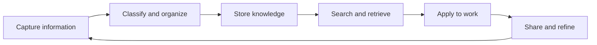

[[concepts/Explainers for Tooling/Advanced Documents|Advanced Documents]]
[[Tooling/Productivity/Advanced Documents/Notion|Notion]]
[[Tooling/Productivity/Advanced Documents/Obsidian|Obsidian]]

# Defining and Describing Personal Knowledge Management

- _Personal Knowledge Management turns scattered information into usable understanding._
- Personal Knowledge Management (PKM) is the process by which an individual collects, classifies, stores, searches, retrieves, applies, and shares knowledge in daily work and learning. [^9d22x7] [^c8f5k5] It is a bottom-up counterpart to organizational knowledge management and places responsibility for personal learning and professional growth on the knowledge worker. [^9d22x7]
- PKM applies whenever people must handle information across projects, research, creative work, education, or decision-making. Its purpose is not merely to accumulate notes, but to make information findable, reusable, and useful for problem-solving. [^9d22x7] [^c8f5k5]

# Uses in Context

- In workplace discussions, PKM describes how knowledge workers independently manage information and support their own growth rather than relying entirely on centralized organizational systems. [^9d22x7]
- In education, it refers to practices for collecting readings, lecture notes, ideas, and references so they can be retrieved for exams, essays, or research. [^e93lhv]
- In productivity culture, “second brain” commonly describes an external digital system that stores knowledge so the user can think with it instead of trying to remember everything. [^05k161] [^e93lhv]
- In note-taking practice, PKM invokes atomic notes, explicit links, and connected ideas associated with the Zettelkasten method. [^5geckw] [^e93lhv]
- In software discussions, PKM can describe local-first or linked-note environments such as Obsidian, as well as database-oriented systems such as Notion. [^e93lhv] [^eqi6np]
- In contemporary AI discussions, PKM is being reframed around automated capture, classification, semantic retrieval, and synthesis across a personal knowledge base. [^r36fao]

# History of Use

## Origins

- The concept is generally traced to work by Frand and Hixon, whose foundational late-1990s work framed PKM around questions such as “Who? What? Why? When? Where? How?” concerning an individual’s knowledge processes. [^c8f5k5]
- Davenport emphasized the importance of understanding individual knowledge processes for worker productivity before the term became widely established. [^c8f5k5]
- Wright later modeled PKM through four interrelated domains—analytical, information, social, and learning—treating it as an inherently social approach to applying knowledge to problems. [^c8f5k5]

## Evolution

- **1990s–2000s:** PKM developed as an individual-centered response to organizational knowledge management, emphasizing the knowledge worker’s responsibility for gathering, evaluating, organizing, and communicating information. [^9d22x7] [^c8f5k5]
- **Mid-2010s–early 2020s:** Zettelkasten practices entered wider knowledge-work culture through atomic notes, unique identifiers, and explicit links; Sönke Ahrens’s 2017 book helped present the method to students and professionals in accessible form. [^e93lhv] [^eqi6np]
- **2022 onward:** Tiago Forte’s *Building a Second Brain* popularized the CODE workflow—Capture, Organize, Distill, Express—and the PARA structure of Projects, Areas, Resources, and Archives for everyday knowledge workers. [^5geckw] [^e93lhv] [^eqi6np]

# Best Real-World Examples

- [Zettelkasten](https://en.wikipedia.org/wiki/Zettelkasten) — [[Vocabulary/Zettelkasten|Zettelkasten]] —a linked-note method built around atomic notes, unique identifiers, and associative connections. [^e93lhv] [^bx2ntk]
- [Obsidian](https://obsidian.md/) — a local-first Markdown knowledge environment organized around linked notes and a user-controlled vault. [^e93lhv] [^eqi6np]
- [Notion](https://www.notion.so/) — a workspace commonly used to combine notes, databases, project information, and deadline tracking in one personal system. [^e93lhv]
- [Building a Second Brain](https://fortelabs.com/blog/basboverview/) — [[Sources/Books/Building a Second Brain|Building a Second Brain]] — Tiago Forte’s framework for externalizing knowledge and turning it into reusable material through CODE and PARA. [^5geckw] [^e93lhv]
- [How to Take Smart Notes](https://takingnotenow.com/) — Sönke Ahrens’s popular exposition of Zettelkasten-informed note-making for learning and writing. [^eqi6np]
- [Niklas Luhmann’s slip-box](https://en.wikipedia.org/wiki/Niklas_Luhmann) — a paper-based knowledge network reported to contain roughly 90,000 index cards built over several decades. [^eqi6np]
- AI-assisted second-brain systems — emerging tools increasingly automate capture, categorization, semantic retrieval, and cross-note synthesis. [^r36fao]

# Case Studies

**Niklas Luhmann’s slip-box.** German sociologist Niklas Luhmann used a physical Zettelkasten consisting of individually identified cards connected through references, creating a growing network rather than a simple hierarchical filing cabinet. [^eqi6np] The method supported the development of ideas across reading, research, and writing by making earlier thoughts available in new combinations. [^eqi6np] This case shows that PKM predates digital software and depends less on a particular interface than on durable capture, explicit relationships, and retrieval.

**Tiago Forte’s “second brain” framework.** Tiago Forte translated PKM into a system aimed at everyday knowledge workers, presenting PARA as an action-oriented filing structure and CODE as a lifecycle for captured information. [^5geckw] [^eqi6np] The approach reframed personal notes as material for future projects and expression rather than as an archive to be passively maintained. [^05k161] [^e93lhv] Its influence illustrates how an independent practitioner can popularize a concept through a clear vocabulary and repeatable workflow without originating the broader scholarly field of PKM.

**Local-first linked-note practice.** Obsidian helped make linked, plain-text note systems accessible to a broad audience by combining Markdown files, bidirectional links, offline use, and an extensible plugin ecosystem. [^e93lhv] [^eqi6np] Users can combine Zettelkasten-style atomic notes with project-oriented structures such as PARA, adapting the same knowledge base to research, writing, study, and professional work. [^e93lhv] The case demonstrates that effective PKM is a design pattern rather than a single product: the central functions are capture, connection, retrieval, and reuse.

***

# Sources

[^05k161]: 2026, Jun 05. [obsibrain.com](https://www.obsibrain.com/). [Building a Second Brain in Obsidian: The Complete Setup (2026)](https://www.obsibrain.com/blog/obsidian-second-brain-template). Updated: 2026, Oct 22. Generated: 2026, Nov 05. [Perplexity](https://www.perplexity.ai/) API response.
[^9d22x7]: 2026, Sep 17. [mem.nhiro.org](https://mem.nhiro.org/). [personal knowledge base](https://mem.nhiro.org/personal_knowledge_base). Updated: 2026, Sep 21. Generated: 2026, Nov 05. [Perplexity](https://www.perplexity.ai/) API response.
[^5geckw]: 2026, May 17. [hackernoon.com](https://hackernoon.com/). [AI Coding Tip 020 - Create a Second Brain](https://hackernoon.com/ai-coding-tip-020-create-a-second-brain). Updated: 2026, Oct 30. Generated: 2026, Nov 05. [Perplexity](https://www.perplexity.ai/) API response.
[4]: 2026, Jul 06. [shadow.do](https://www.shadow.do/). [The CODE Method for AI Meeting Notes in Obsidian](https://www.shadow.do/blog/code-method-obsidian-ai-meeting-notes-2026). Updated: 2026, Oct 26. Generated: 2026, Nov 05. [Perplexity](https://www.perplexity.ai/) API response.
[^e93lhv]: 2025, Nov 14. [activerecalling.com](https://activerecalling.com/). [Building a Second Brain: Knowledge Management for Students](https://activerecalling.com/blog/second-brain-for-students). Updated: 2026, Nov 02. Generated: 2026, Nov 05. [Perplexity](https://www.perplexity.ai/) API response.
[^r36fao]: 2026, Oct 23. [idvork.in](https://idvork.in/). [AI AS YOUR SECOND BRAIN - IGOR'S BLOG](https://idvork.in/ai-second-brain). Updated: 2026, Oct 10. Generated: 2026, Nov 05. [Perplexity](https://www.perplexity.ai/) API response.
[^c8f5k5]: 2026, Aug 13. [handwiki.org](https://handwiki.org/). [Personal knowledge management](https://handwiki.org/wiki/Personal_knowledge_management). Updated: 2026, Aug 21. Generated: 2026, Nov 05. [Perplexity](https://www.perplexity.ai/) API response.
[^eqi6np]: 2026, Jun 29. [llbbl.blog](https://llbbl.blog/). [Knowledge-management](https://llbbl.blog/categories/knowledge-management/). Updated: 2026, Jul 01. Generated: 2026, Nov 05. [Perplexity](https://www.perplexity.ai/) API response.
[^bx2ntk]: 2026, May 25. [calmops.com](https://calmops.com/). [Obsidian and Second Brain Productivity Complete Guide 2026](https://calmops.com/productivity/obsidian-second-brain-productivity/). Updated: 2026, Jun 02. Generated: 2026, Nov 05. [Perplexity](https://www.perplexity.ai/) API response.
[10]: 2026, Aug 20. [tandfonline.com](https://www.tandfonline.com/). [www.tandfonline.com › doi › fullFull article: Knowledge at Risk: a life cycle model for ...](https://www.tandfonline.com/doi/full/10.1080/14778238.2026.2719483). Updated: 2026, Oct 04. Generated: 2026, Nov 05. [Perplexity](https://www.perplexity.ai/) API response.
