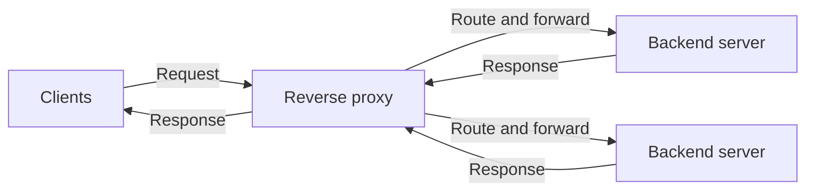

# Defining and Describing Reverse Proxying

- _Reverse proxying puts a controlled front door between users and the servers that serve an application._
- A reverse proxy is an intermediary that accepts requests for one or more backend servers, forwards each request to an appropriate backend, and returns the response while presenting itself to the client as the origin. [^kcp9v7] [^xs4rah]
- In HTTP terminology, RFC 9110 calls this intermediary a **gateway**: it “acts as an origin server for the outbound connection” while translating and forwarding requests inbound to another server or servers. [^3hw683] [^h18ma5] [^7eaq8a]
- Reverse proxying applies when a server owner—not an end user—places the intermediary in front of application servers. It can centralize TLS termination, routing, caching, compression, access control, traffic filtering, health checks, and load balancing. [^kcp9v7] [^xs4rah] [^3hw683]
- The pattern matters because clients can use one public address while backend topology, addresses, and implementation details remain behind the proxy. [^xs4rah] [^9k8myr]

## Uses in Context

- **Infrastructure:** “The gatekeeper” centralizes TLS, routing, load balancing, and security for application infrastructure. [^xs4rah]
- **Performance:** A reverse proxy can provide “accelerator” caching, allowing repeated requests to be served without contacting the origin each time. [^3hw683] [^h18ma5]
- **Scalability:** Operators place several application servers behind one public endpoint and distribute traffic among them. [^3hw683] [^h18ma5]
- **Security and encapsulation:** Gateways can hide backend servers and “encapsulate legacy or untrusted information services.” [^3hw683]
- **Application delivery:** Nginx, HAProxy, Caddy, Traefik, Envoy, and Apache with `mod_proxy` are commonly used implementations or products in this role. [^3hw683] [^9k8myr] [^6m5t0t]
- **Networking terminology:** The term contrasts with a forward proxy: a forward proxy acts for clients, while a reverse proxy acts for servers. [^6m5t0t]

# History of Use

## Origins

- The broader web-proxy lineage is documented in *World-Wide Web Proxies*, published in April 1994 by Ari Luotonen of CERN and Kevin Altis of Intel. [^1exjgj]
- That early work addressed firewall traversal and caching: users on closed networks could reach external services through an intermediary that also cached responses. [^1exjgj]
- Reverse proxying is the server-facing counterpart of that arrangement: instead of representing clients to outside servers, the intermediary represents origin infrastructure to clients. [^1exjgj]

## Evolution

- **1994 — Web proxies become a documented architectural pattern.** Luotonen and Altis described a proxy that combined intermediary access with caching and supported HTTP, Gopher, WAIS, and FTP. [^1exjgj]
- **HTTP standardization — Gateway terminology becomes central.** RFC 9110 formalized the relevant intermediary as a gateway, emphasizing translation, forwarding, caching, legacy-service encapsulation, and load balancing. [^3hw683] [^h18ma5] [^7eaq8a]
- **Modern application delivery — The proxy becomes an edge control plane.** Contemporary implementations combine reverse proxying with TLS termination, path- and host-based routing, health checks, caching, compression, filtering, and load balancing. [^kcp9v7] [^xs4rah] [^37p42e]

# Best Real-World Examples

- [NGINX](https://nginx.org/) — combines web serving, reverse proxying, caching, and load balancing. [^kcp9v7] [^xs4rah]
- [HAProxy](https://www.haproxy.org/) — provides high-performance reverse proxying and load balancing for TCP and HTTP applications. [^h18ma5]
- [Caddy](https://caddyserver.com/) — commonly used as a reverse proxy with automated HTTPS capabilities. [^kcp9v7] [^3hw683]
- [Traefik](https://traefik.io/) — routes requests to application backends as a reverse proxy in modern service environments. [^xs4rah] [^3hw683]
- [Envoy](https://www.envoyproxy.io/) — functions as an edge and service-proxy implementation in distributed systems. [^9k8myr] [^37p42e]
- [Apache HTTP Server `mod_proxy`](https://httpd.apache.org/docs/current/mod/mod_proxy.html) — implements reverse-proxy behavior within Apache HTTP Server. [^3hw683]
- [Cloudflare](https://www.cloudflare.com/) — operates reverse-proxy and CDN infrastructure at hosted-service scale. [^kcp9v7] [^3hw683]

# Case Studies

**CERN’s early web proxy work.** In 1994, Ari Luotonen and Kevin Altis described a proxy architecture intended to help users behind closed corporate or institutional networks access outside services. [^1exjgj] The implementation combined firewall traversal with caching and supported multiple protocols, including HTTP, Gopher, WAIS, and FTP. [^1exjgj] Although this was primarily a forward-proxy use case, it established the intermediary pattern later applied in the opposite direction for origin servers. It shows that proxying evolved from a practical connectivity and resource-efficiency problem rather than from a single vendor’s product strategy. [^1exjgj]

**NGINX and the consolidation of edge functions.** NGINX exemplifies how an open-source web server expanded into a general front-end traffic layer: it can serve static content, proxy requests, cache responses, and balance traffic across backends. [^kcp9v7] [^xs4rah] In a typical deployment, clients connect to NGINX while the application remains behind it, allowing operators to manage routing and connection behavior at a single boundary. [^kcp9v7] [^9k8myr] The example shows how reverse proxying became more than request forwarding: it became a composable control point for performance, availability, and application exposure.

**HAProxy and specialized load distribution.** HAProxy illustrates the specialization of reverse proxying around high connection counts, protocol handling, health checks, and traffic distribution. [^kcp9v7] [^h18ma5] Its role spans TCP and HTTP, making it useful when operators need a dedicated intermediary rather than a general-purpose web server. [^h18ma5] This case shows that reverse proxying and load balancing are distinct concepts but frequently converge in one component: an L7 load balancer is a reverse proxy that selects among multiple backends. [^h18ma5]

***

# Sources

[^kcp9v7]: 2026, Oct 14. [vmheaven.io](https://vmheaven.io/). [What is a reverse proxy? How it works, explained | VMHeaven](https://vmheaven.io/blog/guides/what-is-a-reverse-proxy). Updated: 2026, Oct 30. Generated: 2026, Nov 02. [Perplexity](https://www.perplexity.ai/) API response.
[^xs4rah]: 2026, Oct 27. [stephane-robert.info](https://www.stephane-robert.info/). [Reverse proxy: definition, role and which tool to choose](https://www.stephane-robert.info/en/docs/services/network/reverse-proxy/). Updated: 2026, Oct 31. Generated: 2026, Nov 02. [Perplexity](https://www.perplexity.ai/) API response.
[3]: 2026, Oct 30. [zigproxy.com](https://zigproxy.com/). [Reverse proxy configuration](https://zigproxy.com/reverse-proxy/). Updated: 2026, Oct 31. Generated: 2026, Nov 02. [Perplexity](https://www.perplexity.ai/) API response.
[^3hw683]: 2026, Oct 06. [flamingo.run](https://www.flamingo.run/). [What Is a Proxy Server? Types, Uses and PAC Files](https://www.flamingo.run/blog/what-is-a-proxy-server). Updated: 2026, Nov 02. Generated: 2026, Nov 02. [Perplexity](https://www.perplexity.ai/) API response.
[^h18ma5]: 2026, Oct 11. [hproxy.com](https://hproxy.com/). [hproxy.com › blog › reverse-proxy-vs-load-balancerReverse proxy vs load balancer: what each does | HProxy](https://hproxy.com/blog/reverse-proxy-vs-load-balancer). Updated: 2026, Oct 23. Generated: 2026, Nov 02. [Perplexity](https://www.perplexity.ai/) API response.
[^9k8myr]: 2026, Oct 04. [howhttpworks.com](https://howhttpworks.com/). [Reverse Proxy](https://howhttpworks.com/glossary/reverse-proxy). Generated: 2026, Nov 02. [Perplexity](https://www.perplexity.ai/) API response.
[^7eaq8a]: 2026, Jul 17. [allahabadi.dev](https://allahabadi.dev/). [Reverse Proxy Explained From Zero](https://allahabadi.dev/backend-system-design/patterns/reverse-proxy/). Updated: 2026, Oct 01. Generated: 2026, Nov 02. [Perplexity](https://www.perplexity.ai/) API response.
[^6m5t0t]: 2026, Oct 22. [techloghub.com](https://techloghub.com/). [What Is a Reverse Proxy? | TechLogHub Glossary](https://techloghub.com/glossary/reverse-proxy). Updated: 2026, Oct 31. Generated: 2026, Nov 02. [Perplexity](https://www.perplexity.ai/) API response.
[^1exjgj]: 2026, Aug 31. [joinmassive.com](https://www.joinmassive.com/). [Proxies Are as Old as the Web: A Short History - Joinmassive](https://www.joinmassive.com/blog/proxies-are-as-old-as-the-web). Updated: 2026, Oct 15. Generated: 2026, Nov 02. [Perplexity](https://www.perplexity.ai/) API response.
[^37p42e]: 2026, Oct 21. [computese.com](https://computese.com/). [Reverse proxy: how it works, NGINX, Caddy, Traefik - Computese](https://computese.com/reverse-proxy/). Generated: 2026, Nov 02. [Perplexity](https://www.perplexity.ai/) API response.
