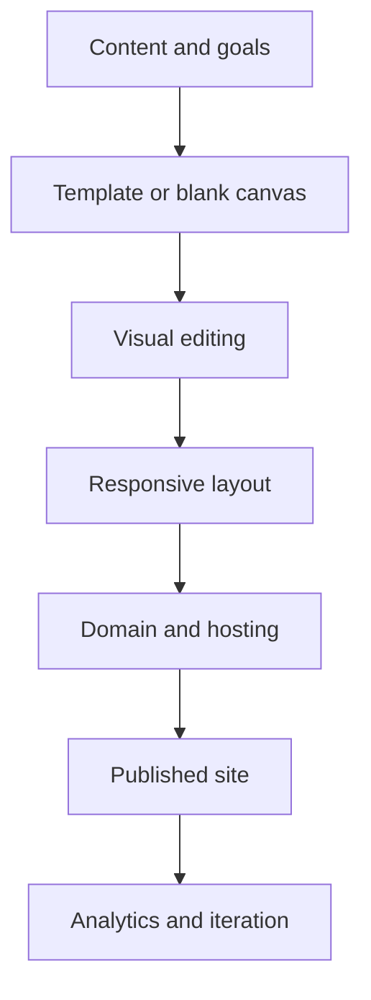

:::tool-showcase
tag: Site-Builders
:::

# Defining and Describing Site Builders

- _Site builders turn website creation from a coding task into a visual publishing workflow._
- A **site builder** is a software service or application for designing and publishing websites, commonly through templates, visual editing, hosting, and domain-management features rather than hand-written code.[^nfmz57]
- Site builders apply when individuals, small businesses, marketers, creators, and organizations need to launch or update a web presence quickly.[^nfmz57]
- Their central trade-off is convenience versus control: an all-in-one builder reduces setup work, while a conventional content-management system generally offers more freedom over hosting, themes, plugins, and extensions.[^nfmz57]
- The category includes hosted visual builders, self-hosted page builders, ecommerce-oriented builders, open-source application builders, and increasingly AI-assisted interfaces.[^038y9q][^nfmz57]

## Uses in Context

- **Business launch:** A startup or local business may use a builder to publish a landing page without assembling separate hosting, domain, design, and deployment systems.[^nfmz57]
- **Marketing:** Marketers invoke site builders as campaign infrastructure for rapidly changing landing pages, forms, calls to action, and content.[^nfmz57]
- **Creator publishing:** Individuals use them for portfolios, personal sites, newsletters, and one-page profiles; Carrd is described as a simple one-page builder created as a side project.[^h7t2fk]
- **Ecommerce:** Builders can combine storefront design, product presentation, checkout, and publishing in a single workflow; Shopify is listed among the cloud-based builders that emerged in the mid-2000s.[^v2vpux]
- **Internal tools:** The term can extend beyond public websites to visual application builders; Appsmith is described as an open-source platform for internal applications and customer-facing websites.[^038y9q]

## History of Use

### Origins

- The visual-web-editor lineage predates modern hosted builders. WYSIWYG, meaning “What You See Is What You Get,” appeared in 1974, while the first web browser and HTML editor are attributed to Tim Berners-Lee’s WorldWideWeb browser in December 1990.[^v2vpux]
- SGI’s WebMagic, launched on January 26, 1995, is identified as an early documented WYSIWYG web editor and as a no-code website-building precursor; it allowed users to place images, movies, and text visually without writing HTML.[^6p78ds]
- The category’s early purpose was abstraction: visual tools concealed much of the underlying markup so non-specialists could construct pages through a word-processor-like interface.[^d2ku7t][^6p78ds]

### Evolution

- **1995–1997 — Desktop WYSIWYG editors:** WebMagic, FrontPage, PageMill, and Dreamweaver expanded visual web authoring across Unix, Windows, and Macintosh environments.[^6p78ds]
- **1995–2002 — Browser fragmentation:** The competition between Netscape Navigator and Internet Explorer made cross-browser behavior difficult, helping create demand for tools that managed HTML and compatibility on behalf of less technical users.[^d2ku7t]
- **2004–2006 — Hosted builders:** Squarespace, Wix, Shopify, and Weebly are identified as major cloud-based builders emerging during this period, shifting website creation toward subscription services that bundled editing and publishing.[^v2vpux]
- **2010s–2020s — Lightweight and open-source expansion:** Products such as Carrd emphasized focused, low-overhead publishing, while Appsmith represented an open-source extension of the builder model into internal applications and customer-facing experiences.[^038y9q][^h7t2fk]

## Best Real-World Examples

- [Carrd](https://carrd.co/) — A focused one-page builder launched in 2015 by solo developer AJ and grown through a self-funded, freemium model.[^h7t2fk]
- [Appsmith](https://www.appsmith.com/) — An open-source application builder for internal applications and customer-facing websites.[^038y9q]
- [WordPress](https://wordpress.org/) — An open-source CMS selected in one case study to avoid dependence on a proprietary platform and to preserve operational adaptability.[^d0jv3u]
- [Squarespace](https://www.squarespace.com/) — A hosted builder associated with the mid-2000s shift toward cloud-based website creation.[^v2vpux]
- [Wix](https://www.wix.com/) — A hosted visual-building service identified among the cloud builders emerging in 2006.[^v2vpux]
- [WebMagic](https://en.wikipedia.org/wiki/WebMagic) — An early visual web editor that used direct manipulation of page elements rather than hand-written HTML.[^6p78ds]
- [Dreamweaver](https://www.adobe.com/products/dreamweaver.html) — A professional visual web editor launched in 1997 during the desktop WYSIWYG era.[^d2ku7t][^6p78ds]

## Case Studies

**Carrd and the focused-builder model.** Carrd began in 2015 as a side project by a solo developer, AJ, and reportedly grew to more than three million created sites without venture-capital funding.[^h7t2fk] Its positioning around simple one-page websites narrowed the product scope instead of attempting to reproduce every capability of larger platforms.[^h7t2fk] The case illustrates how a site builder can compete through a clear job-to-be-done, low operational complexity, freemium distribution, and word-of-mouth growth rather than organizational scale.[^h7t2fk]

**Appsmith and the open-source extension of site building.** Appsmith applies the builder pattern to internal applications and customer-facing websites, rather than limiting it to brochure sites.[^038y9q] Its open-source orientation gives organizations a way to inspect, adapt, and operate the underlying platform instead of relying exclusively on a proprietary hosted editor.[^038y9q] The example shows how “site builder” capabilities—visual composition, reusable interfaces, and accelerated publishing—can expand into broader software construction.[^038y9q]

**De Druglijn and platform independence.** In a redesign case study, De Druglijn required an open-source CMS and rejected being locked into a single studio or proprietary system.[^d0jv3u] The project selected WordPress because the organization wanted a platform that remained operational and adaptable regardless of who managed it.[^d0jv3u] This case demonstrates the boundary between hosted site builders and extensible CMS-based building: the latter generally demands more assembly but can preserve greater control over ownership, maintenance, and future migration.[^d0jv3u][^nfmz57]

***

# Sources

[1]: [Crafted With Code | Mozilla Builders by Upstatement - WP Engine](https://wpengine.com/case-studies/mozilla-builders/)
[^038y9q]: [Real-Time B2B Data Provider for AI Agents | Crustdata](https://crustdata.com/casestudies/appsmith-live-company-people-data)
[^d0jv3u]: [De Druglijn Case Study](https://weichie.com/case/druglijn/)
[^v2vpux]: [The Roast of Hostinger Horizons | STFO - Louis Grenier](https://www.stfo.io/roasts/hostinger-horizons/)
[^d2ku7t]: [How IE vs Netscape Gave Us Modern Site Builders](https://nocodewebsitebuilder.com/blog/how-ie-vs-netscape-gave-us-modern-site-builders)
[^6p78ds]: [The First WYSIWYG: Why WebMagic (1995) Deserves More Credit.](https://nocodewebsitebuilder.com/blog/the-first-wysiwyg-why-webmagic-1995-deserves-more-credit)
[^nfmz57]: [Website Builder vs CMS: Cost and Features Comparisons](https://www.hostinger.com/tutorials/website-builder-vs-cms/)
[8]: [Building a startup with AI? Here's what you can learn from our 21-Day Startup Challenge winners](https://www.hostinger.com/blog/21-day-startup-challenge-winners/)
[9]: [Inkwave Case Study: Newsletter Platform | Plutonapps](https://www.plutonapps.com/work/inkwave)
[^h7t2fk]: [How a Solo Developer Bootstrapped a Million-Dollar Website...](https://podimo.com/en/shows/bootstrapped-business-with-fexingo-self-funded/episode/fe972638-1d65-5c99-b988-7aab5f571760)
