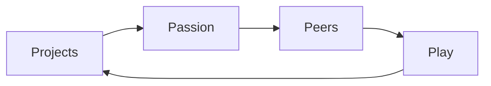

---
aliases:
  - Projects, Peers, Passion, Play
date_created: 2025-04-09
date_modified: 2026-11-07
cf_last_run: 2026-11-07T05:00:01.015Z
cf_last_run_model: Perplexity sonar-pro
for_clients:
  - Colearn
  - AI-Camp
site_uuid: 4ae360f9-6b39-4d34-b38b-0cb37d588308
publish: true
title: Four P'S Of Creative Learning
slug: four-ps-of-creative-learning
at_semantic_version: 0.0.0.1
tags:
  - Pedagogical-Approaches
  - Conceptual-Frameworks
---

Projects, Peers, Passion, Play.

# Defining and Describing Four P's of Creative Learning

_The Four P’s turn learning from receiving answers into making, caring, collaborating, and experimenting._

The **Four P’s of Creative Learning** are **Projects, Passion, Peers, and Play**, a framework associated with MIT Media Lab learning researcher Mitchel Resnick. [^a8o9ck] The framework applies to classrooms, informal learning environments, creative tools, and lifelong learning, especially where learners are expected to develop creativity through active making rather than passive instruction. [^a8o9ck] [^1egpri] Its central claim is that creative development is strengthened when people work on meaningful projects, pursue personally significant interests, collaborate with others, and experiment playfully. [^1egpri]

## Uses in Context

- **Project-based education:** “Projects” describes learning through meaningful, open-ended activities in which students generate ideas, build artifacts, and revise their work. [^1egpri]
- **Personalized learning:** “Passion” refers to pursuing questions or projects that matter to learners, increasing persistence when challenges arise. [^1egpri] [^j3qyog]
- **Collaborative learning:** “Peers” frames creativity as social, involving idea-sharing, feedback, cooperation, and building on other people’s work. [^1egpri] [^j3qyog]
- **Creative experimentation:** “Play” means trying things out, tinkering, taking risks, and learning from mistakes rather than merely having fun. [^1egpri] [^3najdl]
- **Educational design:** The Four P’s are used as a practical test for evaluating classes, applications, camps, and other learning experiences. [^9gzb89]
- **Lifelong creativity:** The framework extends kindergarten-like habits—imagining, creating, sharing, and reflecting—into later education and adult life. [^8m27do] [^w0u24l]

## History of Use

## Origins

- The framework is chiefly associated with **Mitchel Resnick**, the MIT Media Lab researcher identified with the development of Scratch and the book *Lifelong Kindergarten*. [^a8o9ck] [^w0u24l]
- Resnick and collaborators articulate the four principles as **Projects, Passion, Peers, and Play**: learners make meaningful things, pursue interests they care about, work socially, and experiment with a playful mindset. [^1egpri]
- The Four P’s belong to a broader argument for “lifelong kindergarten,” in which the exploratory and constructive qualities of kindergarten should continue throughout education and life. [^1egpri] [^w0u24l]

## Evolution

- **2017:** Resnick’s *Lifelong Kindergarten* popularized the Four P’s as a compact framework for cultivating creativity through projects, passion, peers, and play. [^wws6ky] [^w0u24l]
- **2018:** Resnick and Robinson’s formulation emphasized project work, social learning, personal commitment, and playful experimentation as mutually reinforcing conditions for creative learning. [^1egpri]
- **2020s:** Educators and learning organizations increasingly adapted the framework for AI-supported learning, STEM education, K–8 classrooms, and creative digital tools. [^a8o9ck] [^xp2pyv] [^3najdl]

## Best Real-World Examples

- [Scratch](https://scratch.mit.edu/) — a creative programming environment associated with Resnick that supports project-making, peer sharing, and iterative experimentation. [^a8o9ck] [^w0u24l]
- [Lifelong Kindergarten](https://mitpress.mit.edu/9780262536134/lifelong-kindergarten/) — Resnick’s book-length account of learning through Projects, Passion, Peers, and Play. [^wws6ky] [^w0u24l]
- [MIT Media Lab Creative Learning](https://www.media.mit.edu/) — the research and education context in which the Four P’s are presented as principles for creative learning. [^a8o9ck]
- [Creative Learning Spiral](https://chadcomello.com/booknotes/lifelong-kindergarten/) — an iterative model of imagining, creating, playing, sharing, reflecting, and imagining again. [^wws6ky] [^j3qyog]
- [MakeInspires](https://www.makeinspires.com/) — an educational initiative that applies the Four P’s to creativity-oriented and AI-supported learning. [^xp2pyv]
- [STEM toys and learning activities](https://www.gevernova.com/news/articles/play-innovate-how-engaging-stem-toys-prepares-young-minds) — examples of playful experimentation, risk-taking, and learning from mistakes. [^3najdl]

## Case Studies

**Scratch and the creative-learning model.** [[Scratch]] is associated with Mitchel Resnick and the [[organizations/MIT Media Lab|MIT Media Lab]], which is described as the group behind the platform. [^a8o9ck] [^w0u24l] Its relevance to the Four P’s lies in allowing learners to create shareable projects, pursue personally meaningful ideas, receive feedback from peers, and revise through experimentation. [^1egpri] [^j3qyog] The model demonstrates that programming can be presented as a creative medium rather than only as a technical exercise, making the Four P’s concrete in a widely used learning environment. [^a8o9ck] [^w0u24l]

**Classroom project-based learning.** The MIT Media Lab describes the Four P’s as transforming K–8 classrooms by combining projects, passion, peers, and play. [^a8o9ck] In this setting, learners work on meaningful tasks, collaborate, test ideas, and refine prototypes instead of merely completing predetermined exercises. [^1egpri] The case illustrates how the framework changes the teacher’s role from delivering all content toward designing conditions in which learners can pursue questions, make artifacts, and learn through iteration. [^1egpri] [^xp2pyv]

**Creative learning through playful STEM.** [[STEM]] learning activities and toys provide a practical setting for the Four P’s because learners can construct objects, follow interests, collaborate, and experiment with alternatives. [^3najdl] The relevant meaning of “play” is not limited to entertainment; it is an attitude of trying things, taking risks, and learning from mistakes. [^3najdl] This example shows why the framework treats play as a method of inquiry and design, not as a break from serious learning. [^1egpri] [^3najdl]

***

# Sources

[^a8o9ck]: 2026, Apr 14. [media.mit.edu](https://www.media.mit.edu/). [Transform Your Classroom with the 4 Ps of Creative Learning](https://www.media.mit.edu/events/transform-your-classroom-with-the-4-ps-of-creative-learning/). Updated: 2026, Oct 28. Generated: 2026, Nov 06. [Perplexity](https://www.perplexity.ai/) API response.
[^1egpri]: 2026, Jun 01. [link.springer.com](https://link.springer.com/). [Illustrating the Geographies of Justice: Collaborative Storytelling ...](https://link.springer.com/chapter/10.1007/978-3-032-11698-7_21). Updated: 2026, Oct 11. Generated: 2026, Nov 06. [Perplexity](https://www.perplexity.ai/) API response.
[^xp2pyv]: 2026, Jan 01. [makeinspires.com](https://www.makeinspires.com/). [How MakeInspires Brings Mitchel Resnick's Vision to Life](https://www.makeinspires.com/post/learning-with-ai-through-creativity-how-makeinspires-brings-mitchel-resnick-s-vision-to-life). Updated: 2026, Oct 29. Generated: 2026, Nov 06. [Perplexity](https://www.perplexity.ai/) API response.
[^wws6ky]: 2026, Sep 04. [chadcomello.com](https://chadcomello.com/). [Lifelong Kindergarten: Cultivating Creativity Through Projects, Passion, Peers, and Play](https://chadcomello.com/booknotes/lifelong-kindergarten/). Updated: 2026, Sep 22. Generated: 2026, Nov 06. [Perplexity](https://www.perplexity.ai/) API response.
[^8m27do]: 2026, Jul 08. [atoolye.com](https://atoolye.com/). [Lifelong Kindergarten: Cultivating Creativity through ... - ATooLyE](https://atoolye.com/es/habilidades-openclaw/lifelong-kindergarten-cultivating-creativity-through-projects-passion-peers-and-play-71364). Updated: 2026, Oct 24. Generated: 2026, Nov 06. [Perplexity](https://www.perplexity.ai/) API response.
[^j3qyog]: 2026, May 06. [aibrary.ai](https://www.aibrary.ai/). [The End of the 'A' Student](https://www.aibrary.ai/podcasts/lifelong-kindergarten/summary-the-end-of-the-a-student). Updated: 2026, Aug 28. Generated: 2026, Nov 06. [Perplexity](https://www.perplexity.ai/) API response.
[^9gzb89]: 2026, Oct 12. [screenwiseapp.com](https://screenwiseapp.com/). [Lifelong Kindergarten](https://screenwiseapp.com/media/lifelong-kindergarten-book). Updated: 2026, Oct 19. Generated: 2026, Nov 06. [Perplexity](https://www.perplexity.ai/) API response.
[^w0u24l]: 2026, Nov 02. [ltcillinois.org](https://www.ltcillinois.org/). [Book Study Check-in: Lifelong Kindergarten by Mitchel Resnick](https://www.ltcillinois.org/event/book-study-check-in-lifelong-kindergarten-by-mitchel-resnick-a03ux00000rapufyag/). Updated: 2026, Nov 03. Generated: 2026, Nov 06. [Perplexity](https://www.perplexity.ai/) API response.
[^3najdl]: 2026, Jan 20. [gevernova.com](https://www.gevernova.com/). [www.gevernova.com · news · articlesPlay to Innovate: How Engaging with STEM Toys Prepares Young ...](https://www.gevernova.com/news/articles/play-innovate-how-engaging-stem-toys-prepares-young-minds). Updated: 2026, Oct 15. Generated: 2026, Nov 06. [Perplexity](https://www.perplexity.ai/) API response.
[10]: 2026, Oct 09. [joincalie.org](https://joincalie.org/). [Featured Speakers - CALIE](https://joincalie.org/events/forward/featured-speakers/). Updated: 2026, Oct 14. Generated: 2026, Nov 06. [Perplexity](https://www.perplexity.ai/) API response.
