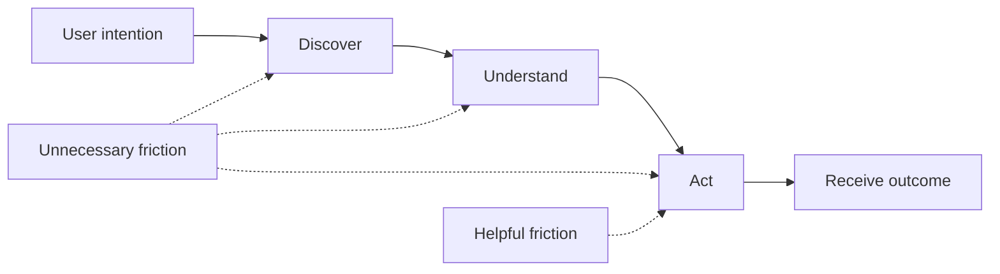

[[concepts/Getting Started|Getting Started]]
[[essays/Win the Market on Getting Started|Win the Market on Getting Started]]

# Defining and Describing Frictionless Experiences

- _Frictionless experiences remove unnecessary obstacles so people can complete meaningful tasks with minimal effort._
- A frictionless experience is an interaction designed to reduce barriers between a user’s intention and an outcome. In contemporary technology, “friction” can include anything from complex system architecture to an extra confirmation click during a purchase.[1][3]
- The concept applies across [[Vocabulary/User Interface|User Interfaces]], [[Vocabulary/Customer Journeys]], digital products, services, and increasingly AI-mediated systems. Its main benefits are speed, ease, continuity, and reduced cognitive effort, although removing too much friction can weaken agency, reflection, and accountability.[2][4][7]
- Frictionless design is therefore best understood as selective reduction rather than total elimination: accidental, confusing, or repetitive obstacles should disappear, while deliberate pauses may remain where they prevent errors or support informed decisions.[8]

## Uses in Context

- **[[Product Design]]:** Teams use “frictionless” to describe interfaces that make desired actions intuitive, fast, and easy to complete.[1][6]
- **[[concepts/Market-Categories/Customer Experience|Customer Experience]]:** Businesses invoke the term for journeys that reduce abandonment, repeated data entry, checkout obstacles, and unnecessary handoffs.[10]
- **[[Interaction Design]]:** UX practitioners distinguish harmful friction—such as broken navigation or unclear controls—from intentional friction used to prevent mistakes or prompt reflection.[8]
- **AI products:** Researchers use “frictionless” to describe anticipatory systems that mediate access to knowledge and action with little visible user effort.[2]
- **Critical design:** Scholars use the term critically, arguing that seamlessness can diminish attention, interpretation, autonomy, and awareness.[4][7]
- **Behavior-change products:** Friction is framed as a psychological barrier that makes an action more effortful without making it impossible; reducing or adding it can influence behavior.[9]

# History of Use

## Origins

- The word **“frictionless”** predates digital product design: the Oxford English Dictionary’s earliest cited usage is associated with James Russell Lowell’s 1848 poem *A Fable for Critics*, where it described a mind characterized by quietness and suppressed conflict.[1][3]
- Its modern business and technology meaning developed by analogy with physical friction. In computing, the term came to describe obstacles that prevent users from completing tasks, including complexity, extra steps, and cognitive effort.[1][3]
- The modern [[Vocabulary/User Experience|UX]] framing is closely related to the late-1990s and early-2000s usability movement, including Steve Krug’s 2000 book *[[Sources/Books/Don’t Make Me Think]]*, which popularized the goal of making digital interactions self-evident and low in cognitive load.[1]

## Evolution

- **Late 19th century:** “Frictionless” primarily described physical engineering problems involving lubrication, bearings, and low-friction materials.[1][3]
- **Around the early 2000s:** UX and digital-service design adapted “friction” as a metaphor for barriers in navigation, learning, purchasing, and task completion.[1][9]
- **2020s:** The concept expanded beyond convenience and conversion. Research began examining frictionless AI and digital services as potential threats to epistemic responsibility, autonomy, attention, and human flourishing.[2][4][7]

# Best Real-World Examples

- [Guest checkout and express payment](https://www.jivochat.com/blog/communication/how-startups-can-create-a-seamless-customer-journey-as-they-scale.html) reduce account-creation and payment steps in online purchasing.[10]
- [Saved cards and digital wallets](https://www.jivochat.com/blog/communication/how-startups-can-create-a-seamless-customer-journey-as-they-scale.html) exemplify low-effort payment flows, particularly on mobile devices.[10]
- [Address autocomplete and prefilled forms](https://www.jivochat.com/blog/communication/how-startups-can-create-a-seamless-customer-journey-as-they-scale.html) reduce repetitive data entry in customer journeys.[10]
- [Predictive-brain-based UX models](https://zenodo.org/records/17254242) frame usability problems as prediction errors and interpret established UX principles as methods for reducing cognitive friction.[6]
- [Disabling autoplay in Netflix](https://dl.acm.org/doi/10.1145/3772318.3791716) illustrates the deliberate reintroduction of friction into attention-capture systems.[5]
- [Reversible confirmation design](https://builder.aws.com/content/3Ld3UC6x9JtcEaL1Q31Lt49e0lf/keep-the-friction-where-it-matters-designing-confirmations-by-reversibility-not-convenience) demonstrates how confirmation points can be placed according to risk and reversibility rather than convenience alone.[8]
- [Friction-oriented architectural design](https://www.repository.cam.ac.uk/items/fe2fd5b9-7f1a-4d69-9343-66a9fb75a223) treats physical, social, and cognitive resistance as possible supports for autonomy, creativity, and awareness.[7]

# Case Studies

**Streamlined [[Vocabulary/E-Commerce|digital commerce]].**  [[Vocabulary/Startups|Startup]]-oriented customer-journey guidance identifies guest checkout, fewer form fields, autocomplete, prefilled information, saved cards, and digital wallets as practical ways to reduce abandonment and repeated effort.[10] The change is not merely aesthetic: fewer interruptions shorten the path between purchase intent and payment, particularly on mobile devices.[10] This case shows that frictionless experience design often consists of many small reductions in procedural effort rather than one breakthrough interface feature.

**Attention-capture systems.** [[concepts/The Attention Economy|The Attention Economy]]. Research on attention-capture damaging patterns describes interfaces that exploit psychological vulnerabilities, cause users to lose track of time or goals, and leave them feeling regret.[5] A study of disabling autoplay in Netflix examined what happens when a formerly seamless continuation mechanism is interrupted.[5] The case demonstrates that frictionlessness can be harmful when it removes the pause needed for self-regulation; a better experience may require intentionally restoring user control.

**AI-mediated knowledge work.** Recent research argues that AI systems increasingly provide frictionless, anticipatory access to knowledge and action, but that this convenience can reduce users’ responsibility in the act of knowing.[2] The authors characterize frictionless UX as an “epistemic anti-pattern” when it hides uncertainty and eliminates opportunities for judgment.[2] This case reframes the concept: successful experience design is not always the fastest route to an outcome, because some resistance can preserve accountability, reflection, and informed choice.[2][4][7]

***

# Sources

[1]: 2026, Jul 02. [nytimes.com](https://www.nytimes.com/). [Is a ‘Frictionless' Society a Trap?](https://www.nytimes.com/2026/07/02/magazine/frictionless-productivity-marketing-tech.html). Generated: 2026, Nov 14. [Perplexity](https://www.perplexity.ai/) API response.
[2]: 2026, Jun 12. [dl.acm.org](https://dl.acm.org/). [Human Agency in the Age of Frictionless, AI-Mediated ...](https://dl.acm.org/doi/10.1145/3802974.3809469). Updated: 2026, Oct 29. Generated: 2026, Nov 14. [Perplexity](https://www.perplexity.ai/) API response.
[3]: 2026, Jul 12. [languagehat.com](https://languagehat.com/). [Frictionless.](https://languagehat.com/frictionless/). Updated: 2026, Jul 14. Generated: 2026, Nov 14. [Perplexity](https://www.perplexity.ai/) API response.
[4]: 2026, Jun 08. [dl.designresearchsociety.org](https://dl.designresearchsociety.org/). [Aesthetics of Resistance in the Age of Frictionless Design](https://dl.designresearchsociety.org/drs-conference-papers/drs2026/researchpapers/57/). Updated: 2026, Aug 18. Generated: 2026, Nov 14. [Perplexity](https://www.perplexity.ai/) API response.
[5]: 2026, Apr 13. [dl.acm.org](https://dl.acm.org/). [Effects of Adding Friction to Attention-Capture Patterns in ...](https://dl.acm.org/doi/10.1145/3772318.3791716). Updated: 2026, Nov 05. Generated: 2026, Nov 14. [Perplexity](https://www.perplexity.ai/) API response.
[6]: 2026, Jan 18. [zenodo.org](https://zenodo.org/). [Frictionless UX: When the Brain and Interface Work as One](https://zenodo.org/records/17254242). Updated: 2026, Jan 19. Generated: 2026, Nov 14. [Perplexity](https://www.perplexity.ai/) API response.
[7]: 2026, Feb 11. [repository.cam.ac.uk](https://www.repository.cam.ac.uk/). [Friction as affordance for flourishing](https://www.repository.cam.ac.uk/items/fe2fd5b9-7f1a-4d69-9343-66a9fb75a223). Updated: 2026, Aug 20. Generated: 2026, Nov 14. [Perplexity](https://www.perplexity.ai/) API response.
[8]: 2026, Nov 04. [builder.aws.com](https://builder.aws.com/). [Keep the Friction Where It Matters: Designing Confirmations by Reversibility, Not Convenience | AWS Builder Center](https://builder.aws.com/content/3Ld3UC6x9JtcEaL1Q31Lt49e0lf/keep-the-friction-where-it-matters-designing-confirmations-by-reversibility-not-convenience). Updated: 2026, Nov 14. Generated: 2026, Nov 14. [Perplexity](https://www.perplexity.ai/) API response.
[9]: 2025, Dec 29. [one-sec.app](https://one-sec.app/). [Friction will change your behavior](https://one-sec.app/es/blog/friction-will-change-your-behavior/). Updated: 2026, Oct 26. Generated: 2026, Nov 14. [Perplexity](https://www.perplexity.ai/) API response.
[10]: 2026, Nov 05. [jivochat.com](https://www.jivochat.com/). [How Startups Can Create a Seamless Customer Journey as They Scale](https://www.jivochat.com/blog/communication/how-startups-can-create-a-seamless-customer-journey-as-they-scale.html). Updated: 2026, Nov 07. Generated: 2026, Nov 14. [Perplexity](https://www.perplexity.ai/) API response.
