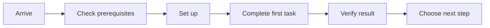

[[essays/Win the Market on Getting Started|Win the Market on Getting Started]]
[[concepts/Frictionless Experiences|Frictionless Design]]

# Defining and Describing Getting Started

_Getting started is the first practical move that turns unfamiliarity into basic competence._

In documentation and onboarding, “getting started” describes an entry point for a newcomer who wants to understand what something is and begin using it successfully. [^1ehn2e] [^d8qtje] It usually combines a clear outcome, prerequisites, installation or setup, a first successful action, and guidance on what to do next. [^ryonk1] [^4c2d7i] The concept matters because it reduces the distance between initial interest and a visible first result, while keeping advanced options and exhaustive explanations out of the newcomer’s path. [^d8qtje] [^4c2d7i]

# Uses in Context

- [[concepts/Documentation First Development|Documentation First Development]] In software documentation, a “Getting Started Guide” is treated as a tutorial or walkthrough in which the reader learns by doing something that works. [^1ehn2e]
- In project documentation, the phrase answers the newcomer’s question, “What is this, and how do I start?” [^d8qtje]
- In developer onboarding, it commonly organizes prerequisites, cloning or setup, local execution, and a first test. [^ryonk1]
- In [[Product Design]], onboarding uses the idea to help first-time users understand value and succeed quickly. [^vj2sft]
- In team settings, “getting-started guide” can mean a new-hire or system onboarding document organized around practical tasks rather than a reading list. [^ceo3z8]

# History of Use

## Origins

The available evidence does not establish a reliable first appearance of the standalone phrase “Getting Started.” In contemporary technical-writing practice, it is used as a practical label for tutorials, walkthroughs, quickstarts, and README landing pages rather than as a single proprietary method. [^1ehn2e] [^d8qtje] Its defining context is instructional: the reader is new, wants a guaranteed first success, and should follow a short sequence of visible actions. [^d8qtje] [^4c2d7i]

## Evolution

- **Tutorial-centered phase:** Getting-started material developed around learning by doing, with a concrete outcome, short prerequisites, numbered actions, and a visible result. [^1ehn2e]
- **Documentation-architecture phase:** The phrase became a distinct documentation type alongside tutorials, how-to guides, concepts, and reference material; its role became first-contact orientation rather than exhaustive explanation. [^d8qtje] [^4c2d7i]
- **Onboarding-and-adoption phase:** The idea expanded beyond documents into product and developer onboarding, emphasizing rapid productivity, self-service, first changes, and early evidence of value. [^ryonk1] [^ceo3z8] [^vj2sft]

# Best Real-World Examples

- [Sphinx Getting Started](https://researchcodingclub.github.io/documentation/aio.html) — represents the documentation-site pattern of pairing installation guidance with user guides and troubleshooting. [^yj3h4q]
- [GitHub README getting-started pages](https://github.com/alexj11324/Mikka/blob/main/.claude/skills/technical-documentation/references/document-types.md) — exemplify the first-arrival page that explains what a project is and how to begin. [^d8qtje]
- [Developer onboarding guides](https://github.com/daddal001/universal-ai-driven-documentation-standard/blob/main/26-ONBOARDING.md) — structure setup around prerequisites, local execution, and a first test. [^ryonk1]
- [Document360 project templates](https://docs.document360.com/docs/en/creating-a-project) — use “Getting Started Guide” as a standard example article for knowledge-base projects. [^w9hdzf]
- [Impeccable onboarding reference](https://github.com/pbakaus/impeccable/blob/main/plugin/skills/impeccable/reference/onboard.md) — frames onboarding as a path beginning with project creation or template import. [^dgaq4b]
- [Technical-documentation type guide](https://github.com/wondelai/skills/blob/main/technical-documentation/references/document-types.md) — formalizes a sequence of outcome, prerequisites, installation, verification, and next steps. [^4c2d7i]

# Case Studies

A developer-onboarding standard illustrates the operational version of getting started. Its prescribed guide begins with a time estimate and prerequisites, then moves through setup, local execution, and a first test; the stated goal is for new developers to become productive during their first week. [^ryonk1] This shows that getting started is not merely introductory prose: it is a bounded workflow designed to produce an observable capability.

A separate onboarding guide shifts emphasis from reading to contribution. It describes onboarding as a new-hire or system guide organized around tasks and recommends a prepared, small change reaching production in the first week. [^ceo3z8] The case demonstrates how the concept can evolve from “read the manual” into “make a real, low-risk contribution,” linking learning with confidence and integration. [^ceo3z8]

Documentation-type frameworks provide a contrasting case: they explicitly separate getting-started material from how-to, concept, and reference documentation. [^d8qtje] [^4c2d7i] A newcomer receives one coherent path and one guaranteed win, while experienced users are directed toward task-specific instructions or exact reference information. [^d8qtje] The distinction shows why effective getting-started content is intentionally selective: its purpose is to establish basic competence, not to enumerate every possible option. [^1ehn2e] [^d8qtje]

# Images

_Source: https://www.youtube.com/watch?v=FJewMTYEU7Q_

_Source: https://zapier.com/blog/how-to-use-chatgpt/_

_Source: https://zapier.com/blog/how-to-use-chatgpt/_

_Source: https://learnprompting.org/blog/guide-chatgpt_

_Source: https://learnprompting.org/blog/guide-chatgpt_

***

# Sources

[^1ehn2e]: 2026, Aug 01. [github.com](https://github.com/). [software-doc-templates/general-swe/user-documentation/tutorial.md at main · Milkeles/software-doc-templates](https://github.com/Milkeles/software-doc-templates/blob/main/general-swe/user-documentation/tutorial.md). Updated: 2026, Nov 14. Generated: 2026, Nov 14. [Perplexity](https://www.perplexity.ai/) API response.
[^d8qtje]: 2026, Oct 20. [github.com](https://github.com/). [Mikka/.claude/skills/technical-documentation/references/document-types.md at main · alexj11324/Mikka](https://github.com/alexj11324/Mikka/blob/main/.claude/skills/technical-documentation/references/document-types.md). Updated: 2026, Nov 14. Generated: 2026, Nov 14. [Perplexity](https://www.perplexity.ai/) API response.
[^ryonk1]: 2026, Jan 19. [github.com](https://github.com/). [universal-ai-driven-documentation-standard/26-ONBOARDING.md at main · daddal001/universal-ai-driven-documentation-standard](https://github.com/daddal001/universal-ai-driven-documentation-standard/blob/main/26-ONBOARDING.md). Updated: 2026, Oct 21. Generated: 2026, Nov 14. [Perplexity](https://www.perplexity.ai/) API response.
[^w9hdzf]: 2026, Sep 28. [docs.document360.com](https://docs.document360.com/). [Creating a project](https://docs.document360.com/docs/en/creating-a-project). Updated: 2026, Oct 31. Generated: 2026, Nov 14. [Perplexity](https://www.perplexity.ai/) API response.
[^dgaq4b]: 2025, Nov 16. [github.com](https://github.com/). [impeccable/plugin/skills/impeccable/reference/onboard.md at main](https://github.com/pbakaus/impeccable/blob/main/plugin/skills/impeccable/reference/onboard.md). Updated: 2026, Nov 12. Generated: 2026, Nov 14. [Perplexity](https://www.perplexity.ai/) API response.
[^ceo3z8]: 2026, Aug 01. [github.com](https://github.com/). [software-doc-templates/general-swe/foundations/onboarding-guide.md at main · Milkeles/software-doc-templates](https://github.com/Milkeles/software-doc-templates/blob/main/general-swe/foundations/onboarding-guide.md). Updated: 2026, Nov 13. Generated: 2026, Nov 14. [Perplexity](https://www.perplexity.ai/) API response.
[^yj3h4q]: 2026, Jul 14. [researchcodingclub.github.io](https://researchcodingclub.github.io/). [All in One View](https://researchcodingclub.github.io/documentation/aio.html). Updated: 2026, Jul 16. Generated: 2026, Nov 14. [Perplexity](https://www.perplexity.ai/) API response.
[8]: 2025, Nov 16. [github.com](https://github.com/). [impeccable/.opencode/skills/impeccable/reference/onboard.md at 5cb95eea9c96479f57afe0732a45470d30183326 · pbakaus/impeccable](https://github.com/pbakaus/impeccable/blob/5cb95eea9c96479f57afe0732a45470d30183326/.opencode/skills/impeccable/reference/onboard.md). Updated: 2026, Oct 29. Generated: 2026, Nov 14. [Perplexity](https://www.perplexity.ai/) API response.
[^4c2d7i]: 2026, Jan 29. [github.com](https://github.com/). [skills/technical-documentation/references/document-types.md at main · wondelai/skills](https://github.com/wondelai/skills/blob/main/technical-documentation/references/document-types.md). Updated: 2026, Nov 04. Generated: 2026, Nov 14. [Perplexity](https://www.perplexity.ai/) API response.
[^vj2sft]: 2025, Dec 06. [github.com](https://github.com/). [AG-Usage/.continue/skills/onboard/SKILL.md at main - GitHub](https://github.com/Zendevve/AG-Usage/blob/main/.continue/skills/onboard/SKILL.md). Updated: 2026, Nov 04. Generated: 2026, Nov 14. [Perplexity](https://www.perplexity.ai/) API response.
