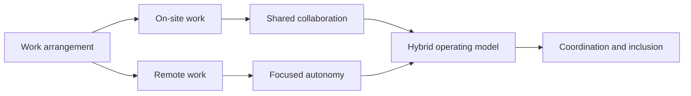

---
aliases:
  - Hybrid work
  - Hybrid Workplaces
date_created: 2026-11-14
date_modified: 2026-11-14
tags:
  - Management-Concepts
  - Founder-Advice
site_uuid: da9e1293-17c9-449b-9e22-8aa9542978aa
publish: true
title: Hybrid Work
slug: hybrid-work
at_semantic_version: 0.0.0.1
cf_last_run: 2026-11-14T19:21:05.673Z
cf_last_run_model: Perplexity sonar-pro
---

# Defining and Describing Hybrid Work

- .jpg)
  
_Hybrid work combines the autonomy of remote work with the coordination and social connection of shared workplaces._

Hybrid work is an arrangement in which employees alternate between working at an employer’s premises and working remotely, commonly from home.[2][3] Unlike fully remote work, it preserves an on-site component; unlike traditional office work, it allows work to occur across multiple locations and often across synchronous and asynchronous schedules.[6][7] The model applies when organizations distribute work between physical and virtual settings through fixed schedules, team-based norms, or employee discretion.[3] Its central management challenge is coordinating people, tasks, communication, and performance across locations while maintaining fairness and connection.[1][3]

## Uses in Context

- **Workplace policy:** Organizations use “hybrid work” to describe policies that specify how employees divide time between offices and remote locations, ranging from fixed schedules to flexible arrangements.[3]
- **Management design:** The term invokes a shift from supervising physical presence toward managing outcomes, expectations, coordination, and team effectiveness.[1]
- **Employee experience:** Researchers use it to describe the alternation between “traditional and non-traditional work modes” across location, timing, and work practices.[7]
- **Technology and collaboration:** Hybrid work commonly refers to systems that allow office-based and remote employees to participate in the same meetings, workflows, and communication networks.[6]
- **Labor-market analysis:** Analysts use the concept to distinguish mixed-location work from both conventional office work and fully remote employment.[2][10]

## History of Use

### Origins

- The underlying practice developed from earlier telework and flexible-work arrangements, but contemporary “hybrid work” is defined as combining employer-premises work with work from another location.[3]
- Academic definitions emphasize that its distinctive feature is not remote work alone, but “working interchangeably in different work locations.”[2]
- The concept therefore emerged as a synthesis of established telework practices, distributed collaboration, and organizational experiments with flexible scheduling rather than as a single invention attributable to a technology company.[2][7]

### Evolution

- **Before 2020:** Telework and flexible-work research established the organizational and technological foundations for alternating between office and remote locations.[9]
- **2020–2021:** The COVID-19 pandemic rapidly expanded remote work and accelerated organizations’ transition toward formal hybrid arrangements.[3][9]
- **2022 onward:** Hybrid work evolved from an emergency response into a continuing organizational design problem involving equity, communication, culture, wellbeing, workspace, and managerial discretion.[3][4][10]

## Best Real-World Examples

- [GitLab](https://about.gitlab.com/company/culture/all-remote/) — [[Tooling/Software Development/Developer Experience/DevOps/GitLab|GitLab]] — illustrates a distributed-work model whose practices helped distinguish fully remote work from hybrid arrangements.
- [Buffer](https://buffer.com/resources/remote-work/) — exemplifies a small-company approach to flexible location, asynchronous communication, and autonomy.
- [Automattic](https://automattic.com/work-with-us/) — [[organizations/Automattic|Automattic]] — demonstrates how distributed teams can operate across locations without treating a central office as the default workplace.
- [37signals](https://basecamp.com/books/remote) — [[organizations/37 Signals|37 Signals]] — popularized practical management guidance for distributed and flexible work through its remote-work practices and writing.
- [Zapier](https://zapier.com/blog/remote-work/) — shows how a technology startup can build coordination norms around remote and distributed employees.
- [Microsoft](https://www.microsoft.com/en-us/worklab) — represents a major technology-company adopter and popularizer of hybrid-work research and workplace tools, rather than the originator of the concept.
- [International Labour Organization](https://www.ilo.org/) — [[International Labor Organization]] —provides an institutional framework for distinguishing hybrid work from broader telework and remote-work categories.[2]

## Case Studies

**Swedish higher-education professional services.** A longitudinal study followed 745 professional-services employees during a transition from full remote work to hybrid work over 12 months.[7] The institution began discussing the transition in November 2020 and permitted employees to work remotely for up to 49% of their hours, subject to first-line-manager approval.[7] The case shows that hybrid work is not merely a location policy: it combines physical collaboration, remote autonomy, temporal flexibility, and managerial judgment.[7]

**European organizations after the pandemic.** Eurofound describes hybrid work as an evolving practice shaped by pandemic legacies, employee preferences, managerial discretion, talent-retention goals, digital capacity, and environmental considerations.[3] Its case material emphasizes that hybrid work has no single universal configuration: some organizations use fixed office days, while others allow teams or individuals to determine when on-site presence is most valuable.[3] The example shows why successful hybrid design depends less on declaring a certain number of office days than on matching location to collaboration, concentration, and organizational purpose.[1][3]

**Research on communication and productivity.** Studies of hybrid teams focus on the consequences of dividing employees’ time between offices, homes, cafés, and client sites.[6] Gallup’s synthesis reports that hybrid work can support strong productivity when organizations provide effective management, clear expectations, and reliable team coordination.[1] At the same time, research identifies risks involving isolation, technostress, boundary management, unequal visibility, and fairness between employees with different levels of location flexibility.[4][10] Together, these findings show hybrid work as a management system whose results depend on operating norms and inclusion—not simply on the presence of remote-work technology.

***

# Sources

[1]: 2026, Jul 27. [gallup.com](https://www.gallup.com/). [Hybrid Work and Productivity: What the Data Show - Gallup](https://www.gallup.com/workplace/713093/hybrid-work-productivity.aspx). Updated: 2026, Nov 10. Generated: 2026, Nov 14. [Perplexity](https://www.perplexity.ai/) API response.
[2]: 2026, Sep 02. [link.springer.com](https://link.springer.com/). [Job characteristics, coping strategies, and employee well ...](https://link.springer.com/article/10.1007/s12144-026-09942-5). Updated: 2026, Nov 01. Generated: 2026, Nov 14. [Perplexity](https://www.perplexity.ai/) API response.
[3]: 2026, Aug 27. [eurofound.europa.eu](https://www.eurofound.europa.eu/). [The shift to hybrid working: Management challenges | Eurofound](https://www.eurofound.europa.eu/en/publications/all/the-shift-to-hybrid-working-management-challenges). Updated: 2026, Nov 14. Generated: 2026, Nov 14. [Perplexity](https://www.perplexity.ai/) API response.
[4]: 2026, Aug 18. [tandfonline.com](https://www.tandfonline.com/). [Full article: Fairness and equity in hybrid work: insights ...](https://www.tandfonline.com/doi/full/10.1080/10967494.2026.2719908). Updated: 2026, Nov 03. Generated: 2026, Nov 14. [Perplexity](https://www.perplexity.ai/) API response.
[5]: 2026, Jun 02. [theconversation.com](https://theconversation.com/). [Hybrid work is not always the golden compromise ...](https://theconversation.com/hybrid-work-is-not-always-the-golden-compromise-employees-expect-even-as-more-companies-implement-it-283015). Updated: 2026, Nov 14. Generated: 2026, Nov 14. [Perplexity](https://www.perplexity.ai/) API response.
[6]: 2026, Sep 01. [onlinelibrary.wiley.com](https://onlinelibrary.wiley.com/). [How Hybrid Work Shapes Communication Ties: The Role of Concern …](https://onlinelibrary.wiley.com/doi/full/10.1111/joms.13277?msockid=3fd4e4a7769867aa11c6fcb7776066b5). Updated: 2026, Nov 13. Generated: 2026, Nov 14. [Perplexity](https://www.perplexity.ai/) API response.
[7]: 2026, Jul 31. [pmc.ncbi.nlm.nih.gov](https://pmc.ncbi.nlm.nih.gov/). [Entering the new normal - psychosocial work environment and ...](https://pmc.ncbi.nlm.nih.gov/articles/PMC13426970/). Updated: 2026, Oct 31. Generated: 2026, Nov 14. [Perplexity](https://www.perplexity.ai/) API response.
[8]: 2026, Apr 16. [link.springer.com](https://link.springer.com/). [Why hybrid workers abandon the office: a regret perspective ...](https://link.springer.com/article/10.1007/s11573-026-01262-1?error=cookies_not_supported&code=a28ad9b4-2f2f-48df-8031-3517a5edfffe). Updated: 2026, Aug 29. Generated: 2026, Nov 14. [Perplexity](https://www.perplexity.ai/) API response.
[9]: 2025, Dec 31. [jhcd.utem.edu.my](https://jhcd.utem.edu.my/). [From Traditional Work to Hybrid Work: A Narrative Review of Evolution, Antecedents, Dimensions, Outcomes, and Scholarly Debates](https://jhcd.utem.edu.my/jhcd/article/view/6517). Updated: 2026, Apr 02. Generated: 2026, Nov 14. [Perplexity](https://www.perplexity.ai/) API response.
[10]: 2026, Jun 25. [mdpi.com](https://www.mdpi.com/). [Sustaining Employee Engagement and Wellbeing in ...](https://www.mdpi.com/2673-8104/6/3/18). Updated: 2026, Nov 14. Generated: 2026, Nov 14. [Perplexity](https://www.perplexity.ai/) API response.
