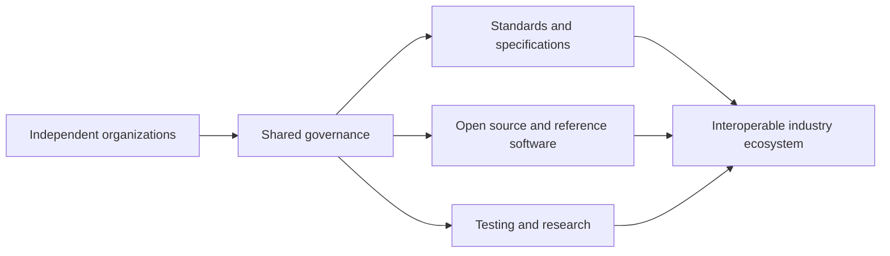

[[content-areas/AI-Factories-Datacenters/Organizations/US Green Building Council|USGBC]]
[[organizations/BACnet|BACnet]]

# Defining and Describing Industry Consortium

- _An industry consortium is a structured collaboration in which otherwise independent organizations coordinate around shared standards, infrastructure, research, procurement, or market development._
- Consortia apply when no single participant can efficiently establish an interoperable standard, shared testing environment, or industry-wide technical foundation alone. Their importance comes from pooling expertise while distributing governance among multiple organizations rather than placing control in one company. [^g6da5q] [^h9d0jt]
- Common outputs include technical specifications, open-source software, reference implementations, testing environments, road maps, and joint research projects. [^g6da5q] [^h9d0jt] [^38u7nh]

# Uses in Context

- **Standards development:** The term describes organizations that coordinate competing firms around common technical specifications, as in automotive alliances that standardize open-source software for software-defined vehicles. [^h9d0jt]
- **Joint experimentation:** A consortium may operate a shared testbed where participants develop and test digital applications, standards, and technologies together. [^g6da5q]
- **Open-source collaboration:** Consortia can provide governance and sustainability for industrial open-source projects rather than leaving development to one vendor. [^38u7nh]
- **Public–private research:** The term can refer to collaborations among government, industry, and academia, such as the National Cybersecurity Excellence Partnership consortium. [^j6g53y]
- **Shared digital infrastructure:** Industry consortia may coordinate common platforms and data-exchange standards across sectors, including maritime logistics and air cargo. [^g6da5q] [^wida7w]
- **Permissioned blockchain governance:** In blockchain usage, a consortium generally means a ledger governed by multiple known organizations that jointly manage access and transaction validation. [^7tuikw] [^4l43o4]

# History of Use

## Origins

- “Industry consortium” is a broad organizational category rather than the name of a single invention or one canonical framework. The underlying pattern is a group of independent organizations jointly developing infrastructure, standards, or research that would be costly or impractical for one participant to create alone. [^g6da5q] [^h9d0jt]
- In contemporary technology practice, the concept is strongly associated with standards bodies, open-source foundations, public–private partnerships, and sector-specific alliances. The available sources document these applications but do not identify a single first academic paper or individual who coined the exact phrase. [^g6da5q] [^h9d0jt] [^j6g53y]

## Evolution

- **2016 — Industrial open-source infrastructure:** Toshiba reports that it and Siemens launched the Civil Infrastructure Platform project with other partners under the Linux Foundation. Its purpose was to create a sustainable, industrial-grade open-source base layer for infrastructure and industrial systems. [^38u7nh]
- **2020s — Open-source industry alliances:** Automotive consortia such as SOAFEE, the Eclipse Foundation, and COVESA expanded consortium work from standards writing into open-source development, shared road maps, and pilot projects for software-defined vehicles. [^h9d0jt]
- **2020s — Cross-sector digital ecosystems:** Consortia increasingly combine open standards, open-source software, simulation, artificial intelligence, and automation in shared testing environments, as illustrated by the Digital Testbed Air Cargo project. [^g6da5q]

# Best Real-World Examples

- [Digital Testbed Air Cargo](https://www.iml.fraunhofer.de/en/projects/2021/dtac-air-cargo.html) — A Fraunhofer-led collaborative environment for testing digital applications, standards, and technologies around the IATA “ONE Record” data-exchange standard. [^g6da5q]
- [SOAFEE](https://www.zf.com/mobile/en/company/divisions_business_units/research_development/open_source/stories/sdv_open_source.html) — An automotive alliance using open-source collaboration and standardized software approaches for software-defined vehicles. [^h9d0jt]
- [COVESA](https://www.zf.com/mobile/en/company/divisions_business_units/research_development/open_source/stories/sdv_open_source.html) — An automotive consortium that helps coordinate open-source software, road maps, and pilot projects among automakers and technology providers. [^h9d0jt]
- [Civil Infrastructure Platform](https://www.global.toshiba/ww/company/digitalsolution/articles/tsoul/tech/t0903.html) — A Linux Foundation project focused on sustainable open-source infrastructure software for industrial and social-infrastructure systems. [^38u7nh]
- [National Cybersecurity Excellence Partnership](https://techcommunity.microsoft.com/blog/microsoft-security-blog/driving-devsecops-standards-nist%E2%80%99s-live-guidelines-for-secure-software-developme/4507781) — A public–private consortium involving government, industry, and academia in the development of secure-software guidance. [^j6g53y]
- [PRecycling](https://www.circularise.com/case-studies/how-precycling-made-recycled-plastics-traceable-safe-and-scalable) — A European research consortium involving universities, manufacturers, technology firms, research institutes, and regional organizations to improve traceability and scalability for recycled plastics. [^xgc8ah]
- [Open Document Format and OSLC Open Projects](https://blog.documentfoundation.org/blog/category/open-document-format/page/16/) — Collaborative projects supporting open document standards and REST APIs that connect data across applications and organizations. [^ul96la]

# Case Studies

**Digital Testbed Air Cargo.** Fraunhofer IML and project partners created the Digital Testbed Air Cargo as a joint development and testing environment for digital applications, standards, and technologies in air-cargo logistics. [^g6da5q] The project combined open standards, open-source software, simulation, artificial intelligence, and automation within a common testing framework. [^g6da5q] It also further developed the open-source NE:ONE software to make the IATA “ONE Record” standard usable in decentralized test and application environments. [^g6da5q] The case shows how a consortium can turn an industry standard into practical, testable infrastructure rather than leaving each participant to build incompatible systems independently. [^g6da5q]

**Civil Infrastructure Platform.** Toshiba, Siemens, and other partners launched the Civil Infrastructure Platform in 2016 under the Linux Foundation. [^38u7nh] The project sought to provide an industrial-grade open-source base layer for social infrastructure and industrial systems, with an emphasis on sustainable and secure maintenance. [^38u7nh] Instead of treating foundational software as the proprietary asset of one supplier, the consortium distributed development and stewardship across participating organizations and the wider open-source community. [^38u7nh] The case demonstrates how consortium governance can address long maintenance horizons and reduce dependence on a single vendor. [^38u7nh]

**Software-defined vehicle collaboration.** SOAFEE, the Eclipse Foundation, and COVESA represent automotive alliances that promote open-source collaboration, define road maps, and initiate pilot projects for software-defined vehicles. [^h9d0jt] Their approach responds to the difficulty of creating safety-relevant automotive software through isolated, proprietary development by coordinating automakers and technology providers around common interfaces and reusable foundations. [^h9d0jt] The S-CORE project, for example, includes work on standardizing the interface between foundational software and applications through an Automotive API Framework. [^h9d0jt] This case illustrates the consortium’s role as an intermediary: smaller or specialized contributors can help shape shared technical foundations, while larger manufacturers adopt and integrate those foundations into production ecosystems. [^h9d0jt]

***

# Sources

[^g6da5q]: [Air Cargo Logistics in the DTAC: Digital Testbed Air ... - Fraunhofer IML](https://www.iml.fraunhofer.de/en/projects/2021/dtac-air-cargo.html)
[^h9d0jt]: [Accelerating the Path to Software-Defined Vehicles with ...](https://www.zf.com/mobile/en/company/divisions_business_units/research_development/open_source/stories/sdv_open_source.html)
[^xgc8ah]: [How PRecycling made recycled plastics traceable, safe - Circularise](https://www.circularise.com/case-studies/how-precycling-made-recycled-plastics-traceable-safe-and-scalable)
[^j6g53y]: [Driving DevSecOps Standards: NIST's Live Guidelines for Secure ...](https://techcommunity.microsoft.com/blog/microsoft-security-blog/driving-devsecops-standards-nist%E2%80%99s-live-guidelines-for-secure-software-developme/4507781)
[^wida7w]: [link.springer.com › chapter › 10Data Platforms in the Maritime Domain: Challenges and ...](https://link.springer.com/chapter/10.1007/978-3-032-30795-8_22)
[6]: [How to govern a consortium tender response - Zephior](https://zephior.com/industries/govern-a-consortium-tender-response)
[^38u7nh]: [(Part 3) Activities of the Civil Infrastructure Platform (CIP) and ...](https://www.global.toshiba/ww/company/digitalsolution/articles/tsoul/tech/t0903.html)
[^ul96la]: [Open Document Format Archives - Page 16 of 16](https://blog.documentfoundation.org/blog/category/open-document-format/page/16/)
[9]: [Choosing the Right Enterprise Blockchain: A CTO’s Guide to ...](https://www.errna.com/tech-talk/choosing-the-right-enterprise-blockchain-a-cto-s-guide-to-public-vs-private-vs-permissioned-architectures.html)
[10]: [European Open Digital Ecosystems Strategy](https://linuxfoundation.eu/newsroom/linux-foundation-europes-response-to-the-european-commissions-public-consultation-european-open-digital-ecosystems-strategy?hs_amp=true)
[11]: [Bank Blockchain Consortiums vs Ripple's Model | XRP Academy](https://xrpacademy.com/blog/bank-consortium-blockchain-lessons-ripple)
[12]: [Executive Report on Strategic Collective Procurement in ...](https://perc-jpmr.org/2026/02/24/executive-report-on-strategic-collective-procurement-in-business-to-business-environments/)
[^7tuikw]: [When should organisations choose a consortium blockchain instead ...](https://nhimg.org/faq/when-should-organisations-choose-a-consortium-blockchain-instead-of-a-fully-publ/)
[^4l43o4]: [Private Blockchain vs Consortium Blockchain | Secure Enterprise ...](https://vegavid.com/blog/private-vs-consortium-blockchain-enterprise-governance)
[15]: [We Came to Stay](https://www.zf.com/mobile/en/company/divisions_business_units/research_development/open_source/stories/interim_report_manifesto.html)
