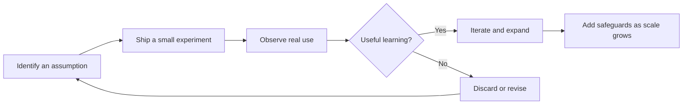

---
tags:
  - Lossless-Thinking
  - State-Of-The-Art-Practices
date_created: 2026-10-13
date_modified: 2026-10-13
site_uuid: ac5a7caf-68da-4b6e-81f7-027b19ba35c6
publish: true
title: Move Fast and Break Things
slug: move-fast-and-break-things
at_semantic_version: 0.0.0.1
cf_last_run: 2026-10-13T22:29:13.895Z
cf_last_run_model: Perplexity sonar-pro
for_clients:
  - Laerdal
  - Tonguc
  - Param
  - Edviro
---

[[organizations/Facebook|Facebook]], [[organizations/Meta|Meta]]

# Defining and Describing Move Fast and Break Things

- _“Move fast and break things” is a doctrine of rapid experimentation: learn and ship quickly, while accepting that some non-critical failures are an unavoidable cost of innovation._
- The phrase became associated with [[organizations/Facebook|Facebook]]’s early engineering culture and prioritized speed, iteration, and disruption over exhaustive planning or polish. [^tj7uc3] [^ax7slu] Zuckerberg summarized its logic as: “Unless you are breaking stuff, you are not moving fast enough.” [^tj7uc3] [^ax7slu]
- The principle is most applicable to reversible product experiments, prototypes, and low-stakes software changes—not to security, safety, financial controls, or other systems where failure can cause severe harm. [^hep1t0]
- Its central tension is scale: practices tolerable for a young product can become dangerous when failures affect millions of users or critical infrastructure. [^0vyd3s] [^rvyw4h]

# Uses in Context

- **Product development:** The phrase describes releasing an early version, gathering user feedback, and improving through repeated iterations rather than waiting for a perfect launch. [^qekf3i]
- **Engineering culture:** It encourages teams to challenge assumptions, accept manageable defects, and treat speed of learning as more valuable than polish in every release. [^qekf3i] [^ydeub2]
- **Entrepreneurship:** Startup founders use it to justify rapid experimentation when the opportunity cost of moving cautiously may exceed the cost of early failure. [^5ami96]
- **Disruption:** In popular technology discourse, “breaking things” can mean overturning established business models or social conventions, not merely introducing software bugs. [^qhoe4x]
- **Criticism of irresponsible innovation:** Critics invoke the phrase to describe a culture that externalizes the costs of experimentation onto users, workers, institutions, or the public. [^ax7slu] [^hep1t0]

# History of Use

## Origins

- The phrase is most reliably documented as an early Facebook motto associated with Mark Zuckerberg; a widely cited public formulation appeared in a 2009 *Business Insider* interview, where Zuckerberg described it as a “prime directive” for developers and said that failing to break things meant the team was not moving fast enough. [^tj7uc3]
- Facebook later formalized the wording in Zuckerberg’s 2012 letter to prospective investors: “We have a saying: Move fast and break things.” [^qekf3i] [^ixyky8]
- The maxim emerged from Facebook’s early-stage context: a young internet product could prioritize rapid learning and tolerate limited, reversible failures more readily than a mature platform operating at global scale. [^0vyd3s] [^qekf3i]

## Evolution

- **2009–2012 — From team slogan to public doctrine:** The phrase moved from an internal engineering principle into a widely quoted description of Facebook’s product culture. [^tj7uc3] [^qekf3i]
- **2014 — Stability becomes an explicit constraint:** Facebook changed its internal motto to “move fast with stable infrastructure,” retaining the emphasis on speed while rejecting indiscriminate breakage as the company and its user base expanded. [^ax7slu] [^0vyd3s]
- **After 2014 — Generalized startup cliché and cautionary shorthand:** The expression spread beyond Facebook as a broader startup and technology maxim, while critics increasingly used it to question whether growth-oriented experimentation adequately accounted for social and operational harms. [^ax7slu] [^hep1t0]

# Best Real-World Examples

- [Facebook’s early product teams](https://www.facebook.com/) — Rapidly shipped and iterated on social-network features under the original motto. [^tj7uc3] [^qekf3i]
- [Facebook’s 2014 infrastructure shift](https://about.fb.com/news/2014/05/move-fast-with-stable-infrastructure/) — Replaced “break things” with “stable infrastructure” as scale made failures more consequential. [^ax7slu] [^0vyd3s]
- [Early-stage software startups](https://www.capicua.com/blog/move-fast-and-break-things) — Use prototypes and fast releases to maximize learning speed before investing in polish. [^qekf3i]
- [Open-source software projects](https://www.linkedin.com/posts/techlooop_move-fast-and-break-things-the-most-expensive-activity-7457346569768529922-4sDd) — Often experiment publicly, allowing users and contributors to expose defects and improve the product through feedback. [^hep1t0]
- [Facebook’s investor narrative](https://www.facebook.com/notes/10150163905387131/) — Turned the motto into a formal explanation of the company’s willingness to favor iteration over excessive caution. [^ixyky8]
- [Large-scale technology platforms](https://virconlegal.com/term/move-fast-and-break-things/) — Illustrate the doctrine’s limits because a failure affecting a global user base is materially different from a bug in an early prototype. [^rvyw4h]

# Case Studies

**Facebook’s early growth phase.** In Facebook’s formative years, Zuckerberg used the motto to encourage developers to release products quickly and learn from real usage rather than spend too long optimizing unproven ideas. [^tj7uc3] [^qekf3i] The doctrine treated some breakage as an acceptable trade-off for faster iteration and competitive learning. [^0vyd3s] Its influence came from matching the organization’s stage: a relatively small product could absorb mistakes more easily than a mature infrastructure platform. [^0vyd3s] [^qekf3i] The case shows that “move fast” works best when experiments are bounded, reversible, and connected to rapid feedback.

**Facebook’s 2014 change in direction.** By 2014, Facebook had outgrown the conditions that made indiscriminate breakage tolerable. Zuckerberg replaced the old motto with “move fast with stable infrastructure,” preserving urgency while adding reliability as an explicit operating requirement. [^ax7slu] [^0vyd3s] The change did not abandon experimentation; it distinguished between moving quickly on product ideas and destabilizing the infrastructure on which a massive service depended. [^0vyd3s] [^rvyw4h] This case demonstrates that the doctrine is not a universal rule but a stage-dependent operating philosophy whose acceptable risk narrows as reach and dependency increase.

**Startup experimentation versus operational responsibility.** Contemporary startup practice often retains the useful core of the phrase—rapid prototypes, short feedback loops, and willingness to abandon weak assumptions. [^qekf3i] [^ydeub2] But examples of poorly tested notifications, insecure authentication, or mishandled user data show how “breaking things” can destroy trust rather than generate learning. [^hep1t0] The resulting distinction is practical: break assumptions and disposable prototypes, not safety mechanisms, privacy protections, or core reliability guarantees. [^hep1t0] The case illustrates the concept’s lasting value as a learning heuristic, while also explaining why its literal form became controversial.

***

# Sources

[^tj7uc3]: [Zuckerberg Retired 'Move Fast and Break Things' in 2014 ...](https://www.stratrix.com/culture-doctrine/meta-s-move-fast-and-break)
[^ax7slu]: [Why "Move Fast And Break Things" Might Be A Disaster In The Age ...](https://www.forbes.com/councils/forbestechcouncil/2026/09/14/why-move-fast-and-break-things-might-be-a-disaster-in-the-age-of-ai/)
[^0vyd3s]: [Facebook's Move Fast Legacy in Production Systems - SoftwareSeni](https://www.softwareseni.com/facebooks-move-fast-legacy-in-production-systems-the-long-term-cost-of-velocity-first-culture/)
[^5ami96]: [History of Meta Platforms: Company timeline, facts & milestones](https://finance.yahoo.com/markets/stocks/articles/history-meta-platforms-company-timeline-235250325.html?fr=sycsrp_catchall)
[^qekf3i]: [Move Fast and Break Things: A Founder's Guide - Capicua](https://www.capicua.com/blog/move-fast-and-break-things)
[^ixyky8]: [🎯 Move fast and break things](https://strategybreakdowns.com/p/move-fast-and-break-things)
[^hep1t0]: [The Dangers of Moving Fast and Breaking Things in Tech - LinkedIn](https://www.linkedin.com/posts/techlooop_move-fast-and-break-things-the-most-expensive-activity-7457346569768529922-4sDd)
[^ydeub2]: [Move Fast and Break Things](https://www.linkedin.com/pulse/move-fast-break-things-vlad-podoliako-wtcze)
[^qhoe4x]: [Quote of the day by Mark Zuckerberg: "Move fast and break things. Unless you are breaking stuff, you are not moving fast enough"](https://www.techradar.com/pro/quote-of-the-day-by-mark-zuckerberg-move-fast-and-break-things-unless-you-are-breaking-stuff-you-are-not-moving-fast-enough-on-the-nature-of-disruption)
[^rvyw4h]: [What Is Move Fast and Break Things? | Vircon Glossary](https://virconlegal.com/term/move-fast-and-break-things/)
