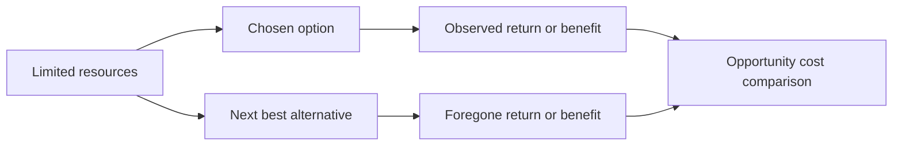

# Defining and Describing Opportunity Cost

- _Every business decision spends scarce resources—and opportunity cost is the value of the best alternative left behind._
- Opportunity cost is the value of the next-best alternative forgone when a decision commits limited money, time, labor, capacity, or managerial attention to one option. [^8lzzmv] [^7eulb6]
- In business, it applies whenever resources could be deployed in competing ways—for example, using factory capacity for one product rather than another, or funding expansion rather than debt reduction. [^7eulb6]
- In investing, it is generally the return available from the best realistic alternative with comparable risk, after accounting for differences in liquidity, timing, and uncertainty. [^7eulb6] [^gq1weg]
- Opportunity cost is usually implicit rather than recorded as an accounting expense, but it is central to economic decision-making and capital allocation. [^0a1wjs]

## Uses in Context

- **Capital budgeting:** Analysts compare a proposed project’s expected return with the return available from the next-best project or investment. [^7eulb6]
- **Financing:** Retaining cash in a low-return activity can carry the opportunity cost of the return available through debt repayment, dividends, or another investment. [^v407gl]
- **Portfolio management:** Allocating capital to one stock, bond, fund, or private venture prevents simultaneous use of that capital elsewhere. [^8lzzmv] [^gq1weg]
- **Operations:** A scarce machine, employee, or production slot creates an opportunity cost when assigned to one product instead of the highest-value alternative. [^7eulb6]
- **Entrepreneurship:** Founders weigh the value of pursuing a venture against employment, another venture, or a different use of their time and capital. [^2c4tzq]
- **Everyday economic reasoning:** The idea is often expressed as the “next best alternative” or the “value of what you forgo.” [^8lzzmv] [^2c4tzq]

## History of Use

### Origins

- Frédéric Bastiat’s 1850 discussion of the “unseen” consequences of economic choices anticipated the counterfactual logic behind opportunity cost by showing that spending on one activity prevents spending on another. [^gycb8e]
- Austrian economist Friedrich von Wieser formalized the alternative-cost doctrine in *Natural Value*, published in 1889. [^gycb8e]
- The English expression “opportunity cost” is attributed to David I. Green’s 1894 article “Pain-Cost and Opportunity-Cost” in *The Quarterly Journal of Economics*. [^gycb8e]
- Later textbook economics popularized the definition as the value of the “next-highest-valued alternative use” of a resource. [^c90ygg]

### Evolution

- **1850–1894 — From unseen effects to explicit terminology:** Economic analysis moved from describing foregone alternatives and hidden consequences to naming opportunity cost as a distinct concept. [^gycb8e]
- **Mid-20th century — Mainstream microeconomics:** The concept became a standard framework for scarcity, choice, production, and resource allocation. [^2c4tzq]
- **Modern finance — Opportunity cost of capital:** Investment analysis extended the idea to hurdle rates and alternative returns, requiring projects to outperform what similarly risky capital could earn elsewhere. [^7eulb6] [^gq1weg]

## Best Real-World Examples

- [A production line](https://ceopedia.org/index.php/Opportunity_cost) assigned to one product illustrates the revenue sacrificed by not producing the best alternative product. [^7eulb6]
- [A stock investment](https://gridoasis.com/guides/economics/opportunity-cost-economics/) has an opportunity cost equal to the return available from a comparable stock, index fund, bond, or cash instrument. [^gq1weg]
- [A business expansion project](https://ceopedia.org/index.php/Opportunity_cost) must be evaluated against the alternative return from deploying the same capital elsewhere. [^7eulb6]
- [Idle cash](https://achievable.me/define/opportunity-cost/) carries the opportunity cost of market returns that could have been earned through an appropriate investment. [^2ln4xp]
- [A covered-call strategy](https://achievable.me/define/opportunity-cost/) exchanges premium income for the potential upside surrendered above the option’s strike price. [^2ln4xp]
- [Debt repayment](https://financelearn.org/guides/opportunity-cost-of-money) can be compared with investing the same cash and earning a potentially higher return, subject to additional risk. [^v407gl]

## Case Studies

A company deciding whether to invest \$100,000 in a new product line faces more than the project’s direct cost. The relevant comparison is the return that the same capital could generate in the best realistic alternative, such as another project, debt reduction, a bond, or an equity investment. [^7eulb6] [^gq1weg] If the new product’s expected risk-adjusted return is below that alternative, accepting the project destroys economic value even if it produces accounting profit. This illustrates why opportunity cost belongs in capital budgeting alongside cash-flow forecasts and financing costs. [^7eulb6]

An investor who places \$100,000 in one stock cannot use that capital simultaneously for another stock, an index fund, a bond, or a high-yield savings product. [^gq1weg] The opportunity cost is therefore not simply the cash invested; it is the return and flexibility surrendered by choosing the selected asset. [^e8cnro] [^gq1weg] The comparison must be made against a realistic alternative with similar risk and investment horizon, because an apparently higher return may merely compensate for materially greater uncertainty. [^7eulb6]

A covered-call investor provides a more specific portfolio example. Selling the call generates premium income, but the investor gives up some or all upside above the strike price if the underlying asset rises sharply. [^2ln4xp] The strategy can therefore be attractive when income and downside considerations dominate, yet costly when preserving unlimited upside is the next-best objective. This demonstrates that opportunity cost can involve foregone flexibility and optionality—not only a measurable cash return. [^2ln4xp]

***

# Sources

[^e8cnro]: 2026, May 27. [news.climate.columbia.edu](https://www.news.climate.columbia.edu/). [The Hidden Math Behind Decisions: What Is Opportunity Cost In ...](https://www.news.climate.columbia.edu/economics-693bb2). Updated: 2026, Oct 29. Generated: 2026, Nov 02. [Perplexity](https://www.perplexity.ai/) API response.
[^8lzzmv]: 2026, Sep 28. [equiti.com](https://www.equiti.com/). [What does opportunity cost mean? Examples explained](https://www.equiti.com/jo-en/news/trading-ideas/opportunity-cost-explained/). Updated: 2026, Oct 11. Generated: 2026, Nov 02. [Perplexity](https://www.perplexity.ai/) API response.
[^c90ygg]: 2026, Feb 23. [scypionfinance.com](https://www.scypionfinance.com/). [Opportunity Cost: The Mental Lens That Prices Every Choice](https://www.scypionfinance.com/economy/economic-foundations/economics-fundamentals/opportunity-cost). Updated: 2026, Oct 29. Generated: 2026, Nov 02. [Perplexity](https://www.perplexity.ai/) API response.
[^v407gl]: 2026, Aug 15. [financelearn.org](https://www.financelearn.org/). [Opportunity cost of money: what you give up | FinanceLearn](https://www.financelearn.org/guides/opportunity-cost-of-money). Updated: 2026, Oct 08. Generated: 2026, Nov 02. [Perplexity](https://www.perplexity.ai/) API response.
[^7eulb6]: 2026, Jan 03. [ceopedia.org](https://ceopedia.org/). [Opportunity cost](https://ceopedia.org/index.php/Opportunity_cost). Updated: 2026, Oct 23. Generated: 2026, Nov 02. [Perplexity](https://www.perplexity.ai/) API response.
[^gq1weg]: 2026, Apr 13. [gridoasis.com](https://gridoasis.com/). [Opportunity Cost in Economics and Investing | Grid Oasis](https://gridoasis.com/guides/economics/opportunity-cost-economics/). Updated: 2026, Oct 14. Generated: 2026, Nov 02. [Perplexity](https://www.perplexity.ai/) API response.
[^gycb8e]: 2026, Oct 01. [centralconcepts.org](https://centralconcepts.org/). [Opportunity cost: Meaning, Origins & Lineage — Central Concepts](https://centralconcepts.org/en/concepts/opportunity-cost/). Updated: 2026, Nov 01. Generated: 2026, Nov 02. [Perplexity](https://www.perplexity.ai/) API response.
[^0a1wjs]: 2026, Feb 11. [pearson.com](https://www.pearson.com/). [Microeconomics Study Guide: Opportunity Cost, PPC & Trade | Notes](https://www.pearson.com/channels/microeconomics/study-guides/principles-of-microeconomics-scarcity-opportunity-cost-and). Updated: 2026, Oct 05. Generated: 2026, Nov 02. [Perplexity](https://www.perplexity.ai/) API response.
[^2ln4xp]: 2026, Aug 17. [achievable.me](https://achievable.me/). [What is opportunity cost? Definition & Meaning](https://achievable.me/define/opportunity-cost/). Updated: 2026, Oct 30. Generated: 2026, Nov 02. [Perplexity](https://www.perplexity.ai/) API response.
[^2c4tzq]: 2026, Apr 02. [news.climate.columbia.edu](https://www.news.climate.columbia.edu/). [How to Define Opportunity Cost: The Hidden Trade-Offs Shaping ...](https://www.news.climate.columbia.edu/opportunity-cost-definition). Updated: 2026, Oct 30. Generated: 2026, Nov 02. [Perplexity](https://www.perplexity.ai/) API response.
