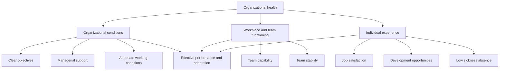

---
tags:
  - Best-Practices
  - Performance-Optimization
  - Continuous-Performance-Management
  - Management-Concepts
date_created: 2025-06-12
date_modified: 2026-11-14
site_uuid: 48ee8fe6-73d8-4b5c-8634-dcd934f23e02
publish: true
title: Organizational Health
slug: organizational-health
at_semantic_version: 0.0.0.1
cf_last_run: 2026-11-14T19:16:08.879Z
cf_last_run_model: Perplexity sonar-pro
---

# Defining and Describing Organizational Health

_Organizational health is an organization’s ability to perform effectively, adapt to change, support employee well-being, and remain viable over time._ [^9a8zfu] [^p6n19n]

The concept applies to organizations seeking sustainable performance rather than short-term output alone. It treats health as a systemic condition involving culture, structures, leadership, team functioning, employee experience, and the organization’s capacity to respond to environmental change. [^9a8zfu] [^p6n19n] Unlike a narrow productivity measure, organizational health connects goal achievement with adaptability, meaningful work, job satisfaction, manageable absence, and supportive working conditions. [^p6n19n] [^obqwo3]

## Uses in Context

- **Management diagnosis:** Leaders use organizational health to assess whether structures, objectives, managerial support, and working conditions enable employees and teams to perform effectively. [^p6n19n]
- **[[client-content/Laerdal/Sources/Laerdal Entities/Human Resources|Human Resources]] strategy:** The term frames employee well-being as connected to productivity, retention, development, and long-term organizational viability rather than as a separate benefits program. [^9a8zfu] [^obqwo3]
- **Organizational development:** Researchers and practitioners use it to examine whether an organization can “cope with problems” and continue developing its capabilities in changing environments. [^9a8zfu] [^r9ycrp]
- **Workplace measurement:** Organizational health can be operationalized through indicators such as team stability, sickness absence, job satisfaction, development opportunities, and perceived productivity loss. [^p6n19n]
- **Public-sector evaluation:** In public workplaces, the concept is applied across organizational, workplace, and individual levels rather than reduced to an individual wellness score. [^p6n19n]
- **Well-being programs:** Employers invoke organizational health when integrating mental, physical, social, financial, and environmental dimensions of employee well-being into organizational policy. [^qsbq5r] [^w7fp3a]

## History of Use

### Origins

- Matthew B. Miles helped establish organizational health as an organizational-development concept. In the formulation reported in later scholarship, a healthy organization can sustain its life in its environment, continually develop, cope with problems, and build the capacity to perform those functions. [^9a8zfu] [^r9ycrp]
- The concept emerged in management, organizational-development, human-resource-management, and industrial-psychology research as a way to describe organizational vitality and effectiveness together. [^9a8zfu] [^obqwo3]

### Evolution

- **1960s–1970s:** Organizational health was associated with organizational development and the capacity of organizations to survive, adapt, solve problems, and continue learning rather than merely maintain existing routines. [^9a8zfu] [^r9ycrp]
- **Later organizational research:** The concept expanded from a primarily organization-level idea into a multidimensional construct involving cultural, structural, behavioral, workplace, team, and individual conditions. [^9a8zfu] [^p6n19n]
- **2020s:** Contemporary research increasingly operationalizes organizational health through measurable combinations of organizational preconditions, team capability and stability, employee well-being, job satisfaction, development opportunities, sickness absence, and productivity loss. [^p6n19n] [^obqwo3]

## Best Real-World Examples

- [TELUS well-being blueprint](https://www.telushealth.com/en-us/resources/premium/telus-well-being-strategy-case-study) — a multidimensional well-being strategy linking infrastructure, leadership, psychological safety, and targeted programs with engagement, disability, mental-health, and retention outcomes. [^qsbq5r]
- [Tapestry Mental Health First Aid program](https://mentalhealthfirstaid.org/case-study/tapestry-corporate-workforce-mental-health-first-aid) — an example of embedding mental-health capability across corporate, creative, fulfillment, and retail roles. [^95t4v5]
- [Sierra Nevada and Calm](https://health.calm.com/resources/calm-case-studies/sierra-nevada-prioritizes-mental-health-with-use-of-calm/) — a distributed-workforce response that made mental-health resources available across locations, comfort levels, backgrounds, and individual needs. [^wpwly9]
- [Starbucks Mexico well-being initiative](https://www.telushealth.com/en-us/resources/case-study-starbucks-mexico) — a case of strengthening employee assistance through a more proactive model organized around mental, physical, and financial well-being. [^w7fp3a]
- [Bain Wellbeing at Bain](https://www.bain.com/pt-br/careers/impact-stories/wellbeing/) — an example of expanding an internal well-being initiative into a globally embedded organizational program. [^h7mdg0]
- [Organizational-health factor-structure research](https://pmc.ncbi.nlm.nih.gov/articles/PMC12720095/) — a research example treating organizational health as overall organizational condition, effectiveness, sustainability, functionality, and adaptability. [^obqwo3]

## Case Studies

**TELUS.** TELUS developed a structured well-being blueprint based on organizational infrastructure, awareness, targeted programming, psychological-safety commitments, leader training, and a five-dimensional view of health encompassing physical, psychological, social, environmental, and financial dimensions. [^qsbq5r] The organization reported placement in the top 10% globally for employee engagement, reductions in short-term-disability claims across four consecutive periods, reductions in mental-health claims across five consecutive years, and stronger recruitment and retention. [^qsbq5r] The case illustrates the organizational-health principle that employee well-being becomes strategically significant when supported by systems, leadership practices, measurement, and sustained implementation rather than isolated benefits. [^qsbq5r]

**Tapestry.** Tapestry began introducing Mental Health First Aid for corporate teams at kate spade new york in 2018 and later extended the approach to retail through a retail-specific program in 2023. [^95t4v5] Nearly 1,000 employees completed the training, and all surveyed participants reported feeling better equipped to support someone experiencing a mental-health challenge. [^95t4v5] The case shows how organizational health can be built through distributed capability: employees across brands, departments, and job functions receive shared language and practical skills, strengthening everyday support and connection across the organization. [^95t4v5]

**Sierra Nevada.** Sierra Nevada faced the challenge of maintaining a robust well-being culture after moving to a distributed, fully remote organization during the pandemic. [^wpwly9] The company partnered with Calm to provide employees with mental-health resources and tools accessible across locations and adaptable to differing comfort levels, backgrounds, and individual needs. [^wpwly9] The case demonstrates that organizational health is context-sensitive: a practice designed for a colocated workforce may need to be redesigned around accessibility, distributed work, and psychological inclusion when the organization’s operating environment changes. [^p6n19n] [^wpwly9]

***

# Sources

[^9a8zfu]: 2025, Dec 02. [pmc.ncbi.nlm.nih.gov](https://pmc.ncbi.nlm.nih.gov/). [Development and validation of the organizational health ...](https://pmc.ncbi.nlm.nih.gov/articles/PMC12705562/). Updated: 2026, Nov 04. Generated: 2026, Nov 14. [Perplexity](https://www.perplexity.ai/) API response.
[^p6n19n]: 2026, Jun 30. [frontiersin.org](https://www.frontiersin.org/). [Organizational health in public-sector workplaces: a mixed- ...](https://www.frontiersin.org/journals/organizational-psychology/articles/10.3389/forgp.2026.1817625/full). Updated: 2026, Aug 01. Generated: 2026, Nov 14. [Perplexity](https://www.perplexity.ai/) API response.
[^qsbq5r]: 2026, Sep 28. [telushealth.com](https://www.telushealth.com/). [The TELUS well-being blueprint - TELUS Health](https://www.telushealth.com/en-us/resources/premium/telus-well-being-strategy-case-study). Updated: 2026, Oct 07. Generated: 2026, Nov 14. [Perplexity](https://www.perplexity.ai/) API response.
[^w7fp3a]: 2026, Sep 23. [telushealth.com](https://www.telushealth.com/). [Case study - Starbucks Mexico | TELUS Health](https://www.telushealth.com/en-us/resources/case-study-starbucks-mexico). Updated: 2026, Nov 02. Generated: 2026, Nov 14. [Perplexity](https://www.perplexity.ai/) API response.
[^obqwo3]: 2025, Nov 21. [pmc.ncbi.nlm.nih.gov](https://pmc.ncbi.nlm.nih.gov/). [Dataset on the exploratory factor structure of organizational health ...](https://pmc.ncbi.nlm.nih.gov/articles/PMC12720095/). Updated: 2026, Oct 20. Generated: 2026, Nov 14. [Perplexity](https://www.perplexity.ai/) API response.
[^95t4v5]: 2026, May 19. [mentalhealthfirstaid.org](https://mentalhealthfirstaid.org/). [How Tapestry Strengthened Its Retail and Corporate Workforce with Mental Health First Aid](https://mentalhealthfirstaid.org/case-study/tapestry-corporate-workforce-mental-health-first-aid). Updated: 2026, Nov 02. Generated: 2026, Nov 14. [Perplexity](https://www.perplexity.ai/) API response.
[^h7mdg0]: 2026, Sep 21. [bain.com](https://www.bain.com/). [Growing an internal wellbeing initiative into an award-winning global program](https://www.bain.com/pt-br/careers/impact-stories/wellbeing/). Updated: 2026, Nov 02. Generated: 2026, Nov 14. [Perplexity](https://www.perplexity.ai/) API response.
[^r9ycrp]: 2025, Dec 02. [public-pages-files-2025.frontiersin.org](https://public-pages-files-2025.frontiersin.org/). [xml](https://public-pages-files-2025.frontiersin.org/journals/psychology/articles/10.3389/fpsyg.2025.1689559/xml). Generated: 2026, Nov 14. [Perplexity](https://www.perplexity.ai/) API response.
[^wpwly9]: 2026, Jan 13. [health.calm.com](https://health.calm.com/). [Sierra Nevada Prioritizes Mental Health with Use of Calm](https://health.calm.com/resources/calm-case-studies/sierra-nevada-prioritizes-mental-health-with-use-of-calm/). Updated: 2026, Oct 29. Generated: 2026, Nov 14. [Perplexity](https://www.perplexity.ai/) API response.
[10]: 2026, May 29. [linkedin.com](https://www.linkedin.com/). [Client Case Study - Bentley Motors | Westfield Health - LinkedIn](https://www.linkedin.com/posts/westfield-health_client-case-study-bentley-motors-activity-7466118722865283074-LzbN). Updated: 2026, Aug 28. Generated: 2026, Nov 14. [Perplexity](https://www.perplexity.ai/) API response.
