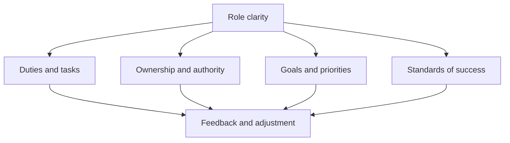

# Defining and Describing Role Clarity

_Role clarity is knowing what you own, what success looks like, and where your authority begins and ends._

Role clarity is the extent to which people understand their duties, tasks, goals, responsibilities, performance standards, and expected contribution. [^1ufwuz] [^fdr1n4] It applies whenever work is distributed among people—especially in organizations, teams, hybrid workplaces, reorganizations, and cross-functional projects. [^1ufwuz] [^7jorp2] Its opposite is role ambiguity: insufficient information about role requirements, methods, performance standards, or consequences. [^7jorp2] Role clarity matters because research syntheses associate role ambiguity with lower satisfaction, commitment, and performance, alongside greater tension, anxiety, burnout, and intention to leave. [^fdr1n4] [^s8an75]

## Uses in Context

- **Management:** Leaders use role clarity to specify “who owns what, the decision, the delivery, the sign-off.” [^9fw2u5]
- **Performance management:** Managers define expected outcomes, decision boundaries, and standards distinguishing adequate from excellent work. [^7jorp2]
- **Team design:** Teams use it to reduce duplicated work, unclear handoffs, and disputes over responsibility. [^9fw2u5] [^qawzp0]
- **[[concepts/Hybrid Work]]:** Researchers examine whether remote-work frequency changes the relationship between role clarity, engagement, and anxiety. [^1ufwuz]
- **Organizational diagnosis:** Role ambiguity and role conflict are treated as distinct problems: the former concerns missing information, while the latter concerns incompatible demands. [^9fw2u5] [^7jorp2]
- **Employee experience:** Role clarity is invoked to describe confidence that a person understands how they are expected to perform a job. [^ex187n]

## History of Use

## Origins

- The intellectual roots of role clarity lie in mid-century organizational research on **role ambiguity**, defined as inadequate information about role requirements, responsibilities, and performance expectations. [^s8an75]
- Daniel Katz and Robert Kahn’s organizational-behavior tradition helped establish roles and role expectations as central features of organizational systems; later summaries identify their 1964 work as introducing role ambiguity as a formal construct. [^s8an75]
- John Rizzo, Robert House, and Sidney Lirtzman operationalized the concept in their 1970 study, *Role Conflict and Ambiguity in Complex Organizations*, developing separate measures for role ambiguity and role conflict. [^9fw2u5]

## Evolution

- **1964 — Formal organizational construct:** Role ambiguity was framed as a problem of insufficient information available to organizational members about role requirements, responsibilities, and performance expectations. [^s8an75]
- **1970 — Measurement and differentiation:** Rizzo, House, and Lirtzman’s questionnaire treated role ambiguity and role conflict as related but statistically separable constructs. [^9fw2u5]
- **1985–2000 — Evidence synthesis:** Meta-analytic research linked role ambiguity to lower job satisfaction, commitment, and performance and to higher strain and turnover-related attitudes; later synthesis estimated the ambiguity–performance association at approximately $r=-0.21$. [^fdr1n4] [^s8an75] [^0tfm16]

## Best Real-World Examples

- [GitLab Handbook](https://handbook.gitlab.com/) — documents responsibilities, decision rights, and distributed-work practices in an all-remote organization.
- [Basecamp Shape Up](https://basecamp.com/shapeup) — exemplifies explicit scopes, appetites, and ownership for product work.
- [Atlassian Team Playbook](https://www.atlassian.com/team-playbook) — turns role and responsibility alignment into reusable team exercises.
- [RACI matrix](https://www.pmi.org/learning/library/responsibility-assignment-matrix-relate-people-work-10680) — makes responsibility, accountability, consultation, and information flows explicit.
- [Holacracy](https://www.holacracy.org/) — formalizes roles as accountabilities and domains rather than relying solely on conventional job titles.
- [OpenProject](https://www.openproject.org/) — provides open-source project-management structures for assigning work and clarifying ownership.
- [Role Conflict and Ambiguity in Complex Organizations](https://doi.org/10.2307/2391485) — supplies the foundational measurement model separating ambiguity from conflict.

## Case Studies

**RACI-style responsibility mapping.** In cross-functional projects, responsibility-assignment matrices distinguish who performs work, who is ultimately accountable, who must be consulted, and who should be informed. [^9fw2u5] This converts vague collective ownership into explicit decision and delivery relationships. The approach illustrates that role clarity is not merely a job-description exercise: it is also a coordination mechanism for handoffs, approvals, and escalation. Its limitation is that a matrix clarifies formal responsibility only if teams keep it current and reconcile it with actual authority. [^7jorp2]

**Distributed and hybrid work.** Hybrid-work research treats role clarity as employees’ perception that they receive precise information about duties, tasks, goals, and responsibilities from supervisors or the organization. [^1ufwuz] In this setting, informal office cues are less dependable, so written expectations, explicit decision boundaries, and timely feedback become especially important clarity-producing practices. [^1ufwuz] [^7jorp2] The example shows how role clarity adapts from a traditional organizational-behavior construct into a practical design requirement for distributed collaboration.

**Organizational restructuring.** A documented EcoWave case describes a post-campaign restructuring in which responsibilities were not updated, leaving employees uncertain about who handled particular requirements. [^qawzp0] The resulting ambiguity contributed to miscommunication, duplicated work, frustration, and wellbeing concerns. [^qawzp0] The case demonstrates the temporal character of role clarity: a role can be clear when created yet become unclear after reporting lines, workloads, or priorities change. Regular role reviews and team briefings therefore function as maintenance practices rather than one-time announcements. [^7jorp2] [^qawzp0]

# Images

_Source: https://www.effectory.com/request/hr-analytics-role-clarity-infographic-fact-sheet/_

_Source: https://www.predictiveindex.com/blog/how-to-create-stronger-role-clarity-for-your-team/_

_Source: https://sonder.io/resources/blog/risk-impact-poor-role-clarity/_

_Source: https://sonder.io/resources/blog/risk-impact-poor-role-clarity/_

_Source: https://managementconsulted.com/raci-chart/_

_Source: https://www.smartsheet.com/comprehensive-project-management-guide-everything-raci_

***

# Sources

[^1ufwuz]: 2026, Sep 02. [link.springer.com](https://link.springer.com/). [Job characteristics, coping strategies, and employee well-being in hybrid work: the role of remote work frequency - Current Psychology](https://link.springer.com/10.1007/s12144-026-09942-5). Updated: 2026, Oct 21. Generated: 2026, Nov 14. [Perplexity](https://www.perplexity.ai/) API response.
[2]: 2026, Jul 04. [orgchartstudio.com](https://www.orgchartstudio.com/). [The work between the boxes: Why ownership gets lost on ...](https://www.orgchartstudio.com/blog/org-chart-shows-reporting-lines-not-ownership). Updated: 2026, Sep 22. Generated: 2026, Nov 14. [Perplexity](https://www.perplexity.ai/) API response.
[3]: 2026, Nov 08. [scribd.com](https://www.scribd.com/). [Rizzo RoleConflictAmbiguity 1970 | PDF | Sampling (Statistics)](https://www.scribd.com/document/981770992/Rizzo-RoleConflictAmbiguity-1970). Generated: 2026, Nov 14. [Perplexity](https://www.perplexity.ai/) API response.
[^fdr1n4]: 2026, Mar 12. [academia.edu](https://www.academia.edu/). [clarity as the execution multiplier: organizational focus, strategic ...](https://www.academia.edu/165112705/CLARITY_AS_THE_EXECUTION_MULTIPLIER_ORGANIZATIONAL_FOCUS_STRATEGIC_ALIGNMENT_AND_THE_PERFORMANCE_IMPERATIVE). Updated: 2026, Apr 09. Generated: 2026, Nov 14. [Perplexity](https://www.perplexity.ai/) API response.
[^9fw2u5]: 2026, Jun 14. [leadersloop.com](https://leadersloop.com/). [Role & expectation clarity, explained simply](https://leadersloop.com/uk/toolkit/role-and-expectation-clarity/?skillcheck=1). Updated: 2026, Oct 14. Generated: 2026, Nov 14. [Perplexity](https://www.perplexity.ai/) API response.
[^7jorp2]: 2026, Jul 01. [evanslearninglabs.com](https://www.evanslearninglabs.com/). [Role Clarity and the Hidden Cost of Ambiguity | Evans ...](https://www.evanslearninglabs.com/articles/role-clarity-ambiguity-performance). Updated: 2026, Oct 20. Generated: 2026, Nov 14. [Perplexity](https://www.perplexity.ai/) API response.
[^ex187n]: 2026, Apr 20. [scribd.com](https://www.scribd.com/). [Service Quality From the Lenses of Role Clarity 2015 Procedia ...](https://www.scribd.com/document/1017236500/Service-Quality-From-the-Lenses-of-Role-Clarity-2015-Procedia-Social-and). Generated: 2026, Nov 14. [Perplexity](https://www.perplexity.ai/) API response.
[^qawzp0]: 2025, Dec 08. [studocu.com](https://www.studocu.com/). [BTM536 Case Study 1: EcoWave Stress Management & Wellbeing Issues](https://www.studocu.com/my/document/universiti-teknologi-mara/stress-management-and-well-being/btm536-case-study-1-ecowave-stress-management-wellbeing-issues/148199352). Updated: 2026, Mar 13. Generated: 2026, Nov 14. [Perplexity](https://www.perplexity.ai/) API response.
[^s8an75]: 2026, Jul 01. [evanslearninglabs.com](https://www.evanslearninglabs.com/). [What Role Clarity Does for Performance | Evans Learning Labs](https://www.evanslearninglabs.com/articles/what-role-clarity-does-for-performance). Updated: 2026, Oct 21. Generated: 2026, Nov 14. [Perplexity](https://www.perplexity.ai/) API response.
[^0tfm16]: 2026, Jun 11. [newmanhumanresources.com](https://newmanhumanresources.com/). [Role Clarity and Goal-Setting — Research and Evidence](https://newmanhumanresources.com/kb/role-clarity-and-goal-setting-evidence/). Updated: 2026, Oct 08. Generated: 2026, Nov 14. [Perplexity](https://www.perplexity.ai/) API response.
