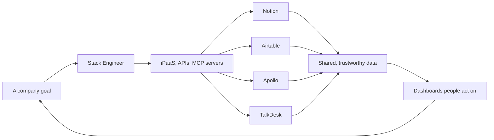

## Further Reading

- [[essays/On the Need for Stack Engineering|On the Need for Stack Engineering]]
- [[concepts/Lego-Kit Engineering|Lego-Kit Engineering]]
- [[concepts/Stack Compatibility|Stack Compatibility]]
- [[concepts/CARBS/Stack Maps|Stack Maps]]
- [[concepts/Data Fluidics|Data Fluidics]]
- [[concepts/Unified API|Unified API]]

# Defining and Describing Stack Engineering

_Stack engineering is the work of making a company's whole set of business tools operate as one system, so the organization can mobilize around a goal._

The term is a working job description advocated by [[client-content/Laerdal/Sources/Laerdal Entities/The Lossless Group|The Lossless Group]]. We use it for a role that keeps showing up without a name: a business, operations or marketing person, unafraid of technical work, who takes charge of the [[vocabulary/iPaaS|iPaaS]] workflows, API calls, [[concepts/Explainers for AI/MCP Servers|MCP servers]] and dashboards that connect the company's tools.

Think: [[Tooling/Productivity/Advanced Documents/Notion|Notion]] talks to [[Tooling/Software Development/Lego-Kit Engineering Tools/Backend-as-a-Service/Airtable|Airtable]] talks to [[Tooling/Enterprise Jobs-to-be-Done/Apollo|Apollo]] talks to [[organizations/TalkDesk|TalkDesk]].

The important part is where the work happens. **Stack engineering is mostly outside the product and engineering organization.** It serves sales, marketing, operations and management, the teams whose work depends on data that lives in somebody else's tool.

It's possible now because the technology stack has become reachable. Most serious business software now has [[vocabulary/REST API|REST APIs]] and good documentation, so connecting two systems no longer has to be a software project. It's needed now because a company can only streamline its operations when it has good data, great [[vocabulary/Data Visualizations|data visualization]] and systems that can work together, and none of those arrive by buying one more tool.

## Why the Role Exists

The argument has three parts: nearly everything now has an API, a stubborn non-engineer can connect those APIs, and connecting them pays off. That's the value proposition behind both [[vocabulary/iPaaS|iPaaS]] tools like [[Tooling/Software Development/Developer Experience/DevOps/Zapier|Zapier]] and the [[vocabulary/Data Warehouses|data warehouse]] or [[concepts/Explainers for Tooling/Data Lakes|data lake]]. The first moves data between the tools people work in. The second brings it together so the company can see the whole picture.

### Modern Software Comes With an API

> "APIs remain a cornerstone of digital innovation, with 99% of organizations using them to streamline and automate business processes." — MuleSoft's 2025 Connectivity Benchmark, as summarized by its CMO [^nyneuy]

> "Eighty-two percent of organizations have adopted some level of an API-first approach, with 25% operating as fully API-first organizations, a 12% increase from 2024." — Postman, 2025 State of the API Report [^qgxi4j]

Postman sells API tools and surveys its own community, so that isn't a sample of all companies. The direction is still the point: more software is being built to be connected from the start.

### Most of It Still Isn't Connected

> "The number of apps in enterprises grew from 897 to 957 year over year, with only 27% of them integrated together." — Salesforce, on the 2026 MuleSoft Connectivity Benchmark, a survey of 1,050 enterprise IT leaders [^wfptjh]

> "While the demand for integration spans all departments, only 2% of organizations have more than half their applications connected." — MuleSoft, 2025 [^nyneuy]

> "Integration is no longer just an IT issue – it’s a business imperative that affects every industry." — MuleSoft [^nyneuy]

BetterCloud counts an average of 118 SaaS apps per company in 2026. [^q226h1] The two counts measure different things, and both describe the same condition: teams buy good tools one at a time, and the gaps between those tools belong to nobody.

Those gaps are where a goal falls apart. Say a company decides to reduce churn. The warning signs are in support calls, the account history is in the CRM, the renewal dates are in a spreadsheet and the plan is in a doc. No single vendor can fix that, and neither can a meeting.

The same MuleSoft report names the warehouse side of the problem:

> "Data silos remain a pervasive challenge, with 90% of organizations identifying business obstacles caused by them. Key barriers include moving data into data warehouses (26%) and correlating it to derive actionable insights (24%)." — MuleSoft [^nyneuy]

### A Stubborn Non-Engineer Can Do It

This work takes less formal training than it does a willingness to sit with a problem until it gives. The market is being built on that assumption:

> "The iPaaS market grew by 23.4% to $8.5 billion in 2024, driven by rising adoption of AI, no-code/low-code developer tools, and SaaS." — Gartner [^u1sl5j]

> "Sixty-five percent of organizations report having complete or near-complete strategies for supporting non-technical users to build automation via low-code and no-code platforms." — MuleSoft [^nyneuy]

Zapier's 2022 survey of no-code users found that "the bulk of no-code users" are self-taught, with 18% "simply teaching themselves through trial and error." [^h4wl4z] That's the stubbornness in the data.

The same survey has a useful caution: "nearly 9 in 10 users have some type of prior technical knowledge." [^h4wl4z] Unafraid doesn't mean unskilled. The people who succeed tend to already be comfortable around technical things, even when engineering isn't their job.

### Connecting It Pays Off

The best independent evidence is about using data, not about integration tools specifically. In a study of 179 large public companies, Erik Brynjolfsson, Lorin Hitt and Heekyung Kim found:

> "firms that adopt DDD have output and productivity that is 5-6% higher than what would be expected given their other investments and information technology usage." [^3tfhfo]

DDD is data-driven decision making. You can't make decisions from data your systems won't share, and that's the link to this role.

MIT's Center for Information Systems Research points the same way:

> "MIT CISR research found that top-performing organizations attributed 11 percent of revenues to data monetization, more than five times the 2 percent reported by bottom-performing organizations." [^jgfoh3]

And the case for getting departments working together has academic support of its own. In a study of 821 respondents, Robert Peterson, Geoffrey Gordon and Vijaykumar Krishnan Palghat found "strong support for improved performance on eight key outcomes for firms where sales and marketing were aligned." [^hcdavd] That study measures organizational alignment rather than software, but shared data is one of the few practical ways to get there.

The direct return figures come from Forrester Consulting's Total Economic Impact studies, each paid for by the vendor it evaluates:

| Study                                                                               | Category       | Three-year ROI | Commissioned by |
| ----------------------------------------------------------------------------------- | -------------- | -------------- | --------------- |
| [[Tooling/Enterprise Jobs-to-be-Done/Integration Platforms/Boomi\|Boomi]], 2025     | iPaaS          | 347%           | Boomi           |
| Celigo, 2024                                                                        | iPaaS          | 383%           | Celigo          |
| [[Tooling/Enterprise Jobs-to-be-Done/Integration Platforms/Workato\|Workato]], 2022 | iPaaS          | 283%           | Workato         |
| Azure [[Tooling/Data Utilities/DataBricks\|DataBricks]]                             | Data lakehouse | 331%           | Microsoft       |
| BigQuery lakehouse                                                                  | Data lakehouse | 117%           | Google          |
Sources for Table: [^0ihavm] [^i1tpjr] [^tp4kl9] [^44mvvy] [^ifcypd]

Treat those as what a good outcome can look like, not what you should expect. Boomi's study, for example, combines interviews with four decision-makers into one composite organization. [^0ihavm] Forrester itself "makes no assumptions as to the potential ROI that other organizations will receive." [^44mvvy]

The problems they describe are more telling than the percentages. In the Databricks study, teams "repeatedly rebuilt similar ingestion, transformation, and analytics logic, and cross-business or cross-region analysis was extremely difficult or impossible." [^44mvvy] Google's version: "Siloed legacy systems often result in data duplication, rising infrastructure costs, and slowed innovation." [^ifcypd]

No study we've found measures a Stack Engineer directly, because almost nobody hires one yet. The case is an inference: the APIs exist, the connections mostly don't, and companies that do use their data tend to perform better. Somebody has to close that gap.

## What a Stack Engineer Does

- **Connects systems.** Builds and maintains workflows in tools like [[Tooling/Software Development/Developer Experience/DevOps/Zapier|Zapier]], [[Tooling/Enterprise Jobs-to-be-Done/Integration Platforms/Make|Make]], [[Tooling/Enterprise Jobs-to-be-Done/Integration Platforms/Workato|Workato]] and [[Tooling/AI-Toolkit/Agentic AI/Agentic Workspaces/n8n|n8n]], and writes direct API calls and [[vocabulary/Webhooks|webhooks]] when those tools run out.
- **Keeps the data trustworthy.** Decides which system is the source of truth for each thing, how a customer in one tool maps to the same customer in another, and who fixes it when they stop matching.
- **Makes the data visible.** Builds the dashboards that management actually uses to make decisions, in tools like [[Tooling/Data Utilities/Looker|Looker]], [[Tooling/Data Utilities/Tableau|Tableau]] or [[Tooling/Data Utilities/PowerBI|PowerBI]]. A connected system that nobody can see into doesn't change behavior.
- **Connects AI agents safely.** Sets up MCP servers, decides what an agent may read and change, and watches what it does.
- **Maintains the map.** Keeps a [[concepts/CARBS/Stack Maps|Stack Map]] of what's in use, by whom, for what, who owns it and how to get access.
- **Evaluates new tools.** Asks whether a new purchase fits the rest of the stack before the contract is signed. See [[concepts/Stack Compatibility|Stack Compatibility]].
- **Keeps it running.** Handles expired credentials, API changes, rate limits and the automation someone built before they left the company.

## What It Is Not

| Role                                                                    | Mainly focused on                      | How stack engineering differs                                                                               |                                                                |
| ----------------------------------------------------------------------- | -------------------------------------- | ----------------------------------------------------------------------------------------------------------- | -------------------------------------------------------------- |
| Software engineer                                                       | Building and maintaining software      | Connects and configures existing software to serve business goals, and usually comes from the business side |                                                                |
| IT administrator                                                        | Access, licenses, devices and security | Works on how the tools operate together toward business goals                                               |                                                                |
| RevOps                                                                  | Revenue processes and reporting        | Covers operations and management too, not only revenue                                                      |                                                                |
| [[concepts/Explainers for AI/Context Engineering\|Context Engineering]] | Context Engineer                       | What information an AI model receives                                                                       | Makes sure the data exists and is reachable in the first place |
| Data engineer                                                           | Pipelines and warehouses for analytics | Also owns live workflows between the tools people use daily                                                 |                                                                |

The closest relative is the **GTM engineer**, a title [[tooling/AI-Toolkit/Data Augmenters/Clay|Clay]] coined in 2023 for people who build automated revenue systems. [^sip26s] It shows the same pattern at work, limited to go-to-market. Stack engineering is the same instinct applied to the whole company.

## Who Becomes One

**This is not a software developer's job.** It's best suited to someone from business, operations or marketing who is unafraid of reading documentation, troubleshooting integrations and working with agents. The role tends to find the most technically curious person in marketing ops, or the analyst who got tired of exporting CSVs. As [[vocabulary/Vibe Coding|Vibe Coding]] improves, more of these people can do this work, including the [[vocabulary/Citizen Developers|citizen developers]] who've already been doing a version of it.

The qualities that matter:

- **Knows how the business runs.** Understands what sales, marketing, operations and management are trying to do, and why the numbers matter to them.
- **Reads the documentation.** Doesn't wait for someone else to explain what an API can do.
- **Stays with a broken integration.** Troubleshoots across systems until the actual cause turns up.
- **Works with agents.** Uses AI to do what they couldn't do alone, and checks the results.

Great software engineers would feel undervalued in this role. Most of the work is configuring, connecting and maintaining other people's software, and much of it never calls for deep engineering. That doesn't make it low value. It's probably the most valuable role that no one is hiring for.

## Uses in Context

- **Advising founders:** "You don't need another tool, you need a Stack Engineer" is often the honest answer when a growing company can't get a straight number out of its own systems.
- **AI adoption:** [[lost-in-public/talks/How investors evaluate startups during the Gold Rush of AI|Most of the challenge of adopting AI is everything other than the AI]]: the data, the access and the workflows. That's stack engineering work.
- **Hiring:** Few companies post this job today. The work gets done on the side by whoever cares most, or it doesn't get done. We think that's a mistake, and that companies should hire for it directly.

# History of Use

## Origins

The Lossless Group has used "Stack Engineering" for this role since at least April 2025. We haven't found an established earlier use of the term with this meaning, though the practice is much older than the name. Operations people and business systems analysts have been wiring tools together for as long as there have been tools with APIs.

It's easily confused with **full-stack engineering**, a well-established term for working across all the layers of a software product. The two share a word and very little else.

## Evolution

- **Manual integration:** Connecting business systems meant a software project, or people moving data by hand between spreadsheets.
- **REST APIs and iPaaS:** As SaaS tools published APIs and integration platforms made them accessible, a capable operations or marketing person could connect systems without writing much code.
- **Revenue operations and GTM engineering:** Companies began to name parts of this work, first in operations and then in go-to-market.
- **MCP and AI agents:** Anthropic open-sourced the [[concepts/Explainers for AI/Model Context Protocol|Model Context Protocol]] in November 2024, and it moved to a Linux Foundation fund in December 2025. [^u2o3iv] Airtable and HubSpot now publish their own MCP servers, and Talkdesk's AI agents can call externally hosted MCP tools. [^6esoz2] [^z1gewr] [^bn7j9l] The connections a Stack Engineer maintains now serve agents as well as people.

# Best Real-World Examples

These are close matches, though none of them use our term.

- **Clay's GTM engineering team** works like an internal product team for the go-to-market organization. It identifies problems, writes specs, ships prototypes and scales what works, measured by results like meetings booked and hours saved. [^sip26s]
- **The GTM engineer job market** shows how much range employers expect from one person. Onfire's analysis of 209 postings found that the average names 6.4 tools, led by Clay, HubSpot, Salesforce, Claude, SQL, n8n and Zapier. It also found the title is still small, with roughly 1,200 people holding it on LinkedIn as of May 2026. [^rzpufk]
- **A marketer running their own CRM:** Someone in marketing can fork a CRM like [[Tooling/Enterprise Jobs-to-be-Done/Twenty|Twenty]], deploy it on [[Tooling/Software Development/Cloud Infrastructure/Railway|Railway]] and get to work, as we describe in [[vocabulary/Vibe Coding|Vibe Coding]].

# Case Studies

## Workato's Lead Bot

Workato used its own automation platform on a familiar cross-system problem: new leads weren't reaching sales quickly enough. Its Lead Bot routes each new lead to sales in Slack with enrichment data attached, and reps can accept, reassign or disqualify it from there. Workato reports lead response time under 4 minutes and a 4x improvement in conversion to meetings. [^71gl2r]

These are a vendor's numbers about its own product, so treat them as an illustration of the pattern rather than a benchmark. The shape is the useful part: one business goal, several systems, and no new platform for the sales team to learn.

***

# Sources

[^nyneuy]: 2025, Jan 29. Karuna Mukherjea. [Harnessing the Future: Integration, AI, and APIs in Digital Transformation](https://www.salesforce.com/blog/mulesoft-connectivity-benchmark-2025/). Salesforce. Summarizes the 2025 MuleSoft Connectivity Benchmark Report, a survey of 1,050 IT leaders.
[^q226h1]: 2026, Aug 18. [The big list of SaaS statistics that you should know](https://www.bettercloud.com/monitor/saas-statistics/). BetterCloud.
[^sip26s]: [GTM Engineering: What It Is, How It Works, and How to Hire](https://www.clay.com/blog/gtm-engineering). Clay.
[^rzpufk]: 2026. [The Rise of GTM Engineering, in 3 Charts](https://www.onfire.ai/blog/gtm-engineering-data). Onfire AI.
[^71gl2r]: [Revenue Operations (RevOps) Automation](https://www.workato.com/revops). Workato.
[^u2o3iv]: 2025, Dec 9. [Linux Foundation Announces the Formation of the Agentic AI Foundation](https://www.linuxfoundation.org/press/linux-foundation-announces-the-formation-of-the-agentic-ai-foundation). The Linux Foundation.
[^6esoz2]: [Using the Airtable MCP server](https://support.airtable.com/articles/9897799762-using-the-airtable-mcp-server). Airtable.
[^z1gewr]: [Integrate AI tools with the HubSpot MCP server](https://developers.hubspot.com/docs/apps/developer-platform/build-apps/integrate-with-the-remote-hubspot-mcp-server). HubSpot.
[^bn7j9l]: [AI Agent Platform: Build - Skill (MCP)](https://support.talkdesk.com/hc/en-us/articles/46063702440475-AI-Agent-Platform-Build-Skill-MCP). Talkdesk.
[^qgxi4j]: 2025. [2025 State of the API Report](https://www.postman.com/state-of-api/2025/). Postman.
[^u1sl5j]: 2025, Jul 21. [Market Share Analysis: Integration Platform as a Service, Worldwide, 2024](https://www.gartner.com/en/documents/6747734). Gartner.
[^h4wl4z]: 2022, Mar 11. [Zapier data report: The rise of no-code](https://zapier.com/blog/no-code-report/). Zapier.
[^3tfhfo]: 2011. Erik Brynjolfsson, Lorin M. Hitt and Heekyung Hellen Kim. [Strength in Numbers: How Does Data-Driven Decisionmaking Affect Firm Performance?](https://papers.ssrn.com/abstract=1819486). SSRN.
[^44mvvy]: [The Total Economic Impact of Microsoft Azure Databricks](https://tei.forrester.com/go/microsoft/databricks/). Forrester Consulting, commissioned by Microsoft.
[^ifcypd]: 2025. [The Total Economic Impact of Building A Data Lakehouse](https://cloud.google.com/resources/content/forrester-tei-data-takehouse). Forrester Consulting, commissioned by Google.
[^i1tpjr]: 2024, Sep 3. [Celigo Integration Platform Achieves 383% ROI and $1.1M NPV Over Three Years](https://www.businesswire.com/news/home/20240903439834/en/Celigo-Integration-Platform-Achieves-383-ROI-and-%241.1M-NPV-Over-Three-Years-According-to-Forrester-Consultings-Total-Economic-Impact-Report). Business Wire.
[^0ihavm]: 2025, Aug. [The Total Economic Impact of the Boomi Enterprise Platform](https://tei.forrester.com/go/boomi/theboomienterpriseplatform/). Forrester Consulting, commissioned by Boomi.
[^wfptjh]: 2026, Feb 5. [Salesforce Announces 2026 Connectivity Report](https://www.salesforce.com/news/stories/connectivity-report-announcement-2026/). Salesforce.
[^jgfoh3]: 2024, Nov. Barbara H. Wixom, Cynthia M. Beath and Ja-Naé Duane. [High-Performance Data Monetization](https://cisr.mit.edu/publication/2024_1101_HighPerformanceDataMonetization_WixomBeathDuane). MIT CISR.
[^hcdavd]: Robert M. Peterson, Geoffrey Gordon and Vijaykumar Krishnan Palghat. [When Sales and Marketing Align: Impact on Performance](https://www.wku.edu/jos/documents/issues/v15n1/15-01-03.pdf). Journal of Selling, 15(1).
[^tp4kl9]: 2022. [The Total Economic Impact of the Workato Enterprise Orchestration Platform](https://mktg.workato.com/forrester-total-economic-impact.html). Forrester Consulting, commissioned by Workato.
