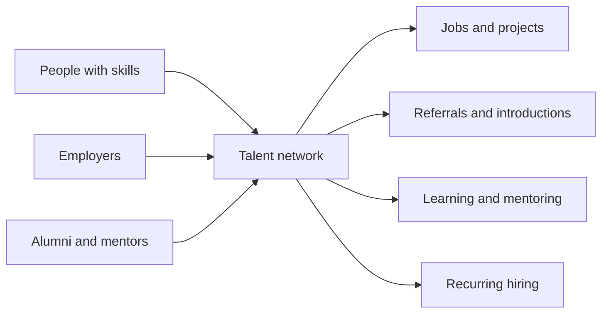

---
tags:
  - Talent-Networks
  - War-for-Talent
  - HR-Solutions
date_created: 2026-08-17
date_modified: 2026-11-05
site_uuid: 5b5ca7d5-a80b-4e69-ac02-fa6ddba1e555
publish: true
title: Talent Networks
slug: talent-networks
at_semantic_version: 0.0.0.1
cf_last_run: 2026-11-05T18:24:04.498Z
cf_last_run_model: Perplexity sonar-pro
for_clients:
  - Laerdal
  - Param
  - Tonguc
---

[[Tooling/Enterprise Jobs-to-be-Done/Talent-Networks/Andela|Andela]]
[[Tooling/Enterprise Jobs-to-be-Done/Talent-Networks/g2i|g2i]]
[[Tooling/Enterprise Jobs-to-be-Done/Talent-Networks/Multiversal|Multiversal]]
[[Tooling/Enterprise Jobs-to-be-Done/Talent-Networks/TopTal|TopTal]]

# Defining and Describing Talent Networks

- _Talent networks turn hiring from a one-time transaction into an ongoing relationship._
- A **talent network** is an organized community or platform that connects people with relevant skills to employers, projects, mentors, professional opportunities, or one another. In practice, it may include candidate communities, alumni groups, academic faculty networks, specialist talent pools, or distributed talent-sharing arrangements. [^3ft2xp] [^d7kzra] [^kg9vfj]
- The concept applies when organizations need recurring access to skills rather than a single recruitment event. Members may receive job alerts, mentoring, networking, referrals, events, or direct consideration for future roles. [^4kvdi7] [^kg9vfj] [^kdzuy4]
- Talent networks matter because they preserve relationship and context: recruiters can search an existing pool, while members can remain visible even when no suitable vacancy exists. [^4kvdi7]

## Uses in Context

- **Recruiting:** Employers use “talent networks” as searchable communities where recruiters can identify candidates for future vacancies. [^4kvdi7]
- **Academic employment:** AcademicJobs describes its service as “the largest talent network” for academic hiring, positioning the network as broader than a conventional job board. [^3ft2xp]
- **Workforce partnerships:** Universities connect employers, community organizations, and alumni to create “employment and recruiting partnerships” that strengthen workforce pipelines. [^0hi5qm]
- **Corporate alumni relations:** Former employees form managed communities that support referrals, rehires, events, and continuing professional ties. [^kg9vfj]
- **Distributed work:** Small businesses use talent-sharing networks to exchange access to specialized skills through partnerships, freelance platforms, and community groups. [^d7kzra]
- **Career networking:** Alumni and current job seekers use recurring events and year-round programming to generate mentoring, internships, introductions, and job offers. [^kdzuy4]

# History of Use

## Origins

The phrase does not have one clearly documented inventor in the available sources. Its institutional logic draws from older alumni associations, guilds, apprenticeships, professional communities, and workforce partnerships, while its modern digital form combines searchable candidate databases with ongoing community engagement. [^d7kzra] [^kg9vfj]

- University alumni associations supplied an early organizational model: maintain relationships after a person leaves an institution and use the network for connection, identity, mentoring, and opportunity. [^kg9vfj]
- Guilds and apprenticeships provided an earlier talent-sharing pattern in which skills and knowledge circulated through durable occupational communities. [^d7kzra]
- Modern recruiting platforms adapted these relationship-based models into branded talent communities and searchable pools for recurring hiring. [^4kvdi7] [^6xjve6]

## Evolution

- **Pre-digital period:** Professional and educational communities used alumni ties, apprenticeships, referrals, and institutional relationships to circulate knowledge and identify capable people. [^d7kzra] [^kg9vfj]
- **Late 2000s:** Digital freelance platforms such as Upwork and Fiverr expanded scalable access to independent talent, helping move talent sharing from local relationships toward online marketplaces. [^d7kzra]
- **Recent period:** Talent networks expanded beyond candidate databases into alumni ecosystems, mentoring programs, events, rehire channels, and community-based sourcing. [^kg9vfj] [^kdzuy4]

# Best Real-World Examples

- [AcademicJobs](https://www.academicjobs.com/) — an academic recruitment platform that presents itself as a global academic talent network. [^3ft2xp]
- [University of Regina Talent Network](https://www.academicjobs.com/u-of-r-careers) — a candidate-interest pool that lets recruiters search for people with matching skills and research focus. [^4kvdi7]
- [Compunnel education talent communities](https://www.compunnel.com/industry/education/) — branded communities designed to support recurring hiring across academic, administrative, and technology roles. [^6xjve6]
- [Corporate alumni networks](https://smartkeys.org/corporate-alumni-networks/) — structured former-employee communities combining directories, newsletters, job feeds, events, referrals, and rehire pathways. [^kg9vfj]
- [Sloanies Helping Sloanies](https://mitsloan.mit.edu/year-review/where-sloanies-learn-real-meaning-networking) — an alumni-centered network whose events generate mentoring, internships, introductions, and hiring. [^kdzuy4]
- [Bowie State employer and community partnerships](https://bowiestate.edu/about/administration-and-governance/division-of-academic-affairs/engage-center/employer_and_community_partners/employment_and_recruiting_partnerships.php) — an institutional model linking employers, community organizations, alumni, and students around workforce pipelines. [^0hi5qm]
- [Upwork](https://www.upwork.com/) and [Fiverr](https://www.fiverr.com/) — digital talent-sharing marketplaces cited as important late-2000s developments in scalable online access to freelance skills. [^d7kzra]

# Case Studies

**University of Regina talent network.** The University of Regina model uses a registration-based talent network to keep prospective candidates visible to internal talent-acquisition teams. [^4kvdi7] Rather than requiring a person to apply to a specific opening, the system allows recruiters to search the network when departmental vacancies arise and look for candidates whose skills and research interests match the need. [^4kvdi7] This illustrates the core shift from vacancy-centered recruiting to relationship-centered talent discovery: the network preserves candidate information between hiring cycles.

**Sloanies Helping Sloanies at MIT Sloan.** MIT Sloan’s recurring alumni and career-networking program brings together alumni, current job seekers, and startup founders, with connections continuing through workshops, speaking events, seminars, and other activities. [^kdzuy4] The network has produced practical outcomes such as mentoring, internships, and job offers; one cited example involved an MIT MBA candidate being hired by a startup founded by an MIT Sloan alumnus. [^kdzuy4] The case shows that a talent network can operate as a social infrastructure rather than merely as software: repeated contact and shared affiliation create trust that supports hiring and entrepreneurship.

**Corporate alumni networks.** Managed corporate alumni communities extend the employment relationship after departure through member directories, newsletters, events, job feeds, referrals, and rehire programs. [^kg9vfj] Examples described in the available material include Starbucks’ “Once a Partner, Always a Partner” community, A&O Shearman’s relaunch of a large former-colleague network, and Accenture’s international alumni connections and structured rehire channels. [^kg9vfj] These cases show how organizations can treat former employees as continuing sources of expertise, referrals, business relationships, and future hires rather than as permanently lost talent. [^kg9vfj]

***

# Sources

[^3ft2xp]: 2026, Sep 15. [academicjobs.com](https://www.academicjobs.com/). [Higher Ed Hiring | Mejor bolsa académica para anunciarse](https://www.academicjobs.com/es-es/hiring). Updated: 2026, Nov 05. Generated: 2026, Nov 05. [Perplexity](https://www.perplexity.ai/) API response.
[^d7kzra]: 2025, Nov 25. [news.climate.columbia.edu](https://www.news.climate.columbia.edu/). [How Talent Sharing Reshapes Small Businesses](https://www.news.climate.columbia.edu/small-business-strategy-05ed0c). Updated: 2026, Nov 01. Generated: 2026, Nov 05. [Perplexity](https://www.perplexity.ai/) API response.
[3]: 2026, Sep 01. [foundationlist.org](https://www.foundationlist.org/). [University & College Jobs | Higher Education Job Board](https://www.foundationlist.org/university-college-jobs-nationwide/). Updated: 2026, Nov 04. Generated: 2026, Nov 05. [Perplexity](https://www.perplexity.ai/) API response.
[4]: 2025, Dec 28. [litmus.lapaas.com](https://litmus.lapaas.com/). [The Startup Mafia Effect & Alumni Network | Litmus](https://litmus.lapaas.com/framework/strategic-alliance/the-mafia-effect-moving-beyond-the-company). Updated: 2026, Aug 10. Generated: 2026, Nov 05. [Perplexity](https://www.perplexity.ai/) API response.
[5]: 2026, Oct 21. [academicjobs.com](https://www.academicjobs.com/). [Aston University Employment Portal: Diversity & Inclusion](https://www.academicjobs.com/aston-university-employer-portal). Updated: 2026, Nov 05. Generated: 2026, Nov 05. [Perplexity](https://www.perplexity.ai/) API response.
[^4kvdi7]: 2026, Oct 29. [academicjobs.com](https://www.academicjobs.com/). [U of R Careers | Talent Network Regina - academicjobs.com](https://www.academicjobs.com/u-of-r-careers). Generated: 2026, Nov 05. [Perplexity](https://www.perplexity.ai/) API response.
[^kg9vfj]: 2026, Mar 11. [smartkeys.org](https://smartkeys.org/). [Corporate Alumni Networks 2026: Rehires, Referrals and ROI](https://smartkeys.org/corporate-alumni-networks/). Updated: 2026, Oct 31. Generated: 2026, Nov 05. [Perplexity](https://www.perplexity.ai/) API response.
[^6xjve6]: 2026, Oct 16. [compunnel.com](https://www.compunnel.com/). [Education](https://www.compunnel.com/industry/education/). Updated: 2026, Oct 26. Generated: 2026, Nov 05. [Perplexity](https://www.perplexity.ai/) API response.
[^0hi5qm]: 2026, Feb 27. [bowiestate.edu](https://bowiestate.edu/). [Employer and Community Partners Services | Bowie State](https://bowiestate.edu/about/administration-and-governance/division-of-academic-affairs/engage-center/employer_and_community_partners/employment_and_recruiting_partnerships.php). Updated: 2026, Oct 09. Generated: 2026, Nov 05. [Perplexity](https://www.perplexity.ai/) API response.
[^kdzuy4]: 2026, May 20. [mitsloan.mit.edu](https://mitsloan.mit.edu/). [Where Sloanies Learn the Real Meaning of Networking | MIT Sloan](https://mitsloan.mit.edu/year-review/where-sloanies-learn-real-meaning-networking). Updated: 2026, Nov 03. Generated: 2026, Nov 05. [Perplexity](https://www.perplexity.ai/) API response.
